# 完整道德黑客课程 2026：07：Kali Linux 虚拟环境安装 🖥️


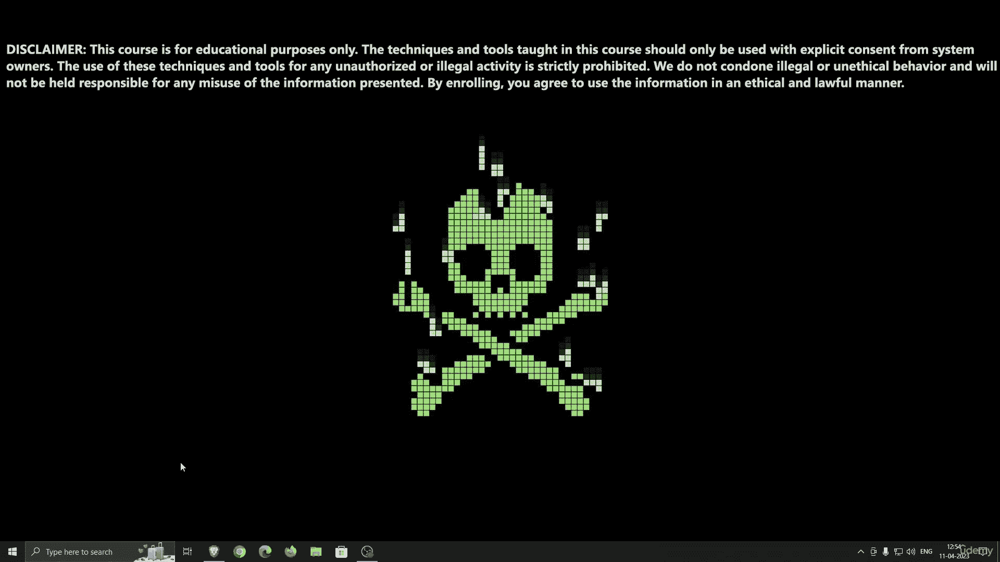

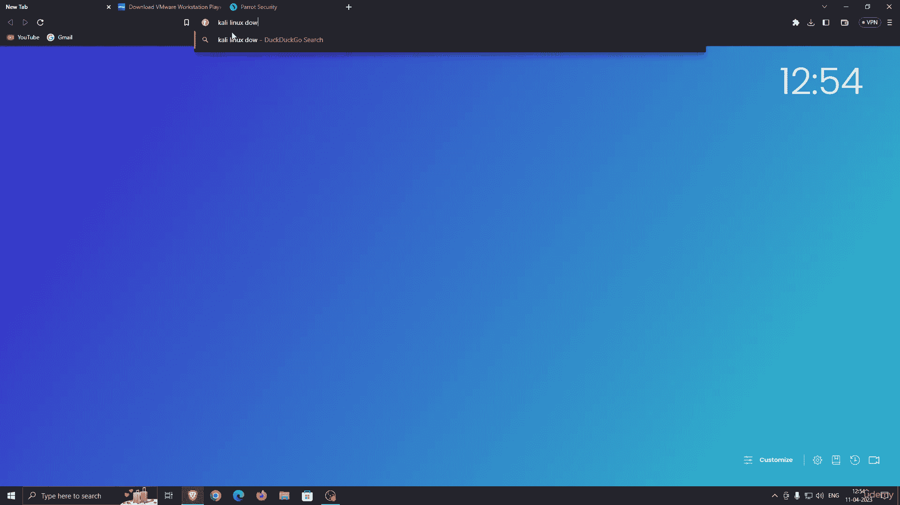

在本节课中，我们将学习如何把 Kali Linux 操作系统安装到虚拟机里。这适合零基础的初学者，不需要任何黑客或 Linux 基础。我们会先从官网下载 Kali Linux 的 ISO 镜像文件，然后了解 VirtualBox 和 VMware 两种虚拟化软件的区别，接着在 VirtualBox 中创建新虚拟机，设置内存和处理器，最后加载镜像文件并启动系统。完成这些步骤后，你就可以在电脑里运行一个完整的 Kali Linux 环境，用来练习网络安全和道德黑客技能。


## 一、下载 Kali Linux 镜像文件 📥

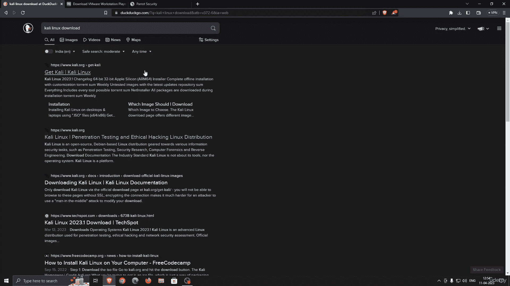

首先，我们需要从官网拿到 Kali Linux 的安装文件。

打开你常用的浏览器，搜索 Kali Linux ISO 下载。进入官网之后，点击页面里的第一个链接。然后进入安装镜像页面，选择 64 位完整离线安装版本，这个版本支持自定义安装。文件版本是 2023.1，文件大小大约是 3.61 GB。你要确认下载的是 64 位版本，而不是 32 位版本。下载完成之后，你会得到一个 ISO 文件，这个文件就是 Kali Linux 的安装镜像，相当于一张虚拟光盘。

以下是核心文件信息：

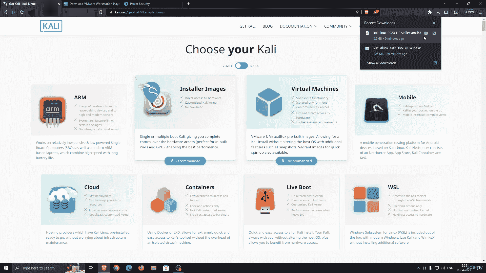

```
Kali Linux ISO 文件
版本：2023.1
架构：64 位
大小：约 3.61 GB
用途：虚拟机安装光盘镜像
```


## 二、虚拟化软件选择 💻

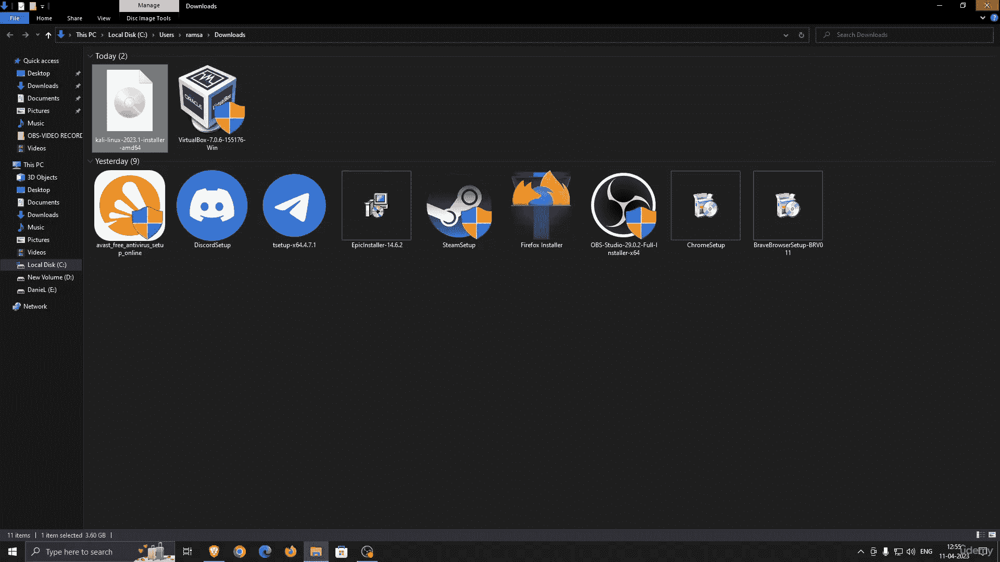

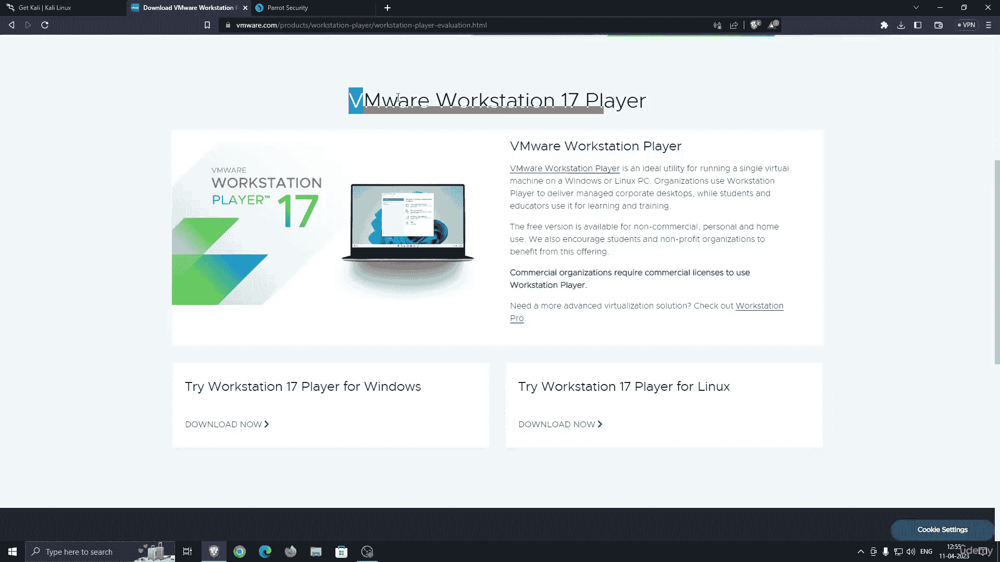

在打开镜像之前，先看看常见的虚拟化软件有哪些。

市面上主要有两种常用软件，一种是 VirtualBox，另一种是 VMware Workstation 17 Player。这两种软件功能类似，都可以在 Windows 操作系统里运行 Linux 系统。讲师更倾向于使用 VirtualBox，因为它是免费且开源的，不需要付费。如果你想使用 VMware，可以去下载页面点击下载按钮来获取。不过为了节省成本和操作简单，本节课我们继续使用 VirtualBox。此外，还有 Parrot OS 这种系统，和 Kali Linux 很相似，被道德黑客和网络安全专家使用，内置了很多渗透测试工具，但本节课我们不展开介绍 Parrot OS，只专注于 Kali Linux。

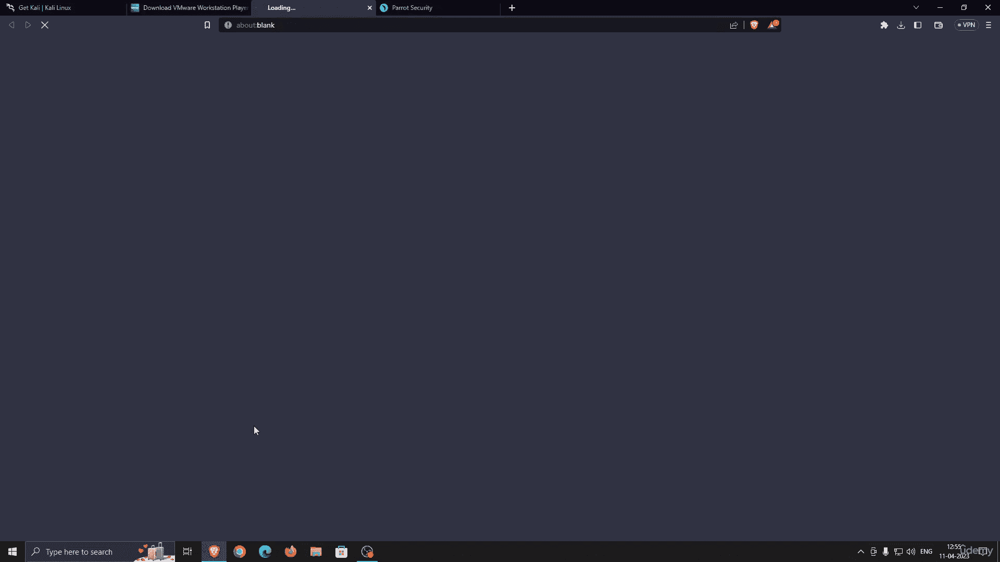

以下是两种软件的对比关系：

```
虚拟化软件 = VirtualBox（免费开源） 或 VMware Workstation 17 Player（商业可选）
推荐选择：VirtualBox
```


## 三、在 VirtualBox 中创建虚拟机 🛠️

镜像文件下载完成后，我们打开 VirtualBox 来建立虚拟机。

在电脑里搜索 VirtualBox，然后以管理员身份运行程序。主界面打开后，点击新建按钮。虚拟机名称可以随便起，比如起名为 Kali Linux，文件夹位置保持默认，通常是 C:\Users\VirtualBox。类型选择 Linux，版本选择 Debian 64 位，因为 Kali Linux 是基于 Debian 开发的。设置完成后，点击下一步继续。

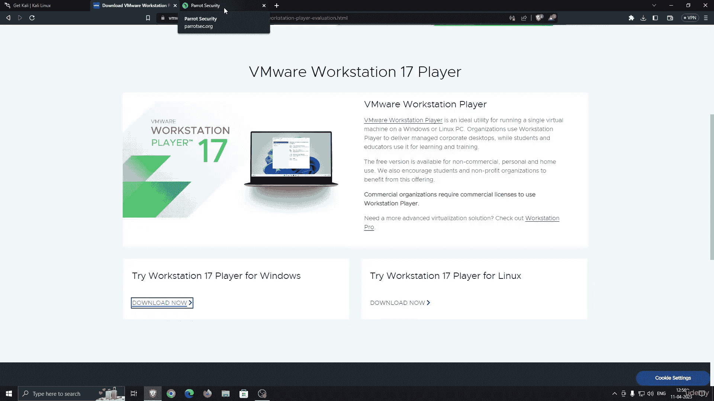

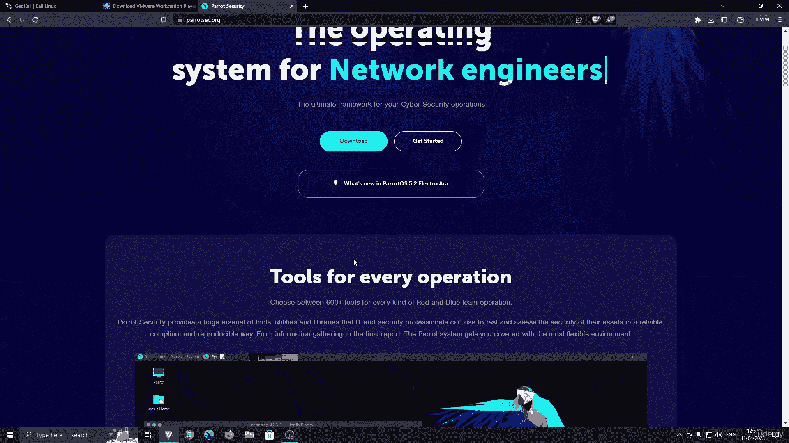

以下是创建虚拟机的基本步骤：

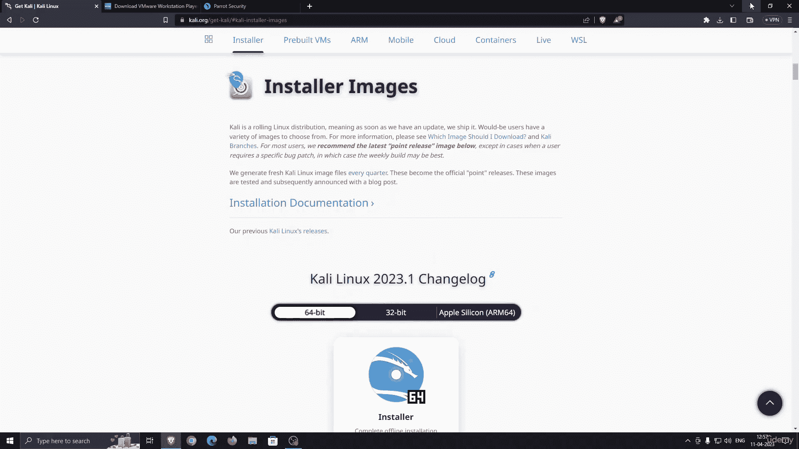

- 点击新建按钮
- 输入名称，例如 Kali Linux
- 保持文件夹路径为默认值
- 类型选择 Linux
- 版本选择 Debian 64 位
- 点击下一步


## 四、配置虚拟机硬件资源 ⚙️

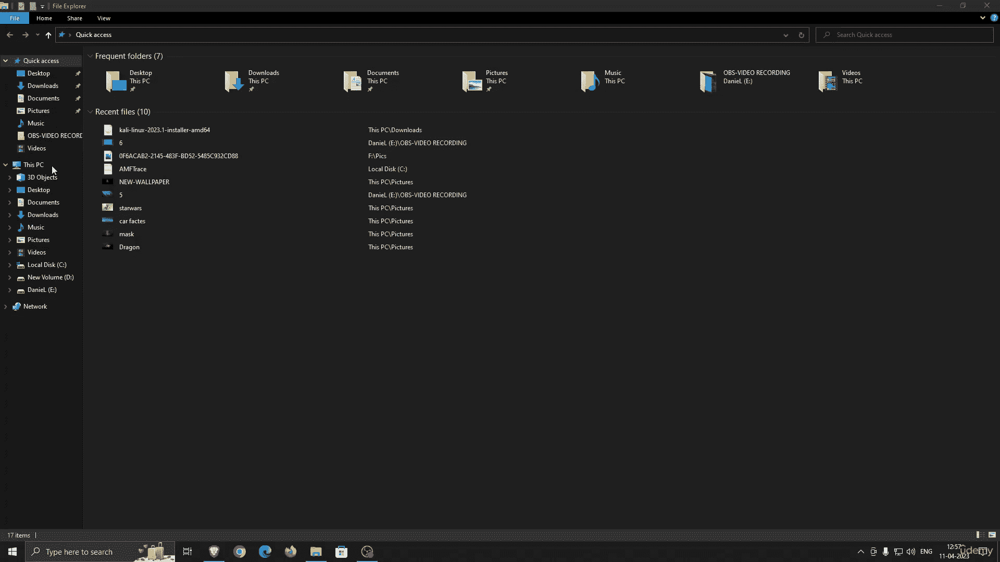

接下来，我们需要给虚拟机分配内存和处理器。

基础内存建议设置为 4 GB。如果你的电脑有 8 GB 内存，可以给虚拟机分配 4 GB，也可以根据实际硬件情况多给或少给。处理器数量至少选择 4 个，点击下一步。然后创建虚拟硬盘存储文件，大小大约 30 GB 就足够了，点击下一步。最后会出现汇总页面，显示 4 个处理器，基础内存大约 4 GB，EFI 启用状态为 false。确认无误后，点击完成按钮。

创建完成后，你还可以修改设置，比如把处理器改成 2 个或 3 个，或者调大显存，让系统运行更流畅。但最重要的一步还是加载 ISO 镜像文件。

以下是推荐的硬件配置参数：

```
基础内存 = 4 GB
处理器数量 ≥ 4
存储空间 ≈ 30 GB
EFI 启用 = false
操作系统类型 = Debian 64 位
```


## 五、加载 Kali Linux 镜像文件 💿

虚拟机创建好之后，最关键的一步是把 ISO 镜像加载进去。

点击存储选项卡，选择空光盘，然后选择你之前下载的 ISO 文件。我的 ISO 文件保存在下载文件夹里，直接选中它即可。点击打开之后，你会看到文件大小是 3.61 GB，类型是映像，文件位置也会显示在界面上。点击确定按钮，设置就全部完成了，现在就可以启动操作系统。

以下是加载镜像的操作路径：

```
存储 → 光盘 → 选择 ISO 文件
文件大小：3.61 GB
文件类型：映像
```


## 六、启动虚拟机 🚀

一切就绪之后，就可以启动 Kali Linux 了。

点击启动按钮，虚拟机就会开始运行，加载 Kali Linux 操作系统。下一节课中，我们会在 VirtualBox 里启动操作系统，正式进入 Kali Linux 环境，继续后面的学习。


## 总结

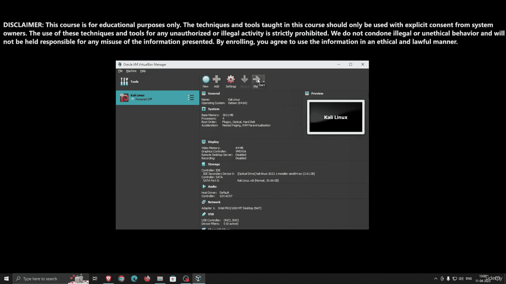

本节课中，我们一起学习了如何在虚拟环境中安装 Kali Linux。首先从官网下载了 64 位 Kali Linux ISO 镜像文件，接着比较了 VirtualBox 和 VMware 两种虚拟化软件并选择了 VirtualBox，然后在 VirtualBox 中创建了新虚拟机，设置了名称、类型、版本、内存、处理器和存储空间，最后加载了 ISO 镜像文件并启动了系统。这些步骤完成后，你的 Kali Linux 虚拟机就准备好了，下一节课我们将进入系统内部进行设置。

