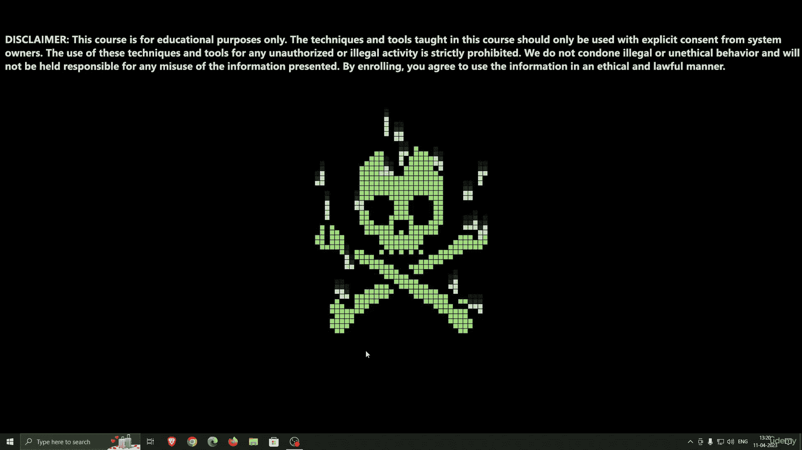
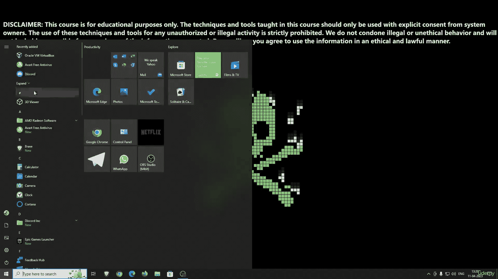
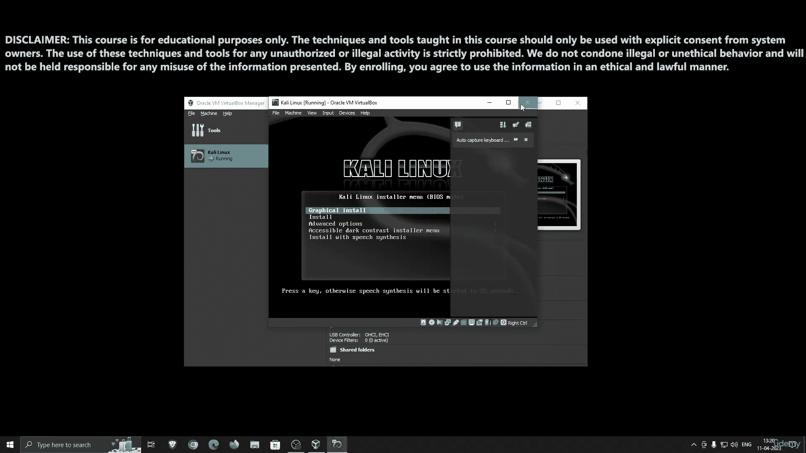
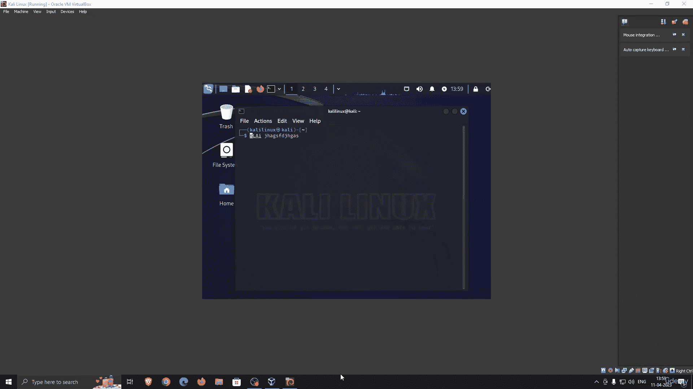

# 道德黑客完全课程 2026：08：安装和配置 Kali Linux 🐧

在本节课中，我们将一起学习如何在 VirtualBox 中启动 Kali Linux 操作系统，并完成从安装到登录的全部配置过程。无论你是第一次接触虚拟机，还是之前没有安装过 Kali Linux，本节内容都会用最直白的方式带你走完每一步。我们会先打开虚拟机软件，然后启动系统，接着设置语言、位置、键盘和网络，之后创建用户账户，进行磁盘分区，安装基础系统和工具，最后安装引导程序并进入桌面。整个过程虽然需要一点时间，但只要跟着步骤操作，就能顺利完成。






启动 VirtualBox 和 Kali Linux 虚拟机

上一节我们简单介绍了课程背景，本节中我们来看看如何启动虚拟机。首先，你需要打开已经安装好的 VirtualBox 软件。打开之后，你会看到主界面上列出了可用的虚拟机列表。找到 Kali Linux 所在的虚拟机，它当前显示的状态是关机。接下来，选中这个虚拟机，然后点击启动按钮，系统就会开始加载。启动过程中需要等待一段时间，请耐心等待，不要关闭窗口。

```
VirtualBox -> 选中 Kali Linux 虚拟机 -> 点击启动
```


选择语言和位置



虚拟机启动后，进入安装界面之前，系统会先让你选择语言。以下是需要完成的语言和位置设置步骤：

- 选择安装界面使用的语言，建议选择 English，或者根据你自己的偏好选择其他语言
- 确认语言选择后按下回车键继续
- 接下来选择你所在的地理位置，这里演示选择 India，你可以根据实际居住地选择
- 位置选择完成后同样按下回车键进入下一步

这两个设置主要影响系统显示的语言和时区，选错也可以在安装完成后重新调整，所以不必过度担心。


配置键盘和检测硬件

语言和位置设置完成后，安装程序会进入键盘配置阶段。以下是键盘和硬件检测的相关操作：

- 在键盘配置界面，直接使用所有默认选项即可
- 确认键盘布局后按下回车键
- 接下来系统开始检测硬件，扫描安装介质
- 如果你觉得讲解速度太快，可以暂停视频，或者调慢播放速度，也可以调小音量

硬件检测完成后，系统会加载所有额外组件，这时候屏幕上会显示 Kali Linux 的初始界面，这意味着安装程序已经进入正常流程。


设置网络和主机名

硬件检测之后，接下来是网络配置部分。以下是具体的网络设置内容：

- 系统会自动检测网络硬件，并尝试获取本地链路地址
- 此时会出现 IPv6 配置界面，配置网络连接
- 主机名可以保持默认，不需要修改
- 域名可以留空，不填写任何内容
- 网络配置完成后，继续进入用户账户创建阶段

网络设置对后续使用影响不大，如果家里或公司网络有特殊要求，也可以在系统安装完成后再修改。


创建用户账户和密码

网络配置好之后，系统需要你创建一个用户账户，用于之后登录系统。以下是账户设置步骤：

- 输入你的姓名或者任意想要使用的名称，这里演示使用 admin
- 系统可能会提示用户名已被使用，这时需要返回并选择一个新的用户名
- 你可以尝试使用 KaliLinux 或者 CarliLox 之类的名字，记住你设置的用户名
- 接下来设置密码，演示中使用 SclyLinuxux，你也可以设置自己容易记住的密码
- 确认密码后，请务必记住用户名和密码，因为安装完成后需要用它们登录

```
用户名: KaliLinux
密码: SclyLinuxux
```

账户信息是你进入系统的凭证，建议记在本子上，或者保存在密码管理器里。


磁盘分区

用户账户创建完成后，接下来需要对虚拟机硬盘进行分区。以下是分区相关操作：

- 选择使用整个磁盘，即 use the entire disc
- 将所有文件放在一个分区中，即 all files in one partition
- 确认分区方案后选择完成分区，即 finish partitioning
- 将更改写入磁盘，即 write changes to the desk
- 确认写入操作，系统开始安装基础系统

磁盘分区这一步需要一点时间，系统会在后台进行安装，你可以稍微休息一下，等待进度条完成。


软件选择和安装基础系统

分区完成后，系统开始安装基础组件，随后进入软件选择界面。以下是这部分的操作说明：

- 安装程序会安装 Kali Linux 操作系统中的所有工具
- 软件选择非常重要，这里直接点击继续即可使用默认选项
- 如果你在录制或演示过程中按键无法暂停视频，不要在意，直接点击继续
- 软件安装过程同样需要一段时间，完成后我们将进入最后一步

所有安全工具会被安装到系统中，这正是 Kali Linux 作为渗透测试系统的核心价值所在。


安装 GRUB 引导程序

软件安装完成后，最后一步是安装引导程序。以下是 GRUB 引导程序的设置方法：

- 点击继续进入引导程序安装界面
- 选择第二个选项，即安装 GRUB bootloader
- 确认选择后继续，系统会花费一些时间完成引导程序安装
- 引导程序安装完成后，整个操作系统安装过程就结束了
- 系统会自动重启，屏幕会显示倒计时，例如欢迎来到 GRUB，将在 1、2、3 秒后启动

```
安装 GRUB -> 重启系统 -> 完成 Kali Linux 安装
```

GRUB 是操作系统启动时的引导程序，没有它系统无法正常开机，所以这步不能跳过。


完成安装并登录系统

重启完成后，Kali Linux 操作系统就会启动，进入图形登录界面。以下是登录步骤：

- 输入之前设置的用户名，演示中使用的是 KaliLinux
- 输入之前设置的密码，演示中使用的是 SclyLinuxux
- 点击登录按钮进入操作系统桌面
- 登录后你会看到 Kali Linux 2023 的图形用户界面，即 GUI

此时安装和配置全部完成，你已经拥有一个可以运行的 Kali Linux 虚拟机。


总结



本节课中，我们一起学习了如何在 VirtualBox 中安装和配置 Kali Linux 操作系统。具体包括启动虚拟机、选择语言和位置、配置键盘、检测硬件、设置网络和主机名、创建用户账户和密码、进行磁盘分区、安装基础系统和安全工具、安装 GRUB 引导程序，最后登录图形桌面。下一节课中，我们将介绍如何开启全屏模式，并开始讲解终端的使用方法，带你掌握常见命令操作。

