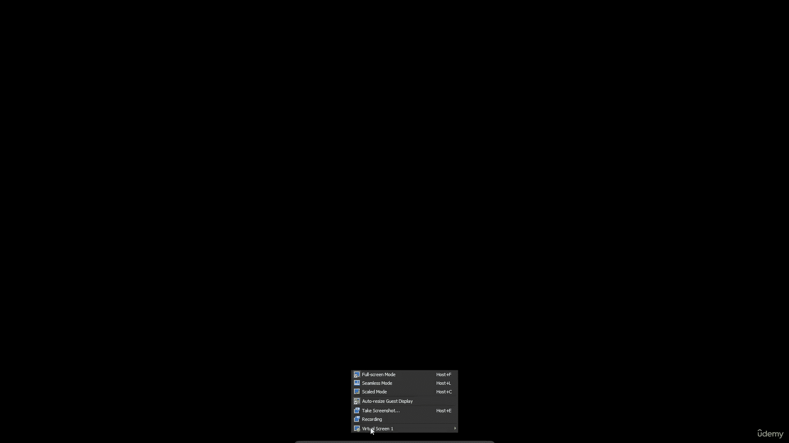
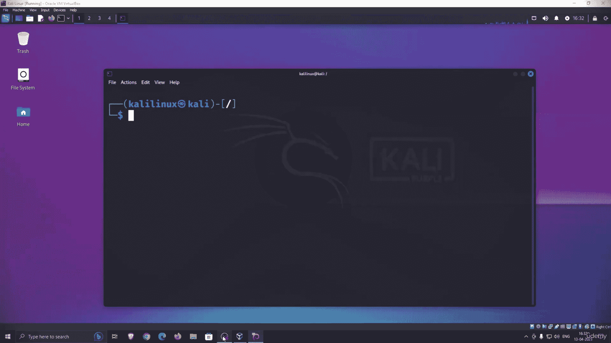

# Udemy 道德黑客完全课程 2026：从零到英雄：09：Kali Linux 终端入门 🖥️

在本节课中，我们将一起学习 Kali Linux 终端的基础知识。首先介绍如何启动虚拟机，接着讲解如何进入全屏显示模式，然后说明登录系统的步骤。进入桌面后，我们会打开终端窗口，并详细介绍 ls、ifconfig、clear、cd 等常用命令的用法。最后还会简单说明终端的偏好设置，并预告下一节课的内容。这篇教程适合完全没有基础的初学者，所有概念都会用大白话解释清楚，确保每个人都能跟上进度。

## 启动 Kali Linux 虚拟机

要开始使用 Kali Linux，第一步是启动虚拟机软件。请在电脑上打开 VirtualBox，也就是 Oracle VM VirtualBox。启动虚拟机的方法非常简单，你可以点击开始按钮，或者直接双击 Kali Linux 的图标。虚拟机启动后，会进入系统加载界面，这时候你只需要耐心等待，让操作系统完成初始化，直到出现登录画面为止。

## 切换到全屏模式

虚拟机窗口启动后，默认可能并不是全屏显示。你可以点击切换到虚拟机窗口，这时显示模式会自动切换到全屏。如果你想退出全屏，回到普通的窗口模式，可以按下主机键加上 F 这个组合键。在这里，主机键通常就是键盘上的右侧 Control 键。进入全屏模式后，Kali Linux 操作系统会占据整个屏幕，界面更加清晰，操作起来也更加舒适。

## 登录 Kali Linux 系统

等待系统启动完成以后，可能需要几秒钟的时间，这时你会看到登录界面。请输入你之前设置的用户名，这里是 kali，然后按下回车键。接着输入密码，同样按下回车键。系统启动可能需要大约五秒钟，请不要着急，等待设备完成引导。登录成功以后，你就可以像使用 Windows 操作系统一样，开始使用 Kali Linux 了。

## 打开终端

系统进入桌面以后，你可以在屏幕左上角找到终端图标，点击它就能打开终端窗口。终端是我们日后大部分时间都会用到的地方，主要用于运行操作系统命令、测试各种工具以及执行渗透测试任务。Kali Linux 自带了大量内置工具，涵盖信息收集、漏洞分析、Web 应用程序分析、数据库评估、无线攻击和密码攻击等多个方面，是伦理黑客和渗透测试的理想平台。

## 常用基础命令

以下是 Kali Linux 终端中最常用的几个基础命令，每个命令都有明确的用途。

- `ls`：列出当前操作系统中的所有目录，类似于查看 Windows 或 Mac 系统里的文件夹列表。
- `ifconfig` 或 `ip`：查看本机 IP 地址，或者检查是否有无线网络适配器。如果没有连接网络，这里可能不会显示相关信息。
- `clear`：清除终端当前的所有显示内容，让屏幕恢复整洁，方便你输入新的命令。

## 目录切换命令

如果你想进入某个具体的目录，可以使用 `cd` 命令。比如输入 `cd /home/` 就可以进入 home 目录，进入之后可以使用 `ls` 命令查看该目录下的文件数量。如果你想从当前目录返回上一级目录，可以输入 `cd ..`，这样就会回到父目录。这些命令是文件系统导航的基础，掌握它们以后，你就能在终端里自由移动，找到自己需要的文件和文件夹了。

## 终端偏好设置

终端窗口上方有“查看”和“偏好设置”选项。在偏好设置里面，你可以调整终端的透明度，改变窗口行为，还可以查看所有快捷键列表。终端还提供下拉菜单功能，方便你进行个性化配置。这些设置虽然不是必须的，但可以让你的操作体验更顺手，让终端界面更符合你的个人习惯。

## 下节课预告

本节课的内容就介绍到这里。在下一节课中，我们将安装 Tor 浏览器，并学习如何使用 Kali Linux 提升匿名性，或者开始针对 WiFi 网络的攻击实践。敬请期待下一节的课程内容。

## 总结

本节课中，我们一起学习了如何启动 Kali Linux 虚拟机、如何切换全屏模式、如何登录系统，以及如何打开终端。我们掌握了 `ls`、`ifconfig`、`clear`、`cd` 等基础命令，并了解了目录切换和终端偏好设置的方法。这些知识是后续进行渗透测试和伦理黑客实践的基础，请务必多加练习，熟练掌握每一个命令的操作方法。

