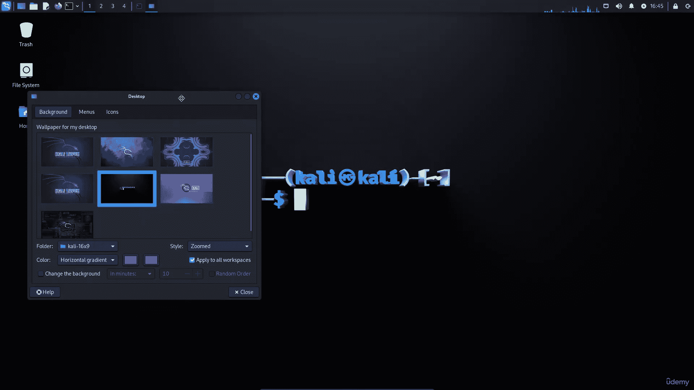
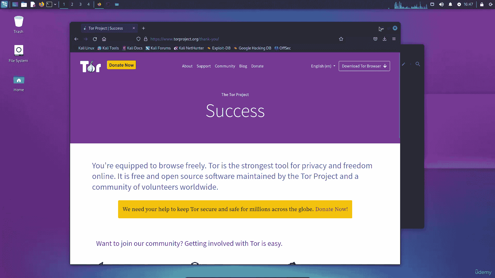
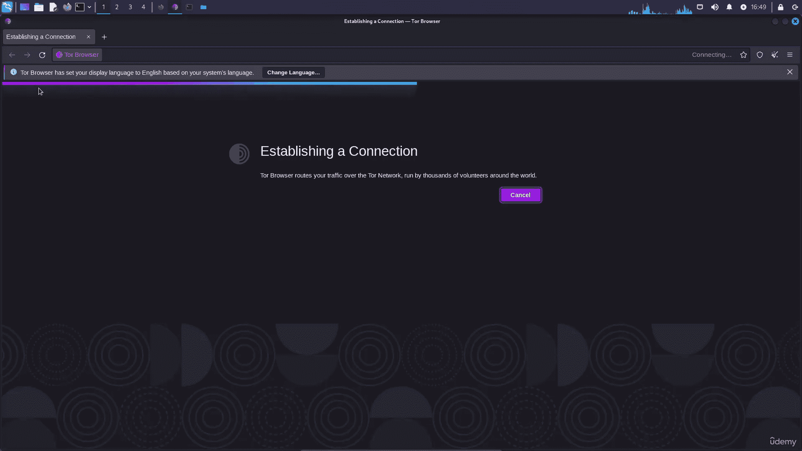
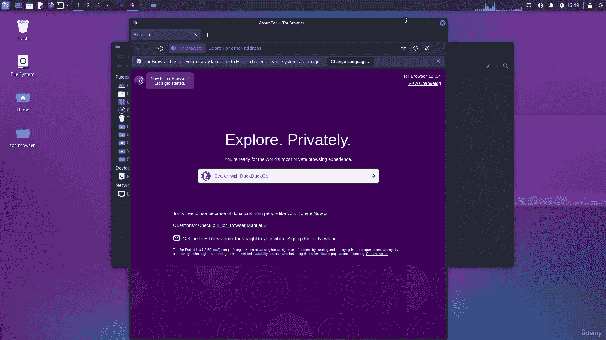

# Complete Ethical Hacking Course 2026：p10：在 Kali Linux 中安装 TOR 浏览器 🧅

## 课程概述

在本节课中，我们将一起学习如何在 Kali Linux 操作系统中安装 TOR 浏览器，也就是洋葱路由器浏览器。我们还会简单看一下如何更换系统壁纸，不过这部分只是热身，重点依然是安装和使用 TOR 浏览器，让你了解匿名上网的基本原理。

## 背景知识：什么是 TOR 浏览器

在正式安装之前，我们需要先搞清楚 TOR 浏览器到底是一个什么样的工具，这样你在使用的时候才知道它在保护什么。

TOR 浏览器是一个免费且开源的网页浏览器，它的核心作用是让用户能够匿名和私密地浏览互联网。它基于 ToR 网络，这是一个由分散服务器组成的网络，可以重新发送互联网流量，确保用户的身份和位置不会被泄露，从而提供一层匿名性保护。

核心概念可以用下面的公式来理解：

[ \text{匿名性} = \text{隐藏用户身份} + \text{隐藏用户位置} + \text{加密流量中转} ]

换句话说，当你通过 TOR 浏览器上网时，你的数据会经过多个中继节点，任何人都难以追踪到真实的你。

在日常网络环境中，保护自己的数据和 IP 地址变得非常重要，否则很容易被其他人监控或追踪。TOR 浏览器内置了类似代理链或 VPN 的安全层，可以屏蔽追踪器，阻止指纹识别，让你私密地探索互联网。

以下是 TOR 浏览器的主要功能特点：

- 匿名浏览，隐藏用户身份和位置。
- 基于去中心化的 ToR 服务器网络。
- 阻止追踪器和指纹识别。
- 内置代理链或 VPN 类似的安全层。
- 默认使用 DuckDuckGo 搜索引擎，不记录日志，不展示广告，不出售用户数据。

## 准备工作：更改壁纸（可选）

在安装 TOR 浏览器之前，讲师先简单演示一下如何在 Kali Linux 中更换桌面壁纸，这与本节主题没有直接关系，但如果你感兴趣，可以参考操作。

具体步骤如下：

1. 点击屏幕上的设置图标，即齿轮形状的图标。
2. 在设置菜单中选择“外观”选项。
3. 或者在桌面上右键点击，选择“桌面设置”。
4. 在出现的选项中，你会看到几张可用的壁纸，点击任意一张即可更换。
5. 你也可以调整菜单和图标等相关的显示设置。

这一步纯粹是为了让桌面环境更舒服，不影响后续的 TOR 安装流程。

## 下载 TOR 浏览器

接下来我们进入正题，开始下载 TOR 浏览器。在 Kali Linux 中预装的浏览器是 Firefox，你可以用它打开 TOR 的官方网站。

打开 Firefox 后，在地址栏输入 TOR 项目的官网地址。你可以浏览“关于”页面或文档，阅读关于监控、追踪器拦截以及指纹识别防护的详细说明。

在网站上找到下载按钮，选择针对 Linux 版本的 TOR 浏览器进行下载。文件大小大约是 1.1 MB，下载完成后你会得到一个压缩包文件，通常是 ZIP 格式。

以下是下载时需要注意的几点：

- 必须从官方网站下载，避免安装不可信的版本。
- 确保选择 Linux 平台对应的安装包。
- 下载完成后，默认会保存为压缩包形式。

## 解压下载的文件

下载完成后，你需要把这个压缩包解压出来，否则无法运行 TOR 浏览器。

Kali Linux 自带归档管理器，操作方式和 Windows 上的解压软件类似（比如 WinRAR），你不需要额外安装其他程序。

解压操作的具体步骤如下：

1. 找到下载好的 ZIP 压缩包文件。
2. 双击打开该文件，系统会开始读取并准备浏览器内容。
3. 使用自带的归档管理器，将文件提取到桌面上。
4. 等待提取完成，你会看到系统显示“正在提取文件”的提示。

提取完成后，打开解压出来的文件夹，里面会出现两个图标。

## 设置运行权限

在文件夹中，有一个名为“启动 TOR 浏览器 desktop”的文件，这是启动程序的关键。但在直接双击之前，你需要修改它的权限，允许它作为程序运行。

权限设置步骤如下：

1. 右键点击“启动 TOR 浏览器 desktop”文件。
2. 选择“属性”。
3. 切换到“权限”选项卡。
4. 勾选“允许将此文件作为程序运行”的选项。

运行未经信任的程序可能会对系统带来安全风险，但因为我们是从官方网站下载的，所以可以放心勾选这一项。勾选完成后关闭属性窗口。

## 启动 TOR 浏览器并连接网络

权限设置好之后，就可以正式启动 TOR 浏览器了。

双击刚才设置过权限的启动图标，系统可能会弹出“不 trusted 应用程序启动器”的提示，不过因为文件来自官方渠道，点击“启动”即可继续。

TOR 浏览器启动后，会提示你连接到 TOR 网络。如果你不点击连接，它只是像普通浏览器一样工作，不会启用代理链和匿名层，失去了使用 TOR 的意义。因此你需要点击“连接”按钮，等待系统建立连接。

启动过程大致如下：

- 双击启动图标。
- 点击“启动”忽略未信任启动器警告。
- 点击“连接”连接到 TOR 网络。
- 等待连接建立完成。

连接成功后，TOR 浏览器就可以正常使用了。

## 使用建议与搜索引擎

TOR 浏览器连接好以后，默认内置了 DuckDuckGo 搜索引擎。这个搜索引擎不会记录你的搜索日志，不会展示广告，也不会把你的数据出售给公司，非常适合匿名上网场景。

使用时有几点建议：

- 不要将浏览器调整为全屏模式，保持当前窗口大小有助于保护隐私。
- 避免随意修改窗口尺寸，防止通过屏幕分辨率进行指纹识别。
- 记住 TOR 浏览器的核心价值在于私密浏览和提升匿名性。

## 课程总结

本节课中，我们一起学习了如何在 Kali Linux 中安装 TOR 浏览器，包括更换壁纸的简单操作、理解 TOR 的匿名原理、从官网下载 Linux 版本、使用归档管理器解压、设置文件运行权限，以及启动浏览器并连接到 TOR 网络。我们还了解了内置的 DuckDuckGo 搜索引擎及其不记录日志、不展示广告的特点。下一节课将详细讲解 TOR 中继及其安全层原理，我们下节课见。

