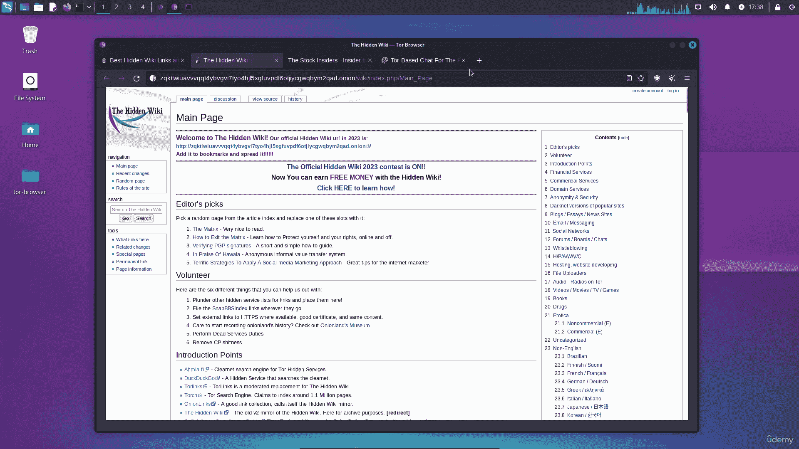
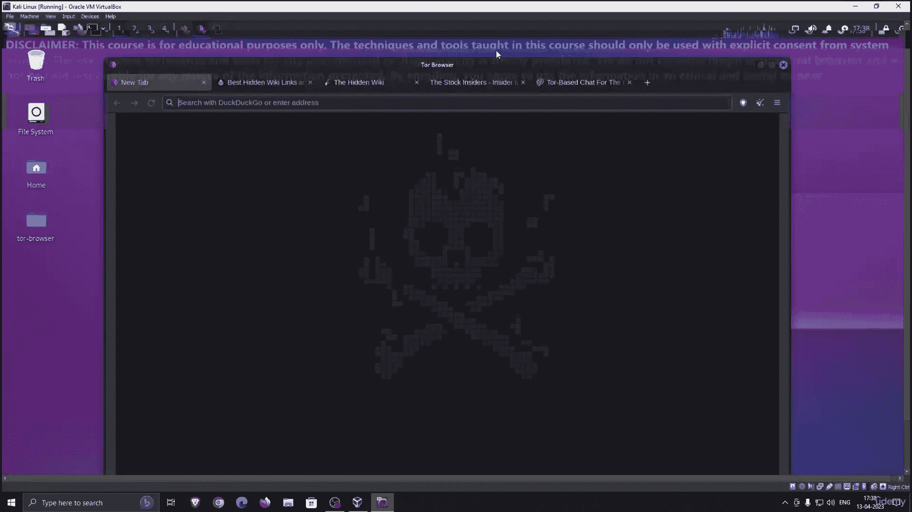

# 🧅 Udemy - Complete Ethical Hacking Course 2026：12：使用 Tor 浏览器访问隐藏维基和暗网

在本节课中，我们将学习如何使用 Tor 浏览器访问隐藏维基和暗网。你会了解 Tor 浏览器的历史背景，学习如何查看洋葱路由线路，掌握安全等级与桥接的设置方法，并了解在访问暗网时需要注意的安全事项。

---

## 一、Tor 浏览器的由来

在本节中我们先来看看 Tor 浏览器是从哪里来的。Tor 浏览器最初并不是由普通商业公司开发的，而是由美国海军或军方发起的一个项目。这个项目的最初目的是在数据从一台系统传输到另一台系统时，对数据进行加密，并增加一层匿名性。后来这个项目被公开，并由一家非营利性软件组织运行。

美国海军研究实验室曾经思考过一个问题，是否可以创建一种不泄露用户信息、并且即使有人监控网络也能提升匿名性的互联网连接方式。最终的答案是，创建并部署第一批洋葱路由的研究设计与原型。简单来说，Tor 的设计初衷就是保护通信双方的隐私，防止第三方轻易窃取传输内容。

---

## 二、Tor 浏览器的工作原理

接下来我们看看 Tor 浏览器是如何工作的。打开 Tor 浏览器后，你可以点击地址栏左侧的锁形图标，查看当前的中继线路。Tor 浏览器会将你的请求经过多个节点进行中转，而不是直接连接到目标网站。例如，你的请求可能先经过德国的节点，再经过荷兰的节点，最后经过乌克兰的节点，才到达目标网站，比如 DuckDuckGo 搜索引擎。

这个多节点中转的过程可以用下面的公式来表示：

```text
用户 → 节点 1（德国） → 节点 2（荷兰） → 节点 3（乌克兰） → 目标网站
```

这种结构本质上是一层层代理或节点的连接，就像洋葱一样一层一层包裹数据，因此被称为洋葱路由。正因为数据经过了多个独立节点的转发，任何单一节点都很难同时知道数据的来源和最终去向，从而大大提高了用户的匿名性。

如果你不满意当前的线路，可以点击“新建线路”按钮，让浏览器为当前网站重新选择一组节点。比如原来的请求经过德国到波兰再回到德国，切换后可能会变成另一条路径，但目标网站依然能够正常加载。如果你想要获得全新身份，可以点击“新建身份”，浏览器会重新启动，关闭所有窗口和标签页，所有网站会话都会丢失，从而重置你的身份。

---

## 三、基本设置与安全等级

在浏览暗网之前，必须先调整好浏览器的安全设置，这是保护自身安全的关键步骤。

首先，不要将浏览器设置为全屏模式。全屏模式可能会泄露你的显示器分辨率、系统界面尺寸等设备信息，攻击者或网站可以利用这些信息对你进行指纹识别，从而削弱匿名性。因此，建议将窗口适当调整，不要最大化。

其次，你需要将安全等级调整到“最安全”。在最安全等级下，浏览器会禁用 JavaScript，部分字体、图标、地图符号和图片将不显示，HTML5 媒体和 WebGL 会改为点击才播放，并且会自动阻止危险和欺骗性内容，以及阻止危险下载。这样做可以有效防止病毒或恶意软件进入你的系统，比如 Kali Linux，避免因为运行恶意程序而导致系统损坏。

还要确保网站使用的是 HTTPS，即超文本传输协议安全版本。只有启用了 HTTPS，数据在传输过程中才会被加密。

---

## 四、桥接连接

如果你所在的国家禁止使用 Tor，或者你的网络服务提供商（ISP）可以检测到你在使用 Tor，那么你需要使用桥接连接来隐藏 Tor 流量的特征。

在设置中选择“桥接”，并在桥接类型中选择“OBFS4”这样的混淆插件。这样可以让你的 ISP 无法轻易判断你是否在使用 Tor，从而绕过网络限制，正常连接到 Tor 网络。

---

## 五、访问隐藏维基和洋葱网站

以下是访问隐藏维基的具体步骤。

隐藏维基是一个专门收集洋葱网站链接的页面。洋葱网站的网址与我们平时看到的 www.youtube.com 完全不同，它们以 .onion 结尾，是一长串看起来随机的字符。

你可以在浏览器中输入“hidden wiki”来查找相关入口。由于安全等级被设置为最安全，某些网站可能会加载失败，或者显示为无 JavaScript 版本，这属于正常现象。耐心等待一段时间后，隐藏维基页面应该会正常出现。如果你之前找到过隐藏维基的链接，也可以直接尝试打开，但有时会出现无法连接的情况，需要多试几次。

---

## 六、暗网安全注意事项

在访问暗网期间，务必遵守以下安全原则，避免造成个人信息泄露或财产损失。

以下是需要遵守的注意事项：

- 不要随意提供个人信息。
- 不要在 Tor 浏览器中登录 Facebook 或银行账户。
- 不要随意下载任何文件。
- 不要将浏览器设置为全屏模式。
- 警惕大部分暗网网站，因为其中 90% 可能都是诈骗网站。

暗网上的大多数交易都是通过加密货币进行的，因为加密货币具有匿名性。很多网站的目的就是诱骗用户付款，或者直接盗取用户资金。因此，不要轻易尝试任何付费服务。

你可以浏览一些论坛、博客和文章，但要保持警惕。例如，暗网上曾经出现过一个名为“丝绸之路”的网站，它的运作方式类似于 Amazon，但销售的是各种违法和非法内容。后来 FBI 通过技术手段找到了运营者的位置，并将该网站关闭。这个案例说明，Tor 并非绝对匿名，只是在一定程度上提升了匿名性，如果行为不当，依然可能被追踪到。

---

## 七、暗网上的常见网站类型

以下是你在隐藏维基上可能遇到的网站分类：

- 隐藏维基本身以及各种生存指南。
- 财务服务，比如某些匿名资金服务。
- 博客和文章，内容涉及无线电等信息。
- 匿名电子邮件和即时通讯服务。
- 吹哨人平台，用于安全地爆料信息。
- 网站托管服务。
- 基于洋葱网络的聊天室，类似于 WhatsApp，用于隐私保护的通信。

在访问这些网站时，请始终记住不要泄露个人信息，不要尝试购买任何商品或服务。



---



本节课中我们一起学习了 Tor 浏览器的历史背景、洋葱路由的工作原理、安全等级与桥接的设置方法，以及如何访问隐藏维基和暗网上的 .onion 网站。同时，我们也重点强调了暗网的安全风险，提醒你不要泄露个人信息，不要轻信暗网上的大部分网站。下节课我们将学习一个不同的主题，敬请期待。

