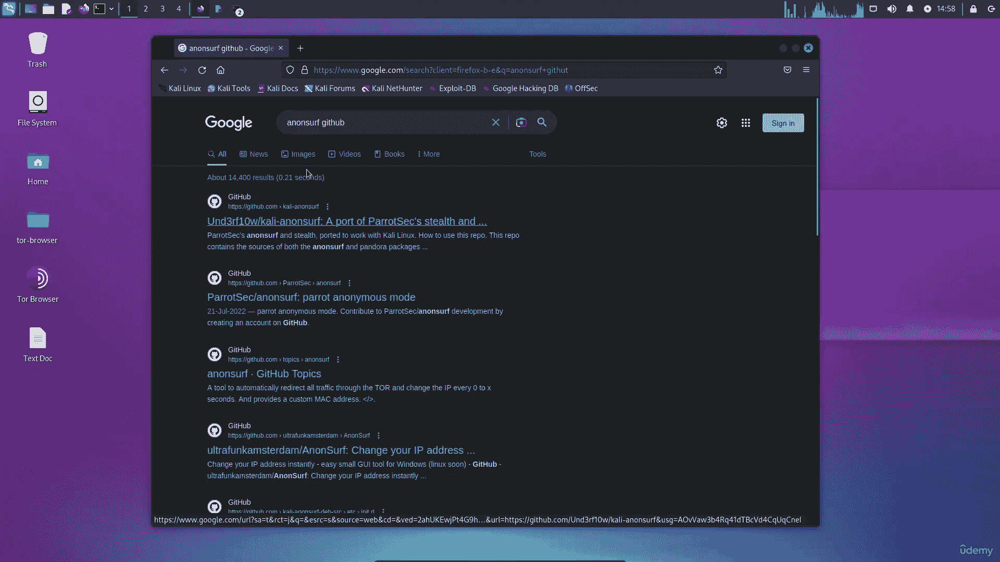
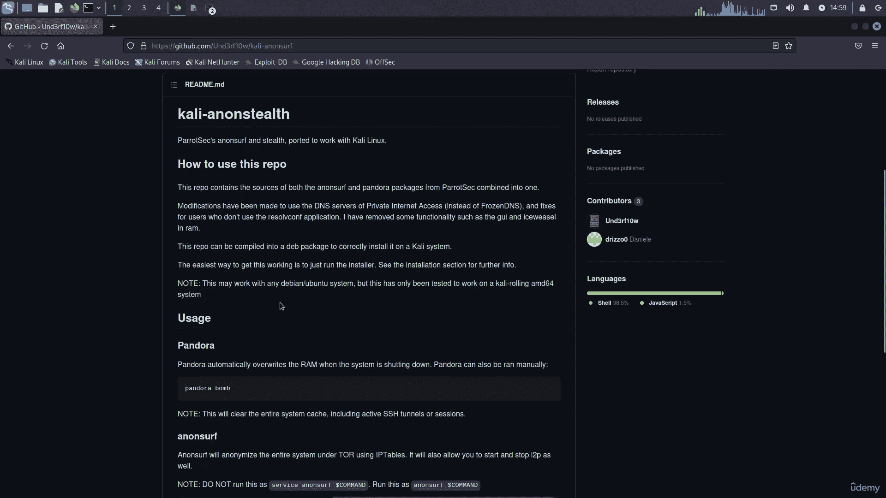
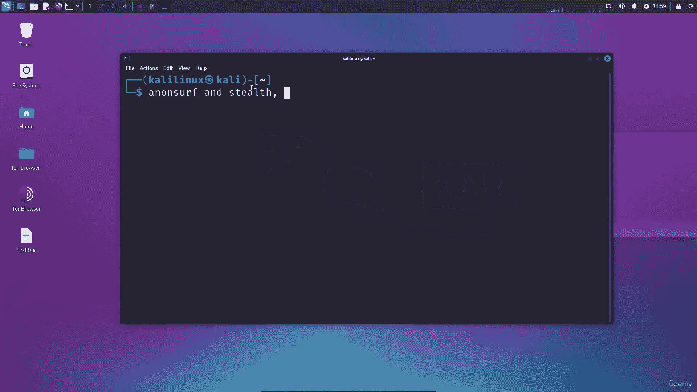
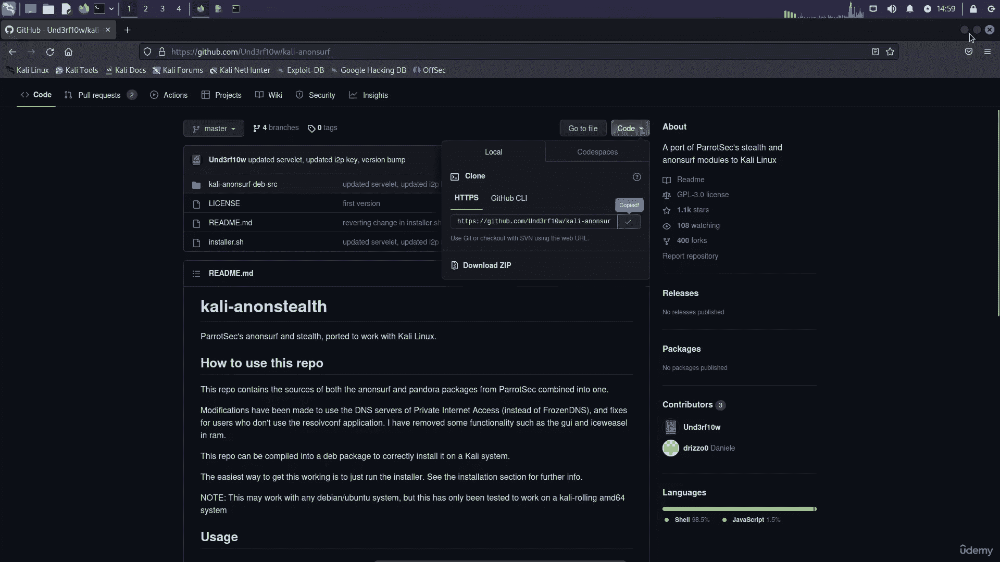
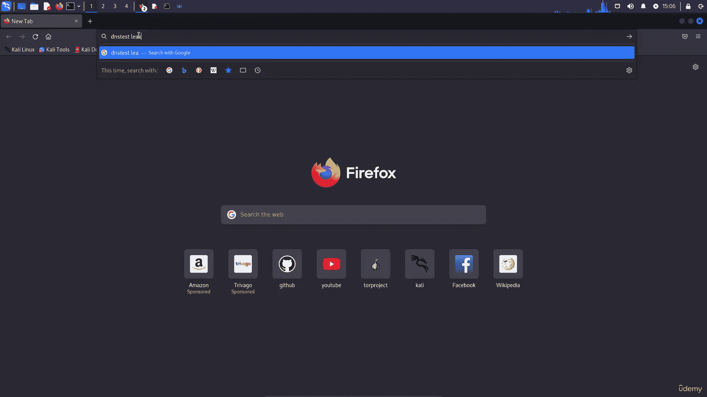
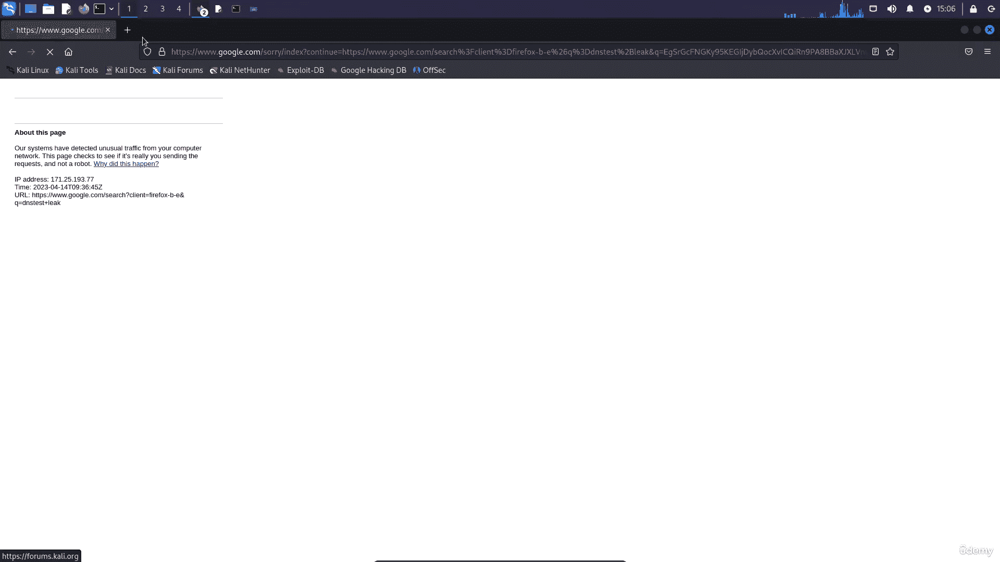
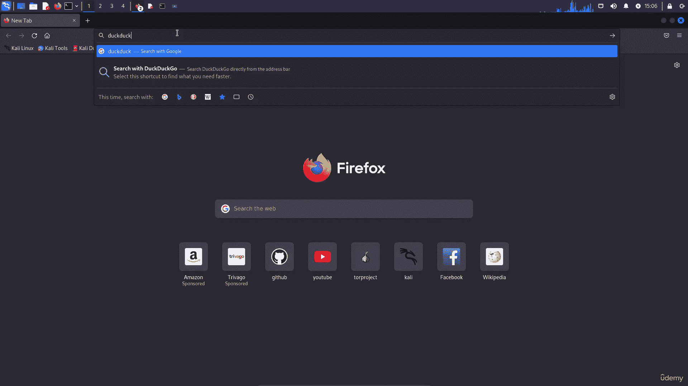
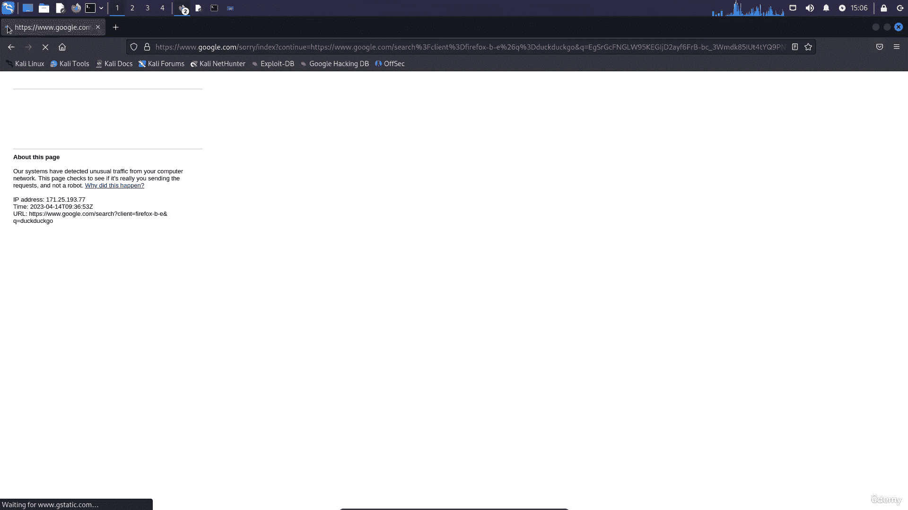
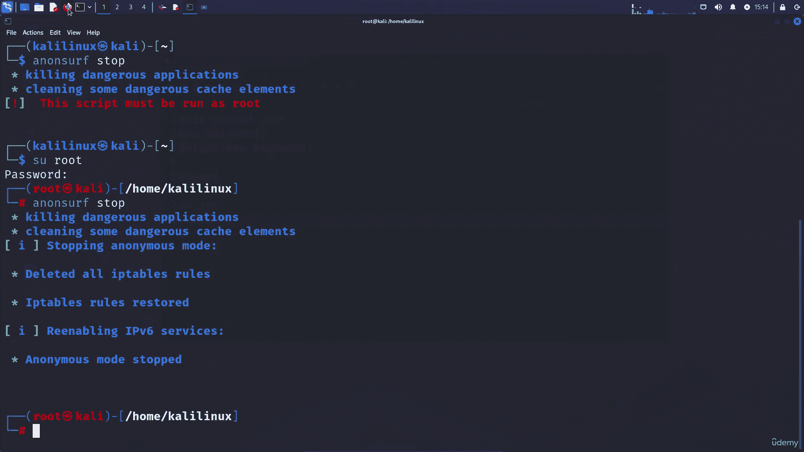

# 道德黑客完整课程2026：01：Anonsurf安装前的准备工作 🛠️

在本节课中，我们将学习如何安装并使用Anonsurf这个工具。Anonsurf是一个可以帮助我们在网络上保持匿名的脚本，它通过代理服务器层和修改DNS服务器来隐藏真实的IP地址，其工作原理和VPN非常相似。在开始实际操作之前，我们需要先从GitHub上获取安装文件，并准备好终端环境。



以下是Anonsurf的核心作用：



```text
隐藏IP地址 = 代理层 + 修改DNS服务器
```

它就像是一层保护壳，让你的真实身份在网络中变得难以追踪。



在本节的第一步，我们需要打开浏览器，搜索Anonsurf的GitHub仓库。进入页面后，点击Code按钮，复制HTTPS克隆链接。这个链接后面会在终端中使用，用来把源代码下载到本地。



# 道德黑客完整课程2026：02：克隆代码并进入安装目录 📂

刚才我们介绍了如何从GitHub复制Anonsurf的链接，本节中我们来看看如何把代码克隆到本地，并进入正确的文件夹。

打开终端，输入以下命令来克隆仓库：

```bash
git clone <复制的HTTPS链接>
```

克隆完成后，你会得到一个名为Anonsurf的文件夹。接下来需要进入这个文件夹，使用cd命令切换目录，具体路径根据你克隆后的文件夹名称而定，例如：

```bash
cd annonsurf
```

进入目录后，使用ls命令列出文件夹内的所有文件，确认安装脚本已经存在。

# 道德黑客完整课程2026：03：获取Root权限并运行安装脚本 🔑

上一节我们已经进入了Anonsurf的安装目录，本节中我们来看看如何获取管理员权限，并运行安装程序。

Anonsurf的安装需要Root权限才能完成，因为它要修改系统的网络配置。如果你当前处于普通用户模式，需要先切换到Root用户。首先设置Root密码，命令如下：

```bash
sudo passwd root
```

系统会提示你输入两次新密码，设置成功后，使用以下命令确认当前身份：

```bash
whoami
```

如果输出结果显示为root，说明已经成功切换到管理员账户，现在就可以开始安装了。

在Root权限下，运行安装脚本：

```bash
./install.sh
```

安装过程会持续一段时间，因为程序需要下载相关的数据库和依赖文件，请耐心等待直到提示安装完成。

# 道德黑客完整课程2026：04：启动Anonsurf并检查运行状态 🚀

刚才我们介绍了如何运行安装脚本并完成安装，本节中我们来看看如何启动Anonsurf，并确认它是否正常工作。

安装完成后，使用以下命令启动匿名代理服务：

```bash
anonsurf start
```





启动后，你的网络流量会经过多层代理，类似于Tor电路，从而隐藏真实IP地址。可以使用状态命令来查看当前运行情况：



```bash
anonsurf status
```



如果输出显示为Active，说明Anonsurf已经成功运行，你的网络正在经过匿名隧道传输。

# 道德黑客完整课程2026：05：验证DNS泄漏与停止服务 🌐

上一节我们介绍了如何启动Anonsurf并查看状态，本节中我们来看看如何验证匿名效果，以及如何停止服务。

启动后，建议访问DNS泄漏检测网站，例如dnsleaktest.com，检查你的DNS服务器是否暴露了真实位置。正常情况下，检测结果会显示你位于另一个国家或地区，而非你的真实位置，这说明IP地址已经成功隐藏。

如果你想更换当前的匿名身份，可以使用以下命令：

```bash
anonsurf change
```

这个命令会重启代理服务并分配一个新的IP地址。

当不再需要匿名网络时，使用以下命令停止Anonsurf：

```bash
anonsurf stop
```

停止后，再次访问IP查询网站，你会看到恢复了原本的真实IP地址。

# 道德黑客完整课程2026：06：本节总结与下一节预告 📚

本节课中我们一起学习了Anonsurf的安装方法、启动命令、状态检查以及DNS泄漏验证。你已经掌握了如何使用这个工具来隐藏IP地址，并为后续的网络安全实践增加一层匿名保护。



在下一节课中，我们将学习VPN的使用方法以及MAC地址的修改技巧，继续深入网络匿名与隐藏的相关内容。

