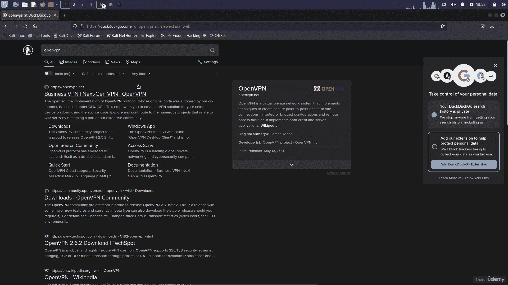
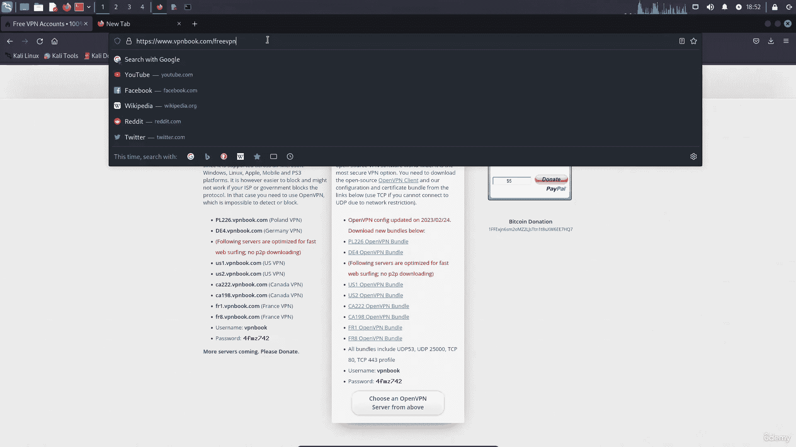
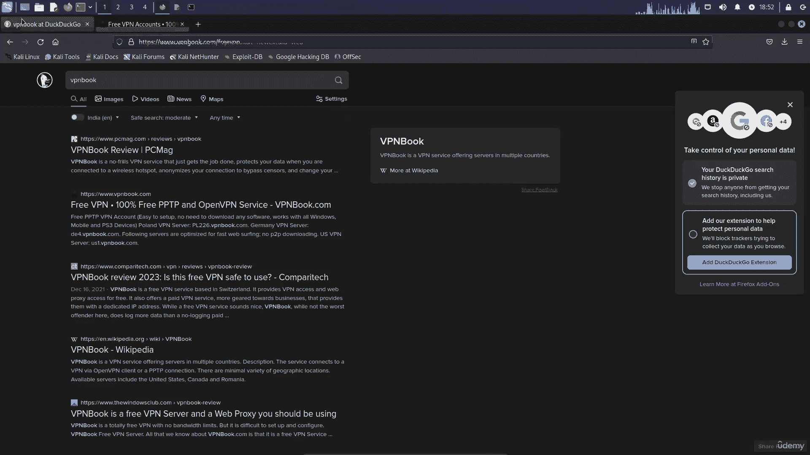
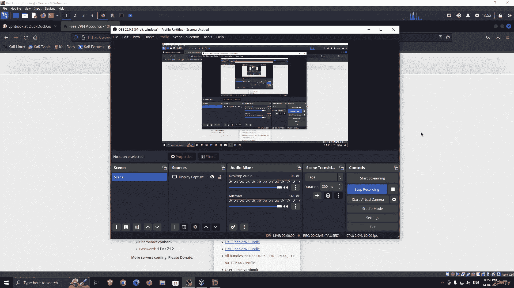
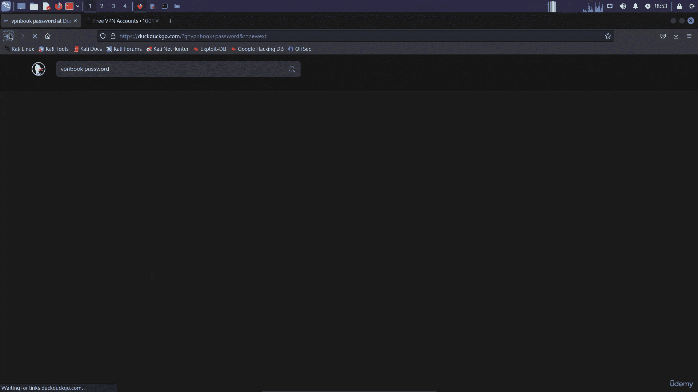
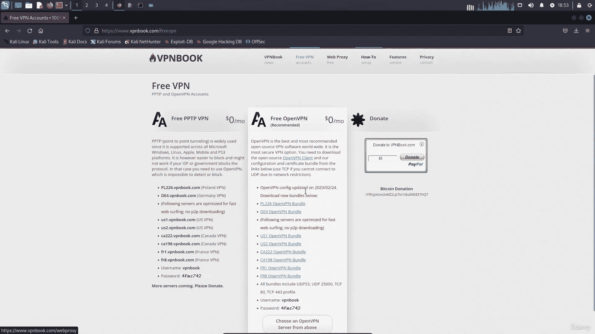
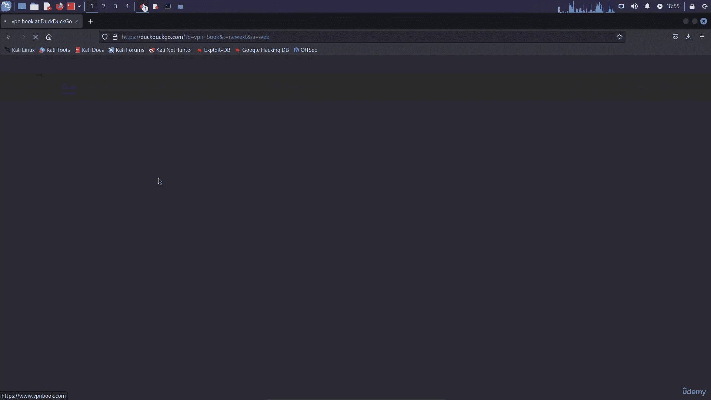
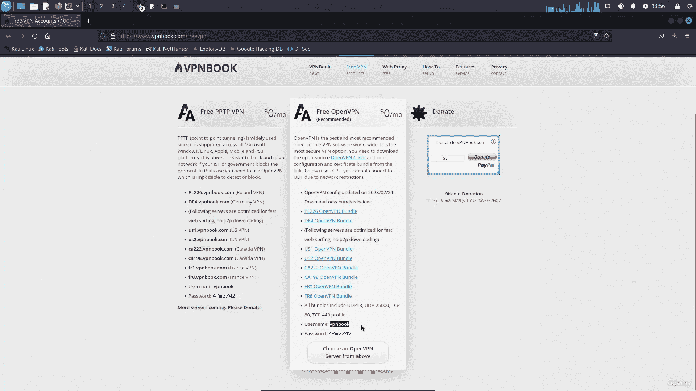
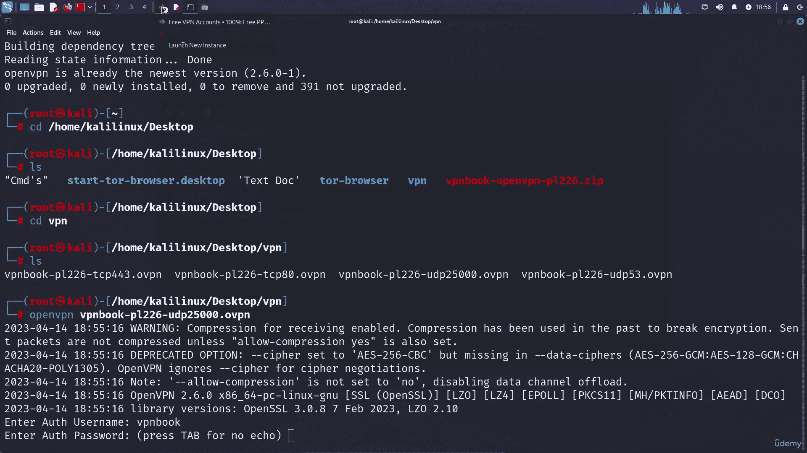
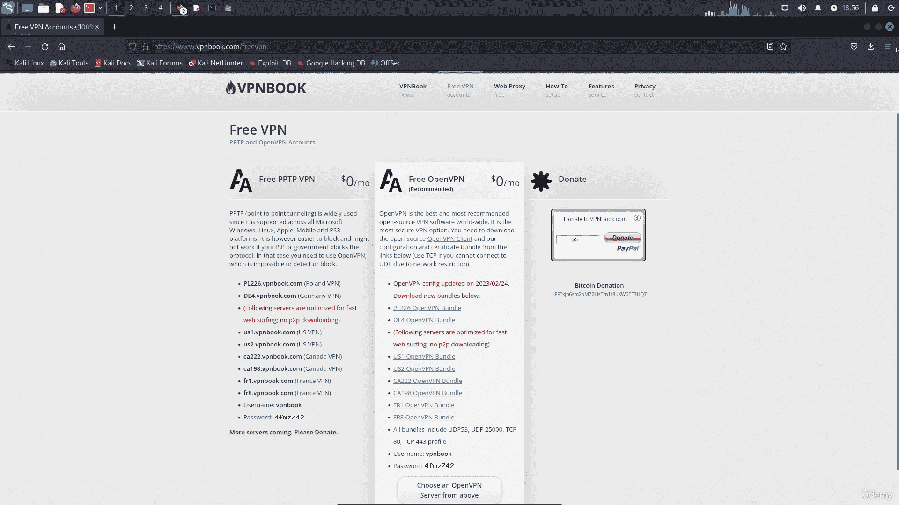

# 完整道德黑客课程 2026：14：在 Kali Linux 中安装并使用 VPN 🛡️


在本节课中，我们将学习如何在 Kali Linux 操作系统中安装和使用 VPN，以便在进行渗透测试时提升网络匿名性。我们会先介绍如何获取 root 权限，然后逐步完成 OpenVPN 软件的安装、配置文件的下载与解压、VPN 连接的建立，最后验证 IP 地址是否已经更改，并学会安全地断开连接。整个过程适合零基础的初学者，每一步都会详细说明操作方法和注意事项。


## 打开 root 终端


在 Kali Linux 中安装软件或修改网络配置之前，首先需要以 root 管理员身份打开终端。很多系统命令都需要最高权限才能执行，如果没有 root 权限，后续的安装和配置步骤都会失败。

你可以直接在桌面上找到终端图标并点击打开，或者在应用程序菜单中搜索 "root terminal"。系统会弹出密码输入框，你需要输入设置好的管理员密码才能进入 root 账户。如果你不记得密码，或者无法直接打开 root 终端，也可以在普通终端窗口中输入以下命令来切换用户身份：

```bash
sudo su
```

执行这条命令后，系统会要求你输入当前用户的登录密码，验证通过后你就获得了 root 权限。接下来的所有操作都将在这个具有管理员权限的终端中进行，确保命令能够正常运行。


## 安装 OpenVPN 软件


上一节我们介绍了如何打开 root 终端，本节中我们来看看如何安装 OpenVPN 软件。OpenVPN 是一种开源的虚拟专用网络工具，可以建立加密的网络隧道，隐藏你的真实 IP 地址，增加上网的匿名性。

在 Kali Linux 中，OpenVPN 通常已经预装了最新版本，但为了保险起见，我们仍然可以使用包管理器来确认安装状态。请在终端中输入以下命令：



```bash
apt install openvpn
```



如果系统提示 "openvpn is already installed"，说明软件已经是最新版本，不需要重复安装。如果系统开始下载和安装文件，则等待进度条完成即可。安装好之后，我们就可以继续下一步，去下载可用的 VPN 配置文件了。




## 下载 VPN 配置文件


安装好 OpenVPN 软件之后，还需要获取具体的 VPN 服务器配置信息才能建立连接。这里我们使用免费的 VPN book 网站，该网站提供公开的 OpenVPN 配置包，适合学习和测试用途。



以下是获取配置文件的具体步骤：


1. 打开浏览器，在搜索引擎中输入 "VPN book" 并搜索。
2. 点击搜索结果中排名靠前的官方网站链接，进入 VPN book 首页。
3. 在网站导航栏中找到 "Free VPN" 菜单并点击进入。
4. 在页面中找到 "Download Bundle" 选项，下载 OpenVPN 配置压缩包，文件名通常包含类似 "PL226" 的标识。
5. 下载完成后，将压缩包文件拖拽到桌面，方便后续查找和解压。



需要注意的是，免费 VPN 网站的界面可能会经常变化，如果打开的页面看起来不对，可以尝试刷新页面或点击搜索结果中的第二个链接。下载完成后，我们就要进入解压阶段了。




## 解压配置文件


上一节我们完成了配置文件的下载，本节中我们来看看如何解压这些文件并准备连接。下载好的压缩包中包含多个不同地区的 `.ovpn` 配置文件，每个文件对应一个 VPN 服务器节点。

Kali Linux 自带图形化解压工具，操作非常简单。你可以右键点击桌面上的压缩包文件，选择 "Extract" 或 "提取"，系统会自动创建一个新文件夹，里面存放所有配置文件。如果你更习惯使用终端，也可以先进入桌面目录，使用以下命令查看当前目录下的所有文件：

```bash
cd ~/Desktop
ls
```

执行 `ls` 命令后，你会看到大量以 `.ovpn` 结尾的配置文件。建议优先选择 UDP 版本的配置文件，因为 UDP 协议在大多数网络环境下连接速度更快，延迟更低，更适合渗透测试场景。


## 连接 VPN 服务器


解压完成后，我们已经拿到了可用的配置文件，本节中我们来看看如何使用 OpenVPN 命令建立实际连接。在连接之前，你需要从 VPN book 网站上获取对应的用户名和密码，这些凭证通常显示在免费 VPN 页面中。

请在终端中输入以下命令格式来启动连接：



```bash
openvpn --config [配置文件名].ovpn
```



将 `[配置文件名]` 替换为你选择的 UDP 配置文件实际名称，然后按回车执行。系统会提示你输入用户名和密码，用户名通常是 "vpnbook"，密码则是网站上显示的一串字符，例如类似 "4FMZ742" 的组合。请注意，免费 VPN 的密码可能会定期更换，如果连接失败，建议回到网站确认最新的凭证。





等待几秒钟，直到终端输出 "Initialization Sequence Completed"，这表明 VPN 隧道已经成功建立。此时你的所有网络流量都将通过远程 VPN 服务器转发，真实 IP 地址被有效隐藏。


## 验证 IP 地址


VPN 连接成功之后，我们需要确认 IP 地址是否真的发生了变化，从而验证隧道是否正常工作。你可以打开浏览器，访问类似 "whatismyip.com" 或 "myip.com" 的 IP 查询网站。

如果页面显示的 IP 地址不再是你本地网络的真实地址，而是 VPN 服务器所在地区的 IP，说明连接已经成功生效。此时你可以使用这个匿名身份进行渗透测试或其他网络安全练习，增加攻击行为的隐蔽性。需要注意的是，免费 VPN 的速度通常较慢，打开网页可能需要等待更长时间，请保持耐心。


## 断开 VPN 连接


使用完免费 VPN 之后，建议及时断开连接，避免长期占用公共服务器资源，也能让你的网络恢复正常速度。如果你想更换另一个服务器节点，也可以先断开当前连接，再重新连接不同的配置文件。

在终端中，你可以使用以下命令强制终止所有正在运行的 OpenVPN 进程：

```bash
sudo killall openvpn
```

执行这条命令后，所有活跃的 VPN 连接都会被关闭。你可以再次打开 IP 查询网站，确认显示的 IP 地址已经恢复为本地真实 IP，从而验证 VPN 已经成功断开。如果你习惯使用多个终端窗口，也可以将当前终端垂直分割，在新的标签页中准备下一次连接。


## 总结


本节课中，我们一起学习了在 Kali Linux 中安装和使用 OpenVPN 的完整流程。我们介绍了如何打开 root 终端、安装 OpenVPN 软件、从 VPN book 下载配置文件、解压并选择 UDP 节点、建立 VPN 连接、验证 IP 地址变化，以及最后使用 killall 命令断开连接。


掌握这些操作后，你可以在渗透测试过程中灵活切换网络身份，提升操作的匿名性和安全性。希望这节课的内容对你有所帮助，我们下节课再见。


