🔒 Udemy - Complete Ethical Hacking Course 2026：Go From Zero to Hero：15：ProxyChains 🌐

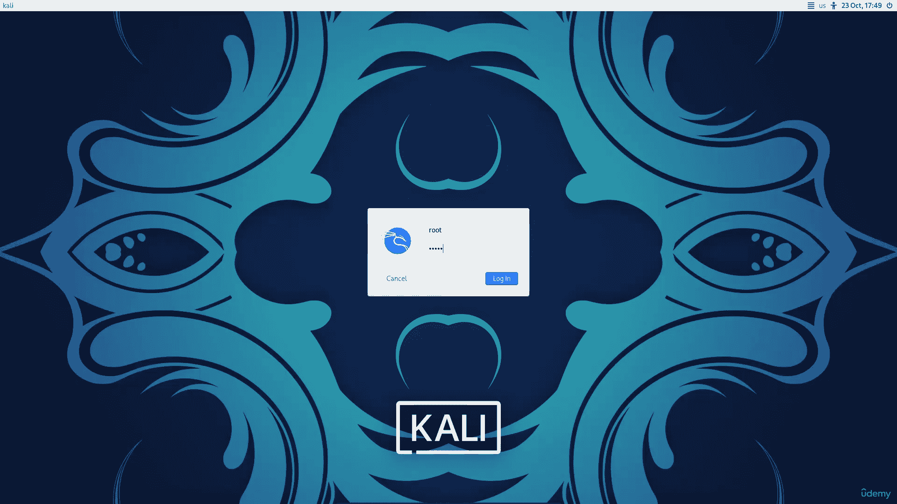

在本节课中，我们将学习如何在 Kali Linux 系统里设置和使用 ProxyChains。ProxyChains 是一个能让你把应用程序流量通过一组代理服务器转发的工具，经常被用来保护隐私、提升安全性和维持网络匿名性。你会先了解如何获取 root 账户的访问权限，然后学习 ProxyChains 的工作原理，接着动手编辑配置文件来启用代理链，最后启动 Tor 服务，并用 Firefox 浏览器访问网站，检查是否存在 DNS 泄漏。内容会尽量用大白话讲解，即使你是初学者也能看懂，跟着步骤一步步操作就可以了。

上一节课我们可能接触过一些渗透测试的基础知识，本节中我们先来看看怎么在 Kali Linux 里拿到 root 权限，因为后面配置代理链需要更高的系统权限才能操作。

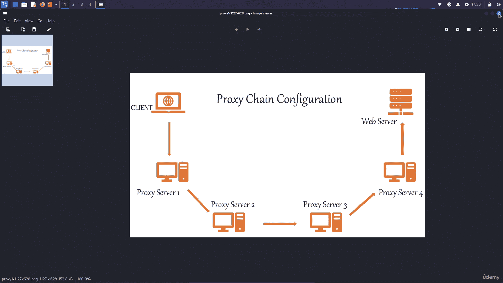

以下是获取 root 权限的具体步骤：
- 首先你需要创建 root 账户并获得 root 访问权限。
- 打开你的普通终端，然后输入 `sudo passwd root` 命令。
- 系统会提示你设置新密码，输入新密码后再输入一次确认。
- 接着输入 `whoami` 命令查看当前身份，如果显示的是普通用户而不是 root，说明你现在还在普通系统权限下，而不是 root 版本。
- 如果你想要获得 root 终端访问权限，可以点击电源按钮，选择切换用户，然后登录刚才创建的 root 账户，而不是你原来的次要账户。
- 登录 root 账户之后，你会拥有更多权限，能够启用代理或者使用 ProxyChains 工具。

有了 root 权限之后，我们就可以开始了解 ProxyChains 是怎么工作的了，这样你在配置之前心里会有个底。

这里有一张从 Google Chrome 下载的图片，可以帮助你理解代理链的整体流程。
- 图片显示客户端先连接到代理 1，然后是代理 2、代理 3 和代理 4。
- 最后这些代理再直接连接到 Web 服务器或者互联网。
- 这就是 ProxyChains 的基本工作方式，通过这张图你可以对代理链有一个直观认识。
- ProxyChains 是一个工具，允许你通过一系列隐私服务器来运行应用程序。
- 它通常被用于隐私保护、安全加固和匿名性维持，帮助你在上网或搜索时不暴露真实身份。
- 安全专业人员、研究人员以及普通个人用户，都会用它来在线保护自己的身份信息。
- 图片展示完之后，我们就进入实际操作部分了。

既然知道了代理链的原理，接下来我们就动手配置 ProxyChains，让它真正跑起来。

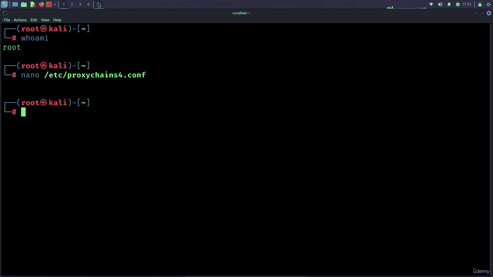

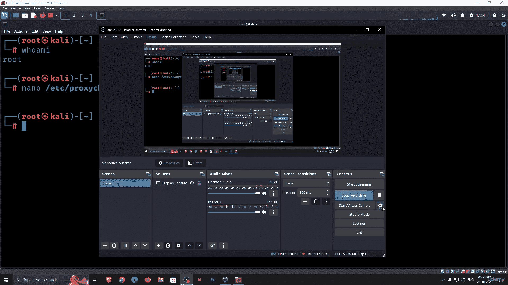

以 root 账户打开终端，先输入 `whoami` 确认当前身份已经是 root。
- 因为 ProxyChains 在 Linux 系统里已经预装好了，所以你不需要额外下载，可以直接开始配置。
- 输入 `nano /etc/proxychains` 或者 `nano /etc/proxychains4.conf` 并回车，打开代理链的配置文件。
- 你会在文件里看到 HTTP、SOCKS4、SOCKS5 以及带有 DNS 的隧道代理选项。
- 一般来说 SOCKS5 比 SOCKS4 更好，也比 HTTP 更先进，是目前最新的选择。
- 你需要去掉动态链前面的井号，移除井号就等于启用动态链，这个操作有点像写代码一样简单。
- 动态链的作用是：链中的每个代理都会按照列表中出现的顺序依次被使用。
- 链中至少要有一个代理在线，整个代理链才能正常工作。
- 本视频里我们使用动态链，而不是严格链，如果你感兴趣，可以自己去了解严格链和轮询链是什么。
- 在这里你会看到有两个井号已经被移除了，你可以继续把井号去掉，这样就能防止 DNS 数据泄露，启用代理 DNS 请求。
- 向下滚动配置文件，你会看到一些示例，包含 IP 地址、端口号和名称，名称属于保密信息。
- 你会看到 SOCKS5，还有 HTTP，即超文本传输协议，它的安全性不如 HTTPS，即超文本传输协议安全。
- 还有 SOCKS4，HTTP 的默认端口是 8080。
- 你会看到一个代理列表，可以在这里添加你想要的任意数量的代理。
- 默认建议是 `tor`，也就是使用 Tor 中继或者 Tor 网络。
- 你可以输入你想要的代理，比如 `socks5 127.0.0.1 9050`，然后按 Control O 写入文件。
- 按回车确认保存，再按 Control X 退出编辑器。
- 退出之后，你可以检查一下 Tor 浏览器或者 Tor 网络是否已经启动。

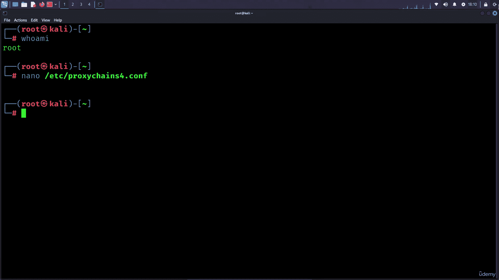

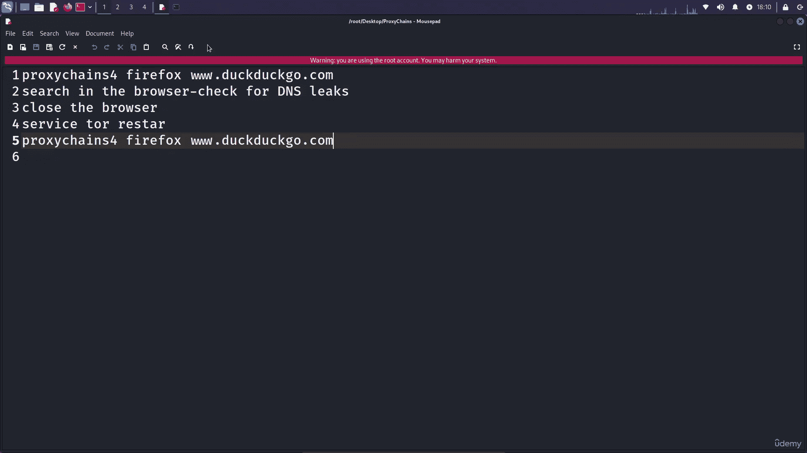

配置文件改好之后，下一步就是启动 Tor 服务，并用 ProxyChains 启动 Firefox 来看看实际效果。

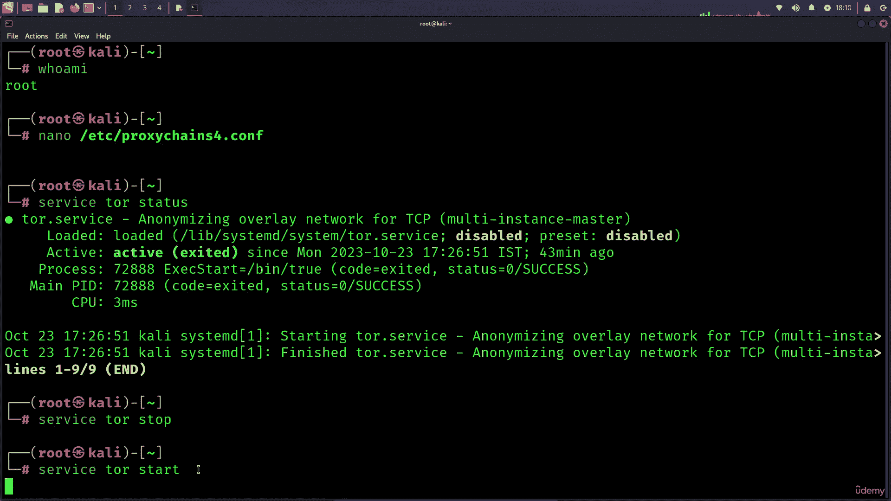

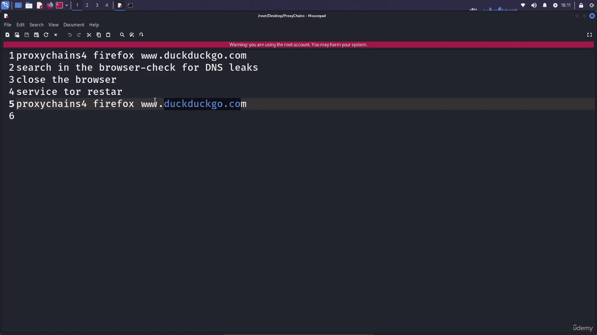

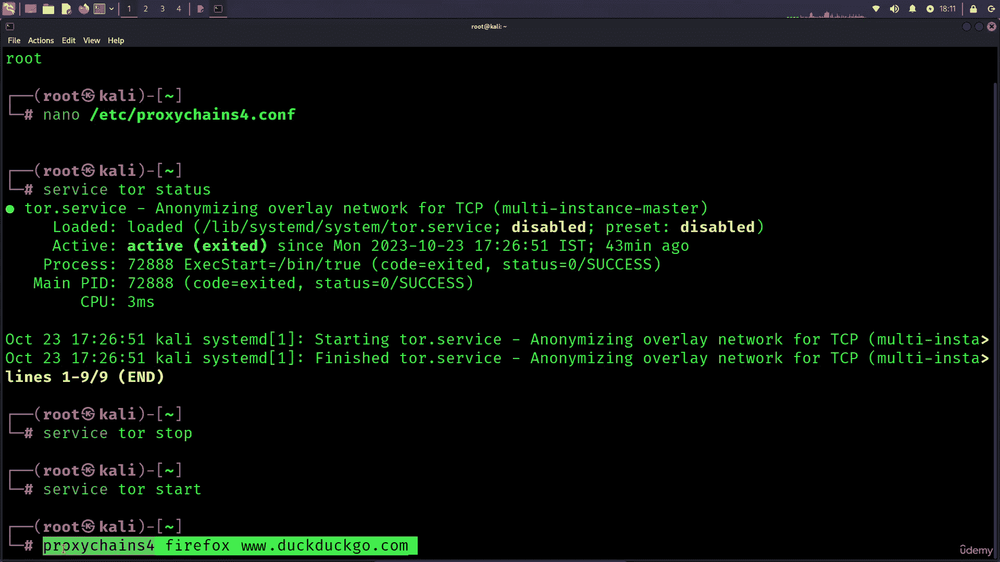

一旦代理链设置完成，你只需要按照记事本里写好的命令来操作就可以了。
- 输入 `service tor start` 来启动 Tor 服务。
- 或者输入 `service tor status` 来查看 Tor 服务的当前状态。
- 如果显示服务正在运行，按 Control C 结束状态查看。
- 你可以读一下输出信息，它会显示 Tor 服务处于活动状态。
- 接下来我需要停止 Tor 服务，输入 `service tor stop`，Tor 服务就会停止。
- 然后再输入 `service tor start` 重新启动，这样 Tor 和 Tor 代理链就会有一个全新的启动。
- 之后，输入命令 `proxychains4 firefox` 并指定一个网站，比如 `www.google.com`，或者你想去的任何其他网站。
- 把网址粘贴进去并回车，Firefox 浏览器就会启动，可能需要等待一小会儿，因为它正在使用 SOCKS5 代理链。
- 我们得耐心等一下，等页面加载完成之后，你就可以去检查 DNS 泄漏了。
- 访问 DNS 泄漏检测网站，输入网址并回车。
- 这是第一个检测网站，它会检查你的 DNS 是否存在泄漏。
- 连接速度还算中等，不是特别快，但能用。
- 结果页面会显示“来自法国的问候”，可我肯定不在法国，离法国很远。
- 这就说明代理链在正常工作了。
- 你可以看看显示的 IP 地址和端口号，网站显示我们正在 DNS 泄漏检测页面，这就是一个正常工作的代理链。
- 按 Control C 结束测试，然后你可以添加一个新代理，再次启动代理链。

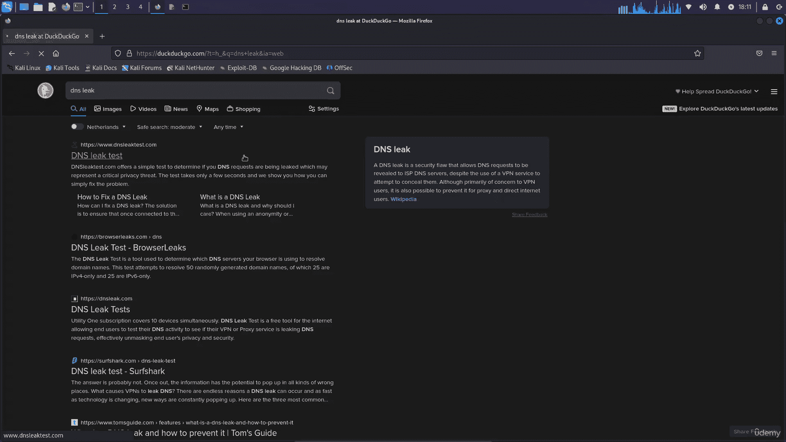

如果你想换一个代理继续测试，方法也非常简单，不需要重新配置。

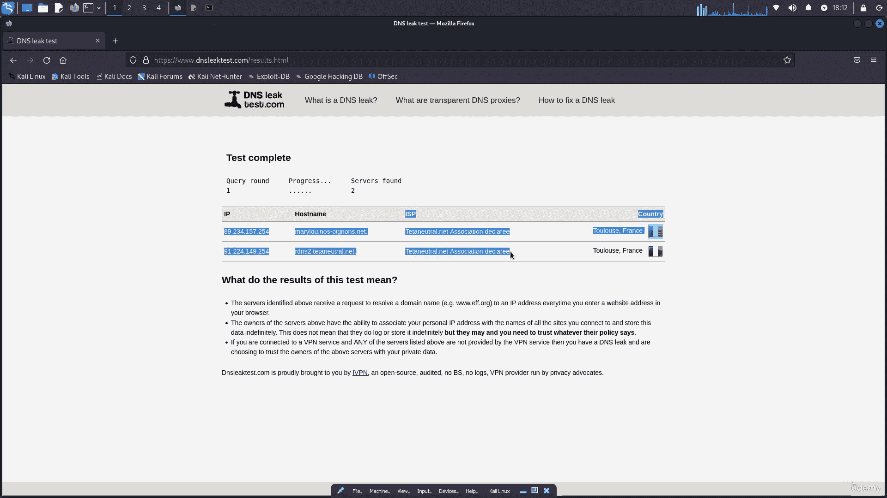

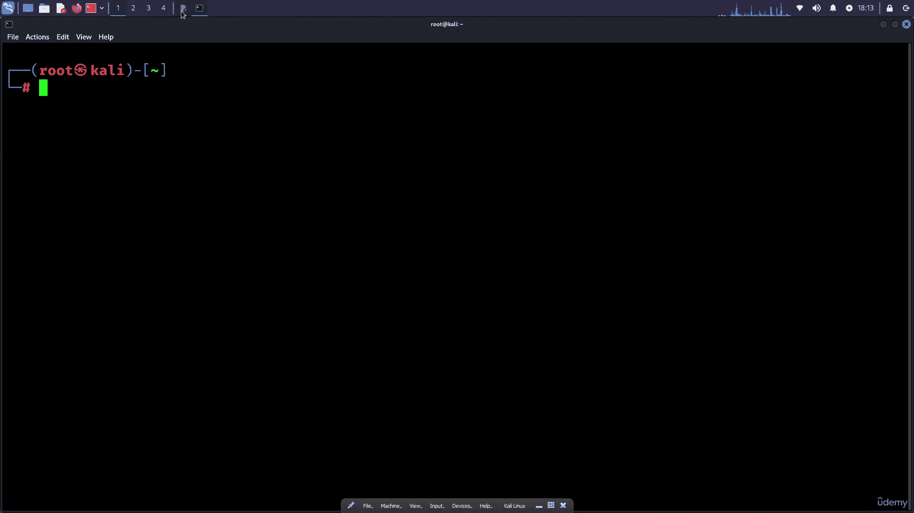

你可以去 DNS 泄漏检测网站，点击标准测试或者扩展测试，它会开始运行测试。
- 测试会告诉你 DNS 服务器来自哪个国家。
- 等测试跑完，结果显示来自法国，好吧，显示的互联网服务提供商是某个公司，我肯定不是在用这个服务商。
- 如果关闭这个页面，代理链会自动结束。
- 想要重新开始，只需要再次输入相同的命令就行。
- 比如输入 `proxychains4 duckduckgo.com`，它会用新的 DNS 服务器、新的 IP 地址和新的位置重新启动代理链。
- 我们再试一次，点击 DNS 泄漏，再访问测试网站。
- 结果又显示来自法国，可能你需要更换 SOCKS5 代理或者它的 IP 地址。
- 这就是使用 ProxyChains 在线保持匿名、保护网络或连接的完整方法了。
- 下期视频见。

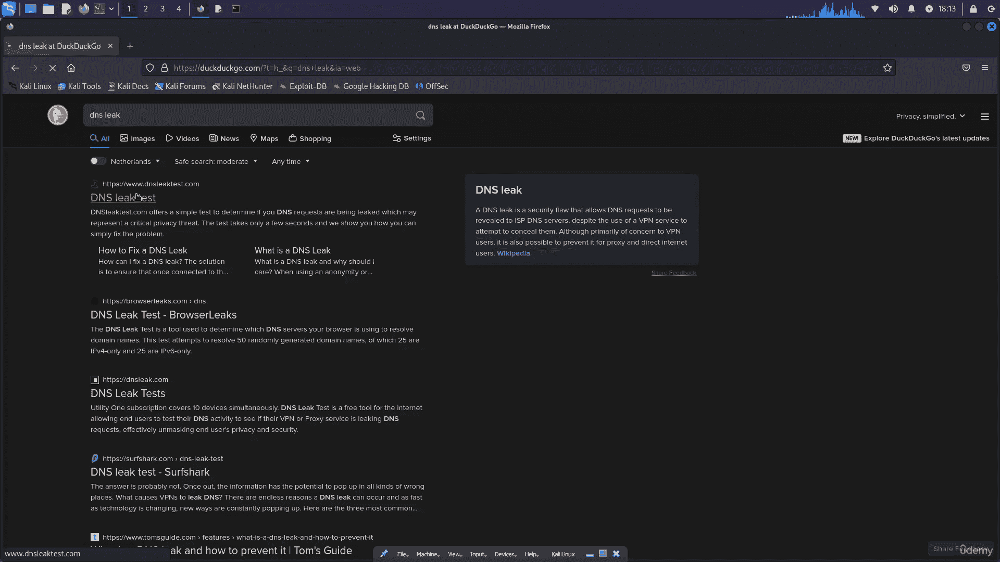

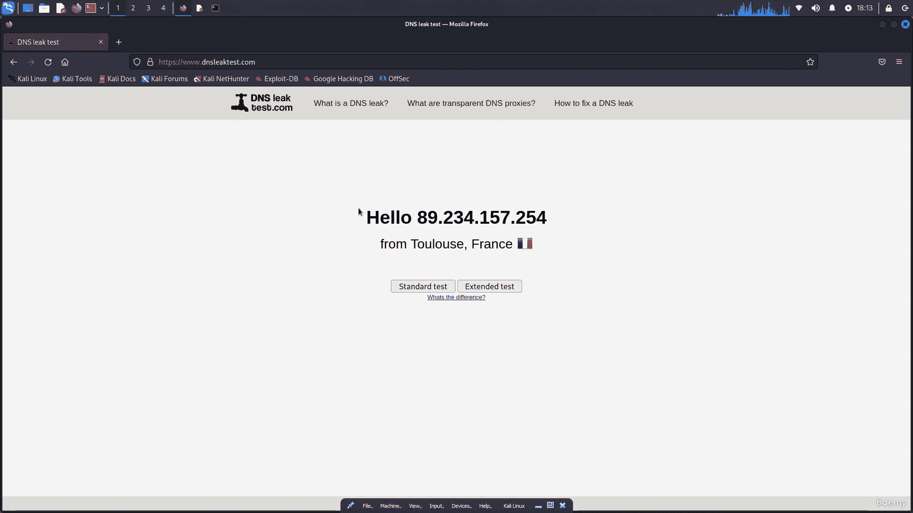

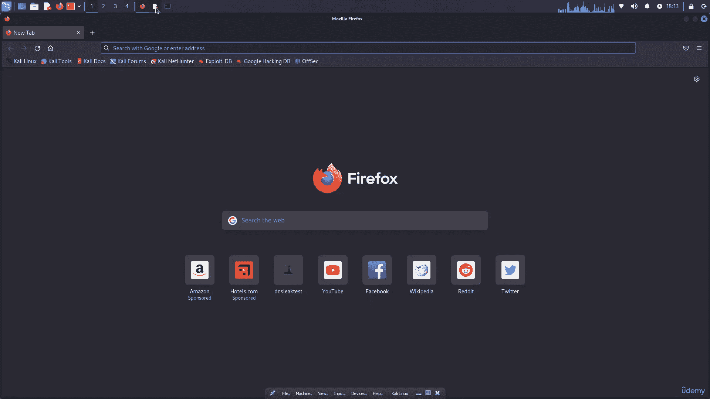

本节课中我们一起学习了如何在 Kali Linux 里获取 root 权限，如何理解 ProxyChains 的代理链原理，如何编辑配置文件启用动态链，如何启动 Tor 服务，以及如何用 Firefox 和 DNS 泄漏检测来验证代理链是否正常工作。
