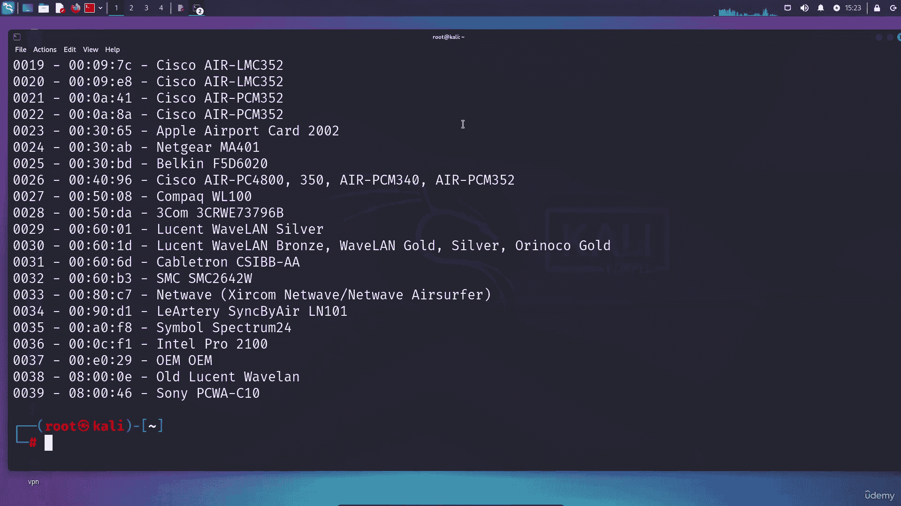

🛡️ Udemy - Complete Ethical Hacking Course 2026：Go From Zero to Hero p15：16：Macchanger

在本节课中，我们将学习如何在 Kali Linux 系统里修改设备的 MAC 地址。MAC 地址是网络设备的唯一身份标识，在进行渗透测试或网络安全练习时，临时修改它可以帮助我们保护隐私、保持匿名，避免被目标系统轻易追踪。我们将使用系统中已经预装好的 macchanger 工具，学习如何查看当前地址、修改为随机地址，以及在需要时如何恢复出厂设置。这部分内容是网络匿名性的基础，对初学者来说非常实用，大家不用担心难度太高，跟着步骤一步步来即可。

### 什么是 MAC 地址

MAC 地址的全称是 Media Access Control Address，中文翻译为媒体访问控制地址。简单来说，它就像是你电脑网卡的身份证号码，每一块网卡在出厂时都会被分配一个全球唯一的地址。以太网和 Wi-Fi 等网络协议会使用这个地址来识别局域网中的设备，并让不同设备之间能够正常通信。网络管理员依靠 MAC 地址来监控和管理网络流量，而安全系统则会根据请求设备的 MAC 地址，来决定允许还是拒绝访问网络资源。

`MAC地址 = Media Access Control Address`

虽然 MAC 地址在理论上是绑定在硬件设备上的，不能永久更改，但我们可以通过软件或硬件工具对它进行临时伪装。也就是说，设备的永久地址不会改变，但当前使用的地址可以被临时替换。这正是我们接下来要学习的核心技术，也是在攻击测试中常用的隐藏身份手段，掌握它之后你就能更好地理解网络通信中的设备识别机制。

### 打开终端并准备操作

在开始实际操作之前，我们需要先打开 Kali Linux 的终端窗口。终端是我们输入命令、与系统交互的地方，修改 MAC 地址属于底层网络配置操作，所以系统会要求你输入管理员密码来确认身份。请确保你已经以 root 权限登录，或者准备好在提示时提供正确的密码，否则后面的命令无法成功执行。这一步非常关键，因为没有管理员权限，系统不会允许你修改网络接口的底层信息。

### 查看当前网络适配器和 MAC 地址

上一节我们介绍了 MAC 地址的基本概念，本节中我们来看看如何查看自己电脑当前的网络设备以及对应的地址。

以下是查看 MAC 地址的具体操作步骤：

- 输入 `ifconfig` 命令并回车，系统会列出所有网络适配器的详细信息。
- 找到你正在使用的适配器名称，在演示中使用的是 `eth0`，它代表有线以太网连接。
- 在输出结果中找到对应的 MAC 地址，这是一串十六进制代码，格式通常为 `XX:XX:XX:XX:XX:XX`。

这串地址就是你当前网卡的物理标识，在接下来的修改步骤中，我们会把它替换成一个新的随机地址。值得注意的是，ifconfig 显示的是当前生效的地址，而在某些系统中还会区分永久地址和当前地址，我们之后会再解释两者的区别，大家先记住当前看到的这个地址就是我们要操作的目标。

### 使用 macchanger 修改 MAC 地址

知道了如何查看地址之后，本节中我们来看看如何使用 macchanger 工具来修改它。macchanger 是 Linux 系统中已经预装的专用软件，可以帮助我们快速生成并应用新的 MAC 地址，而不需要手动编写复杂的配置，使用起来非常方便。

以下是几种常见的修改方式：

- 查看版本和当前信息：输入 `macchanger -s eth0`，这会打印出当前的 MAC 地址并退出。
- 设置同类型随机厂商地址：输入 `macchanger -A eth0`，系统会根据你的网卡类型生成一个随机 MAC 地址，比如无线网卡会对应无线设备厂商，有线网卡则对应有线设备厂商。
- 修改完成后，再次运行 `ifconfig` 就能看到新的 MAC 地址已经生效。

这种修改方式是临时的，重启网络或重启电脑后，地址可能会恢复。在实际攻击某个系统或网络时，我们通常只需要临时更改当前地址，而不需要去修改设备出厂时烧录的永久地址，这样既能保护隐私，又不会影响设备的正常硬件标识，操作起来也更加灵活。

### 恢复永久 MAC 地址

修改 MAC 地址之后，有时候我们需要把它改回原来的样子，本节中我们来看看如何恢复出厂设置，避免长期使用随机地址导致网络连接异常。

以下是恢复永久 MAC 地址的命令：

- 输入 `macchanger -b eth0`，参数 `b` 代表 restore permanent，也就是把当前地址改回设备出厂时设定的永久 MAC 地址。
- 执行完成后，再次使用 `ifconfig` 查看，你会发现地址已经变回原来的那个永久地址。

恢复操作非常简单，只需要一条命令就能完成。如果你在测试结束后想要让设备恢复正常的网络标识，或者不再需要保持匿名，就可以使用这个方法把地址改回来，这样就不会影响日常上网和其他网络服务的正常使用。

### 查看已知厂商列表

除了修改地址，macchanger 还可以帮助我们查看不同品牌的 MAC 地址前缀，本节中我们来看看这个功能。每个网卡厂商在 MAC 地址的前三位十六进制代码中都有固定的标识，比如思科、小米等公司都有自己的专属前缀，了解这些可以让我们更好地伪装设备身份。

以下是查看厂商列表的方法：

- 输入 `macchanger -l`，系统会打印出大量已知的网卡厂商列表，包含思科（Cisco）和各种中国公司等众多品牌。
- 你可以根据需要选择一个厂商前缀，或者自定义前三位数字来生成自己的 MAC 地址，从而进一步伪装设备身份。

这个功能在你想要模拟特定品牌设备时非常有用，比如你希望目标系统认为你的设备是某个特定品牌的路由器或网卡，就可以选用对应厂商的前缀来构造地址，从而增加匿名性的可信度。

### 本节总结

本节课中我们一起学习了 MAC 地址的基本概念，以及如何在 Kali Linux 中使用 macchanger 工具。我们学习了如何查看当前网卡的 MAC 地址，如何修改为随机地址来保护隐私，如何恢复回永久地址，以及如何查看厂商列表来自定义地址前缀。希望这节课能帮助你理解网络匿名的基础操作，为后续的渗透测试学习打下坚实基础。下期视频再见。

