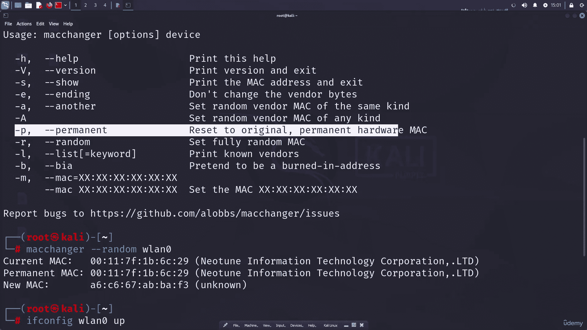
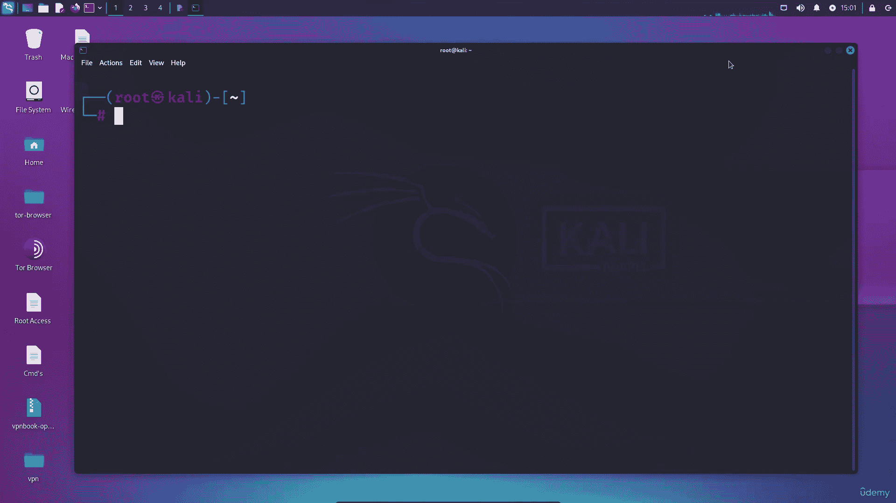

# 🛡️ 道德黑客完整课程 2026：17：修改网络适配器 MAC 地址

## 课程概述


在本节课中我们将要学习如何修改无线网络适配器的 MAC 地址。MAC 地址是网络设备的唯一标识符，就像身份证号码一样，每个网卡出厂时都带有一个固定的地址。通过修改 MAC 地址，我们可以隐藏真实的设备身份，这在渗透测试和网络安全审计中很有用。本节课会一步步教你如何在 Kali Linux 系统中完成这个操作。你将学会打开终端、查看网卡信息、关闭网卡、使用 macchanger 工具生成随机 MAC 地址，以及最后恢复出厂默认的 MAC 地址。每一步都会配合具体的命令进行说明，即使你是初学者也能轻松跟上。

接下来我们先来看准备工作部分，确保你的无线网卡已经正确连接并可以被系统识别。

## 准备工作

在开始之前，你需要确保无线网络适配器已经插入计算机，并且虚拟机或系统已经识别到它。如果没有连接网卡，后续的命令都无法正常运行。这一步非常基础，但也是最重要的一步，因为如果网卡不可用，修改 MAC 地址就无从谈起。

### 查看无线网络适配器

上一节我们介绍了基本的终端操作，本节中我们来看看如何查看系统里的无线网络适配器。

以下是查看无线网络适配器的命令：

```bash
iwconfig
```

运行这个命令后，终端会显示所有无线网卡的名称和状态。常见的网卡名称可能是 wlan0，也可能是其他以 wl 开头的名字。你需要记住自己无线网卡的名称，因为后面修改 MAC 地址时要用到它。

### 确认 USB 网卡已连接

接下来我们要确认 USB 无线网卡已经连接到系统中。

以下是检查步骤：

- 点击虚拟机菜单栏中的设备选项
- 选择 USB 设备列表
- 确认 Atheros USB 93 前面有勾选标记

确保无线网络适配器处于开启状态并且工作正常。只有确认网卡已连接，我们才能继续下一步操作。

完成准备工作之后，我们就可以开始修改 MAC 地址了。首先要做的是把无线网卡暂时关闭，这样才能安全地更改它的硬件地址。

## 修改 MAC 地址

### 关闭无线网络适配器

在修改 MAC 地址之前，必须先让网卡进入下线状态。如果网卡正在运行，系统不允许直接修改它的地址。

以下是关闭无线网络适配器的命令：

```bash
ifconfig wlan0 down
```

这里的 wlan0 是你的网卡名称，如果你的网卡叫其他名字，就把 wlan0 换成实际名称。执行完这个命令后，右上角的网络图标会显示当前没有可用网络，这说明网卡已经成功关闭。

### 使用 macchanger 修改 MAC 地址

网卡关闭之后，我们可以使用 macchanger 工具来修改 MAC 地址。macchanger 是 Kali Linux 自带的工具，专门用于查看和更改网卡的 MAC 地址。

以下是常用的 macchanger 命令：

```bash
macchanger --help
macchanger -v
macchanger -s wlan0
macchanger --random wlan0
macchanger -r wlan0
```

这些命令的作用分别是查看帮助信息、查看工具版本、显示当前 MAC 地址、设置完全随机的 MAC 地址。其中 --random 参数会给网卡分配一个随机的 MAC 地址，这样就可以隐藏原始设备身份。执行修改命令后，终端会提示 MAC 地址已经更改成功。

### 启用无线网络适配器

MAC 地址修改完成之后，我们需要把网卡重新打开，这样它才能重新连接网络。

以下是启用无线网络适配器的命令：

```bash
ifconfig wlan0 up
```

执行完这个命令后，网卡会以新的 MAC 地址重新启动。你可以在右上角的网络图标里看到可用的 Wi-Fi 列表，这说明网卡已经正常工作。

### 验证新的 MAC 地址

为了确认修改是否生效，我们可以再次查看网卡信息。

以下是验证命令：

```bash
iwconfig
```

或者使用：

```bash
ifconfig wlan0
```



在输出信息中，你会看到网卡现在显示的 MAC 地址已经变成了随机生成的新地址，而不是原来的出厂地址。

### 恢复原始永久 MAC 地址


如果你想把 MAC 地址改回原来的出厂设置，也可以使用 macchanger 工具完成。

以下是恢复命令：

```bash
macchanger --permanent wlan0
```

这个命令会将网卡的 MAC 地址重置为出厂时烧录的永久硬件地址。恢复之后，网卡就又回到了最初的状态。

## 课程总结



本节课中我们一起学习了如何在 Kali Linux 中修改无线网络适配器的 MAC 地址。我们先通过 iwconfig 查看网卡名称，确认 USB 网卡已连接，然后使用 ifconfig 将网卡关闭，接着用 macchanger --random 设置随机 MAC 地址，最后用 ifconfig 将网卡重新启用，并通过 iwconfig 验证修改结果。如果需要，还可以用 macchanger --permanent 恢复原始的永久 MAC 地址。下一节课中我们将学习如何开启监听模式，并探索监听模式的功能。

