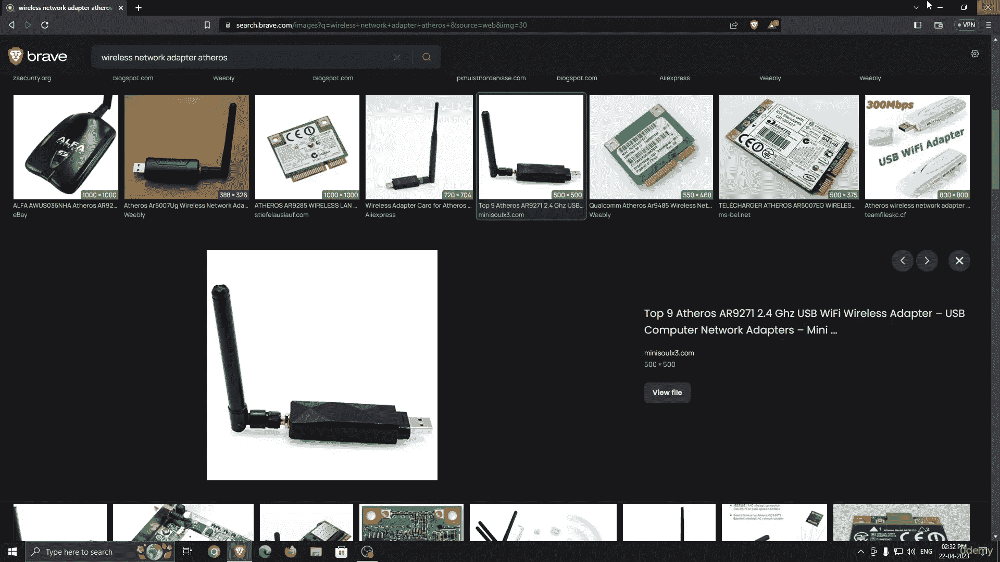
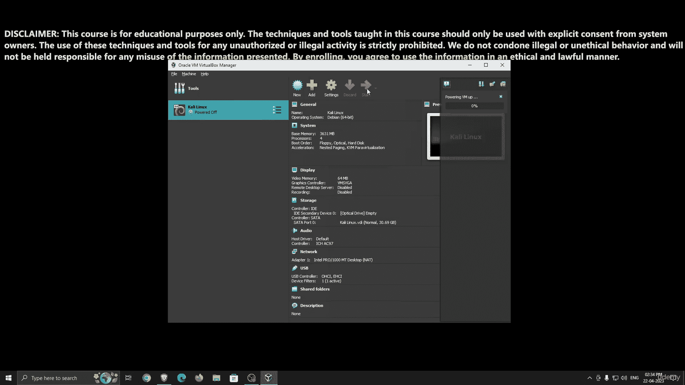
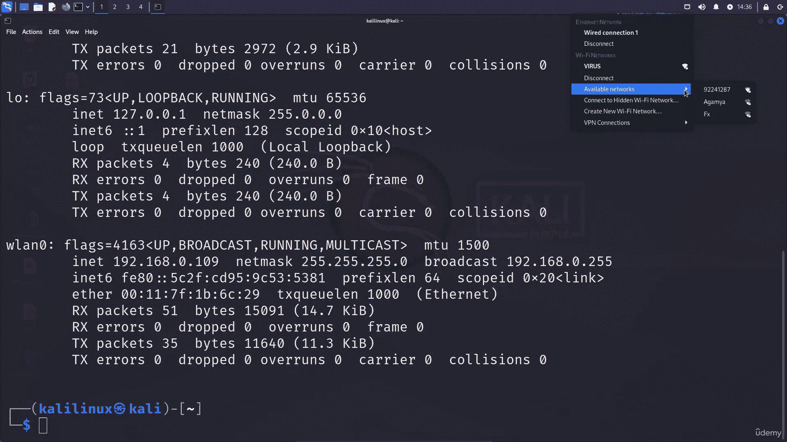

# 🛡️ 道德黑客完全课程：第18章：连接无线网络适配器

## 课程概述

在本节课中，我们将一起学习如何把无线网络适配器连接到操作系统和虚拟机中，目的是为了进行道德黑客攻击、渗透测试和无线网络测试。我们会先看看怎么把网卡插进电脑，再检查设备管理器，最后在 VirtualBox 里做相应配置，让 Kali Linux 能够识别这块无线网卡。下面进入具体内容。

## 物理连接无线网络适配器


首先，你需要把无线网络适配器插到你的个人电脑上。插上之后，系统会弹出提示消息，或者在任务栏显示图标，告诉你网络适配器已经连接成功。这里使用的是 Etherros ER9271 无线网络适配器，你可以在附近的实体店，或者 AliExpress、Amazon 等电商平台直接购买。市面上的无线网络适配器种类很多，频段从 2.4 GHz USB 到 5 GHz 都有，选哪个都可以，只要能正常工作即可。

插好硬件之后，你可以在设备管理器里确认一下是否识别到了这个设备。具体做法是点击开始按钮，打开设备管理器，然后查看网络适配器列表。



以下是设备管理器中可以进行的常见操作：

- 更新驱动程序
- 卸载设备
- 扫描硬件变化
- 查看属性

在属性页面里，你可以看到高级选项，比如 802.11 B 网络地址和驱动程序的详细信息，还有电源管理等设置。确认无误之后，我们就可以继续下一步了。

## 在 VirtualBox 中配置无线网络适配器

上一节我们介绍了如何在物理电脑上连接并检查无线网络适配器，本节中我们来看看如何在 VirtualBox 虚拟机里把它添加进去。

每台笔记本电脑都自带一个网络适配器，用来连接 WiFi 和上网。但是，虚拟机不能直接使用这块内置网卡来进行数据包注入和监听模式。这就是为什么我们需要单独购买一个外置无线网络适配器，用于接下来的几节课。

以下是在 VirtualBox 中添加无线网络适配器的步骤：

1. 选中 Kali Linux 操作系统，点击设置。
2. 找到 USB 或相关设备选项，添加 Etherros 适配器。
3. 点击编辑过滤器，可以修改名称等设置。
4. 选择是否启用远程连接，确认后点击确定。
5. 启动 Kali Linux 虚拟机。

## 在 Kali Linux 中验证无线网络适配器



虚拟机启动完成后，你需要输入密码登录系统，密码通常是 toor。进入桌面后，建议切换到全屏模式，通常是按右侧 Control 键或者 Control + F。

打开终端，输入以下命令来查看无线网络适配器：

```bash
iwconfig
```

也可以使用：

```bash
iw dev
```

你会看到类似 `wlan0` 的无线网络接口，它目前处于托管模式（managed mode）。这里的 `wlan0` 就是你的无线网络适配器接口名称，旁边显示的地址通常是该网卡的 MAC 地址，后续可以用 MAC 地址更改工具进行修改。

下一节我们会把这个模式切换为监听模式。一旦开启监听模式，无线网卡就会断开互联网连接，专门用于无线渗透测试。你可以看到 2.4 GHz 是频段范围，而 `wlan0` 就是你的无线网络适配器。现在的上网方式是无线而不是有线，你可以查看可用的网络及其信号范围，甚至可以尝试连接隐藏的 WiFi 网络。

不过你不需要一直使用这个适配器，因为后面我们会学习不同的系统攻击方法。这个无线网卡主要用于几节课，比如无线渗透测试或 WiFi 破解。之后我们会改用其他方法来攻击系统。



## 总结

本节课中我们一起学习了如何把无线网络适配器物理连接到电脑，如何在设备管理器中确认设备状态，如何在 VirtualBox 中为 Kali Linux 添加这个适配器，以及如何在终端里用 `iwconfig` 命令查看无线网卡信息。这些知识是后续进行无线渗透测试的基础，我们下节课见。
