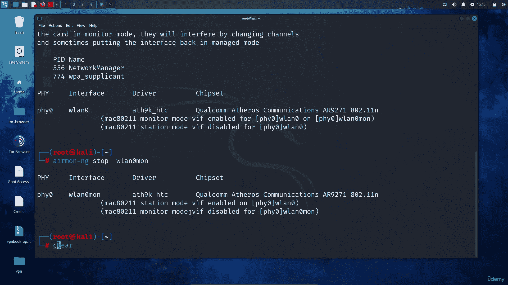

# Udemy - Complete Ethical Hacking Course 2026：Go From Zero to Hero：19：在网络适配器上启用监听模式 📡


在本节课中，我们将学习如何在你的无线网络适配器上启用监听模式。监听模式是无线安全测试中非常基础且重要的一项技能，它允许你的网卡抓取周围所有的无线数据流量，不管这些数据是否发给你自己。我们会先解释清楚监听模式到底是怎么回事，然后一起在终端里输入命令把它打开，接着教你怎么确认已经开启成功，最后再讲怎么把它关掉恢复正常上网。整个过程会尽量用大白话讲解，适合零基础的朋友跟着操作。

什么是监听模式：

监听模式是一种特殊的无线网卡工作模式。在日常上网时，网卡默认只接收发送给本机的数据包，而监听模式下，网卡会捕获当前无线信道上的所有流量，就像把网卡变成一个窃听设备。这个模式也被称为 RF Monitor，也就是无线射频监听模式。

核心概念可以用下面的代码形式来理解：

```
监听模式 = 捕获特定无线信道上的所有数据包
           与数据包是否发给本机无关
```

常用的操作工具是 airmon-ng，它专门用来开启和关闭无线网卡的监听模式。

准备工作：

在动手之前，需要先确保你的无线网络适配器已经连接到虚拟机，否则终端里根本找不到网卡设备。以下是检查步骤：

1. 点击虚拟机菜单中的“设备”。
2. 点击“USB”。
3. 确认无线网卡前面有勾选标记。

完成以上检查后，你的无线网卡就已经在虚拟机里可用了，接下来我们可以开始操作终端。

启用监听模式：

上一节我们介绍了监听模式的基本概念，本节中我们来看看如何在终端里把它真正打开。首先打开终端，建议使用 root 终端，这样可以获得更高的管理员权限，避免命令因为权限不足而执行失败。

输入以下命令查看当前无线网卡的状态：

```
iwconfig
```

运行之后，你会看到类似 wlan0 这样的无线网卡名称，它当前处于 managed 模式，也就是普通的托管模式，只能正常上网不能抓包。

接着使用 airmon-ng 启用监听模式：

```
airmon-ng start wlan0
```

注意，如果你的网卡名称不是 wlan0，请把命令里的 wlan0 替换成你自己的网卡名称，比如 wlan01 或其他名字。命令执行完成后，系统会显示新的监听接口名称，通常可能是 wlan0 或者 wlan0mon，具体取决于你的驱动程序和系统版本。

验证监听模式：

监听模式启用完成后，你会发现自己已经断开了互联网连接，这是正常现象，不必担心。你可以再次运行以下命令来确认当前状态：

```
iwconfig
```

此时你应该能看到网卡已经切换到了 monitor 模式，并且不再连接任何 WiFi 网络。如果你之前连着无线网，现在会被自动断开，因为网卡正在全时段监听信道，无法同时维持普通连接。

禁用监听模式：

如果你想恢复正常上网，需要把监听模式关掉。以下是停止命令：

```
airmon-ng stop wlan0
```

同样，请根据你的实际网卡名称替换命令中的 wlan0。执行之后，网卡会退出监听模式，重新回到托管模式，之后你就可以重新连接 WiFi 并正常上网了。

后续内容预告：

这是开启监听模式的一种方法。除了使用 airmon-ng 之外，还有手动配置的方式，以及使用自动化脚本，也就是懒人脚本，来一键开启或关闭监听模式，这些内容我们会在后续视频中详细讲解。



总结：


本节课中我们一起学习了监听模式的含义，掌握了如何使用 iwconfig 查看网卡状态，学会了用 airmon-ng start 开启监听模式，也知道了用 airmon-ng stop 来关闭它并恢复网络。希望你能在自己的环境中成功操作，下一节课见。
