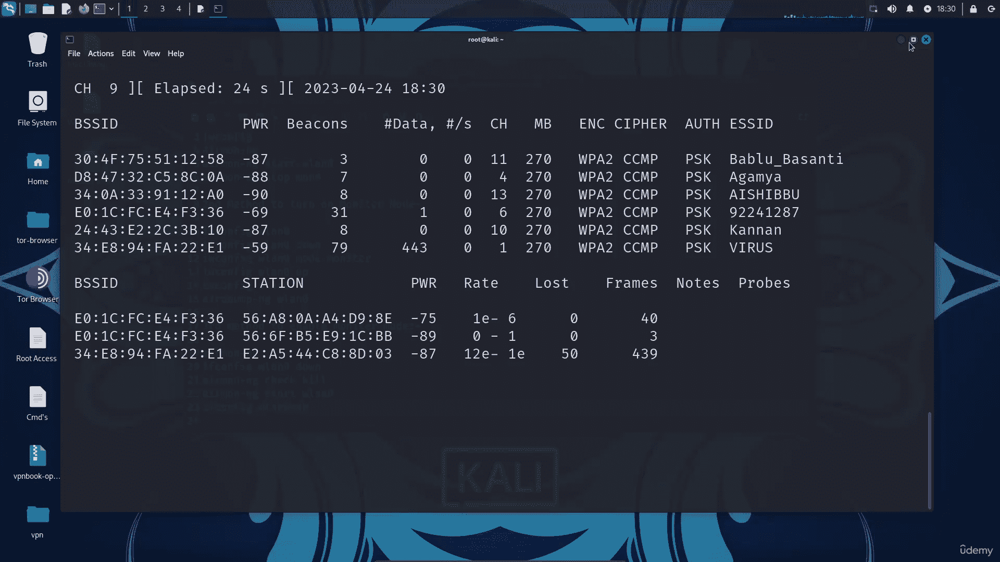
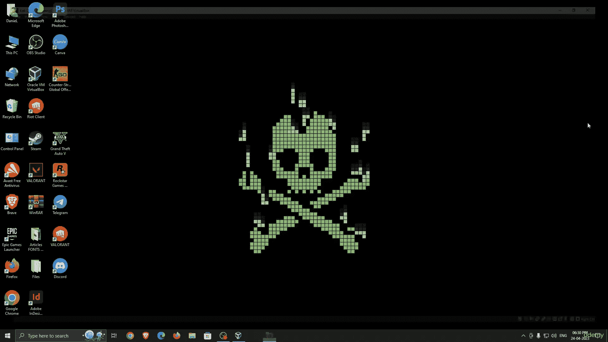

🛡️ Udemy - Complete Ethical Hacking Course 2026：p19：手动启用无线网卡监听模式


在本节课中我们将要学习如何在 Kali Linux 系统中，通过手动命令的方式启用无线网卡的监听模式。监听模式是进行无线渗透测试的基础，只有开启它，你才能扫描周围的 WiFi 网络，并进行后续的安全评估和数据收集。这节内容适合完全没有经验的初学者，我们会把每一步都讲清楚，确保你能跟着操作成功。


下面我们正式开始操作，第一步是打开系统终端，准备好输入命令的环境。


以下是你需要完成的初始准备：

```bash
# 打开终端后，输入你之前设置好的登录密码
# 确保你拥有管理员权限，因为后续命令需要 root 或 sudo 权限
```

在终端界面中，系统会提示你输入密码，输入完成后按回车确认。这时你就可以开始执行后面的命令了，不需要再做其他复杂的设置。


上一节我们介绍了如何打开终端，本节中我们来看看如何查询当前无线网卡的详细信息，以便确认自己的网卡名称。


首先输入查看网卡信息的命令：

```bash
airmon-ng
```

执行这条命令后，系统会输出一组详细信息，其中包括网卡驱动、芯片组以及当前的接口名称。你需要从输出结果中找到自己的无线网卡名称，在本示例中，该名称是 wlan0。记住这个名称，因为后面的每一步都会用到它。


确认了无线网卡名称之后，我们需要先把它关闭，这样才能安全地切换到监听模式，避免出现设备忙碌的报错。


使用以下命令将网卡接口关闭：

```bash
ifconfig wlan0 down
```

这条命令的作用是让网络适配器进入下线状态，断开当前的网络连接。执行之后，你的电脑会暂时失去无线上网能力，这是正常的，因为我们要把网卡从普通模式切换到监听模式。


网卡关闭之后，还有一些后台进程可能会占用无线网卡，导致监听模式无法正常启动，我们需要把这些阻塞进程清理掉。


执行以下命令：

```bash
airmon-ng check kill
```

该命令会终止所有正在阻塞无线网卡的进程。在演示中，它终止了一个名为 wpa_supplicant 的进程。清理完这些进程后，后续的启动操作就不会受到干扰，成功率会更高。


清理完阻塞进程后，我们就可以正式启动监听模式了，这是整个教程的核心步骤。


输入启动命令：

```bash
airmon-ng start wlan0
```

这里的 wlan0 就是你之前确认的无线网卡名称。命令执行成功后，系统会创建一个新的监听接口，通常命名为 wlan0mon。此时监听模式已经开启，网卡开始以监听方式工作，而不是普通的上网方式。


启动之后，我们需要确认监听模式是否真的生效了，不能只凭感觉，必须通过命令行验证。


使用以下命令检查接口状态：

```bash
ifconfig wlan0mon
```

或者也可以使用：

```bash
iwconfig wlan0
```

在输出结果中，你会看到 mode 显示为 monitors，这说明监听模式已经成功启用。此时系统可能会提示 network manager 未运行，这是正常现象，因为网卡现在的任务是监听无线信号，而不是维持普通的网络连接。


验证通过以后，你就可以开始扫描周围的无线网络了，看看附近有哪些信号可以被捕获。


运行扫描命令：

```bash
airodump-ng wlan0mon
```

执行后，终端会列出附近发现的无线设备和网络信息。在演示中，系统识别到了 wlan0mon 接口，并显示了周围邻居的 WiFi 以及讲师自己的 WiFi。你可以看到各个网络的信号强度、频道和加密方式等信息。


在使用监听模式进行实验时，有一点非常重要，必须引起每位学习者的重视，否则可能会触碰法律红线。


以下是操作时应当遵守的原则：



- 只在自己拥有的 WiFi 网络上进行测试和数据收集。
- 不要攻击邻居的 WiFi，也不要未经授权扫描或入侵他人网络。
- 渗透测试必须在合法授权的范围内进行，切勿擅自对他人网络发起任何形式的攻击。




本节课中我们一起学习了如何在 Kali Linux 上手动启用无线网卡监听模式。我们依次完成了打开终端、查询网卡信息、关闭网卡、杀掉阻塞进程、启动监听模式、验证模式是否生效以及扫描周围网络这些步骤。监听模式开启后，你就可以开始进行无线渗透测试了。下节课我们将介绍如何使用懒人脚本更快捷地启用监听模式，敬请期待。
