Udemy - Complete Ethical Hacking Course 2026：21：Nmap入门基础 🛡️

在本节课中，我们将一起学习 Nmap 这个网络扫描工具。Nmap 是一款免费开源的网络映射软件，广泛用于网络探索、网络管理以及安全审计。无论你是刚开始接触网络安全的新手，还是想要了解如何发现主机和服务的学习者，这节课都会用大白话把基础概念讲清楚。我们会先认识 Nmap 的基本用途，然后看看怎么查询 IP 地址，接着尝试扫描一个专门用于练习的目标网站，最后了解扫描时需要注意的法律和道德边界，确保大家在学习技术的同时也懂得合规操作。

## 什么是 Nmap 🔍

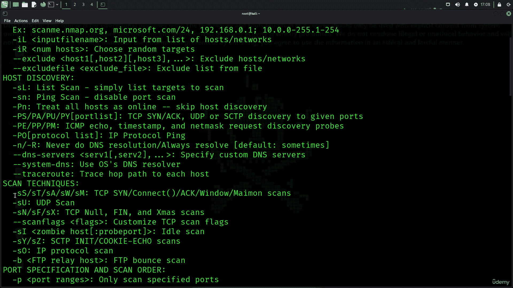

为了让你快速上手，我们先从 Nmap 最核心的定义开始聊起。

Nmap 的全名是 Network Mapper，中文可以理解为“网络映射器”。它是一个完全免费且开源的工具，最早是在 1997 年发布的，到目前为止已经发展成了网络安全领域里非常经典的一款软件。简单来说，Nmap 的主要作用就是帮你扫描网站或者 IP 地址，然后收集相关信息。通过 Nmap，你可以发现计算机网络里有哪些主机在运行，哪些服务被开启，还能进一步识别出潜在的漏洞和安全风险，最后把这些信息整理成一张网络地图，方便你整体掌握目标环境的情况。

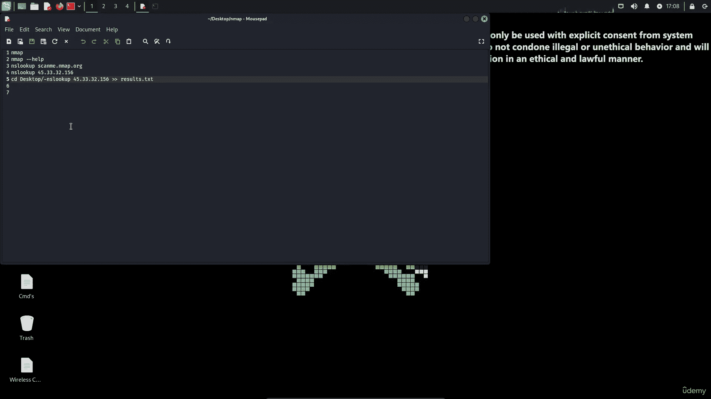

## Nmap 的帮助命令与常用参数 ⌨️

了解了 Nmap 是干什么用的之后，接下来我们来看看如何在终端里使用它，尤其是怎么查看可用的命令和参数。

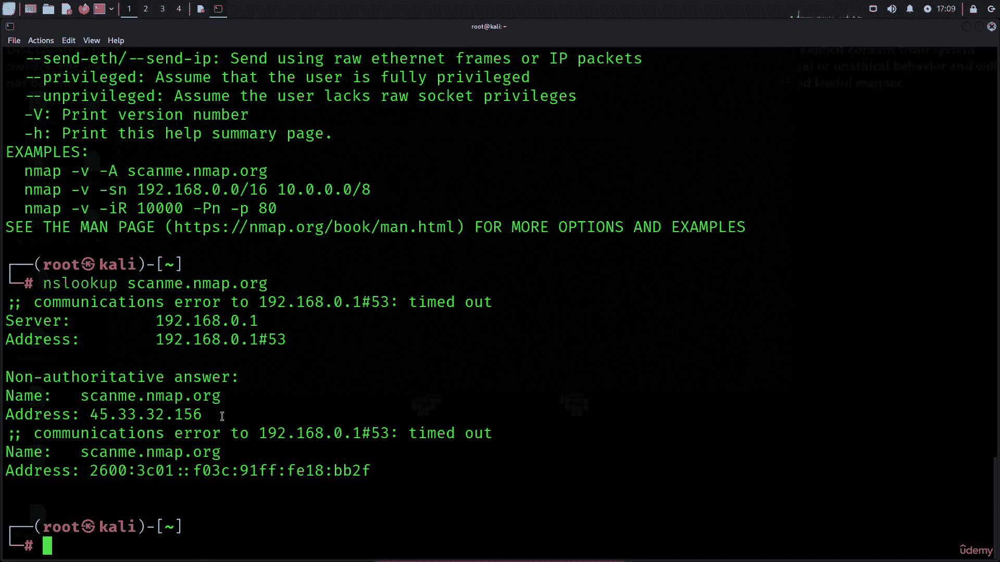

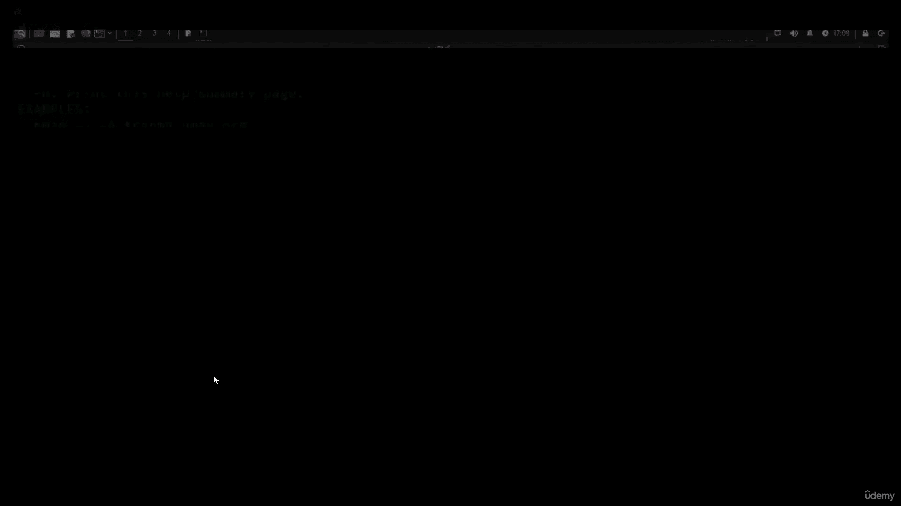

如果你想了解 Nmap 提供了哪些功能，最直接的方法就是查看它的帮助文档。在命令行中输入下面这个命令，就能列出不同类型的参数说明。

```bash
nmap -h
# 或者
nmap --help
```

执行之后，你会看到一长串输出内容，包括目标规范、主机发现命令、扫描技术、端口规范以及扫描顺序等选项。其中有一个参数特别值得初学者注意，那就是 -sS。这个参数代表的是秘密扫描，也可以叫隐蔽扫描，扫描过程相对比较低调，不容易被目标系统轻易察觉。除了扫描技术之外，Nmap 还允许你指定要扫描的端口范围，并调整扫描的先后顺序，这些命令数量比较多，暂时不需要全部背下来，先有印象即可。

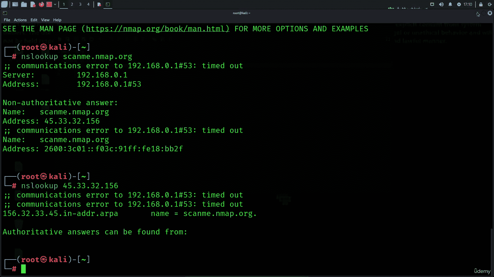

以下是 Nmap 常见的命令分类，供你初步了解：

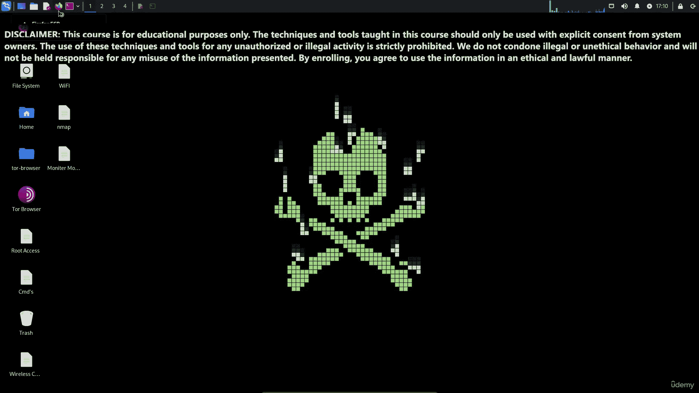

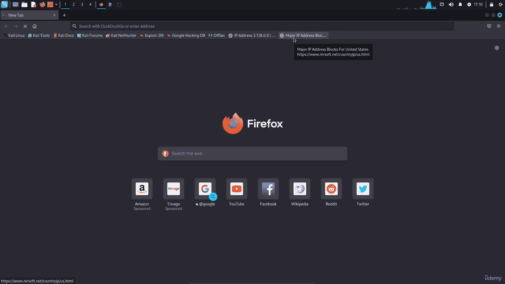

- 目标规范：指定你要扫描的网站域名或 IP 地址。
- 主机发现命令：用来确定网络中哪些主机是存活的。
- 扫描技术：例如 -sS 进行隐蔽扫描。
- 端口规范：选择扫描哪些具体端口。
- 扫描顺序：决定扫描目标的先后顺序。

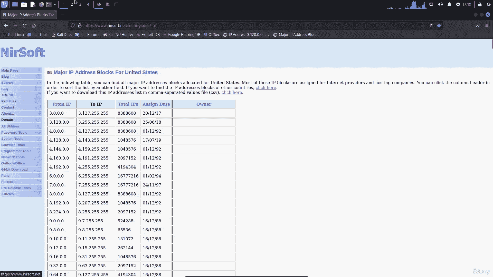

## 使用 nslookup 查询 IP 地址 🌐

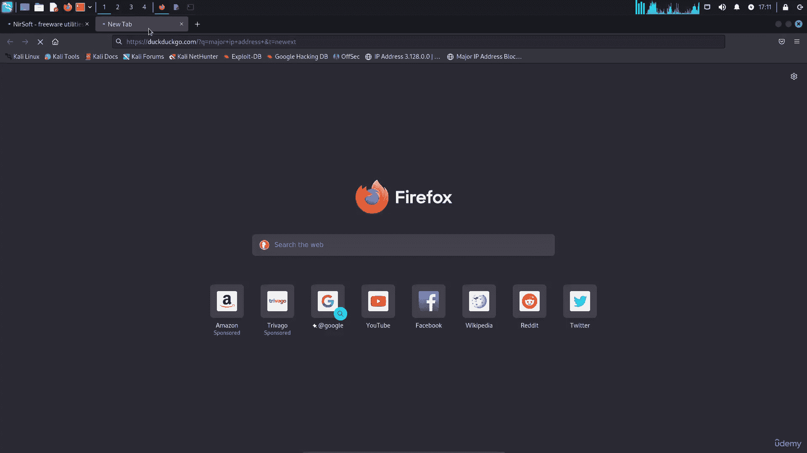

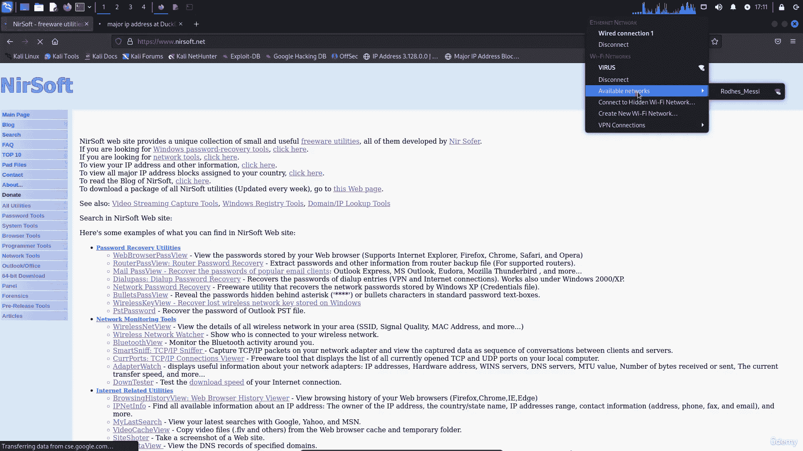

在正式运行 Nmap 扫描之前，我们通常需要知道目标的 IP 地址，这时候就可以用到 nslookup 工具了。

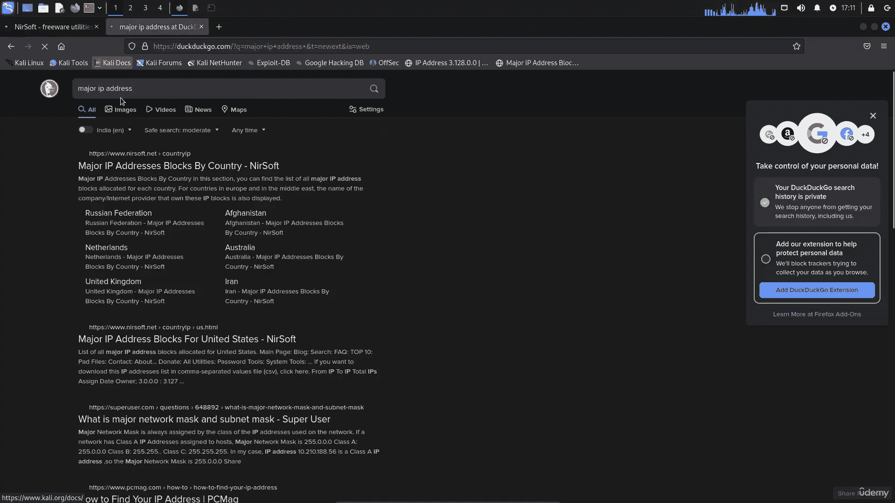

nslookup 是一个非常实用的小工具，专门用于查询域名对应的 IP 地址。操作方法也很简单，直接在终端输入 nslookup，后面跟上你想查询的网站，回车之后它就会显示地址类型以及查询结果。比如我们可以拿一个网站试一下，复制出来的 IP 地址大概是 45.33.32.156。有了这个地址之后，你还可以反过来再用 nslookup 查询一次，这时候它会把 IP 地址还原回对应的域名，结果可能会显示为 scanme.nmap.org。通过这样来回验证，你就能确认目标网站的真实网络标识了。

```bash
nslookup example.com
nslookup 45.33.32.156
```

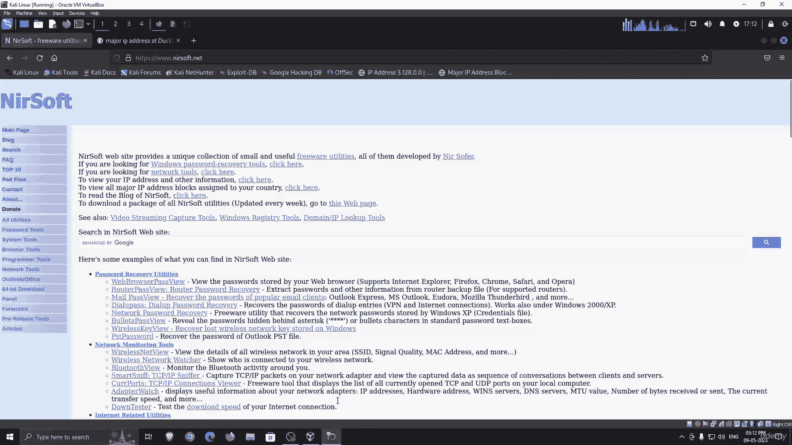


## 获取 IP 地址块与地理位置信息 📍

如果你不仅想查询单个网站，还想了解某个国家或地区有哪些 IP 地址段，可以借助一些在线资源来辅助分析。

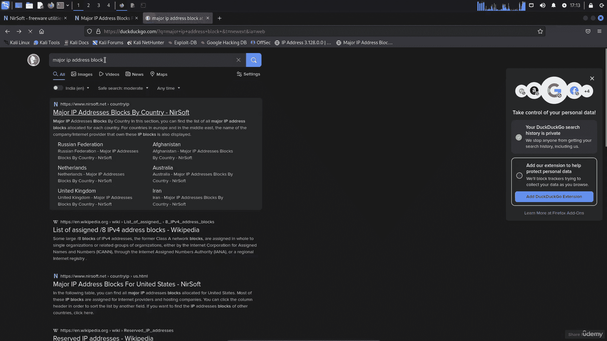

打开浏览器，搜索“主要 IP 地址块”或者类似的关键词，找到相关网站后，你可以看到不同国家的 IP 地址列表。比如选择美国，页面就会展示出大量属于美国的 IP 地址段。你可以随便挑选一个感兴趣的 IP，然后再去使用 IP 查询网站，也就是 GeoIP 查询工具。通过输入这个 IP 地址，网站能告诉你它的地理位置，包括纬度、经度、所在的国家、州、城市，甚至还有所属的互联网服务提供商。在示例中，某个 IP 地址显示位于美国俄亥俄州哥伦布市，组织机构是 Amazon Technologies。掌握了这些信息后，你就可以拿着 IP 地址去用 Nmap 进行扫描了。

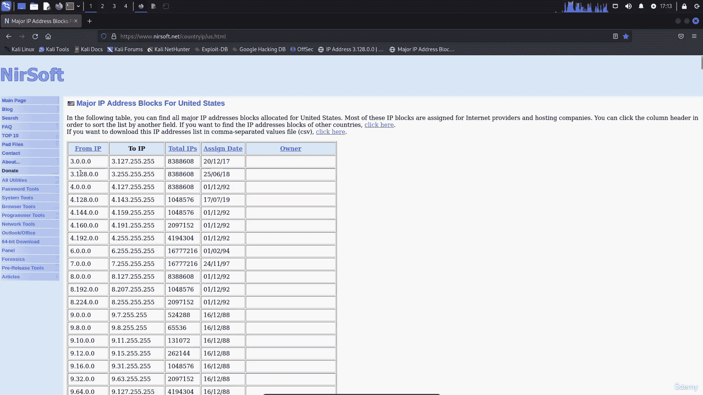

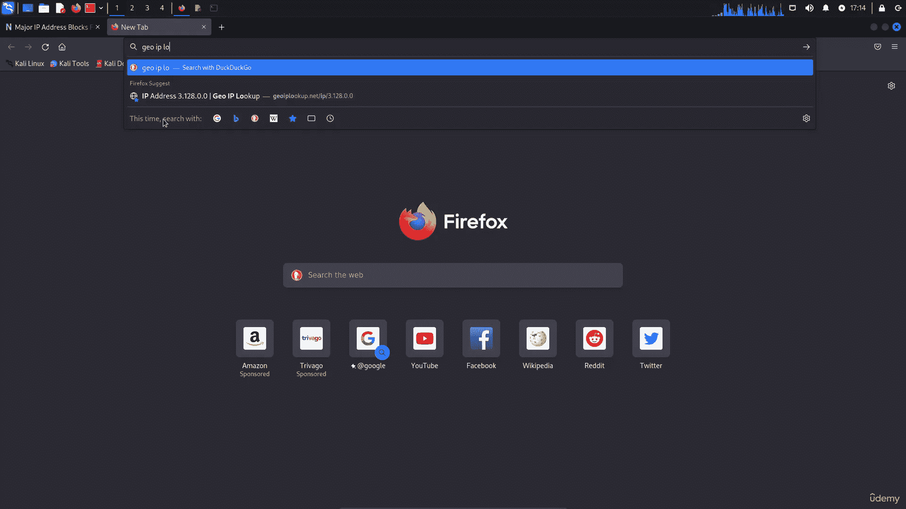

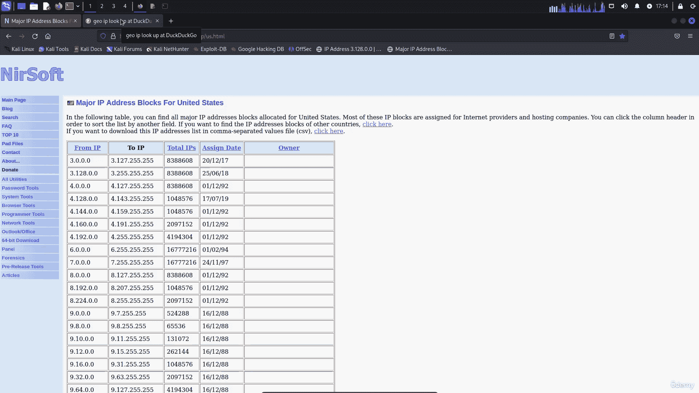

以下是通过 IP 地址可以查到的常见信息：

- 地理位置：国家、州、城市。
- 坐标：纬度和经度。
- 网络运营商：互联网服务提供商名称。
- 组织机构：IP 地址所属的公司或机构。

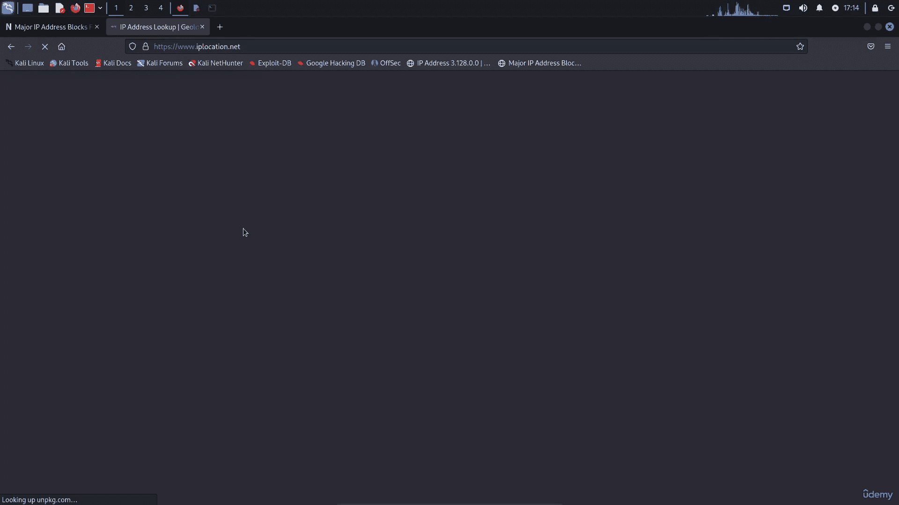

## 扫描 scanme.nmap.org 与注意事项 ⚠️

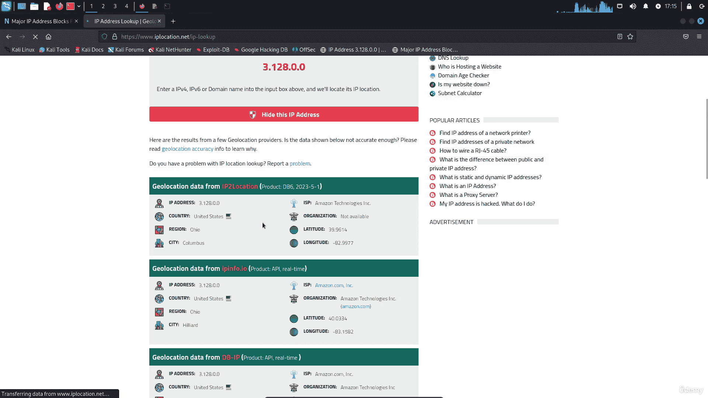

准备好目标 IP 或域名之后，就可以尝试用 Nmap 进行实际扫描了，不过在动手之前，有一些重要的规则必须先搞清楚。

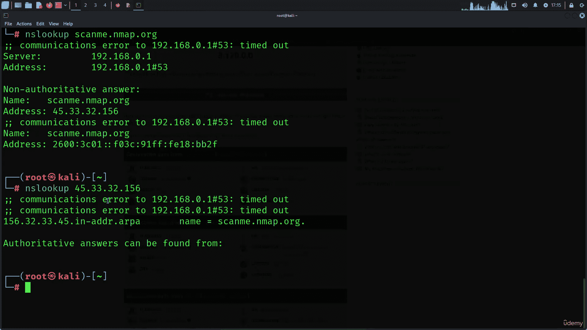

Nmap 官方提供了一个专门用于练习的网站，地址是 scanme.nmap.org。你可以直接用 Nmap 扫描这个网站，观察哪些端口是开放的，哪些是关闭的，从而收集一定的数据。不过，虽然这个网站允许被扫描，但面对其他任意网站，绝对不能随意进行扫描行为。在没有获得目标网站所有者明确许可的情况下擅自扫描，可能会触犯法律，这是非常严肃的红线。此外，即使是针对允许扫描的目标，也不要一天扫描几百次，更不能拿这个网站来测试密码暴力破解工具。简单来说，有授权才能扫，扫的次数要适度，用途必须合法合规。

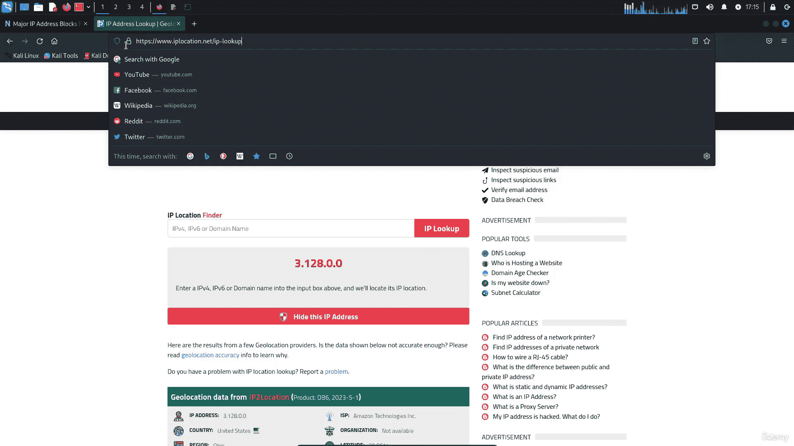

```bash
nmap scanme.nmap.org
```

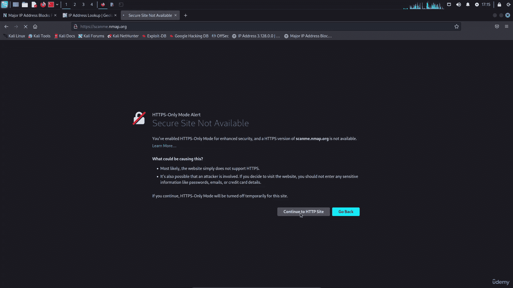

以下是扫描时需要遵守的基本原则：

- 必须事先获得目标网站所有者的授权。
- 未经许可不得对任意网站进行扫描。
- 避免高频重复扫描，例如每天扫描数百次。
- 禁止用于密码暴力破解等违法行为。

## 保存扫描结果 💾

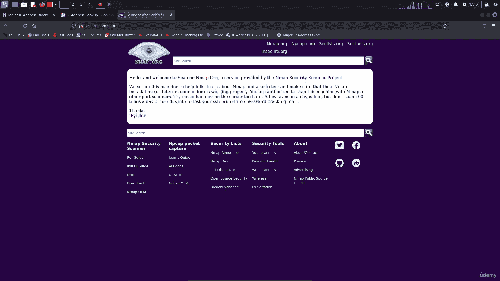

扫描完成之后，你可能希望把结果保存下来，以便日后查看或分享，这时候可以把输出重定向到文本文件中。


保存数据的方法也很直接，只需要在命令后面加上重定向符号和文件名，扫描结果就会以文本格式写入指定文件。比如你可以把查询结果保存为 results.txt，然后去桌面上找到这个文件，打开就能看到完整的扫描内容。这样即使关闭了终端，你的扫描记录也不会丢失，方便后续分析。

```bash
nslookup scanme.nmap.org > results.txt
# 或者保存 Nmap 扫描结果
nmap scanme.nmap.org > results.txt
```

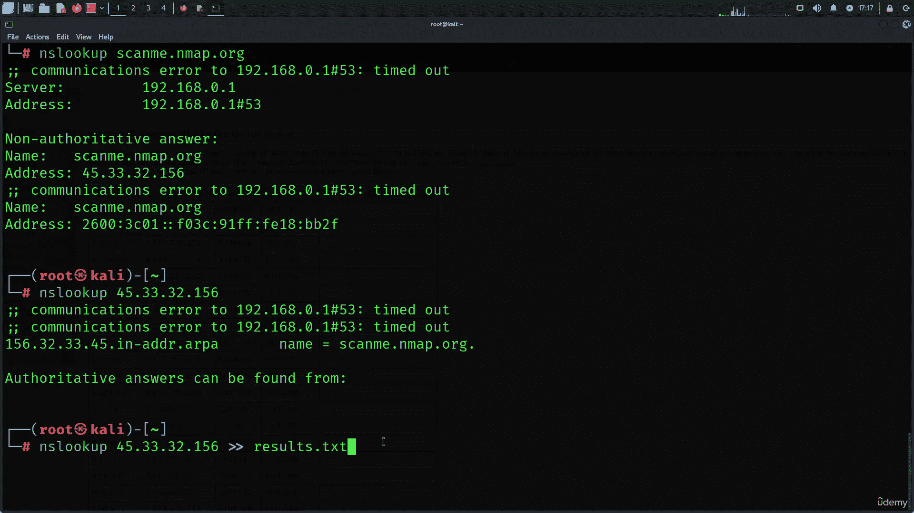

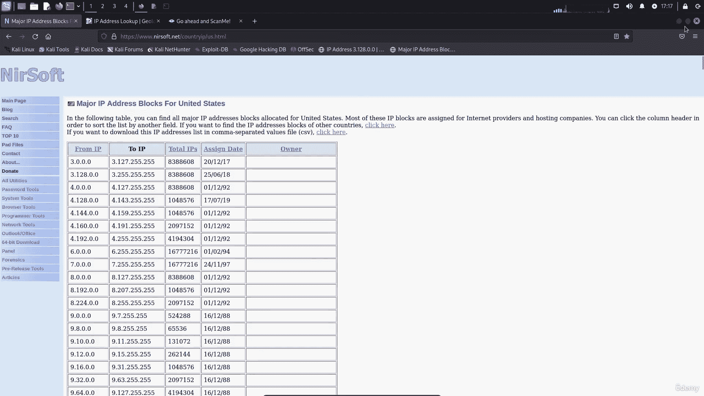

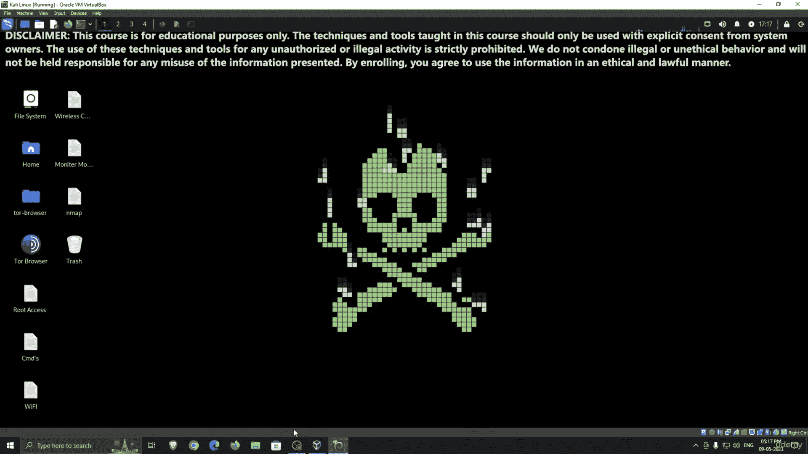

本节课中，我们一起学习了 Nmap 的基本概念，了解了它是如何用于网络探索和安全审计的，还掌握了查看帮助命令、使用 nslookup 查询 IP 地址、获取 IP 地理位置信息的方法。之后我们尝试扫描了官方练习网站 scanme.nmap.org，并重点强调了未经授权扫描可能带来的法律风险，最后学会了如何把扫描结果保存到文本文件中。下一节课，我们将深入探讨 Nmap 的更多功能，并演示一次完整的扫描过程。
