# Udemy - Complete Ethical Hacking Course 2026：22：Nmap 高级扫描 🔍

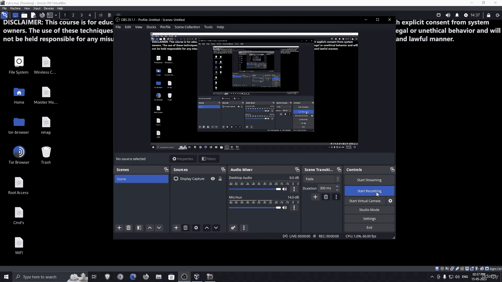

在本节课中，我们将学习如何使用 Nmap 进行高级网络扫描。Nmap 是网络安全领域中非常经典的一款工具，主要用于发现目标主机上的开放端口、运行中的服务以及可能的操作系统信息。无论你是想扫描公网上的测试网站，还是想查看自己本机和局域网的网络状况，本节课都会手把手教你具体的操作方法。我们会先打开具备 root 权限的终端，输入基础的 nmap 命令，然后学习如何把扫描结果保存到桌面文件里，以免因为不小心关闭终端而导致所有进度丢失。最后，我们还会打开保存的报告文件，查看扫描日期、端口状态等关键信息。废话不多说，我们现在就进入正题，先来看看如何打开终端并开始使用 Nmap。

首先，你需要在系统中打开 root 终端，也就是拥有管理员权限的命令行窗口。在桌面上找到终端图标，点击打开之后，系统会弹出密码输入框，请输入你的账户密码并按下回车键确认。密码输入正确后，终端界面就会出现，此时你就可以开始输入各种 Nmap 命令了。整个打开终端的过程非常简单，不需要任何特殊的技术背景，只要能够使用鼠标点击图标并输入文字即可。打开终端之后，屏幕上会显示当前的用户名和主机名，这意味着你已经具备了执行网络扫描的基本环境，接下来就可以输入 nmap 相关的指令了。

接下来，我们来看看 Nmap 最基本的使用方式。直接在终端里输入 `nmap` 并按下回车键，系统会列出大约 13 种不同的扫描示例，以及对应的 13 条命令，这些命令可以用来完成不同类型的扫描任务。对于初学者来说，没有必要强行死记硬背所有命令，一个比较实用的做法是先在记事本里把常用的命令写下来，需要用到的时候直接复制粘贴进终端。这样既能节省时间，也能避免因为手动输入错误而导致命令无法运行。掌握了这个基础命令之后，你就已经迈出了使用 Nmap 进行网络扫描的第一步。

以下是本节课中会用到的几个核心命令。

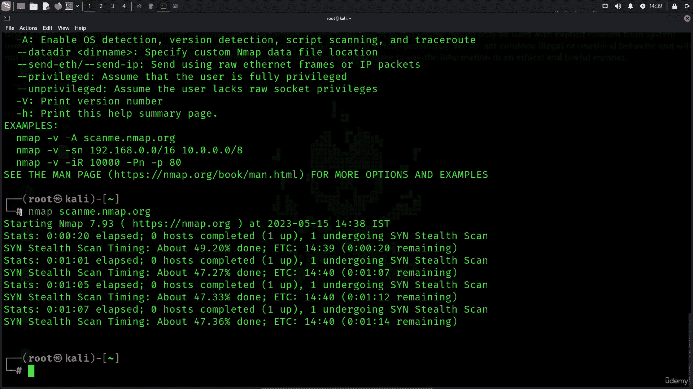

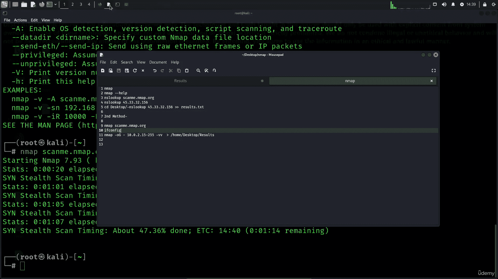

- `nmap`：查看 Nmap 的帮助信息和基础扫描示例。
- `ifconfig`：查看本机的 IP 地址信息，例如 `10.0.2.15`。
- `nmap -oG <文件名> <目标>`：执行扫描，并将结果以 grepable 格式保存到指定文件中。

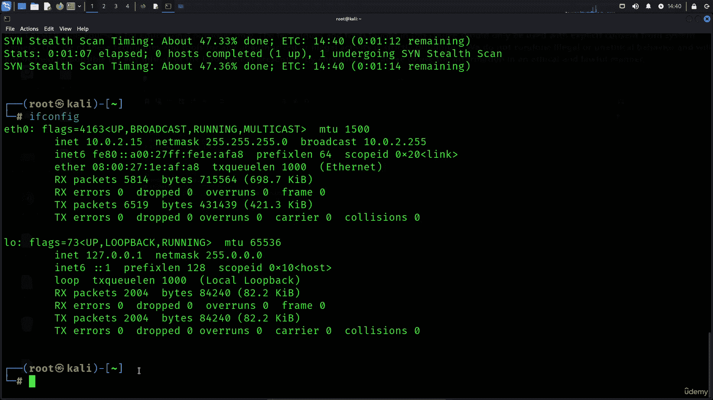

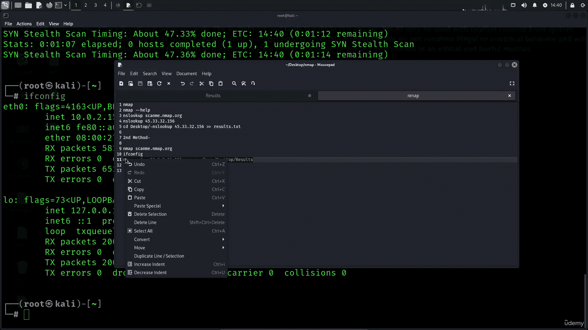

有了基本命令之后，我们可以尝试扫描一个公开的测试网站，也就是 `scanme.nmap.org`。在终端中输入对应的扫描命令并按下回车，Nmap 就会开始对该网站进行探测。这个过程可能会持续比较长的时间，大概需要 10 到 15 分钟，具体时长取决于你的网络状况和目标网站的响应速度。在扫描过程中，你会看到终端显示当前的进度百分比，比如 49% 或者 47.33%，同时也会提示还剩多少秒，Nmap 正在进行隐蔽扫描，试图发现目标网站中哪些端口是开放的，哪些端口是关闭的。你不需要一直盯着屏幕等待，可以让扫描在后台运行，但有一点非常重要，千万不要在扫描过程中直接关闭终端窗口，否则当前的所有进度都会立即中断，之前的结果也会全部丢失。

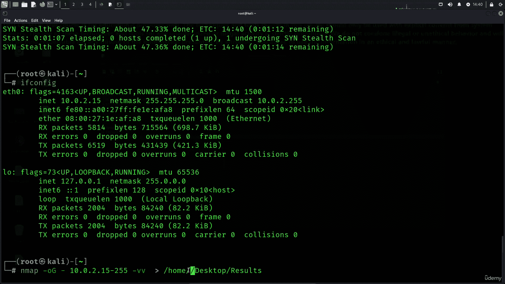

为了避免扫描结果因为关闭终端而丢失，我们可以把扫描内容保存为文本文件，并放在桌面上方便日后查看。使用 `-oG` 参数可以将输出保存为 grepable 格式，这个命令大致写作 `nmap -oG output.gnmap <目标IP>`。在指定保存路径时要特别注意大小写，例如桌面的完整路径是 `/home/kali/Desktop`，其中的 D 必须是大写，否则文件可能无法正确保存。你可以点击保存后的文件，选择“属性”来确认具体的文件路径，确保路径没有任何输入错误。完成这些设置之后，扫描结束后的报告就会自动写入桌面的文件中，即使你后来关闭了终端，数据依然安全。

以下是保存扫描结果时需要注意的关键点。

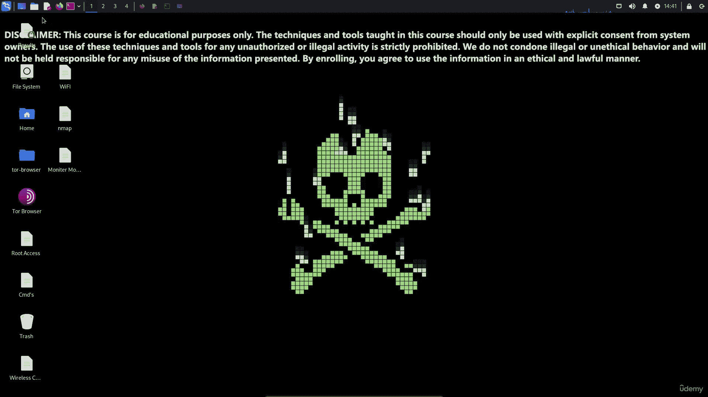

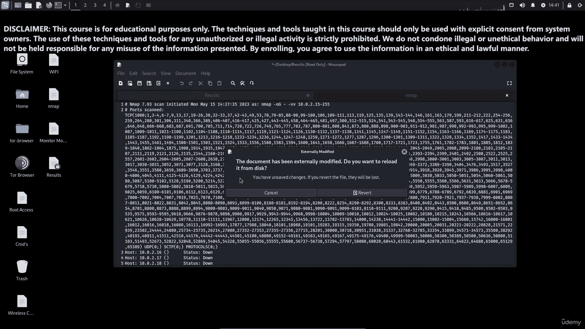

- 输出参数：`-oG` 表示以 grepable 格式保存，方便后续用文本工具查看。
- 文件路径：保存到桌面的完整路径，例如 `/home/kali/Desktop`。
- 大小写敏感：路径中的 `Desktop` 必须大写 D，否则保存会失败。
- 终端不要关闭：扫描过程中关闭终端会导致所有进度清空。

除了扫描外部网站，我们还可以扫描自己机器的 IP 地址，或者整个局域网里的其他设备。首先使用 `ifconfig` 命令查看本机 IP，假设系统显示的地址是 `10.0.2.15`。接着输入 Nmap 命令对该 IP 进行扫描，并加上子网掩码或者网段范围，比如扫描整个 `255` 范围内的主机。扫描完成之后，结果同样会被保存到桌面上的文件中。通过这种方式，你就可以清楚地知道自己本机或者局域网里哪些设备目前在线，哪些端口被占用，从而对本地网络的安全状况有一个直观的了解。

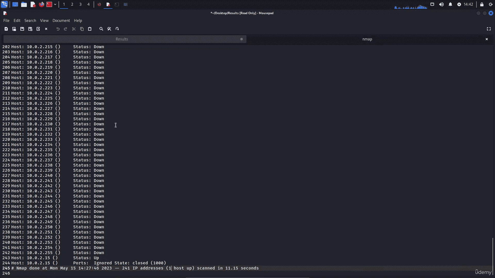

扫描结束后，双击桌面上的结果文件将其打开，你就可以看到详细的扫描报告。报告里会显示扫描发起的具体日期和时间，以及所有端口的扫描情况。在扫描报告中，大部分端口的状态可能显示为 `down`，也就是关闭状态，而只有一个或少数几个端口显示为 `up`，表示该端口是开放并且运行正常的。你可以忽略那些标记为 `closed` 的端口，重点关注状态为 `up` 的端口，因为它们可能代表着潜在的攻击面或者服务入口。报告中还会显示扫描所用的总时间，以及有多少台主机处于活跃状态，此外还可能包含操作系统探测的相关信息，帮助你判断目标设备运行的是什么系统，这些信息对于后续的安全评估非常有价值。

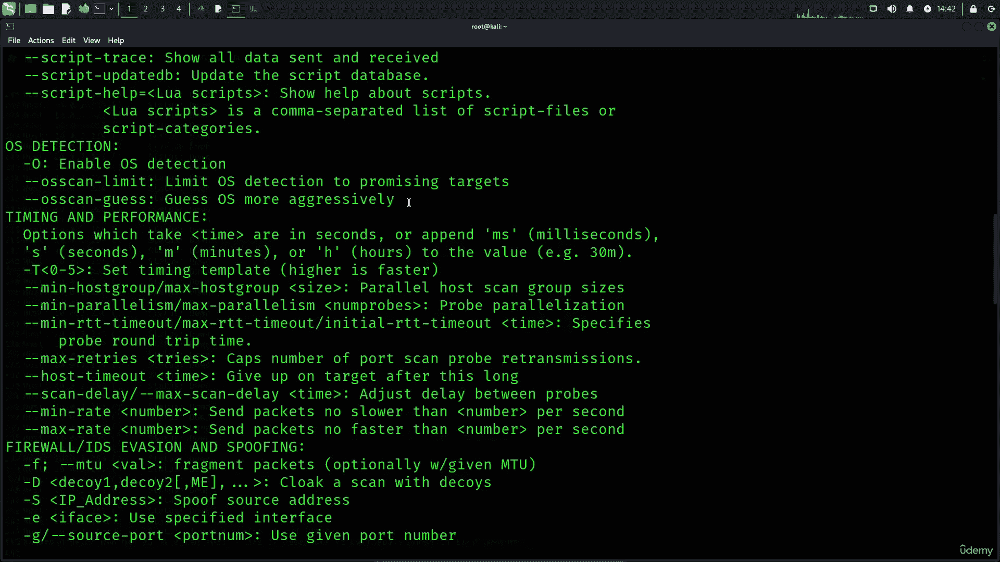

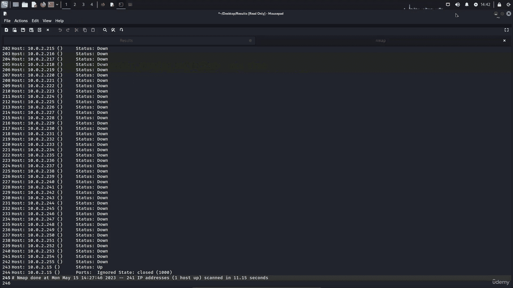

本节课中，我们一起学习了如何使用 Nmap 进行高级网络扫描。具体内容包括打开 root 终端、输入基础的 `nmap` 命令、扫描 `scanme.nmap.org` 等公网目标、使用 `ifconfig` 查看本机 IP、扫描本地网络、利用 `-oG` 参数将扫描结果保存到桌面文件，以及如何打开和解读扫描报告，识别哪些端口是开放的，哪些端口是关闭的。下一节课我们将继续探讨 Nmap 中更加激进的扫描方式，感谢观看，我们下节课见。
