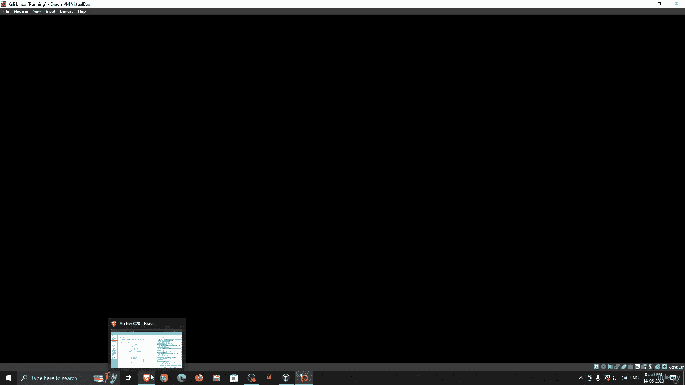
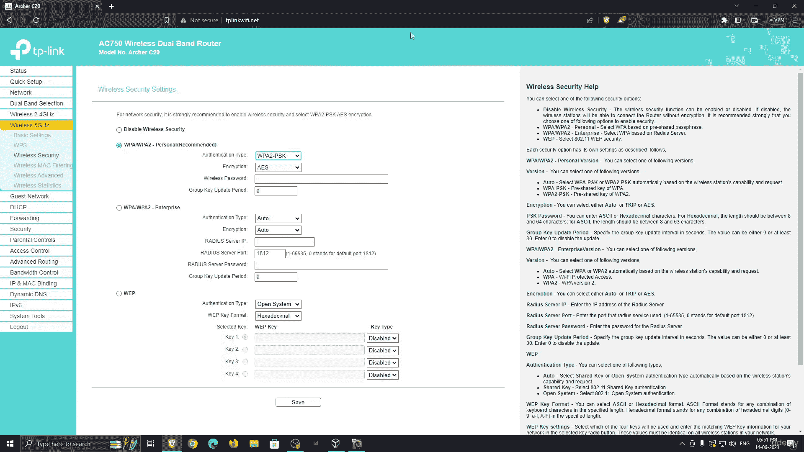
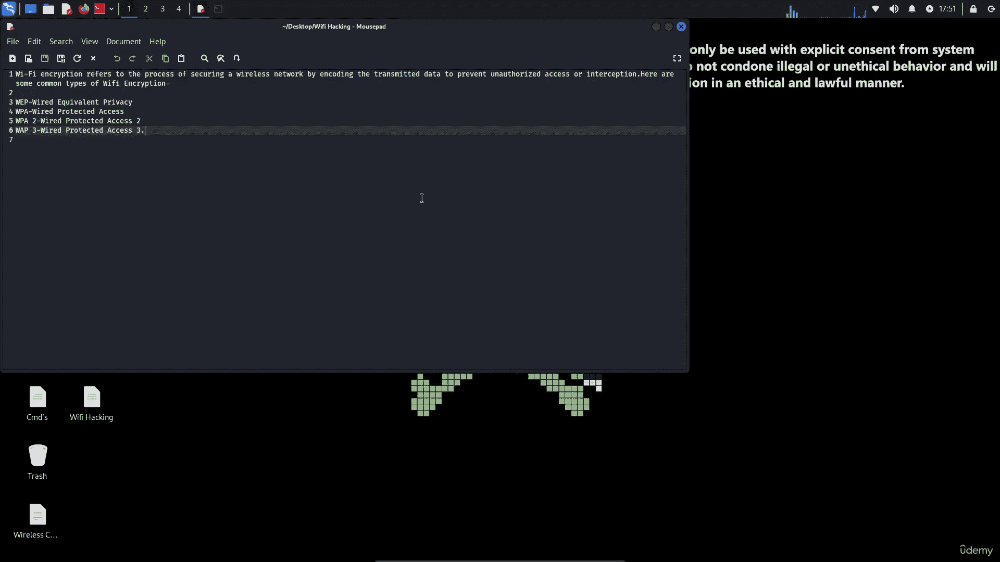
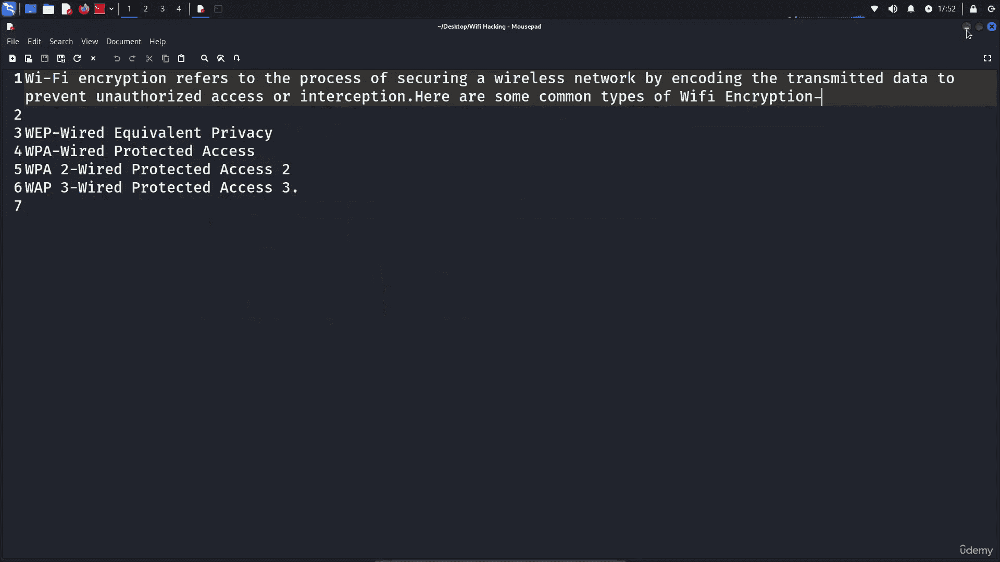
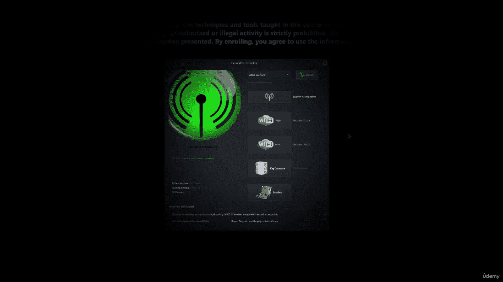

📶 道德黑客完整课程 2026：22：WiFi 黑客入门


概述

在本节课中，我们将一起学习 WiFi 黑客的基础入门知识。课程内容包括 WiFi 的工作原理、不同种类的 WiFi 加密方式，以及如何对无线网络进行初步的渗透测试。我们将使用 Kali Linux 操作系统，配合无线网络适配器和终端命令，查看设备当前的连接状态，并认识常见的加密标准与攻击工具。即使你是完全的初学者，也能跟着步骤逐步理解每一部分的内容。


环境准备



接下来，我们先来搭建实验环境，确保你的系统能够正常识别无线适配器。以下是具体操作步骤：

- 打开 Kali Linux 系统，将无线网络适配器连接到电脑，然后启动终端。
- 使用 root 权限进入终端，密码设置为 kali linux，确保系统已经正常开启。
- 按下控制加号组合键，放大终端窗口，方便查看输出内容。
- 输入 ifconfig 命令，查看有关 wlan0 的详细网络信息。
- 确认输出中包含 inet 和以太网 eth0 相关内容，这表明你的无线适配器已经成功连接。


完成上述操作后，如果你的系统已经连接到 WiFi，就可以尝试访问路由器管理页面了。登录路由器的常见方法如下：

- 在浏览器地址栏输入 tp link，打开 TP-Link 路由器页面。
- 如果你使用的是 D-Link 或 TP-Link 路由器，输入 tp link wifi net 作为访问地址。
- 使用 admin 作为用户名，使用 admin 作为密码，登录路由器后台。


登录成功后，你可以在右侧找到无线安全帮助选项，查看并选择适合的安全选项，了解不同的加密类型。之后关闭页面，我们将回到 Linux 环境继续学习。






WiFi 加密类型介绍

下面是 WiFi 网络常见的几种加密标准，我们逐一来看：

- WEP：全称 Wired Equivalent Privacy，是 WiFi 网络最早使用的加密标准。它只使用 40 位或 104 位加密密钥，现代黑客方法可以轻松破解，因此不再安全。
- WPA：全称 Wi-Fi Protected Access，是 WEP 的下一个版本，也是 WPA2 的早期形式。
- WPA2-PSK：现代 WiFi 系统广泛使用的加密方式，通常配合 AES 加密算法，安全性较高。
- WPA3：目前最强的现代 WiFi 加密标准，也是作者目前使用的加密方式。


那么，什么是 WiFi 加密呢？简单来说，加密就是将普通文本转换为密文的过程，目的是防止未授权访问。这样一来，其他人或黑客就无法读懂你的密码和传输数据。WiFi 加密的核心公式如下：

```text
密文 = 加密算法(明文, 密钥)
```

目前常见的加密类型包括 AES、WPA、WPA2 等，这些技术是为未来网络和新一代设备开发的。以上内容只是简要介绍，下一节我们将深入探讨具体的攻击工具。另外，视频中作者还提到下周见，并再次说明 Kali Linux 是他的登录密码。


无线攻击工具概述



在 Linux 系统中，有一些专门用于无线网络攻击的工具。以下是常见的几种：

- wifite：一个用 Python 编写的脚本，用于自动化无线审计。
- aircrack-ng：常用的无线网络安全审计工具集，支持字典攻击等方式。
- FoneWiFi Cracker：下一节视频中将使用的工具，需要 root 权限才能运行。


使用这些工具时，你还需要一款支持监听模式的无线网络适配器，并且该适配器必须开启监听模式，才能正常进行无线攻击测试。我们将在下一节课程中演示这些软件的具体使用方法，本节暂时不展开操作。


总结



本节课中我们一起学习了 WiFi 黑客的基础入门知识。我们准备了 Kali Linux 环境和无线适配器，通过 ifconfig 命令确认设备连接，访问了路由器管理页面并查看了加密选项。我们介绍了 WEP、WPA、WPA2-PSK 和 WPA3 四种主要加密标准，并解释了 WiFi 加密的基本原理，即把普通文本转换为密文以防止未授权访问。最后，我们概述了 wifite、aircrack-ng 和 FoneWiFi Cracker 等无线攻击工具，并强调了监听模式网络适配器的必要性。下一节课程中，我们将继续探讨具体的无线攻击实操。

