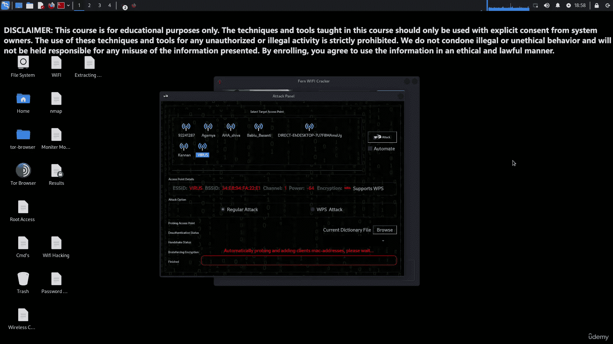
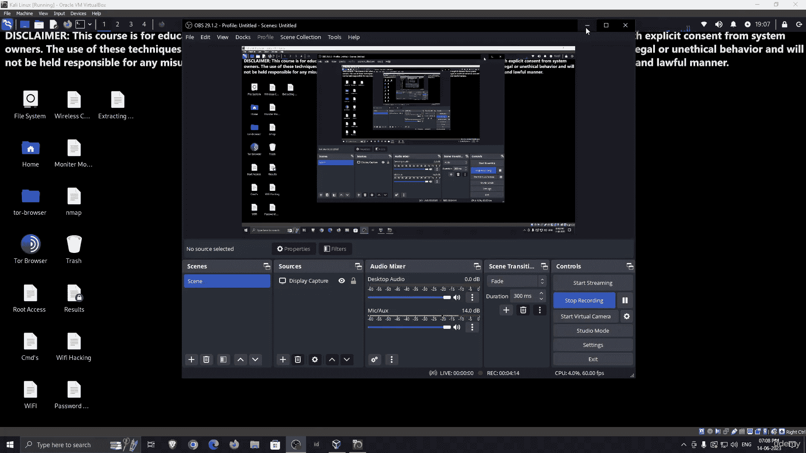
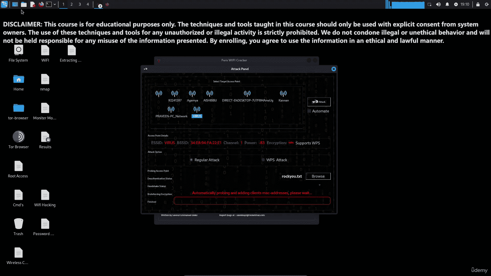
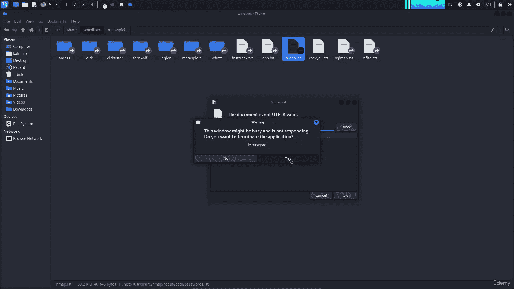
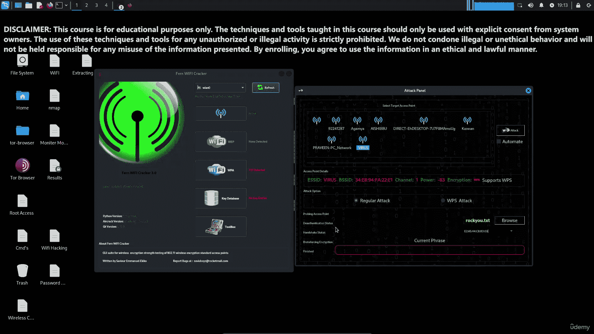

# Udemy - Complete Ethical Hacking Course 2026：23：使用Fern Wifi Hacker攻击WiFi 📶

在本节课中我们将要学习如何使用Fern Wifi Hacker这个工具来攻击WiFi网络。我们会从准备虚拟机和无线网卡开始，一步步讲解如何扫描周围的WiFi信号，如何选择目标网络，如何捕获握手包，最后如何使用字典列表来破解密码。所有的操作都会在Kali Linux系统中完成，并且只会在自己拥有授权的网络上进行演示，绝对不能拿去攻击邻居或者陌生人的WiFi，那是违法的。

## 1. 准备虚拟机与无线网卡 🖥️

上一节我们介绍了渗透测试的基本环境搭建，本节中我们来看看如何把无线网卡接入虚拟机。

首先你需要打开VirtualBox，然后启动Kali Linux系统。启动完成后，你要把物理上的无线网卡连接到虚拟机里。原文中提到的适配器叫Etheros，其实就是常见的无线网卡型号。连接成功后，你就能在系统里看到当前环境下可用的不同WiFi网络，其中就包括你自己的无线网络。

如果你不确定无线适配器是否已经连接好，可以按照下面的步骤检查：

以下是检查无线适配器的操作步骤：
- 点击USB菜单选项。
- 在下拉列表中找到你连接的适配器，比如原文里提到的Arowose U 9,3，或者你自己手头有的其他型号。
- 点击该适配器完成挂载。

## 2. 启动Fern Wifi Hacker工具 🛠️

完成无线网卡连接之后，我们需要打开攻击工具。

等到适配器连接成功后，你可以点击界面上的某个图标，然后进入wireless attacks选项，接着选择fern wifi cracker。这个程序需要root权限才能运行，所以系统会提示你输入密码。在Kali Linux里，默认密码通常是kali，输入正确后工具就可以启动了。

启动后，你会看到一个名为WPA scan的功能，它的作用是扫描周围使用WPA或者WEP加密的WiFi网络。WEP是Wired Equivalent Privacy的缩写，WPA是WiFi Protected Access的缩写。现在大多数WiFi都使用WPA或WPA2加密，所以扫描结果里大概率全是这些类型。

工具启动时可能会弹出一个关于专业版本的提示，问你是否要访问官方网站，直接点击取消或者拒绝即可。

## 3. 选择网卡接口并切换监听模式 📡

接下来我们要告诉工具使用哪块网卡来进行无线扫描。

你必须在工具里选定一块网卡接口，原文中选择的是`wlan0`。选择之后，无线网卡会短暂断开连接，然后自动进入监听模式，也就是monitor mode。在这个模式下，网卡可以捕获空气中传播的所有无线数据包，而不仅仅是发给自己电脑的数据。

工具界面上还会有一些提示信息，原文中说暂时不需要逐条阅读，直接跳过也可以。

## 4. 扫描可用WiFi接入点 🔍

有了监听模式之后，就可以开始搜索周围的WiFi信号了。

点击scan access points按钮，工具就会开始扫描接入点。扫描结束后，它会列出检测到的网络数量和加密类型。原文视频里显示检测到了七个使用WPA加密的网络，当然实际数量会根据你所在的环境而变化。



如果你想确认某个网络具体使用什么加密方式，可以在浏览器里搜索类似TP link Wifi dot net这样的信息，或者参考之前视频中展示过的方法。



以下是扫描结果中可能出现的关键字段：
- SSID：也就是WiFi的名称。
- BSSID：也就是路由器的MAC地址，用于唯一标识接入点。
- 加密类型：WPA、WPA2、WEP或者WPS。
- 信道：无线信号所在的频道，原文示例中是信道1。

这里要注意，WPS是一种比较旧的PIN码加密方式，WEP也是非常古老的加密标准，现代网络基本已经不再使用，所以我们主要关注WPA和WPA2。

## 5. 选择目标网络与字典文件 🎯

扫描出目标网络之后，就要决定攻击哪一个，并准备破解密码所需的字典。

出于法律和道德考虑，我们绝对不会去攻击邻居或者没有授权的WiFi网络。任何未经许可的入侵都是违法行为，必须获得网络所有者的明确同意才能进行测试。原文作者只会在自己的网络上演示，你也应该严格遵守这个原则。

在选择目标时，你可以点击browse按钮来浏览文件，或者直接使用系统自带的字典文件。原文中使用的是桌面上的一个文件，名字类似于`rockyou.txt`，这是一种非常经典的密码字典列表。

如果你想尝试自动化攻击，工具里也有automate选项，但原文作者没有使用这个功能，而是手动选择字典文件进行演示。

## 6. 捕获握手包与字典攻击 🔑

启动攻击之前，必须满足一个关键条件：目标WiFi当前必须有一个设备已经连接。

工具需要捕获一个握手包，也就是Handshake。握手包是在客户端设备（比如手机或电脑）连接到WiFi路由器时产生的加密交互数据，没有这个握手包，字典攻击就无法进行。原文视频中，作者的iPhone正连接着WiFi并且在YouTube上播放视频，正好提供了这个条件。

再次打开Fern Wifi Hacker后，从刚才中断的地方继续操作。选择`wlan0`网卡，网卡会再次断开并开启监听模式，然后点击扫描接入点。扫描结果显示网络状态为active，开始检测WPA信号。



点击你想要攻击的目标网络，原文中目标名字是virus，也就是作者自己的网络。此时会看到有一个客户端已经连接，但是握手状态可能显示不正确。如果遇到这种情况，可以尝试点击home按钮，重新选择字典文件，比如刚才提到的`rockyou.txt`，然后点击打开。

如果握手状态一直无法正常工作，就很难完整演示Fern Wifi Hacker的自动破解流程。这时可以考虑其他攻击WiFi的方法，比如钓鱼攻击：制作一个假的路由器登录页面，诱导目标用户输入密码。

不过不要放弃，我们可以先记录下目标网络的BSSID，并且重点关注握手状态。只有拿到握手包，工具才能执行去认证攻击，也就是Deauthentication过程，强制客户端断开连接然后重新连接，从而在重连过程中再次捕获握手包。

接下来需要选择一个单词列表，也就是字典文件。你可以从文件系统里获取，具体路径大致如下：

以下是查找字典文件的路径示例：
- 点击file system。
- 进入users目录。
- 进入share目录。
- 在这里你会看到不同种类的字典列表，比如John、Nmap、Rockyou.txt、SQL map、Wifi等等。

原文作者手头有`rockyou.txt`这个文件，后面会详细解释字典列表是什么，怎么制作自己的字典，以及如何在Fern Wifi Hacker里使用这些字典。



## 7. 破解过程与结果查看 💾

当一切准备就绪，工具就可以开始跑字典了。

有时候打开字典文件可能会提示不是有效的UTF-8格式，或者因为文件太大（比如有1400万条记录）而打开缓慢，这时候可以点击取消，稍后再试。

终于，工具捕获到了握手包，当前阶段进入字典攻击。字典攻击的原理非常直白：它会从字典文件里读出每一个可能的密码，一个一个地尝试，直到找到正确的那个为止。以`rockyou.txt`为例，里面大约有1400万个密码，工具会把这些密码逐个推送，尝试匹配目标WiFi的密钥。

公式如下：
```
破解密码 = 字典列表中的任意一组
```

你可以观察界面上的加载条，等待进度走完。如果破解成功，密码就会显示在界面上，设备也会立即连接上目标WiFi。在完成列或者cap列下，你能看到对应的WPA密钥。

这就是使用Fern Wifi Hacker攻击WiFi的完整流程，但要明白这个过程非常耗时，尤其是字典很大的时候。你也可以为特定目标创建个性化的字典列表，提高破解效率。

下个视频我们将继续学习如何制作字典列表，并详细讲解如何在实际攻击中使用它们。



本节课中我们一起学习了如何在Kali Linux里准备无线网卡，如何启动Fern Wifi Hacker，如何扫描WiFi接入点，如何选择目标网络和字典文件，以及如何捕获握手包并进行字典攻击破解WiFi密码。希望大家只在授权范围内使用这些知识，合法合规地开展网络安全测试。
