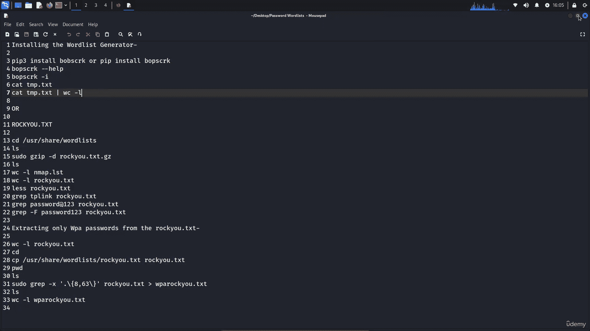
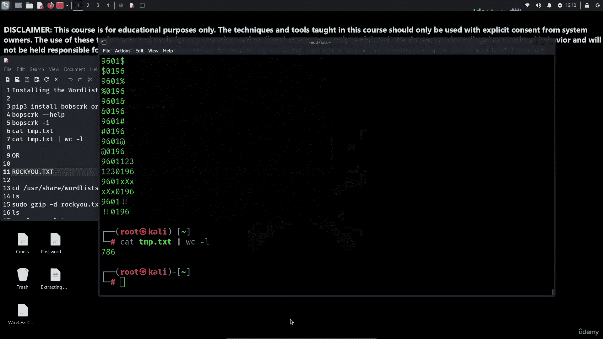

# Udemy - Complete Ethical Hacking Course 2026：25：Word Lists-Bopscrk 🔑


在本节课中，我们将一起学习什么是字典列表，以及如何在Kali Linux系统中创建和使用这些字典列表。字典列表是网络安全实践中非常常见的工具，特别是在针对无线网络进行密码测试时。我们会先认识Bopscrk这个软件，然后学习如何把它安装到你的系统里，接着通过交互式界面生成一份针对特定目标的密码清单，最后查看生成结果并了解如何防范此类攻击。整个过程适合初学者，不需要你之前有太多基础。

## 认识字典列表与Bopscrk 📖

在开始之前，我们先来聊聊字典列表到底是什么。简单来说，字典列表就是一个文本文件，里面写满了大量可能的密码，一行一个，等着被安全工具逐一尝试。当我们要测试WiFi网络的安全性，或者想要知道WPA、WPA2甚至WEP密钥时，手里有这样一份合适的词典，就能极大提高成功率。WEP是有线等效隐私的缩写，WPA和WPA2则是WiFi保护访问协议，它们都是常见的无线加密标准。Bopscrk就是专门用来制造这种密码清单的工具，它可以根据目标的个人信息，把名字、生日、兴趣爱好等元素组合起来，生成更有针对性的字典。你也可以查看随附的文档文件来了解更多细节。

接下来，我们进入安装环节，看看如何把Bopscrk放进你的Kali Linux系统。

## 安装Bopscrk字典生成器 💻



安装Bopscrk并不复杂，只需要在终端里输入几条命令就可以完成。你要先打开终端窗口，然后执行安装步骤。以下是具体的操作命令，你可以直接复制使用：

```
git clone https://github.com/Xen1thLabs/bopscrk.git
cd bopscrk
chmod +x bopscrk.py
```

执行完上面的命令后，系统会把Bopscrk下载到本地，并赋予运行权限。如果你之前已经装过，终端可能会提示已经安装，无需重复操作，这时你直接跳过安装即可。安装完成之后，你可以输入帮助命令查看支持的功能，这能让你更清楚这个脚本能做什么。

安装好之后，我们就可以启动交互式会话，开始制作专属的密码清单了。

## 使用交互模式生成字典 🛠️

Bopscrk提供了一个交互模式，运行后它会一步步向你询问目标的相关信息，然后根据这些信息自动拼凑出大量可能的密码组合。这种方式非常适合初学者，因为你不需要手动去猜测密码，只需要把你知道的关于目标的资料填进去就行。以下是启动交互模式的命令：

```
python3 bopscrk.py -i
```

当你运行这条命令后，程序会开始提问。首先它会询问密码的最小长度，建议直接输入4，这样生成的清单不会太短。接着它会要求你输入目标的名字、姓氏，以及出生年份，比如1996年。你还可以加入目标喜欢的歌词、电视剧名字，或者艺术家名字，例如贾斯汀·比伯或者约翰·塞纳之类的。每一个你提供的信息，都会被程序用来生成更多密码变体。最后程序会问你是否要组合多个词，以及最多组合几个词，通常选择2个就足够了。完成所有设置后，你需要指定输出文件的名字，比如tmtt.txt，然后程序就会把生成的密码列表保存到这个文件里。

字典生成完毕之后，我们来看看里面到底有多少条密码，以及如何把它用到实际的攻击测试中去。

## 查看生成结果与密码注入 🔍

生成完成后，你可以打开输出文件，查看里面具体生成了哪些密码。这些密码会把你之前输入的名字、生日、兴趣等信息以不同方式组合在一起，形成一长串可能的候选密码。如果你想知道这个文件里总共有多少条密码，可以使用下面的命令：

```
wc -l tmtt.txt
```

运行这条命令后，终端会告诉你文件的行数，也就是密码的总数量。在示例中，这个文件里一共有786条密码。有了这份清单，你就可以把它拿去对目标WiFi进行密码测试了。在这里，你需要知道目标网络的BSSID和MAC地址，把这些信息和字典文件一起传给无线攻击工具，工具就会逐一尝试清单里的每一个密码，直到找到正确的那个为止。这就是整个生成并使用字典的基本流程。

在学会如何制造字典之后，我们也必须明白，保护好自己的网络同样重要，否则很容易成为攻击者的目标。

## 安全建议与防范措施 🛡️

既然我们知道了攻击者是如何利用字典列表来破解WiFi密码的，那么作为普通用户，我们就应该采取措施保护自己的网络安全。最基本的原则就是，不要设置过于简单的密码，比如只用名字、生日或者常见的英文单词，这些都很容易被字典攻击工具猜出来。建议你每三个月或者四个月更换一次WiFi密码，并且尽量使用包含大小写字母、数字和特殊符号的复杂组合。如果密码足够强，攻击者即使拥有庞大的字典文件，也很难在短时间内破解成功，你的数据也就更安全了。



本节课中，我们一起学习了什么是字典列表，如何在Kali Linux中安装Bopscrk，如何通过交互模式生成针对特定目标的密码清单，以及如何查看生成结果并应用到无线网络测试中。同时，我们也讨论了如何设置更安全的密码来防范这类攻击。希望这节课能帮助你理解字典攻击的基本原理，并在实践中注意网络安全防护。
