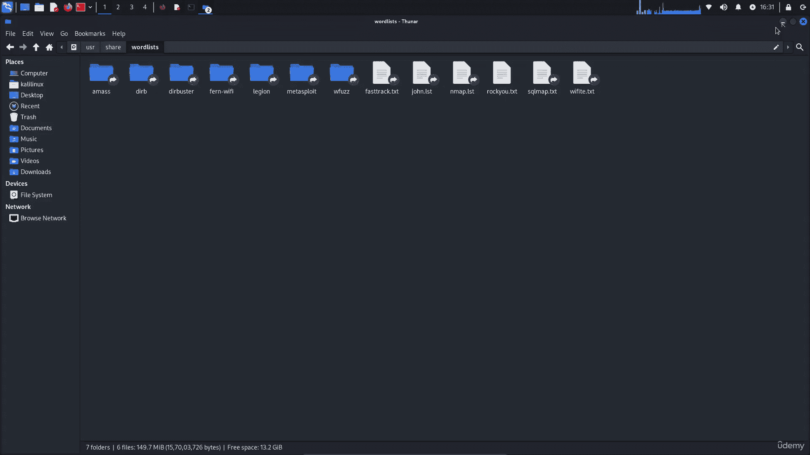
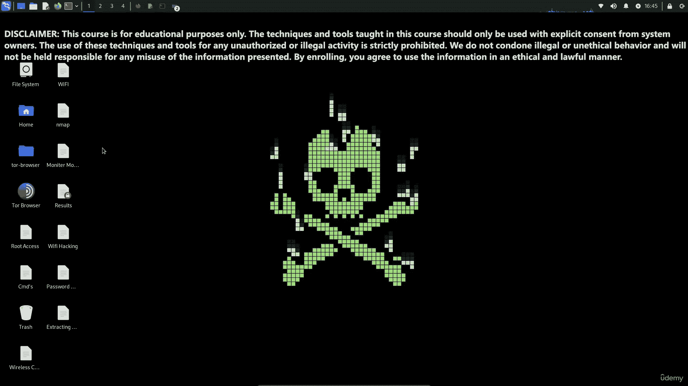
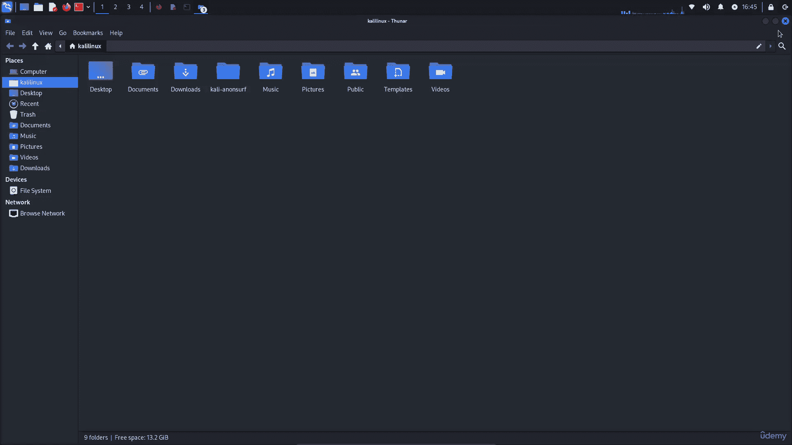
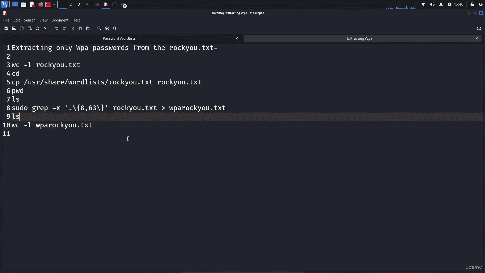

🔒 道德黑客完全课程：第26章：RockYou 密码字典详解


在本节课中我们将要学习如何在 Kali Linux 系统中找到、解压并使用 RockYou.txt 密码字典。RockYou.txt 是目前网络上已知规模最大的密码泄露文件之一，收录了大约 84 亿条明文密码记录。这些记录通常来自数据泄露事件，黑客会在论坛上发布高达 100 GB 的纯文本文件，供他人下载使用。理解这个字典的构成，能帮助你认识弱密码的普遍性，也能让你在后续的渗透测试练习中知道如何获取常用密码列表。本节内容适合零基础学习者，所有命令都会直接演示，你只需要跟着步骤操作即可。


RockYou.txt 是什么
上一节我们介绍了渗透测试环境的基本准备，本节中我们来看看 RockYou.txt 到底是什么。


RockYou.txt 是一个著名的密码泄露集合，被认为是网络上最大的密码泄露来源之一。文件中包含约 84 亿条密码，这些密码没有加密，以明文形式保存在服务器上。数据泄露事件发生后，这类文件经常出现在黑客论坛中，任何人都可以下载。在安全测试中，这个文件常被用作字典攻击的原料，帮助安全人员检查目标系统是否使用了常见弱密码。

密码泄露规模公式：
密码泄露规模 = 84 亿条明文记录

存储特征：
存储格式 = 明文
文件体积 = 约 100 GB


在系统中找到 RockYou.txt
了解了 RockYou.txt 的基本概念之后，本节中我们来看看如何在 Kali Linux 系统里找到它。

在 Kali Linux 中，RockYou.txt 通常预装在系统自带的字典目录里。你可以打开文件管理器，进入用户目录，然后向下滚动查找名为 rockyou.txt 的文件。具体路径可能因系统版本而异，但大多数发行版会将其放在 /usr/share/wordlists 或类似位置。

以下是常见的查找路径：
- /usr/share/wordlists/rockyou.txt
- /usr/share/wordlists/rockyou.txt.gz




解压 RockYou.txt 文件
找到文件之后，本节中我们来看看如何把它解压出来，以便直接阅读。

下载得到的 RockYou.txt 通常是压缩包格式，比如以 .gz 结尾，直接双击可能无法打开。你需要在终端中使用解压命令才能查看里面的内容。解压完成后，你就能得到一个纯文本文件，里面每一行都是一个常见密码。

以下是常用的解压命令：
```bash
gunzip rockyou.txt.gz
```
或者
```bash
zcat rockyou.txt.gz > rockyou.txt
```

如果你已经解压过，使用 ls 命令查看目录时，rockyou.txt 会以绿色显示，表示文件已经存在且可用。


查看文件大小和密码数量
文件解压好之后，本节中我们来看看这个字典到底有多大，里面包含多少条密码。

你可以在图形界面右键点击文件，选择属性，查看文件大小。如果想在终端中直接统计行数，也就是密码条数，可以使用 wc 命令。每一行对应一个密码，所以行数就是字典的总条目数。文件体积可能超过 100 MB，打开时可能需要等待一段时间，请耐心等待。

以下是统计命令示例：
```bash
wc -l rockyou.txt
```

统计结果可能显示数千万甚至上亿行，具体数字取决于你所使用的 RockYou.txt 版本。


在字典中查找特定密码
掌握了怎么统计数量之后，本节中我们来看看如何在 RockYou.txt 里搜索自己关心的密码。

如果你想检查自己的 WiFi 密码或者某个账户密码是否已经泄露，可以使用 grep 命令在文本中进行匹配。grep 会扫描整个文件，找出所有包含指定关键词的行，并把结果显示在终端里。这样你就能知道自己的密码是否属于常见弱密码，是否应该立即更换。

以下是常用的搜索命令：
```bash
grep "123456" rockyou.txt
grep "password" rockyou.txt
```

你也可以把搜索结果保存到新文件，方便之后分析。如果你想检查自己的当前密码是否出现在字典中，只需把自己的密码作为关键词传给 grep，观察是否有输出即可。


关于 WiFi 安全的建议
学会使用字典之后，本节中我们来看看为什么要定期更换 WiFi 密码。

攻击者可以拿到 RockYou.txt 这样的字典，再配合无线网络抓包工具，尝试猜解目标 WiFi 的密码。一旦连接成功，攻击者就可能进入局域网，窃取你的银行信息、社交账号密码等敏感数据。因此，建议你为 WiFi 设置强密码，避免使用“123456”“password”“baby girl”“princess”“iloveyou”这类容易被猜到的组合，并定期更换密码以降低被攻击的风险。

以下是常见的弱密码示例：
- 123456
- password
- baby girl
- princess
- iloveyou

密码安全原则：
强密码 = 包含数字 + 特殊符号 + 大小写字母 + 不足够长的随机组合
避免使用 = 地区相关 + 顺序数字 + 常见英文单词


提取 WPA 密码的基本思路
掌握了查找方法之后，本节中我们简要看看如何从字典中提取 WPA 类型的密码。



在实际的无线网络安全测试中，安全人员有时只需要从大字典中筛选出符合 WPA 密码格式的条目，然后保存为独立文件，供后续破解工具使用。具体的命令操作会在下一节课中详细演示，这里你只需要了解这个思路即可。




以下是后续可能会用到的命令方向：
```bash
wc -l /path/to/rockyou.txt
grep -E "wpa" rockyou.txt
```





总结
本节课中我们一起学习了 RockYou.txt 密码字典的来源、存放位置、解压方法、行数统计方式以及如何用 grep 查找特定密码。我们还讨论了 WiFi 密码安全的重要性，并初步了解了从大字典中提取 WPA 密码的基本思路。希望你能跟着演示亲自操作一遍，在下一节课中我们会继续介绍不同的主题。
