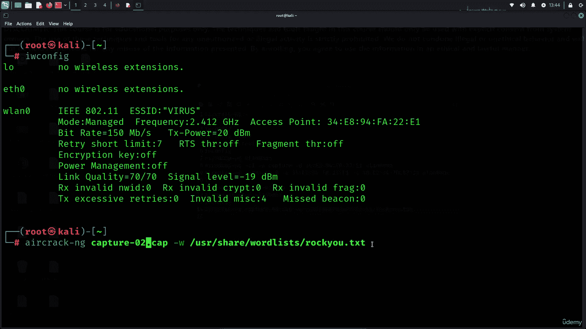
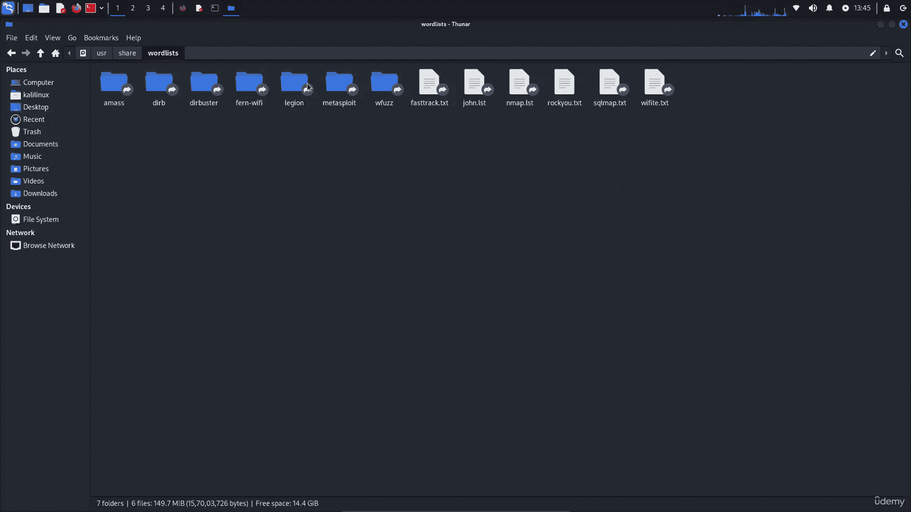
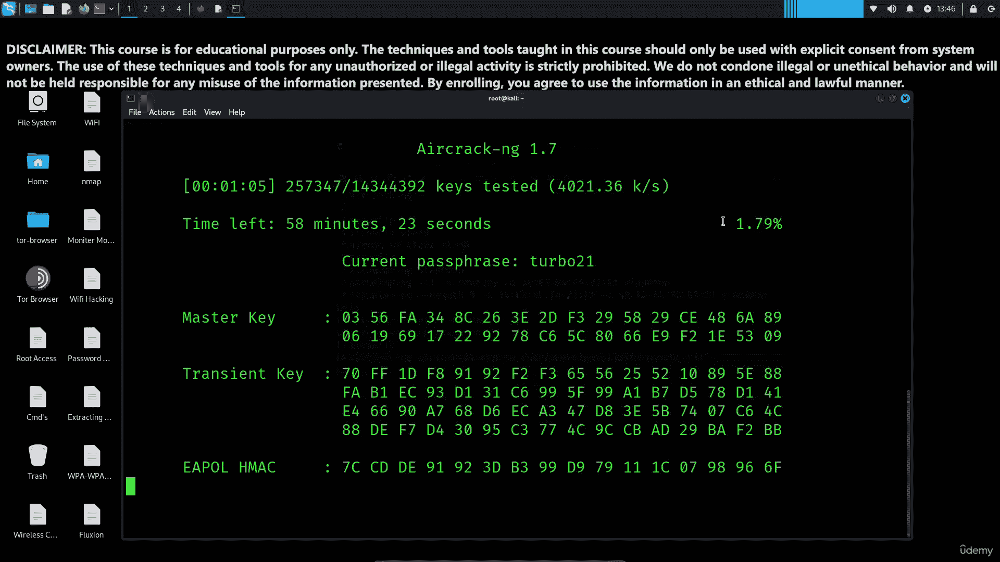

# 🛡️ Udemy完整道德黑客课程2026：27：使用Aircrack-ng获取WiFi密码

## 概述

在本节课中，我们将学习如何使用Aircrack-ng工具套件来获取WiFi密码。本节内容包括检查无线网络适配器、将网卡切换到监听模式、扫描周围的WiFi网络、抓取握手文件、发起去认证攻击、使用字典列表进行暴力破解，以及最后把网卡恢复到正常模式。每个步骤都会用大白话讲解，适合完全没有经验的初学者跟着操作。

WiFi密码破解 = 抓取的握手文件 + 合适的密码字典 + 足够的等待时间

## 一、打开终端并检查无线网络适配器

上一节我们介绍了基本的终端操作，本节中我们来看看如何准备破解WiFi所需的硬件环境。

首先打开系统自带的终端窗口。如果觉得字体太小看不清楚，可以按住键盘左侧的Control键，同时按下加号键来放大终端显示。

因为Aircrack-ng需要输入很多命令，很容易记混，建议先把常用命令写在记事本里，需要时直接复制粘贴。

在开始之前，必须确认电脑已经连接了支持监听模式的无线网络适配器。在设备菜单中选择USB设备，确保对应的无线网卡已经被系统识别。接下来输入以下命令来查看当前无线网卡的状态：

```bash
iwconfig
```

运行上面的命令后，你会看到类似wlan0这样的无线网卡名称，并且它当前处于Managed模式，也就是普通的管理模式。我们之后需要把它切换到监听模式，才能进行后续的抓包和攻击操作。

## 二、将无线网卡切换到监听模式

上一节我们确认了无线网卡的名称和当前模式，本节中我们将把它从管理模式切换到监听模式。

监听模式是指网卡不再只接收发给自己的数据包，而是捕获空中所有的无线信号，这对抓取WiFi握手包是必须的。输入以下命令来启动监听模式：

```bash
airmon-ng start wlan0
```

执行这条命令后，系统会自动关闭可能会干扰抓包的进程，并为你创建一个新的监听接口，通常名字会变成wlan0mon。然后再次运行以下命令来验证模式是否已经切换成功：

```bash
iwconfig
```

如果输出中显示接口已经处于Monitor模式，就说明你的网卡现在可以进行包注入和认证相关的操作了，可以继续下一步。

## 三、扫描周围的WiFi网络

完成监听模式设置后，本节中我们来看看如何发现附近的目标网络。

在发起任何攻击之前，我们需要知道目标WiFi的名称、信道、BSSID地址，以及是否有设备正在连接它。只有目标网络正在被使用，并且有客户端设备连接并运行，我们才能后续发起去认证攻击并抓到握手。输入以下命令开始扫描：

```bash
airodump-ng wlan0mon
```

扫描开始后，终端会列出附近所有的WiFi网络，每一行代表一个网络，你可以看到它的BSSID、信号强度、当前信道以及连接的客户端数量。找到你想攻击的目标网络后，记录下它的信道和BSSID地址，然后按下Control+C来停止扫描。

以下是扫描结果中需要重点关注的信息：
- BSSID：目标路由器的唯一标识地址
- 信道：目标网络当前使用的无线信道
- 功率：信号强度，数值越大代表信号越好
- Stations：当前连接到该网络的客户端设备地址

## 四、抓取WiFi握手文件

找到目标网络并确认有客户端连接后，本节中我们将抓取包含密码信息的握手文件。

握手文件是设备连接WiFi时产生的加密数据包，里面包含了破解密码所需的关键信息。我们需要指定目标网络的信道和BSSID，并将抓到的数据保存到文件中。输入以下命令来开始抓包：

```bash
airodump-ng -c 1 --bssid 34:E8:94:F2:2E:E1 -w capture wlan0mon
```

上面的命令中，`-c 1`表示监听第1信道，`--bssid`后面跟的是目标网络的BSSID地址，`-w capture`表示将抓到的数据保存为以capture开头的文件，`wlan0mon`是你的监听接口名称。

命令运行后，终端会显示连接到该网络的客户端设备列表，也就是Stations部分。你可以看到每个设备的MAC地址，比如48:E2:4:4:70:B7:21。等到你确认有客户端在线后，按下Control+C停止抓包。

## 五、发起去认证攻击

抓取文件开始运行后，本节中我们需要让目标设备断开连接，从而强制它重新连接并产生握手包。

去认证攻击的作用是让已经连接到目标WiFi的客户端被踢下线，当它尝试重新连接时，就会产生我们需要的握手数据包。为了方便观察，建议将终端水平分屏，并在新的标签页中运行攻击命令。输入以下命令来发起无限次数的去认证攻击：

```bash
aireplay-ng --deauth 0 -a 34:E8:94:F2:2E:E1 -c 48:E2:4:4:70:B7:21 wlan0mon
```

上面的命令中，`--deauth 0`表示持续发送去认证请求，`-a`后面是目标路由器的BSSID，`-c`后面是要断开连接的客户端设备地址，`wlan0mon`是监听接口。

攻击运行期间，目标设备的WiFi会被断开，而你的抓包终端应该会在右上角或中间位置显示"WPA handshake captured"字样，说明已经成功抓到握手文件。握手抓到之后，按下Control+C停止攻击，然后输入`clear`清空终端，并折叠当前窗口。

## 六、使用字典列表破解密码

一旦成功抓到握手文件，本节中我们就可以使用字典文件进行暴力破解，找出真实的WiFi密码。

抓到握手后，回到桌面使用`ls`命令查看生成的文件，你会看到类似capture-01.cap和capture-02.cap这样的文件，其中较新的那个就是最新抓到的握手文件。如果你想深入分析握手包的内部结构，可以使用Wireshark这样的数据包分析器，不过详细内容会在其他视频中讲解。

接下来我们需要一个密码字典文件。系统通常自带一些常用字典，比如rockyou.txt，它的路径一般是/usr/share/wordlists/rockyou.txt。当然你也可以使用Metasploit自带的字典，或者从Github下载别人制作的字典，甚至用Crunch等工具自己生成个性化字典。

你可以选择以下几种常见的字典来源：
- 系统自带的rockyou.txt字典
- Metasploit框架自带的密码列表
- 从Github下载的社区字典
- 使用Crunch等工具自己生成的字典

使用以下命令来开始破解：

```bash
aircrack-ng capture-02.cap -w /usr/share/wordlists/rockyou.txt
```

上面的命令会尝试字典里的每一个密码，直到找到匹配的为止。这个过程可能需要大约一个小时，具体时间取决于字典的大小和电脑性能。如果目标WiFi的密码正好在这个字典里，程序就会显示出密码；如果字典里没有这个密码，那么这次破解就会失败。

## 七、恢复无线网卡到管理模式





破解任务完成或停止后，本节中我们将把无线网卡恢复到普通的管理模式，以便正常上网。

当不再需要监听和抓包时，应该把网卡从监听模式切换回管理模式，否则你的电脑可能无法正常连接WiFi。输入以下命令来停止监听模式：

```bash
airmon-ng stop wlan0mon
```

执行完毕后，再次运行`iwconfig`命令，确认wlan0已经恢复到Managed模式。此时你的电脑应该能重新搜索并连接到WiFi网络，恢复正常的上网状态。

## 总结



本节课中我们一起学习了如何使用Aircrack-ng工具套件获取WiFi密码，包括检查无线网络适配器、切换到监听模式、扫描目标网络、抓取握手文件、发起去认证攻击、使用字典进行暴力破解，以及最后把网卡恢复到管理模式的完整流程。希望通过本节的学习，你能掌握无线网络安全测试的基本操作方法。

