# 道德黑客完整课程2026从零到英雄：28：29. Who Am I - 提升匿名性 🛡️

在本节课中我们将要学习如何在 Kali Linux 操作系统中使用 Who Am I 隐私工具来提升网络匿名性。Who Am I 是一个托管在 GitHub 上的开源脚本，它的作用类似于 AnonSurf 或 Anonym8 这类隐私工具，可以帮助用户修改 DNS、IP 地址、MAC 地址以及时区，还能防止中间人攻击并锁定杀毒进程。本节课将从下载脚本开始，依次讲解安装、启动、修改网络标识、检查效果以及停止工具的完整流程，内容通俗易懂，适合完全没有相关经验的初学者跟随操作。

## 什么是 Who Am I 工具

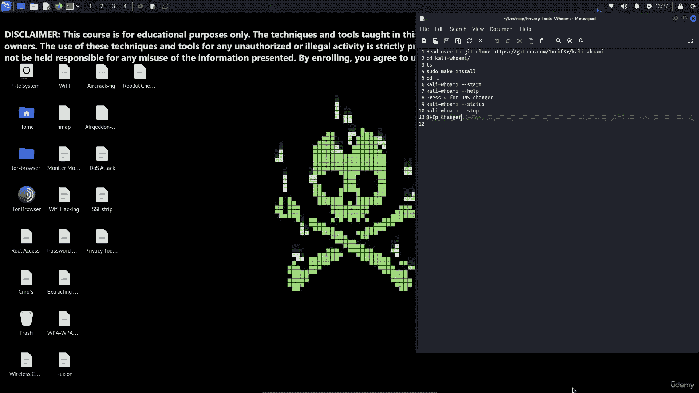

上一节我们介绍了 Kali Linux 的基础环境，本节中我们来看看如何进一步提升系统的匿名性。Who Am I 的核心功能可以用下面这个简单公式来理解：

匿名提升 = 原始网络标识 → 随机或伪装标识

该工具支持多个隐私保护选项，以下是主要功能列表：

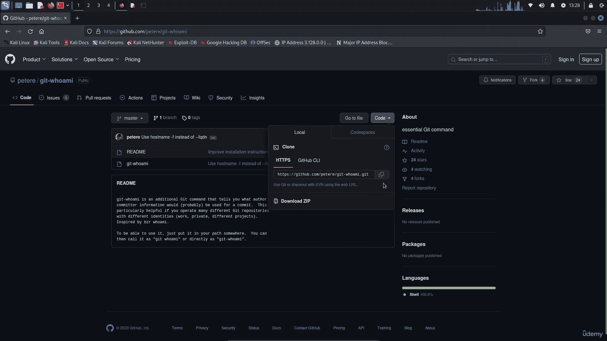

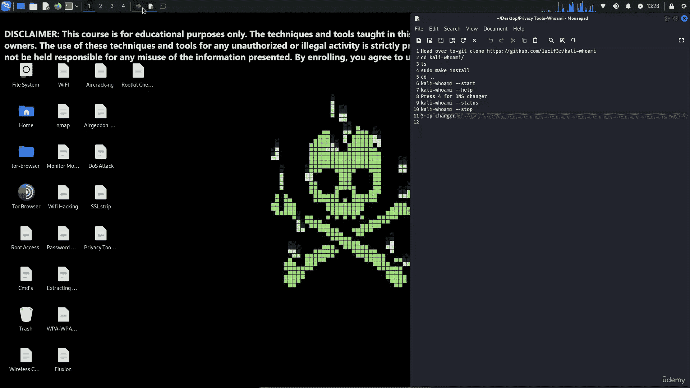

- 防止中间人攻击
- 锁定杀毒进程
- 修改 IP 地址
- 修改域名服务器（DNS）
- 修改 MAC 地址
- 修改时区

需要注意的是，这些选项并不是可以随意组合的，具体的使用限制会在后面的章节中说明。

## 下载 Who Am I 脚本

在使用该工具之前，我们需要先从 GitHub 上将脚本下载到本地电脑。以下是具体的下载步骤：

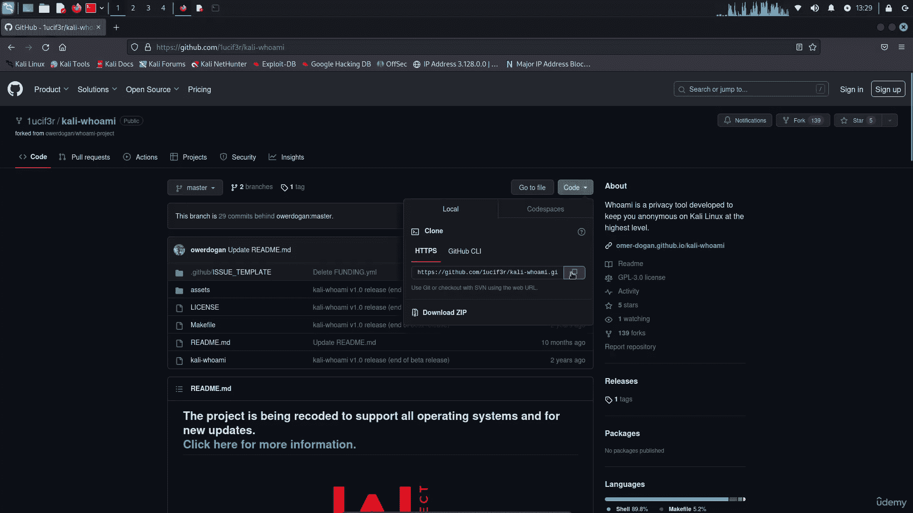

1. 打开浏览器，访问 GitHub 网站。
2. 在搜索栏中输入 who am I 进行搜索。
3. 找到对应的仓库链接并复制。
4. 打开 Kali Linux 的 root 终端。
5. 使用 git clone 命令将脚本克隆到本地。

下载命令如下：

```bash
git clone https://github.com/whoami/WhoAmI.git
```

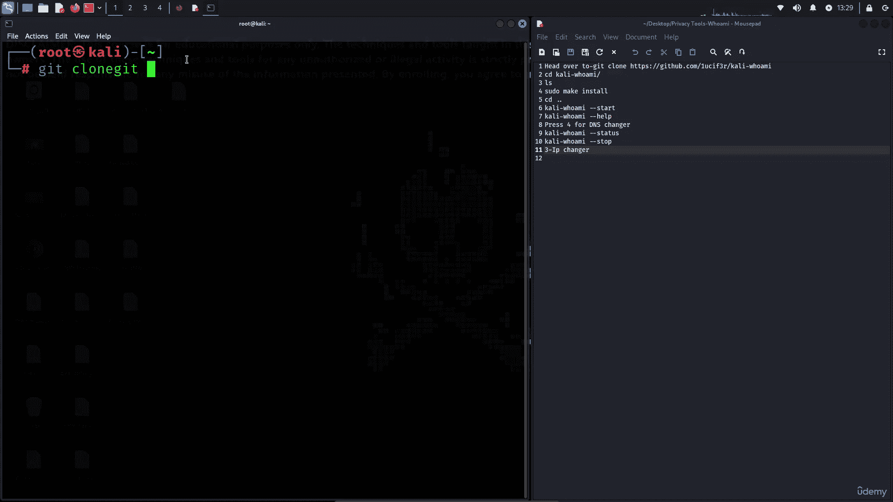

执行完成之后，脚本文件就会出现在当前目录中。

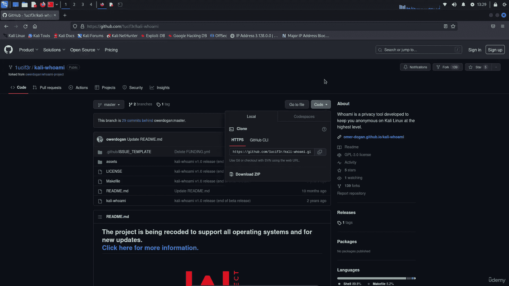

## 安装 Who Am I 工具

脚本下载完成之后，我们需要进入对应的文件夹并完成安装。上一节我们下载了脚本文件，本节中我们来看看如何把它安装到系统中。以下是安装步骤：

1. 使用 cd 命令进入脚本所在的文件夹。
2. 使用 ls 命令查看文件夹内的所有文件，确认安装脚本存在。
3. 因为命令比较多，建议先把命令记录在记事本文件里，以免操作时混淆。
4. 使用 sudo make install 命令进行安装。
5. 安装完成后，使用 cd .. 返回上一级目录。
6. 使用 clear 命令清空终端屏幕，方便查看后续输出。

安装命令示例如下：

```bash
cd WhoAmI
ls
sudo make install
cd ..
clear
```

安装过程中系统可能会提示输入密码，请按照提示完成操作。

## 启动 Who Am I 工具

工具安装完成之后，就可以直接启动并开始使用了。上一节我们完成了 Who Am I 的安装，本节中我们来看看如何启动脚本并选择功能选项。启动命令如下：

```bash
kali-whoami start
```

启动后，工具会显示一个功能菜单，你可以根据需求选择不同的匿名选项。如果想查看所有可用命令，可以使用 help 命令，具体输入方式如下：

```bash
kali-whoami help
```

常见选项包括按 3 修改 IP 地址，按 4 修改 DNS 设置，以及修改 MAC 地址和时区等。

## 修改 IP 地址

修改 IP 地址是提升匿名性的常见操作之一。上一节我们启动了 Who Am I 脚本，本节中我们来看看如何具体更改 IP 地址。以下是操作步骤：

1. 在启动菜单中选择选项 3。
2. 按下回车键确认。
3. 等待系统提示 IP 地址修改成功。
4. 使用状态查看命令确认当前 IP 是否已经更改。

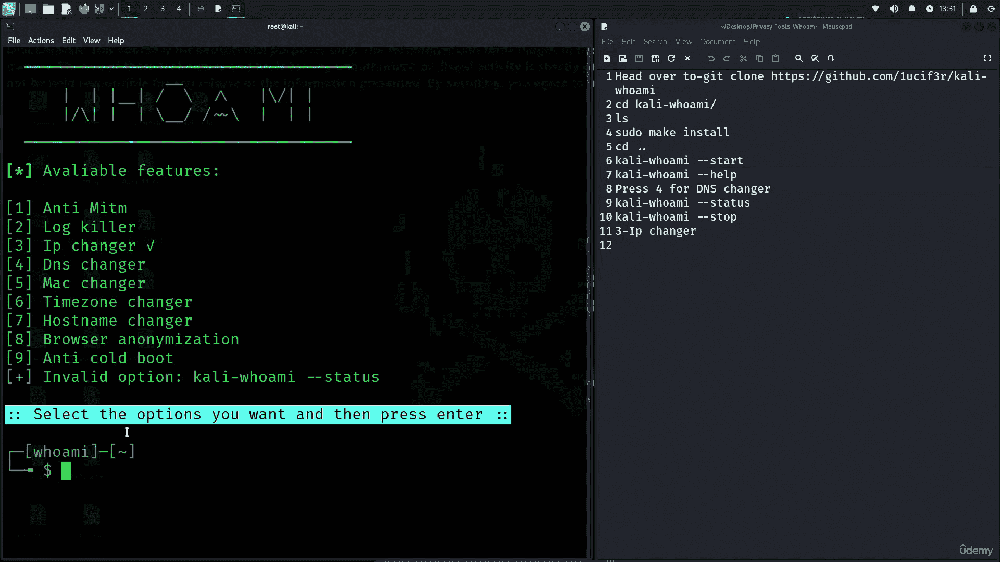

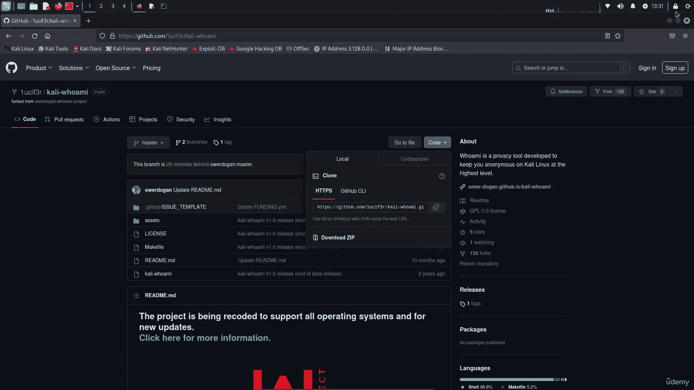

修改 IP 地址的操作示例如下：

```bash
kali-whoami start
# 在菜单中选择选项 3
kali-whoami status
```


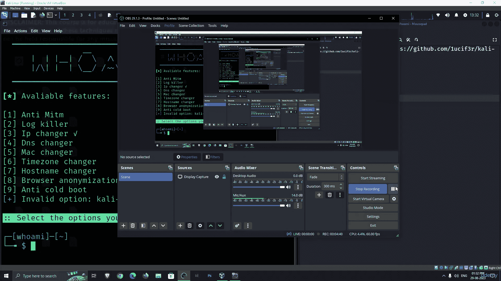

如果系统提示无效选项，请重新启动工具并再次选择正确的数字选项。

## 修改 DNS 与使用限制

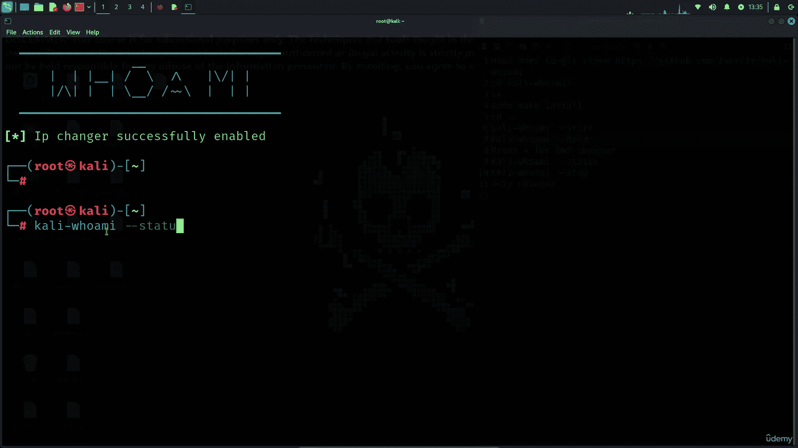

除了 IP 地址，该工具还可以修改 DNS 设置，但存在一些组合限制。上一节我们介绍了修改 IP 地址，本节中我们来看看 DNS 的使用规则。以下是使用限制说明：

- 一次只能修改一项：要么修改 IP 地址，要么修改 DNS，不能同时修改这两项。
- 可以同时修改 MAC 地址和 IP 地址，但不能同时修改 DNS 和 IP。

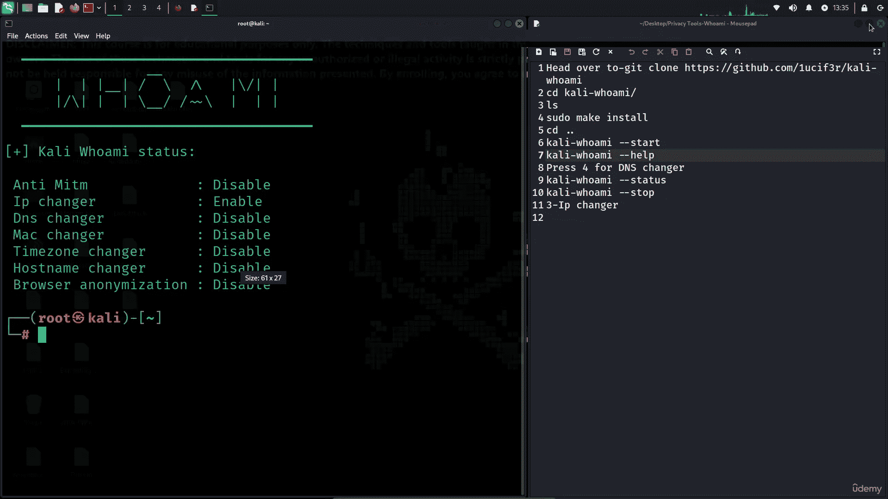

如果你想修改 DNS，在启动菜单中按下 4 即可。如果你想修改 IP 地址，则按下 3。两者不能在同一时间生效。

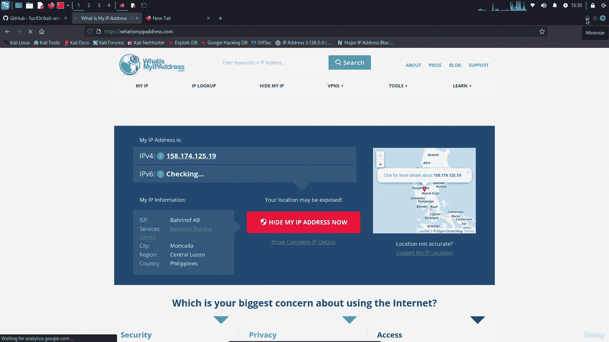

## 检查当前 IP 地址

修改完成之后，我们需要验证 IP 地址是否真的发生了变化。上一节我们修改了 IP 地址，本节中我们来看看如何通过外部网站确认当前网络标识。你可以访问类似“Where is my IP address”的网站，查看显示的 IPv4 地址。如果显示的地理位置或 IP 与修改前不同，说明匿名工具已经生效。

检查 IP 地址是否生效可以用下面这个简单逻辑表示：

当前显示 IP ≠ 原始真实 IP → 匿名生效

在演示中，系统显示当前位置在菲律宾，这就是修改后的 IPv4 互协议版本 4 地址。

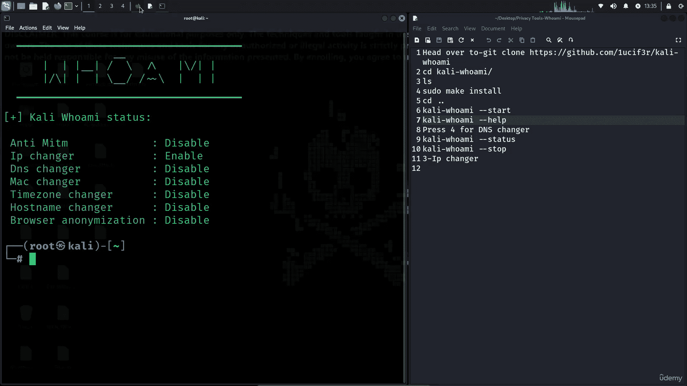

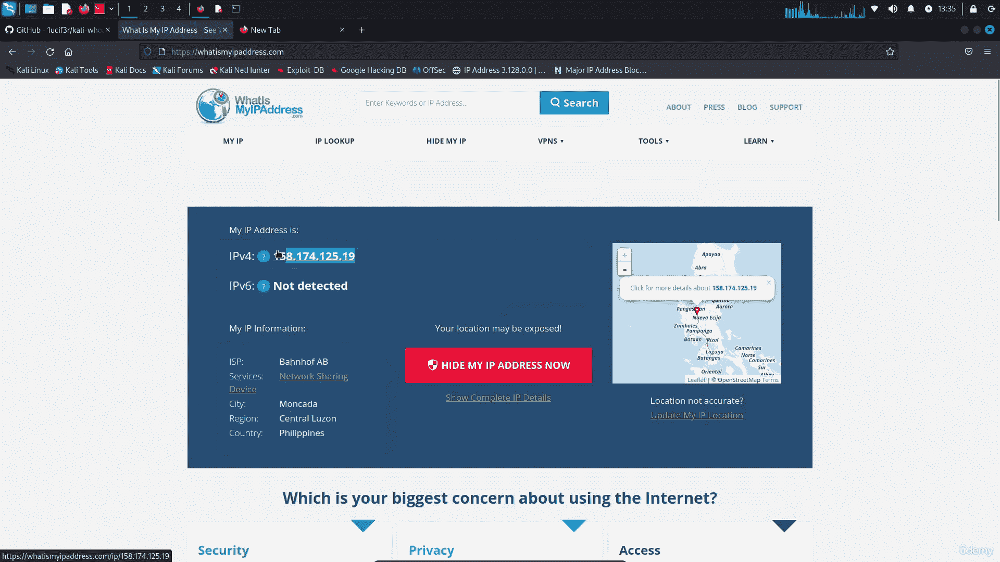

## 停止 Who Am I 工具

当不再需要匿名保护时，应该及时停止该工具以恢复正常网络设置。上一节我们介绍了如何检查 IP 地址，本节中我们来看看如何安全关闭 Who Am I 脚本。停止命令如下：

```bash
kali-whoami stop
```

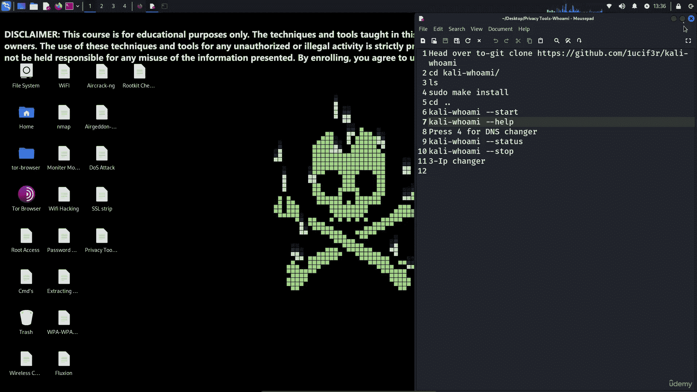

执行后，工具会提示 IP 地址修改已成功禁用，此时你的网络标识将恢复为默认状态。

## 查看更多命令和参数

如果你想深入了解 Who Am I 的所有功能，可以访问官方网站或 GitHub 仓库，查看详细的使用教程。上一节我们介绍了停止工具的方法，本节中我们来看看如何获取更多帮助信息。你可以查看当前版本的预览，以及具体的命令参数和功能描述，其中包括防中间人攻击等高级选项。

## 总结

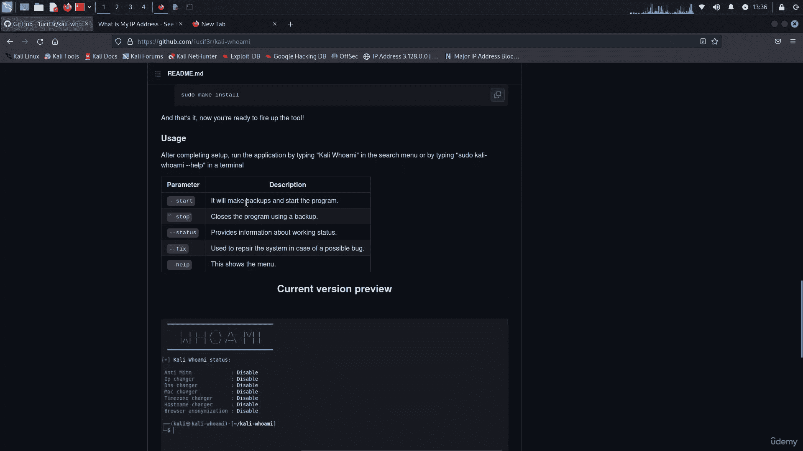

本节课中我们一起学习了 Who Am I 隐私工具的完整使用流程。我们了解了什么是 Who Am I，如何从 GitHub 下载脚本，如何在 Kali Linux 中安装并启动该工具，如何修改 IP 地址和 DNS 设置，如何通过外部网站检查当前 IP，如何停止工具恢复网络，以及在哪里查看更多命令和参数说明。掌握这些内容后，你可以根据需要灵活提升自己的网络匿名性。
