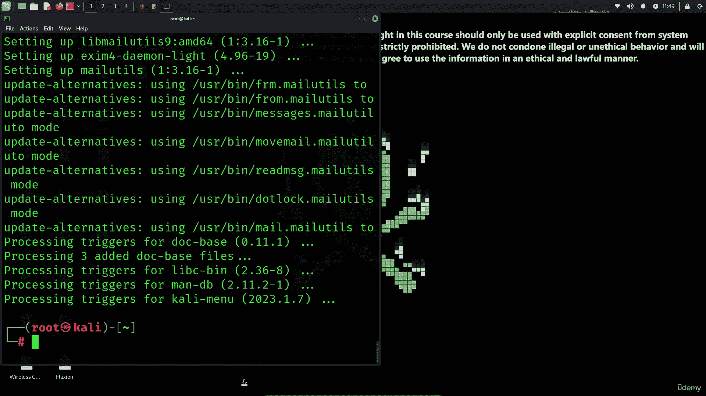
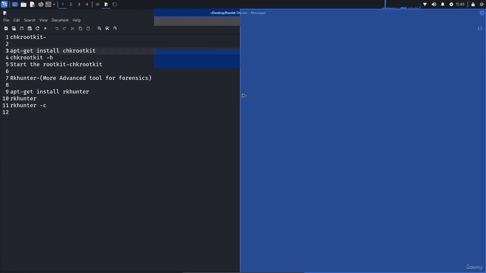
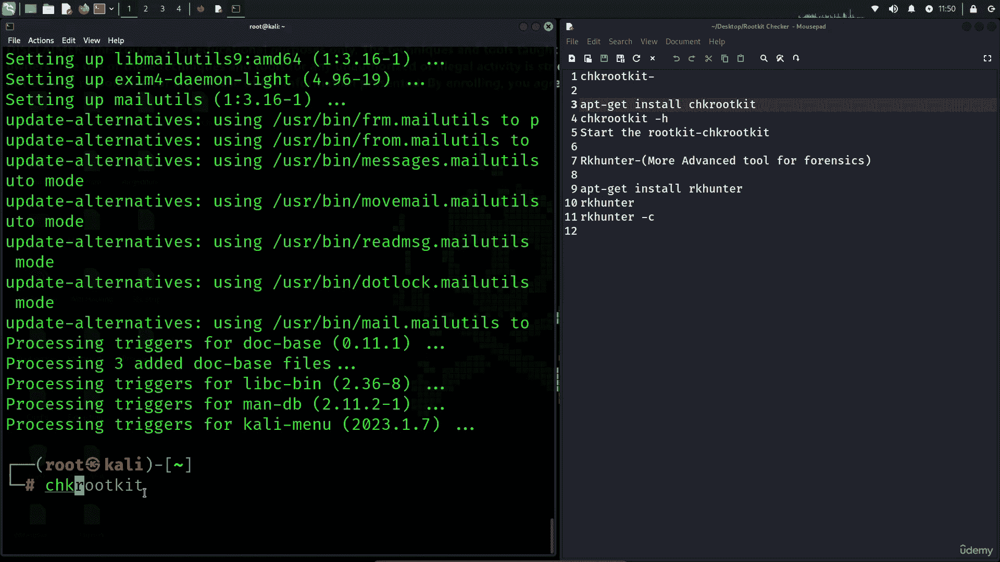
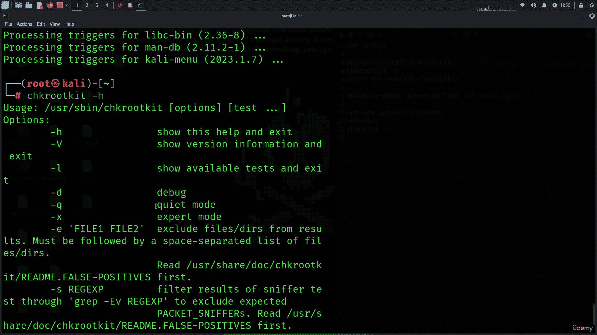
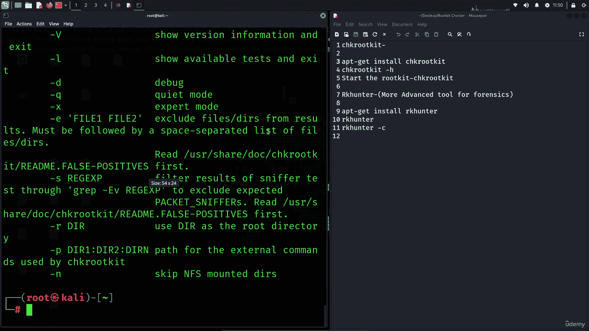
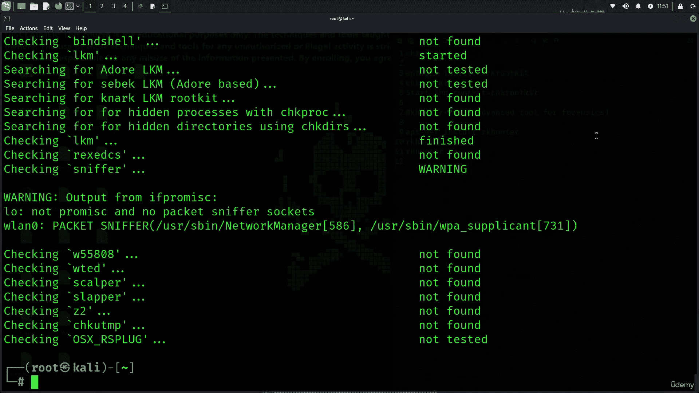
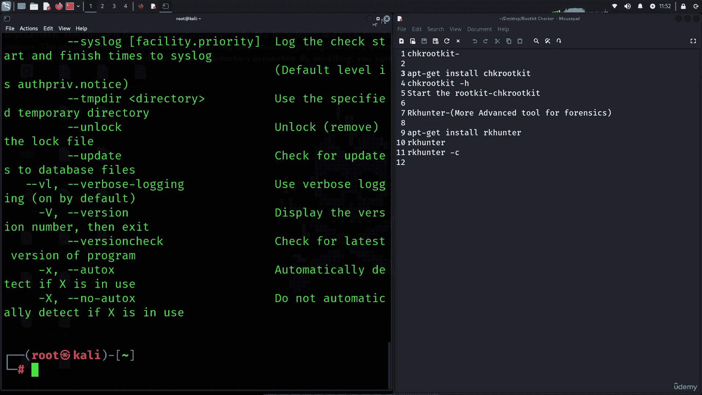
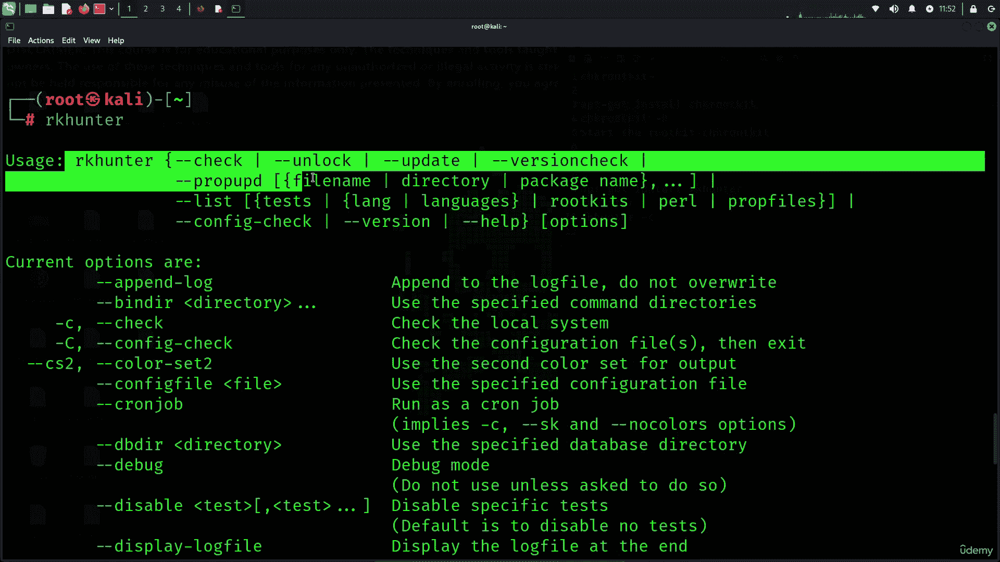
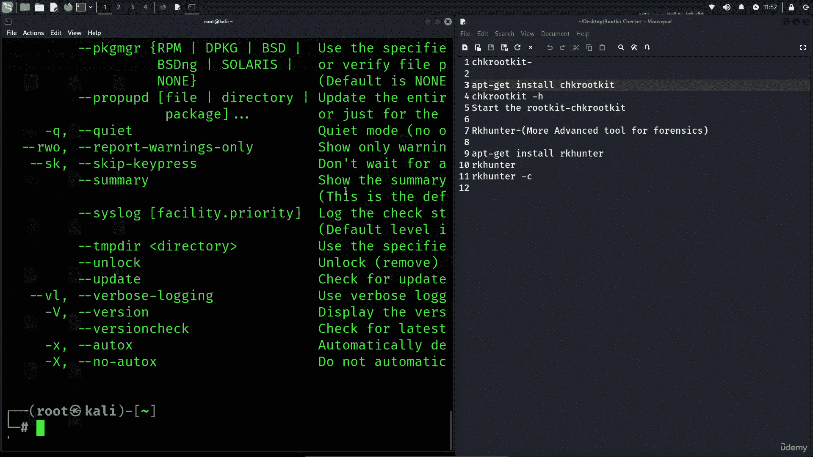
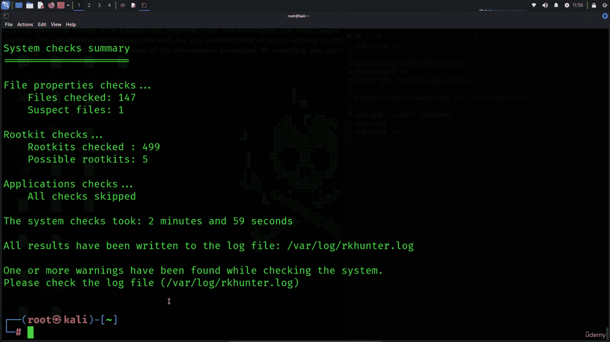

# Udemy - Complete Ethical Hacking Course 2026：30：Rootkit 检查工具 CHKROOTKIT 与 RKHunter 🔍

在本节课中，我们将学习如何检测 Linux 系统中的 Rootkit（根工具包），重点掌握 CHKROOTKIT 和 RKHunter 这两款常用检测工具的安装方法与扫描流程，让你能够初步判断系统是否遭受隐蔽的恶意程序控制。

Rootkit 是一种恶意软件或工具集，其目的是未经授权地获取对计算机系统或网络的访问权限和控制权。Rootkit 具有很强的隐蔽性，不易被发现，攻击者可以在用户毫不知情的情况下访问你的文件。我们可以用下面的公式来简单表示它的行为模式：

[ 入侵行为 = 未经授权访问 + 隐蔽控制 + 文件窃取 ]

在本节的实际操作环境中，我们使用的是 Kali Linux 系统，所有的检测命令都需要在 root 终端中执行，以确保拥有足够的权限去扫描系统文件。






本节我们先来看看 CHKROOTKIT，它是一款专门用于扫描 Rootkit 的开源工具。以下是安装和使用该工具的具体步骤。

首先，打开 root 终端。如果你的系统软件源不是最新的，直接安装可能会报错，这时需要先更新软件源。执行下面的命令更新系统：

```bash
apt-get update
```







更新完成后，再安装 CHKROOTKIT：

```bash
apt-get install chkrootkit
```

安装成功后，你可以先查看该工具支持的命令参数，帮助你了解可用的扫描选项：

```bash
chkrootkit --help
```



常见的参数包括查看版本号、列出可用测试项、开启调试模式、安静模式以及导出模式等。以下是部分常用参数及其作用：

- 查看版本号
- 列出可用测试项
- 开启调试模式
- 安静模式
- 导出模式

直接运行 chkrootkit 即可开始扫描：



```bash
chkrootkit
```



工具会自动扫描系统的根分区、文件系统以及各个目录，寻找已知的 Rootkit 痕迹。在一台全新安装的系统中，通常不会发现任何感染，扫描结果会显示 "not infected" 或 "not found"，意味着没有发现告警信息。




接下来，我们介绍另一款常用的 Rootkit 检测工具 RKHunter。它在很多 Linux 发行版中可能已经预装，如果没有安装，也可以手动通过包管理器安装。

以下是安装 RKHunter 的步骤。先检查是否已安装，如果系统提示未找到，则选择继续安装：

```bash
rkhunter
```

如果提示需要安装，确认继续即可，等待安装完成。安装好之后，使用下面的命令启动系统扫描：

```bash
rkhunter --check
```

扫描过程中，程序会检查多个系统区域。以下是主要检查项目：

- 系统命令完整性
- 整个文件系统
- 已知的 Rootkit 文件和目录
- 后门程序

与 Windows 系统不同，Windows 有 Windows Defender、Avast 或 Norton 等专门的杀毒软件，而 Linux 通常没有自带的专用杀毒程序，因此我们需要下载脚本或安装工具来手动检查系统安全状态。


扫描完成后，RKHunter 会显示系统检查摘要和应用程序检查结果。如果没有发现可疑文件，结果会显示没有 Rootkit 被找到，系统处于安全状态。

检查过程中还会涉及一些细节，例如可疑的大块共享内存段、root 访问权限、隐藏文件和目录等。如果扫描报告中出现警告，建议查看保存的日志文件，日志路径会在扫描结束时给出，你可以复制该路径并查看详细记录，以便进一步确认是否存在真正的威胁。




在本节课中，我们一起学习了 Rootkit 的基本概念，掌握了 CHKROOTKIT 和 RKHunter 的安装方法，学会了如何在 Kali Linux 中运行扫描命令，并了解了如何查看扫描结果和日志文件，从而初步具备检测 Linux 系统中隐蔽恶意程序的能力。

