# 🔍 道德黑客完整课程:第30章:什么是 Shodan.io 以及如何连接到 IoT 设备

在本节课中我们将要学习 Shodan.io 是什么，以及如何使用它来发现和连接各种物联网设备。我们会先了解 Shodan.io 的基本定义，然后学习如何安全地访问这个网站，接着尝试搜索网络摄像头，按国家筛选设备，并按操作系统查找目标系统。最后我们会查看开放端口和已知漏洞，并了解使用这类工具时需要注意的安全事项。


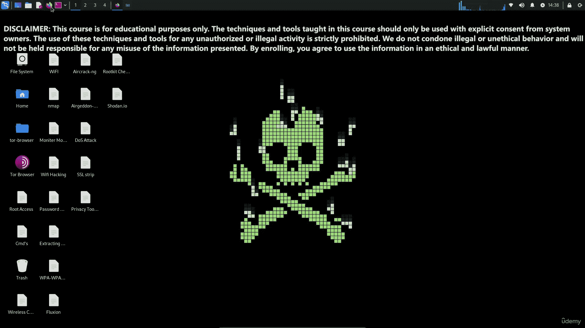

## 什么是 Shodan.io

我们先来看看 Shodan.io 到底是一个什么样的工具。简单来说，Shodan.io 是一款专门用来帮助用户发现并访问各种联网设备和服务的搜索引擎。它不像普通搜索引擎那样索引网页内容，而是索引那些连接到互联网的设备，比如网络摄像头、服务器、路由器，甚至包括一些工业控制设备。

Shodan.io 的核心功能可以用下面这个公式来概括：

```text
Shodan.io = 互联网联网设备搜索引擎
```

当你打开浏览器访问 Shodan.io 之后，你可以在搜索框中输入任意关键词，网站会返回当前连接到互联网并符合条件的设备列表。这些结果通常包含设备的 IP 地址、开放端口、运行的服务、所属组织以及已知漏洞等信息。通过这些信息，安全研究人员可以快速掌握目标系统的暴露面，而不法分子也可能利用这些公开信息寻找切入点。


## 安全访问 Shodan.io

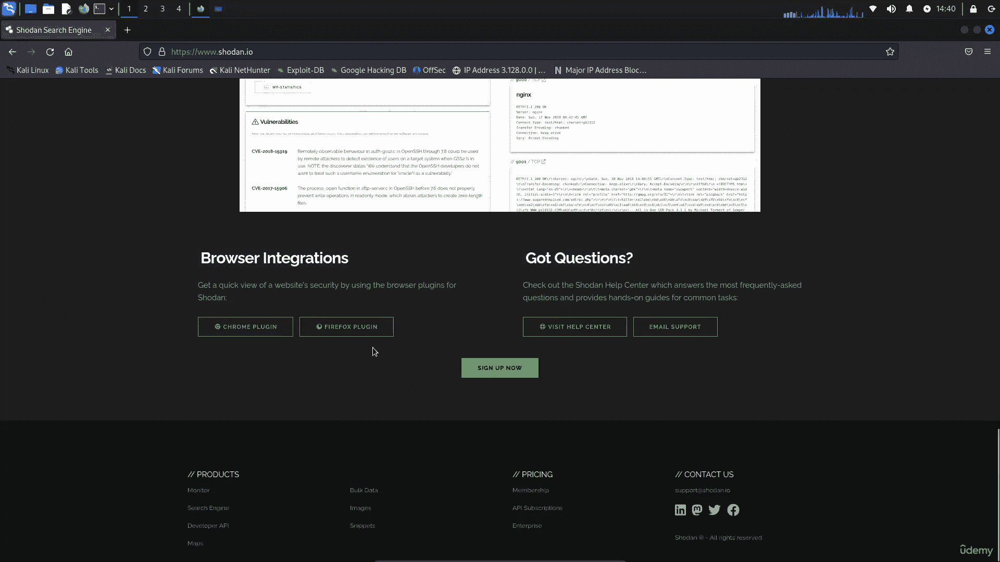

在你直接使用自己的真实公网 IP 地址去访问 Shodan.io 之前，我建议你先考虑安全问题。如果你不使用任何保护措施就直接访问，你的真实 IP 可能会被目标网站或第三方记录，这会带来一定的安全隐患。你可能不希望自己的操作系统、虚拟机或其他运行环境受到病毒或恶意软件的影响。

为了降低风险，建议你采取以下一种或多种措施：

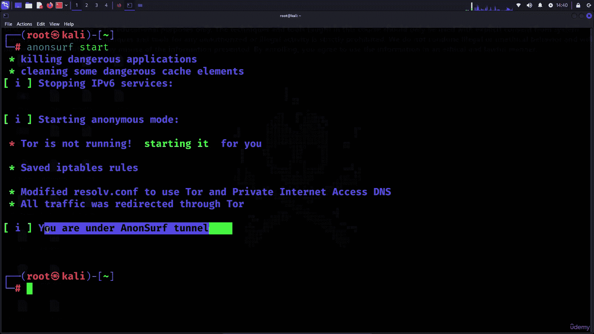

- 使用虚拟专用网络（VPN）隐藏真实 IP 地址
- 使用 DNS 更改工具修改解析行为
- 使用代理服务器中转流量

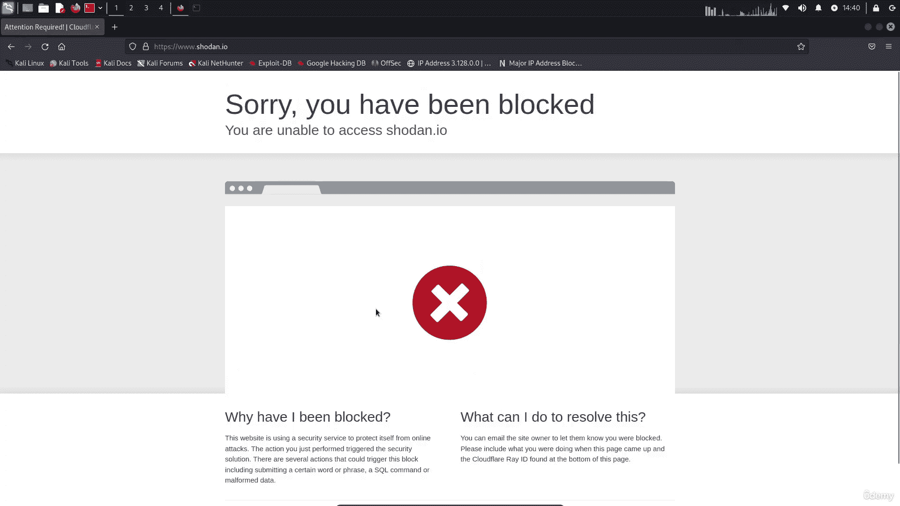

下面是一个常见的安全访问命令示例：

```bash
# 启动 VPN 连接（示例命令，具体请根据你的工具替换）
anonsurf start
```

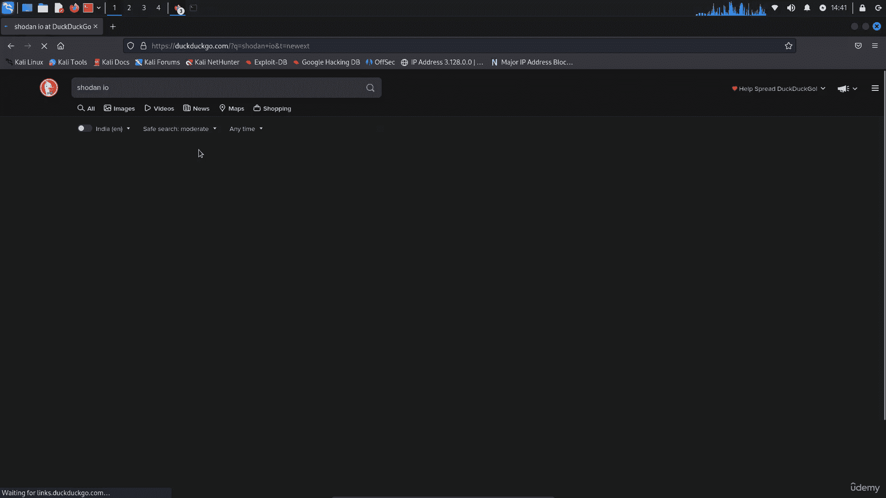

执行这条命令后，你的网络流量会经过 VPN 隧道进行转发，从而避免直接暴露本机 IP 地址。不过需要注意的是，并不是所有的 VPN 都能在 Shodan.io 上正常工作，有些网站可能会对来自 VPN 的请求进行拦截。如果你发现无法正常打开页面，可以尝试切换到无痕窗口，或者暂时关闭 VPN，改用普通方式访问。如果仍然无法访问，说明该网站正在使用安全服务来保护自身免受网络攻击，这时你可以尝试使用代理或者更改 DNS 设置。


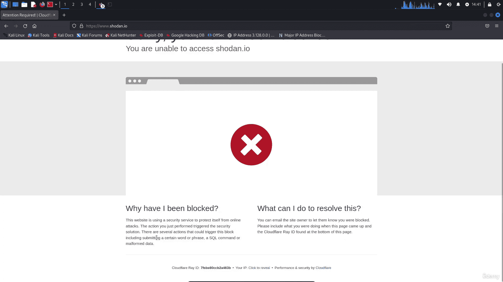

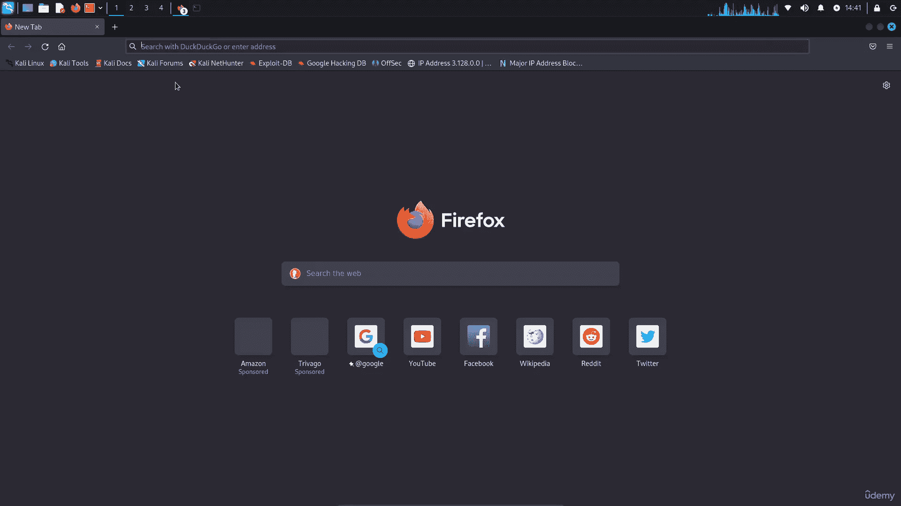

## 搜索联网设备与网络摄像头


访问 Shodan.io 之后，你可以直接在搜索框中输入关键词开始查找。比如搜索网络摄像头，网站会显示目前连接到互联网并开放相关端口的设备数量。搜索结果会告诉你有多少台设备符合条件，以及这些设备分布在哪些国家。

以下是搜索结果中常见的信息字段：

- 设备所在国家，例如美国、中国、台湾、俄罗斯联邦、巴西等
- 开放端口号，例如 80、443、22、8181、3389 以及 4、4、3、2、1、10000 等
- 顶级组织，比如 Amazon、Mo host、AliCloud 等
- 使用的产品和软件，比如 Apache 和远程桌面控制程序
- IP 地址列表

当你点击某个 IP 地址后，页面会显示该设备的详细信息，包括它开放了哪些端口，以及运行了什么服务。比如端口 80 通常对应 HTTP 网页服务，而端口 443 对应 HTTPS 加密服务。通过访问这些端口，你有时可以直接查看设备的网页界面，甚至是网络摄像头的实时画面。在搜索结果中，美国境内可能有 24 个结果，其中 20 个位于美国，2 个位于中国，其余分布在其他两个国家。根据统计，美国境内可用的设备数量可能高达 6664 台。


## 按国家筛选设备

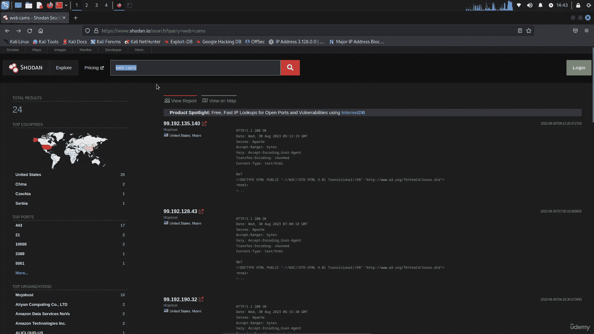

如果你只想查看某个特定国家的联网设备，Shodan.io 也支持按国家代码进行过滤。你可以在搜索框中输入国家过滤条件，然后执行搜索。

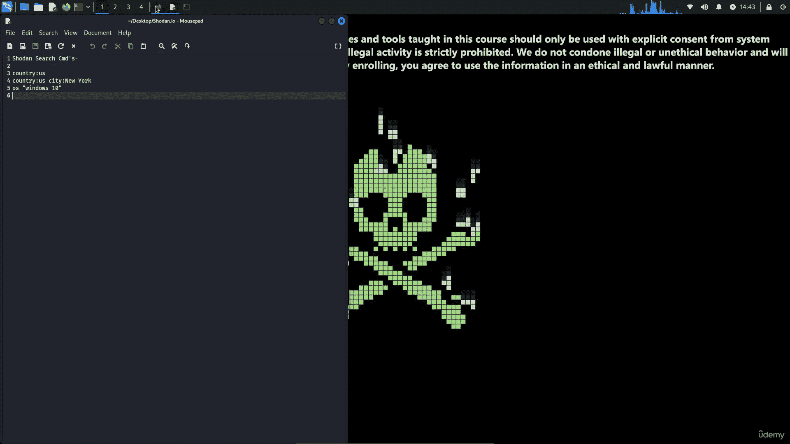

下面是按国家搜索的命令格式：

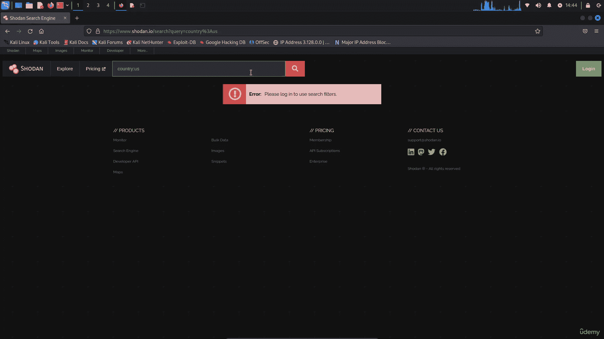

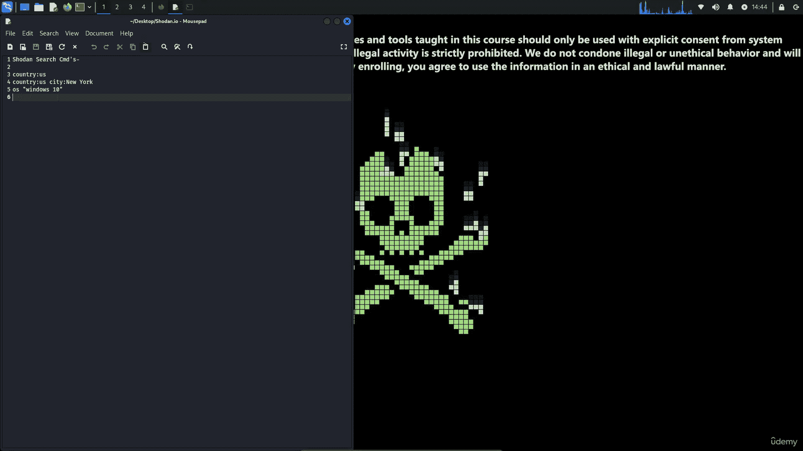

```text
country:US
```

注意，国家代码需要使用大写字母，比如 US 代表美国。如果你输入小写或者格式不正确，搜索可能会返回错误或空结果。当你正确输入 country:USA 并搜索后，页面会列出美国境内连接到互联网的设备，并展示它们的开放端口、所属组织、所在城市以及已知漏洞。这些设备可能分布在波特兰等城市，提供商和组织信息也会一并显示。通过这些信息，你可以了解某个地区内暴露在公网上的设备数量和安全状况。


## 按操作系统搜索设备

除了按国家筛选，你还可以直接搜索特定的操作系统。例如，如果你想查找运行 Windows 10 的设备，可以直接在搜索框中输入 Windows 10，然后查看返回的结果。

以下是按操作系统搜索的示例命令：

```text
Windows 10
```

搜索完成后，你会看到大量运行该操作系统的联网设备列表。点击任意一个结果后，可以查看该设备的详细信息，包括它使用的互联网服务提供商、所在城市、开放端口号，以及是否存在已知漏洞。例如，你可能会在亚特兰大找到一台连接到互联网的系统，它运行的是 Windows 操作系统，并且可能存在一些安全漏洞。常见的开放端口包括 3389 等，但并不是所有端口都能正常工作，有些可能可以访问，有些则不行。某些网络摄像头可能要求输入密码才能建立连接，你可以尝试列表中的第二个设备。


## 查看端口与漏洞信息

在 Shodan.io 的设备详情页面中，你还可以重点查看开放端口和漏洞信息。开放端口决定了哪些服务对外可见，而漏洞信息则告诉你该设备可能存在哪些安全缺陷。

你可以通过以下步骤查看端口与漏洞：

1. 在搜索结果中点击某个 IP 地址
2. 查看页面中列出的开放端口号
3. 查看对应的服务名称和版本号
4. 查看页面列出的已知漏洞列表

常见的端口包括 22（SSH）、80（HTTP）、443（HTTPS）和 3389（远程桌面）等。如果某个设备开放了 3389 端口且没有设置强密码，那么它就可能容易成为攻击目标。除了端口信息，你还可以查看传输控制协议详情和 SSL 证书信息。页面还提供普通视图和地图视图，你可以在地图上查看布拉克斯顿等城市的设备分布情况。


## 使用 Shodan.io 的注意事项

使用 Shodan.io 时，有几点非常重要的事项需要牢记。首先，不要在没有保护措施的情况下频繁暴露你的真实 IP 地址，避免在地图上留下过多的访问痕迹。其次，虽然 Shodan.io 提供了大量公开设备的信息，但这并不意味着你可以随意访问或攻击这些设备。未经授权访问他人系统属于违法行为，可能会带来严重的法律后果。

你可以把 Shodan.io 当作一个学习和研究工具，用来了解互联网上有哪些设备暴露在公网，以及这些设备通常存在哪些安全问题。你还可以在网站上点击探索按钮，随意浏览和玩耍，查看对所有人开放的数据库，甚至尝试访问卫星。如果你想进一步了解，可以阅读维基百科上的相关文档，获取端口、IP 地址、信息和漏洞详情。请记住，只有在目标系统不安全且你拥有授权的情况下，才可以进行测试，切勿随意攻击网络、数据库或计算机。


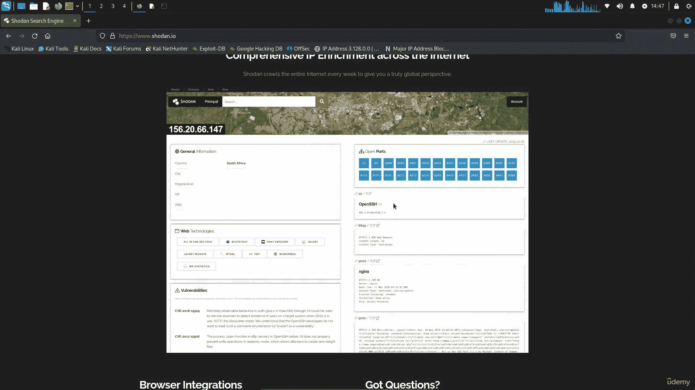

## 总结

本节课中我们一起学习了 Shodan.io 是什么，以及如何使用它来搜索联网设备。我们了解了 Shodan.io 的基本定义，学习了如何通过 VPN 或代理安全地访问该网站，尝试了搜索网络摄像头、按国家筛选设备，以及按操作系统查找目标系统。同时我们也查看了开放端口和已知漏洞信息，并掌握了使用这类搜索引擎时需要注意的安全事项。希望这些内容能帮助你初步了解物联网设备搜索的基本原理，我们下节课见。

