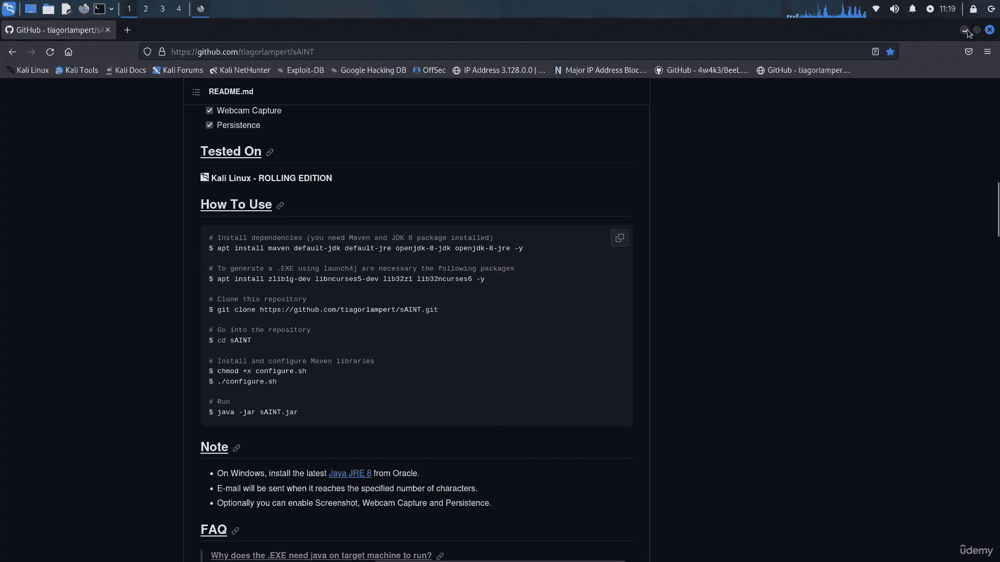
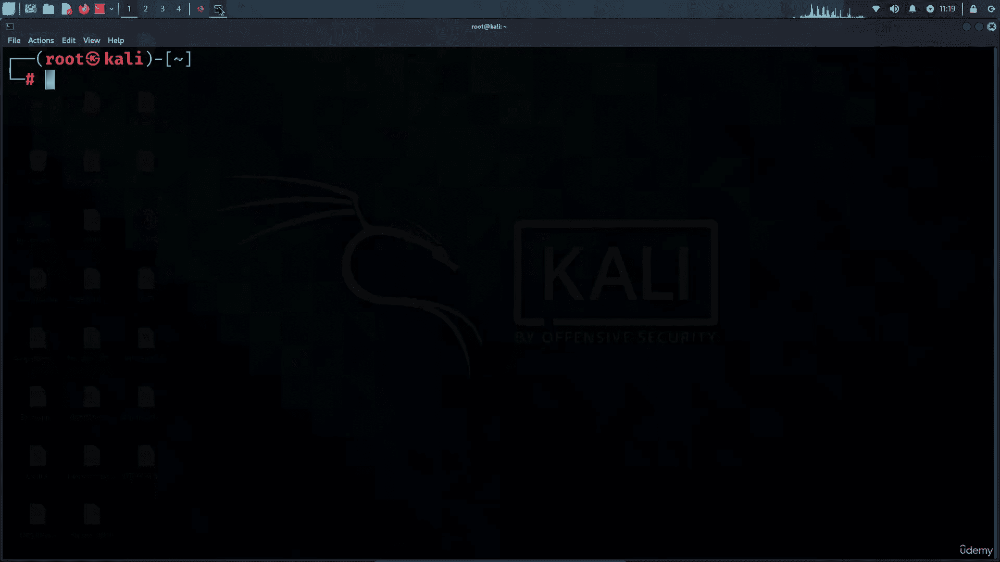
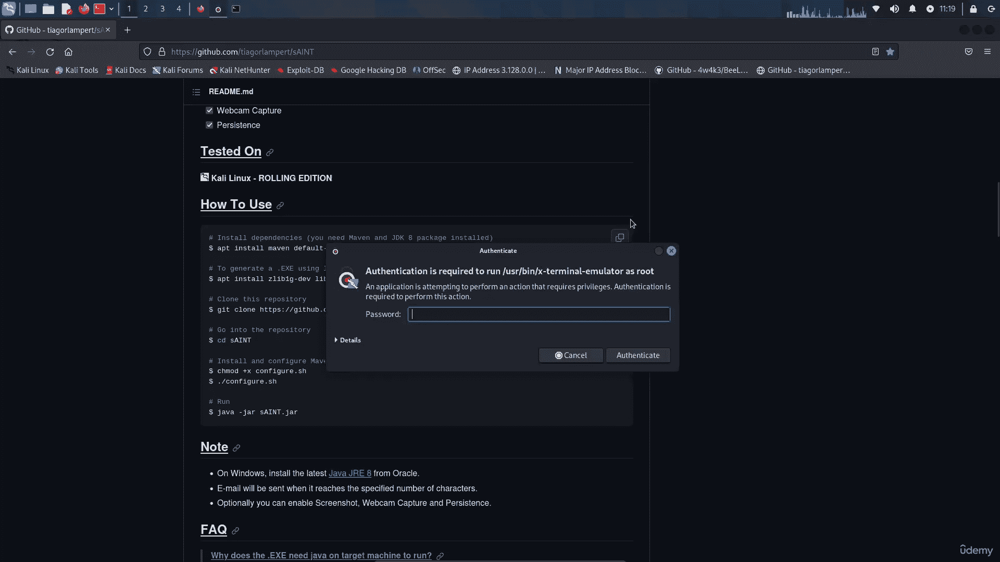
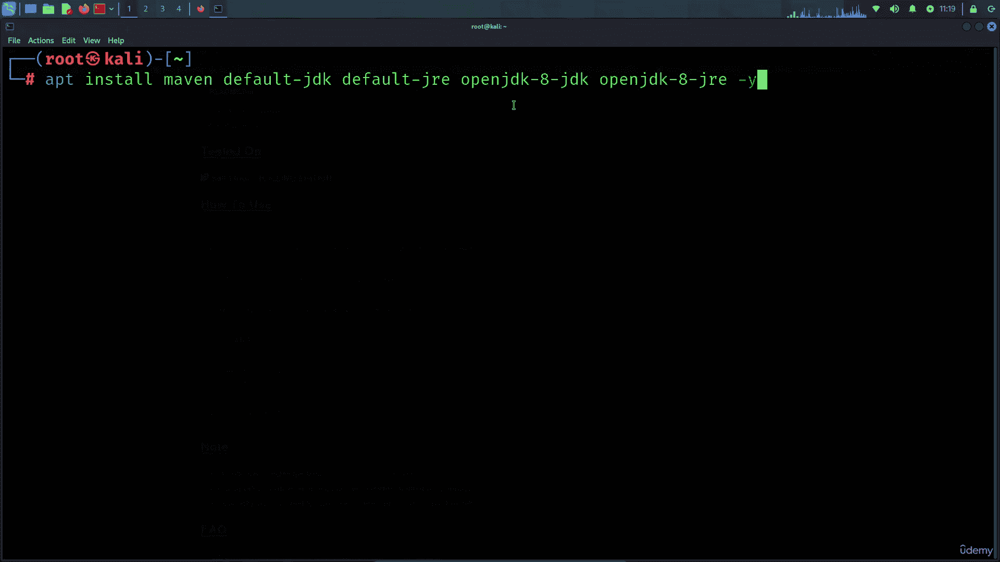
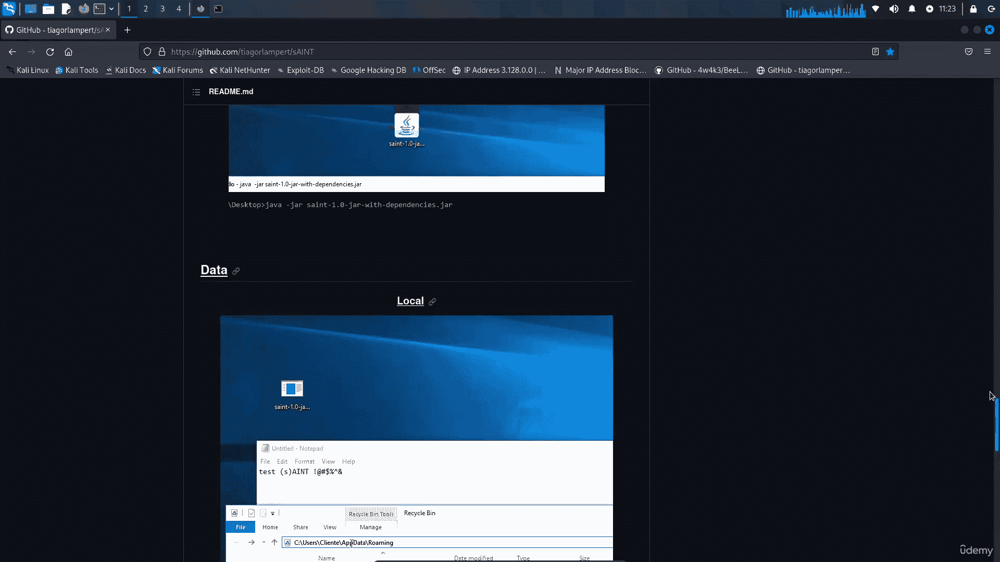
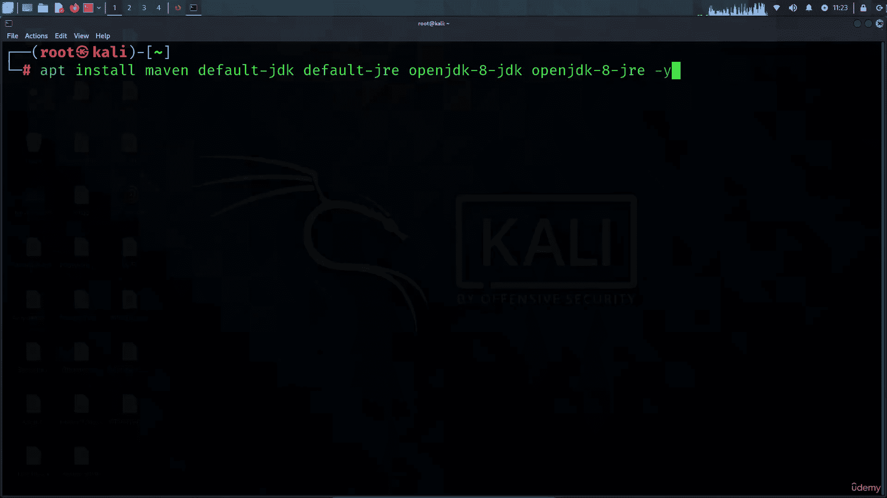
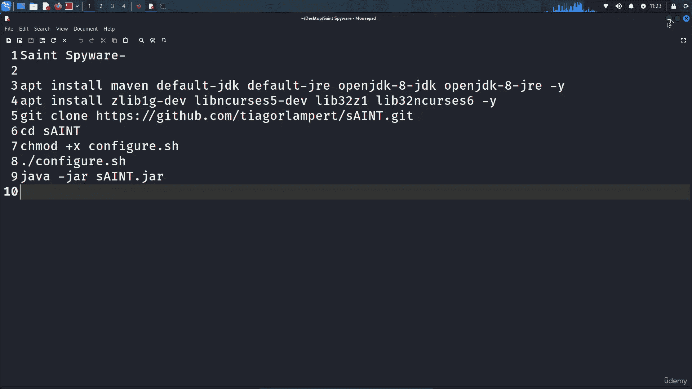

# 🕵️ 完整道德黑客课程2026：从零到英雄：33：圣间谍软件


在本节课中我们将要学习一种名为 sa Spyware 的 Windows 间谍软件。这款工具是用 Java 编写的，专门针对 Windows 操作系统开发。你会看到如何在 Kali Linux 上安装它，如何生成可执行文件，以及如何把采集到的数据发送到你的邮箱。请记住，这只是为了教学和道德用途，绝不能用于偷窥他人隐私或破坏他人设备。

首先，我们来认识一下这个工具到底是什么。sa Spyware 是一款用 Java 编写的间谍软件，专门针对 Windows 系统设计。它主要具备以下几个功能。

以下是 sa Spyware 的核心功能列表：
- 键盘记录：记录目标电脑上所有按下的按键。
- 屏幕截图：在目标用户工作时抓取屏幕快照。
- 摄像头捕获：打开目标摄像头拍照，并直接把照片发送到你的邮箱。

用一段简单的伪代码来描述它的工作逻辑：
```
功能集合 = {键盘记录, 屏幕截图, 摄像头拍照, 将数据发送到邮箱}
```

了解功能之后，我们先看看在 Kali Linux 上安装 sa Spyware 之前需要做什么准备。开发者已经宣布停止维护这个工具，所以你在 GitHub 上看到的页面会带有一些免责声明。软件是“原样”提供的，没有任何担保，开发者不对误用造成的损坏负责。



在开始安装之前，建议先更新 Kali Linux 系统，这样可以减少安装过程中出现各种报错的可能性。你可以运行下面这条命令来更新系统：
```
sudo apt update && sudo apt upgrade -y
```





系统准备好以后，接下来就是正式安装 sa Spyware 了。你可以直接把下面的命令复制到终端里运行。



以下是安装 sa Spyware 所需的命令：
```
git clone https://github.com/...
cd sa-spyware
chmod +x install.sh
./install.sh
```
安装过程中如果出现错误，通常是因为缺少某些依赖。你可以检查错误信息，安装缺失的组件后再试一次。初学者遇到这种情况不要慌，多试几次通常就能解决。

安装完成后，sa Spyware 就会开始运行，并生成一个针对 Windows 的可执行文件。生成的文件是 .exe 格式，你需要把它传输到目标 Windows 电脑上。传输方法有很多种，比如通过 Gmail 发送给目标用户，或者使用 U 盘把文件物理拷贝过去。

生成文件的基本信息可以用下面这行伪代码表示：
```
文件类型 = .exe
目标系统 = Windows 操作系统
```

文件传到 Windows 电脑之后，还需要配置好运行环境。目标机器必须安装 Java，建议安装最新的 JRE 8 或更高版本。你可以通过社会工程学等方法诱导目标用户运行这个文件。运行之后，间谍软件会把自身克隆到其他位置，并开始收集按键、截图和摄像头照片。

运行这个程序需要满足以下条件：
```
运行条件 = 已安装 Java + 目标运行 .exe 文件
```
所有采集到的数据会直接发送到你提供的邮箱地址。

因为所有数据都会发到邮箱，所以邮箱的选择非常重要。强烈建议不要使用个人邮箱，应该创建一个临时或假的邮箱地址提供给 sa Spyware。程序需要你的邮箱密码和地址才能发送数据，如果你用个人邮箱，一旦泄露就会带来很大风险。

邮箱选择建议如下：
```
推荐邮箱 = 临时邮箱 / 假邮箱
禁止邮箱 = 个人常用邮箱
```

在配置过程中，你可以选择开启哪些功能。sa Spyware 允许你开启截图、摄像头捕获和持久化功能。持久化意味着即使目标电脑重启，间谍软件依然会继续运行。一旦程序开始运行，它就会编译并把生成的 .exe 文件放到文件夹里，等你传输到目标机器即可。

最后我们来聊聊如何应对杀毒软件，以及怎么卸载这个工具。如果目标电脑安装了比较好的杀毒软件，它很可能会查杀这个间谍软件。如果你控制的是测试机器，可以暂时禁用杀毒软件，然后再安装 Java 和运行程序。

卸载 sa Spyware 很简单，只需要在目标机器上以管理员权限运行下面这个批处理文件：
```
uninstall.bat
```
卸载时也要记得使用管理员权限，确保能够干净地删除所有相关文件。

在结束之前，必须再次强调使用这类工具的底线。sa Spyware 仅用于合法的安全测试和教学演示。绝对不要用来偷窥你不认识的人的数据，也不要用于任何不道德或违法的行为。开发者明确表示不对滥用造成的任何损失负责。



使用原则可以总结为：
```
使用原则 = 仅限授权测试 + 道德用途
```





本节课中我们一起学习了 sa Spyware 的基本介绍、在 Kali Linux 上的安装方法、如何生成 Windows 可执行文件、如何配置邮箱接收数据，以及卸载和注意事项。希望你能在合法合规的前提下掌握这些知识，提升自己的安全技能。下节课见。
