# 🛡️ 道德黑客完整课程2026：34：Metasploit入门


本节课中我们将学习 Metasploit 渗透测试框架的基础知识，包括它是什么，如何在终端中启动它，常用命令有哪些，以及内部模块分别起什么作用。学完本节后，你将能够在 root 终端中启动 Metasploit，查看帮助信息和启动横幅，并初步理解 exploits、payloads、auxiliary 等核心模块的用途，为后续的信息收集和攻击实践打下基础。


## 什么是 Metasploit

Metasploit 是一个广泛使用且功能强大的渗透测试框架，同时也是一套漏洞利用工具集。它主要用于测试和加固计算机系统与网络的安全性。该框架由 Rapid7 公司开发，属于开源项目，因此对安全专业人员和恶意黑客都有参考价值。虽然它也可能被不法分子滥用，但它的首要目的是用于合法的道德黑客行为和网络安全研究。在实际工作中，你可以用它开展各种渗透测试以及其他与道德黑客相关的活动。从核心组成部分来看，Metasploit 的主要方面包括漏洞利用、有效载荷、后续利用、框架本身，以及用于培训和教育的渗透测试功能。

可以用下面的公式来概括 Metasploit 的核心构成：

```text
Metasploit = 漏洞利用模块 + 有效载荷模块 + 后续利用模块 + 辅助模块
```

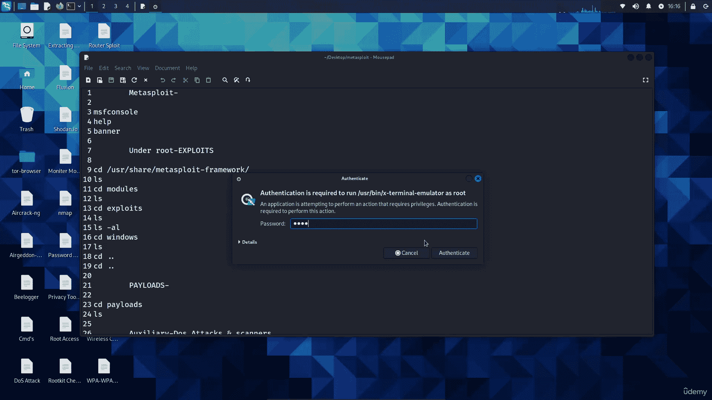

这个公式说明，Metasploit 不是单一的攻击工具，而是一个把多种功能模块组合在一起的综合平台。讲师在课程中也准备了一些命令，记在记事本里，因为命令非常多，不方便全部背诵，演示时会直接复制粘贴到终端中使用。


## 启动 Metasploit

接下来我们来看如何启动 Metasploit。首先打开你的 root 终端，输入管理员密码，确认无误后即可开始。然后使用 msfconsole 命令启动框架。启动过程需要等待几分钟，直到 Metasploit 完成初始化。如果出现命令未找到的提示，请检查命令是否复制正确，尤其是 cd 等命令不要漏掉字母，避免粘贴不完整导致报错。

启动完成后，你可以输入 help 命令，系统会给出一组说明如何使用 Metasploit 的命令。如果你想了解更多高级选项或额外模块，可以输入 advanced。如果你只想快速打开帮助菜单，输入问号即可。输入 banner 命令会显示一个漂亮的 Metasploit 启动横幅，里面包含 exploit、load、payload 等基础信息。当你想要退出框架时，输入 exit 即可。


## 常用命令列表

以下是启动和使用 Metasploit 时常用的命令：

- msfconsole：启动 Metasploit 控制台
- help：查看可用命令列表，包括开发者命令和凭证命令
- advanced：显示高级选项或更多模块
- ？：打开帮助菜单
- banner：显示 Metasploit 启动横幅
- exit：退出 Metasploit


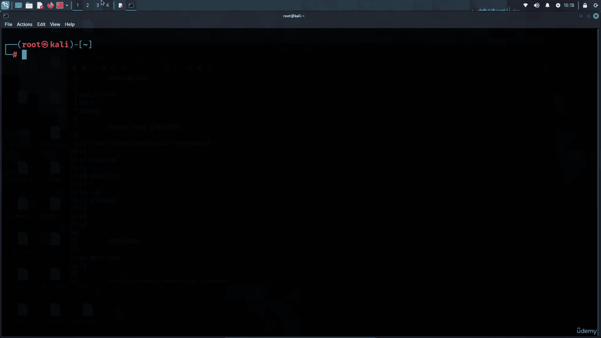

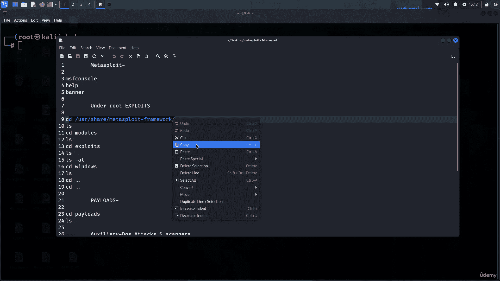

## 进入模块目录

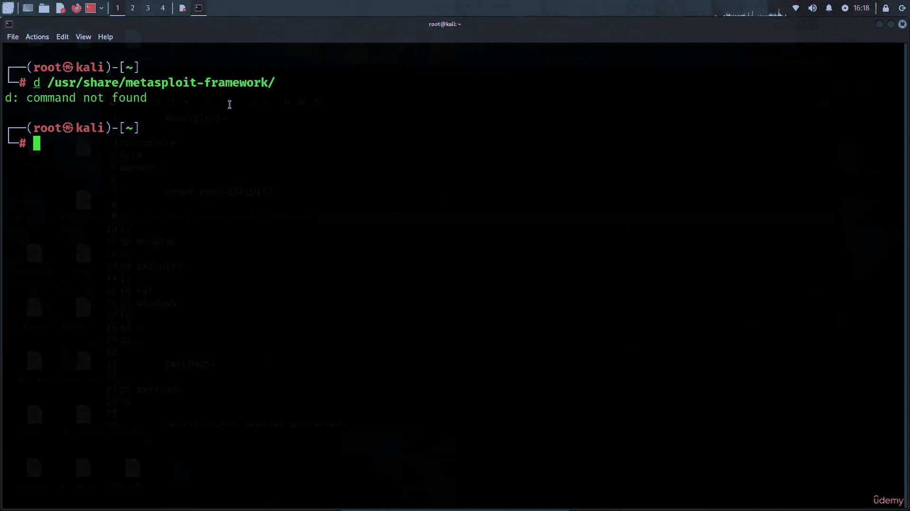

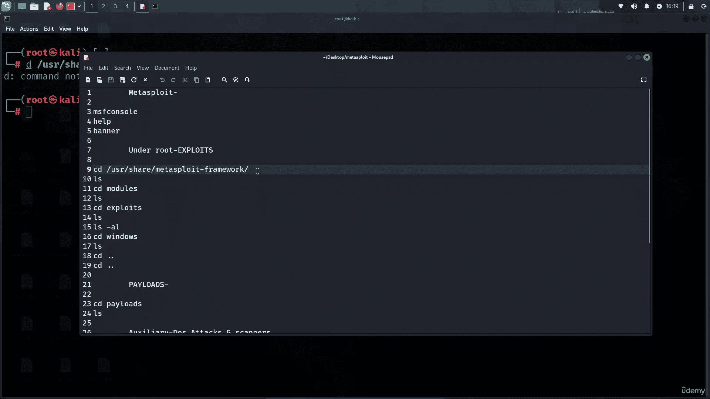

退出 Metasploit 之后，我们还可以通过终端直接进入模块目录，查看框架内部都有哪些模块。假设你已经在终端中，可以使用 cd 命令切换到模块目录，然后使用 ls 命令列出所有模块。进入框架后，你还可以输入 L 进入模块，或者直接输入 cd modules 并按回车。

以下是模块目录的常用操作命令：

- cd modules：进入模块根目录
- ls：列出当前目录下的所有模块
- cd exploits：进入漏洞利用模块目录
- cd payloads：进入有效载荷模块目录
- cd auxiliary：进入辅助模块目录

在终端中执行 cd modules 并按回车后，你会看到类似 auxiliary、encoders、evasion、exploits、nops、payloads 这样的子目录。如果你只想看漏洞利用相关的模块，可以输入 cd exploits 并按回车，接着用 ls 查看具体的利用模块列表。操作完成后，如果想返回上一级，可以使用 cd .. 回到模块目录。


## 核心模块详细介绍

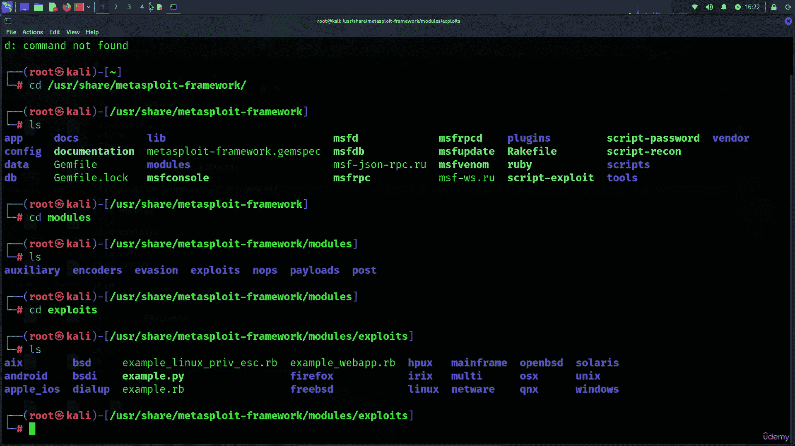

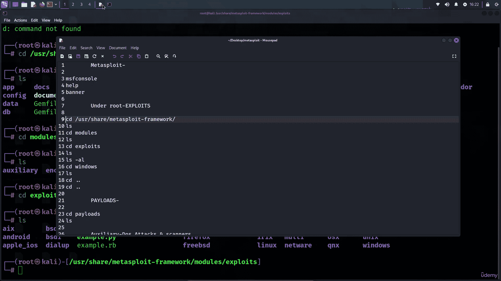

Metasploit 内部包含多种功能模块，每种模块负责不同的任务。以下是几个最重要的模块及其作用。


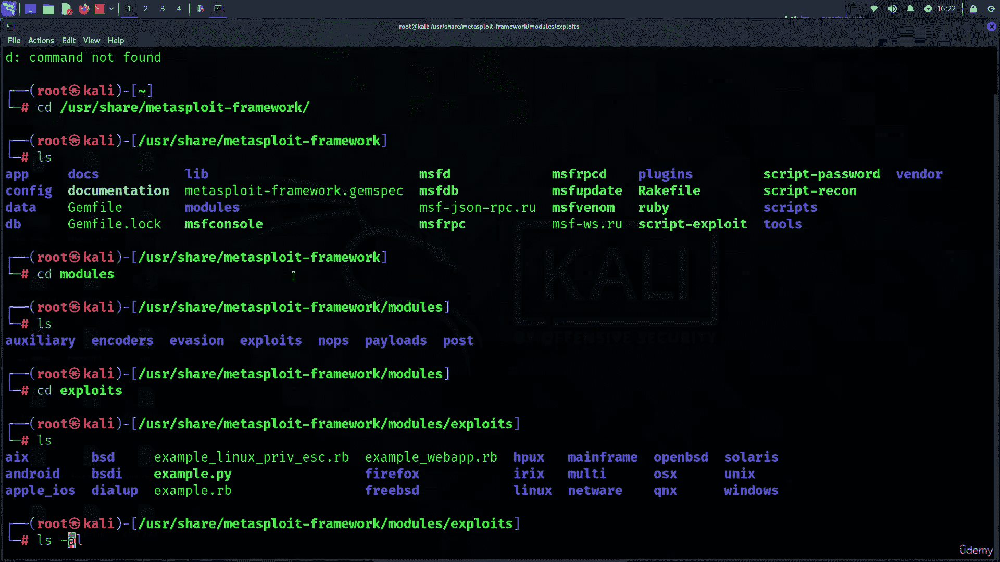

### 漏洞利用模块（Exploits）

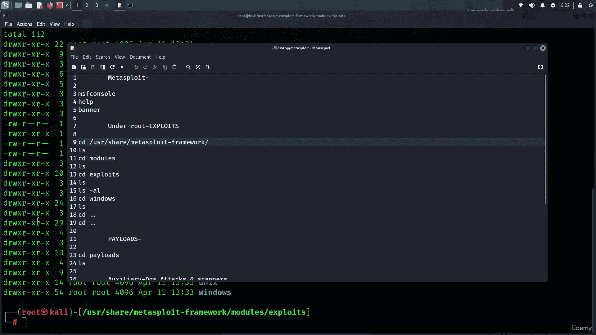

漏洞利用模块用于利用目标系统中的漏洞。这些模块内部包含可执行代码，一旦运行成功，就可以攻破目标系统。它是 Metasploit 中用来攻击目标系统的基础模块之一。在 exploits 目录里，你可以看到针对 Firefox、Windows 框架、Linux 框架等不同目标的模块，Windows 方面还包括防病毒软件、VPN、防火墙破解、浏览器扩展等相关内容。


### 有效载荷模块（Payloads）

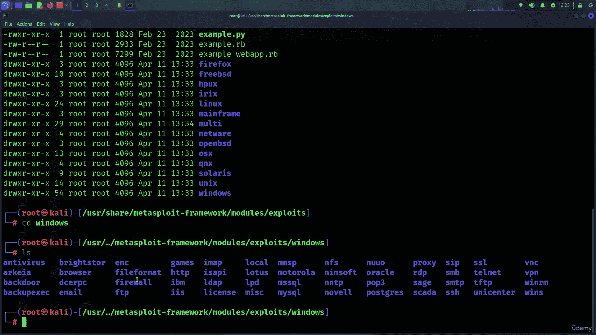

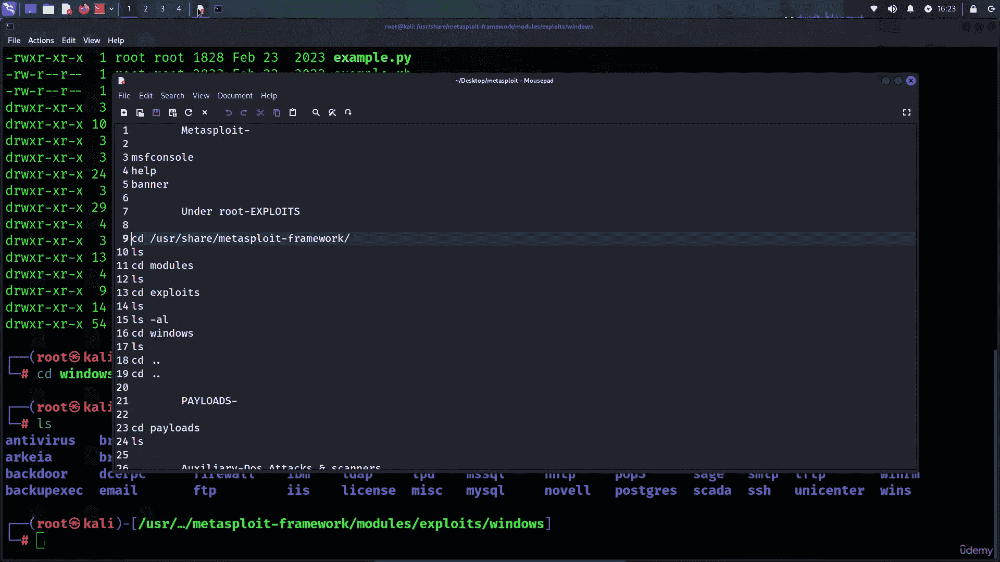

有效载荷模块定义在漏洞利用成功之后应该执行什么操作。它可以包含 shellcode，用于向目标计算机或网络提供远程访问权限，创建后门，或在被攻破的系统上执行其他任务。简单来说，漏洞利用负责“进门”，而有效载荷负责“进门后做什么”。你可以进入 payloads 目录查看所有可用的有效载荷集合，甚至可以针对 Android 设备进行攻击。

可以用下面的公式表示攻击流程：

```text
攻击流程 = 漏洞利用模块 + 有效载荷模块
```


### 辅助模块（Auxiliary）

辅助模块执行各种支持渗透测试过程的任务，但不一定会导致目标系统被完全攻破。常见的例子包括端口扫描、横幅捕获以及拒绝服务攻击等。这些模块主要用于信息收集和目标分析。在 auxiliary 目录里，你可以看到扫描器、嗅探器、SQL 注入等工具，通常用于获取目标系统的信息，需要 root 权限才能使用。


### 其他模块

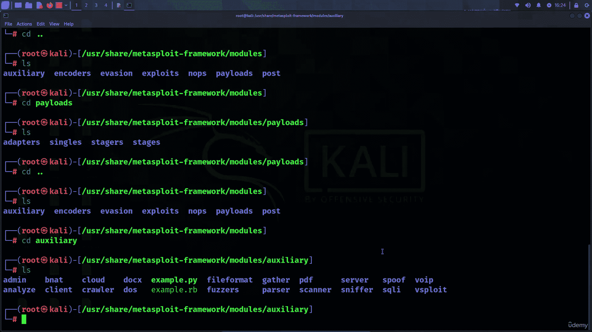

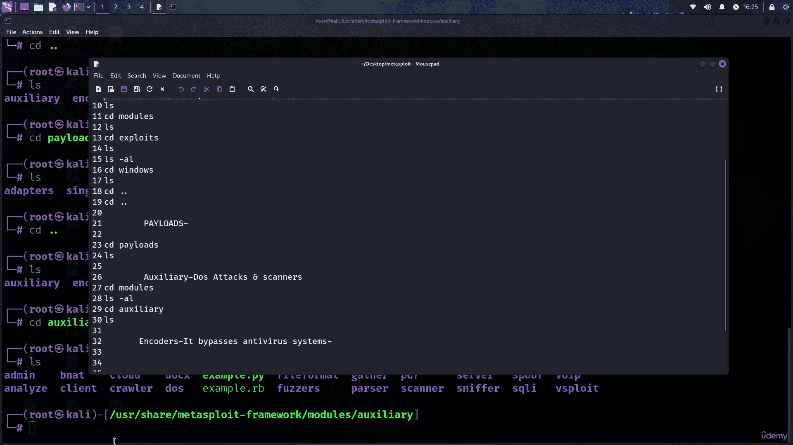

除了上述模块，Metasploit 还包含后续利用模块、NOPS 生成器、编码器模块、规避模块、扫描器模块等。后续利用模块用于在获得访问权限后进行进一步操作，编码器和规避模块则用于绕过安全防护。可以用下面的公式来表示 Metasploit 的四大核心模块：

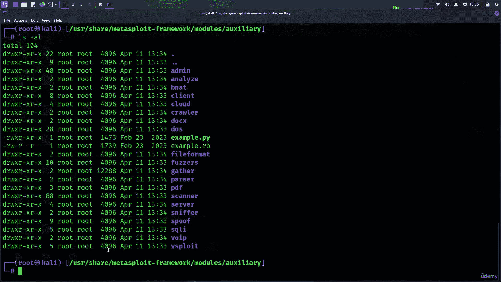

```text
核心模块 = exploits + payloads + auxiliary + 其他辅助模块
```


## 总结

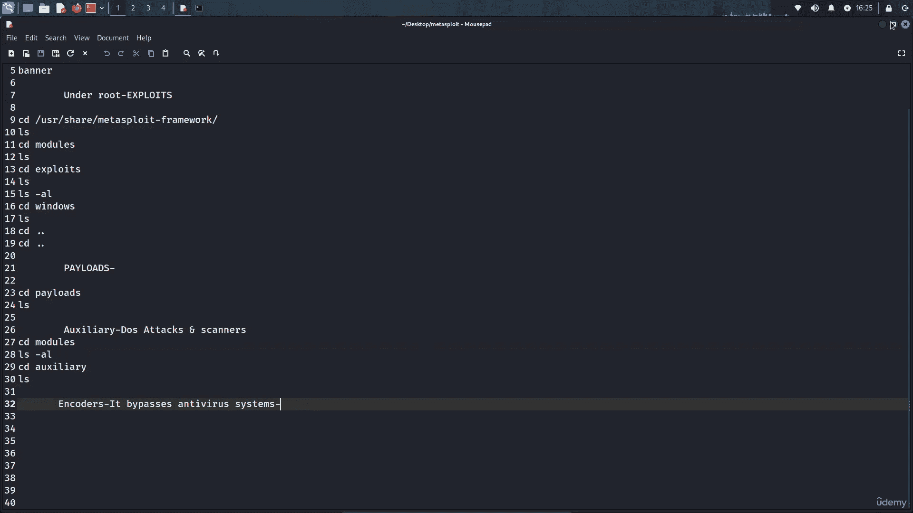

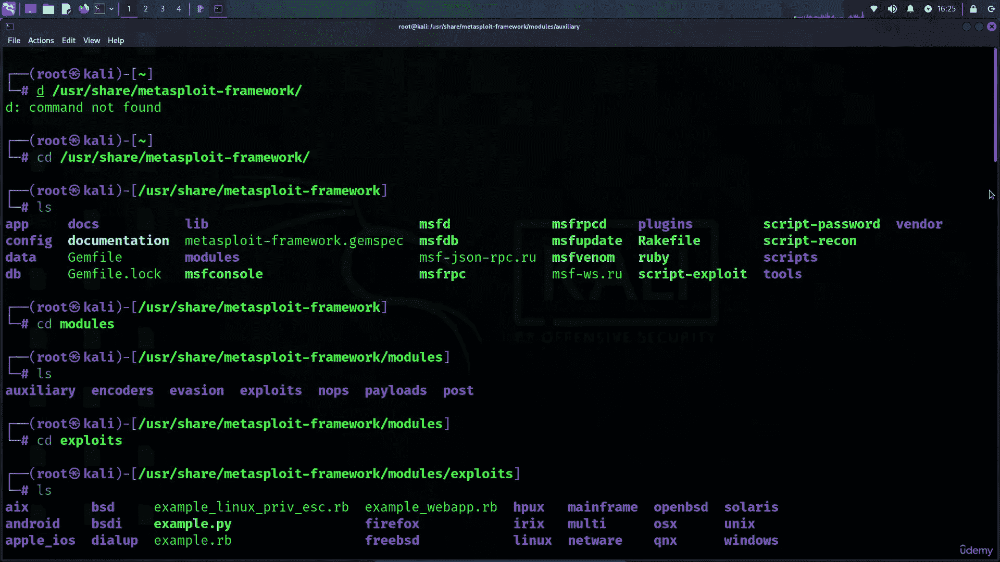

本节课中我们一起学习了 Metasploit 的基本概念、启动方法、常用命令以及 exploits、payloads、auxiliary 等核心模块的作用。我们还了解了如何在终端中启动 msfconsole，如何查看帮助和横幅，以及如何切换到不同的模块目录查看模块列表。下一节课中，我们将学习如何使用 Metasploit 进行信息收集，并对计算机或设备发起攻击。
