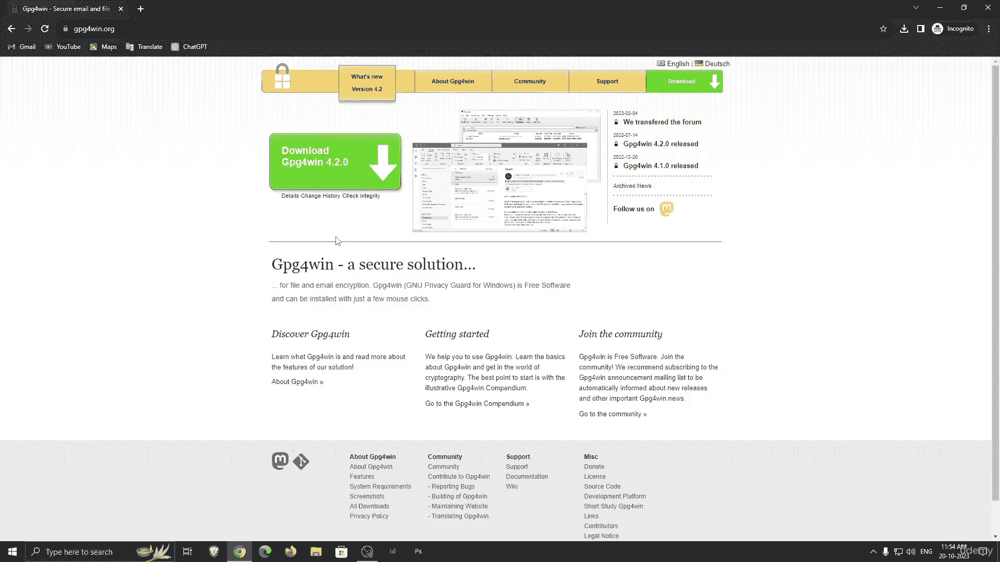
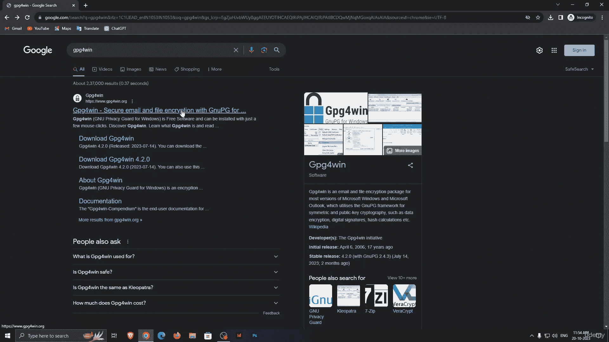
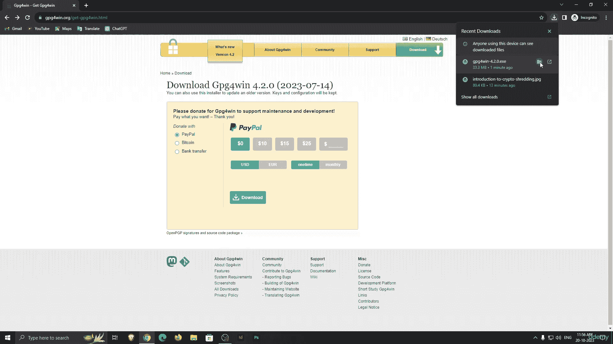
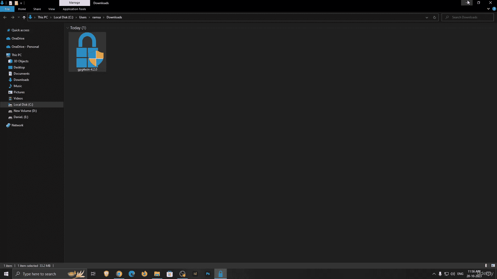
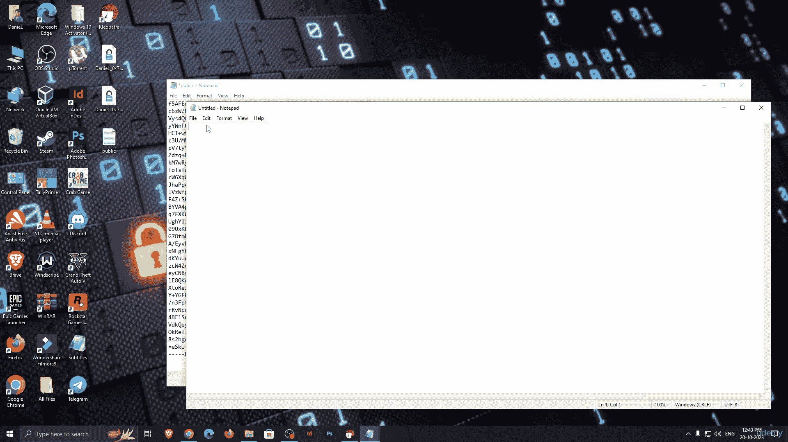

# 🔒 Udemy 道德黑客完整课程 2026：39：Windows 10 加密与 PGP


在本节课中我们将要学习加密的基本概念，以及如何在 Windows 10 操作系统中使用 PGP 技术来保护文件和个人数据。课程会先解释加密是什么，接着对比对称加密和非对称加密的不同，然后教你如何安装和使用 Kleopatra 这款带有图形界面的密钥管理工具，最后演示如何生成公钥和私钥，并对文本文件进行加密和解密操作。

## 一、什么是加密

加密是指将原始数据转换成代码或密文的过程，目的是防止未经授权的人员访问这些数据。简单来说，就是把可以直接阅读的信息变成只有持有特定密钥的人才能还原的形式，这样即使数据被截获，没有密钥的人也无法读取其中的内容。加密在保障敏感信息的完整性和安全性方面起着至关重要的作用，它被广泛应用于数据存储、身份认证和安全通信等多种场景。

## 二、加密的两种主要类型

加密主要分为两类，第一类是对称加密，第二类是非对称加密。




以下是两种加密方式的核心区别：



```
对称加密：同一密钥用于加密和解密，速度快，但需要安全的密钥分发方式，例如 AES 和 3DES。
非对称加密：使用一对密钥，公钥用于加密，私钥用于解密，速度较慢，但密钥交换更安全，例如 RSA。
```

此外，还有端到端加密，以及文件和磁盘加密。加密技术无处不在，比如你在网站上输入密码，或者在密码管理器中保存密码，这些数据都会被加密，以防止黑客攻击。如果攻击者拿到了解密密钥，数据就会泄露，因此保护密钥本身也非常重要。




## 三、加密在现实生活中的应用



加密是现代网络安全的基础组成部分，负责保护主要敏感信息免受未经授权的访问和数据泄露。它的应用范围非常广，从保障在线通信安全，到保护个人和财务数据，比如银行账户信息，这些数据始终处于加密状态，我们的资金和隐私才能得到保障。

## 四、安装 Kleopatra 软件

接下来我们进入实际操作环节。首先需要在计算机上安装 GPG 相关软件，这里我们使用 GPG4Win 中包含的 Kleopatra 程序。

以下是安装步骤：

1. 打开 Google Chrome 浏览器，搜索并下载 GPG4Win 安装包。
2. 下载过程中不需要捐款，直接点击下载按钮即可。
3. 将安装文件保存到下载文件夹，保存完成后双击打开。
4. 运行安装程序需要管理员权限，点击允许继续。
5. 按照提示点击下一步，完成 Kleopatra 的安装。
6. 安装结束后选择运行 Kleopatra，此时会打开一个图形用户界面。

Kleopatra 是一个图形化界面工具，用于在 Windows 系统中管理加密密钥和证书，它是加密软件的前端，可以用来加密文件和电子邮件等内容。

## 五、创建 PGP 密钥对

打开 Kleopatra 软件后，我们需要创建一个新的 OpenPGP 密钥对，也就是公钥和私钥。PGP 的全称是 Pretty Good Privacy，即非常好的隐私保护技术。

以下是创建密钥对的操作步骤：

1. 在菜单中点击“文件”，然后选择“新建 OpenPGP 密钥对”。
2. 输入你想要使用的名称，也可以使用测试用的名称。
3. 填写电子邮件地址，建议使用你自己的个人邮箱，如果只是测试可以使用测试邮箱。
4. 勾选“使用密码保护密钥对”，并设置一个强密码。
5. 点击“高级设置”，选择 RSA 算法，并将位数设置为最高的 4096 位。
6. RSA 算法是由密码学家于 1977 年开发的广泛使用的公钥加密系统，它采用非对称加密方式，安全性很高。
7. 设置密钥的有效期，可以为公钥或私钥单独设置有效日期。
8. 点击确定，重复输入密码进行确认。
9. 系统会提示创建密钥对需要大量随机数，这可能需要几分钟时间，请耐心等待。

等待完成后，Kleopatra 就会为我们生成公钥和私钥，通过这对密钥我们可以对数据进行加密和解密操作。

## 六、导出公钥和私钥

密钥对创建成功后，我们需要将公钥导出到桌面，以便后续使用或分享给他人。私钥则需要妥善备份，不能泄露给其他人。

以下是导出密钥的操作步骤：

1. 在“所有证书”列表中找到刚才创建的证书。
2. 右键点击该证书，选择“导出公钥”，保存到桌面，文件名可以自定义。
3. 公钥文件是 OpenPGP 证书格式，可以用记事本打开查看，里面就是你的公钥内容。
4. 同样地，可以右键点击选择“备份密钥”来导出私钥，保存到桌面。
5. 导出私钥时需要输入你之前设置的密码，请务必记住这个密码，否则无法恢复私钥。

公钥可以分享给别人，用来给你发送加密消息；私钥则由你自己保管，用来解密收到的消息。

## 七、加密文本文件

有了公钥之后，我们就可以开始对数据进行加密了。这里以加密一个文本文件为例。

以下是加密操作的步骤：

1. 在桌面上新建一个文本文档，输入你想要加密的消息内容。
2. 打开 Kleopatra 软件，点击“文件”选择“新建窗口”，或者直接使用剪贴板功能。
3. 将文本内容复制到剪贴板。
4. 在 Kleopatra 中点击剪贴板图标，选择“加密”。
5. 在收件人列表中添加刚才导入的公钥，也可以直接从桌面导入公钥文件。
6. 确认添加收件人后点击下一步，系统会提示加密成功。
7. 加密完成后会生成一段 PGP 加密消息，这就是你要发送的加密文本。

这段加密后的消息只有持有对应私钥的人才能解密，即使在传输过程中被截获，也没有密钥的人无法阅读其中的内容。

## 八、解密文本文件



收到加密消息后，接收方需要使用私钥和之前设置的密码来解密内容。

以下是解密操作的步骤：

1. 将加密后的文本内容复制到剪贴板。
2. 打开 Kleopatra 软件，点击剪贴板图标，选择“解密”或“解密并验证”。
3. 系统会提示输入密码，输入你创建密钥对时设置的密码。
4. 输入正确后，文本会自动解密，你就能看到原始消息内容了。
5. 也可以直接右键点击加密文件，选择“解密”选项，然后输入密码完成解密。

通过这个过程，我们可以看到只有拥有私钥和正确密码的人才能还原加密数据，这体现了非对称加密在实际保护数据中的作用。

## 课程总结

本节课中我们一起学习了加密的定义和作用，了解了对称加密和非对称加密的区别，掌握了加密在日常生活中的应用场景。接着我们在 Windows 10 上安装了 Kleopatra 软件，创建了 RSA 4096 位的 PGP 密钥对，并分别导出了公钥和私钥。最后我们演示了如何对文本文件进行加密，以及如何使用私钥和密码将加密内容解密还原。希望这节课能帮助你理解加密的基本原理，并能够独立使用 PGP 工具保护自己的数据安全。
