完整道德黑客课程：40：Kali Linux-GNU 加密基础 🔐

在本节课中我们将要学习如何在 Kali Linux 中使用加密工具保护文本文档和消息。我们会先创建拥有完整权限的 root 账户，接着更新系统并安装 GNUPG 加密软件，随后生成密钥对并导出公钥，最后演示如何加密和解密消息。学完本节你将掌握基础的文本加密流程。


### 创建 root 权限账户 🔑

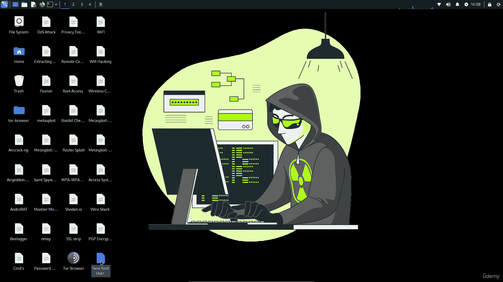

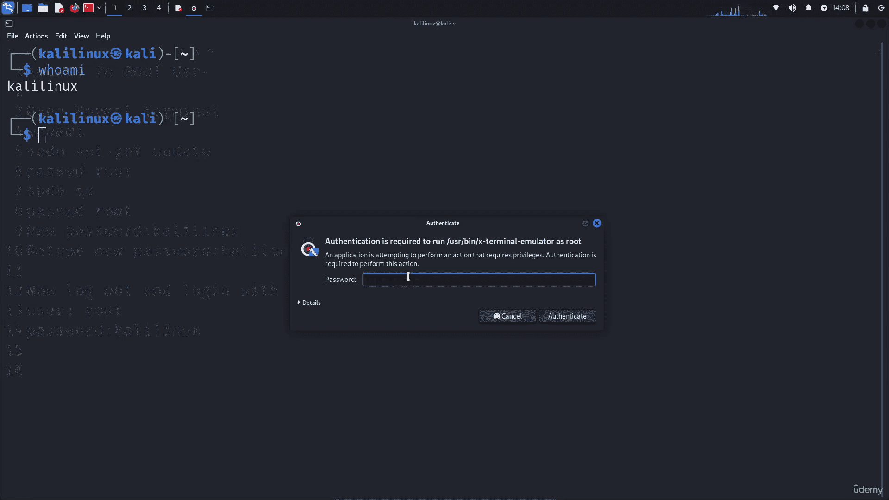

上一节我们介绍了 Kali Linux 的基本环境，本节中我们来看看如何获取完整的 root 权限。首先你需要打开终端，输入 whoami 查看当前用户。如果显示的不是 root，说明当前没有 root 权限。接下来你需要点击终端图标进入 root 终端，并输入 kali 作为密码，按下回车键即可进入 root 终端。但是这个终端只能给你临时的 root 访问，我们希望整个 Kali Linux 操作系统都拥有完整的 root 权限，因此接下来需要创建一个正式的 root 账户。

以下是创建 root 账户需要依次执行的命令：

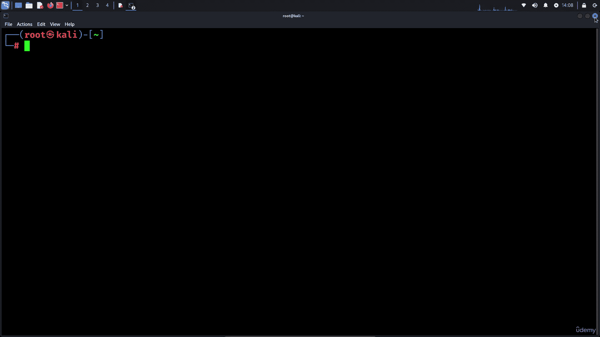

```bash
whoami
su
passwd root
```

请在普通终端中逐行粘贴以上命令。首先输入 root 的当前密码，接着输入 su 切换用户，再次输入 root 密码，然后设置一个新密码，这里示例使用 kali。设置完成后重复输入一遍新密码确认。最后退出当前账户，切换用户，使用用户名 root 和密码 kali 重新登录。这样一来你就成功创建了拥有完整权限的 root 账户。


### 更新系统并安装 GNUPG 📦

有了 root 账户之后，我们需要确保系统是最新的，并安装用于加密的 GNUPG 软件。上一节我们完成了 root 账户的创建，本节中我们来看看如何更新系统和安装加密套件。

以下是更新系统和安装 GNUPG 的命令：

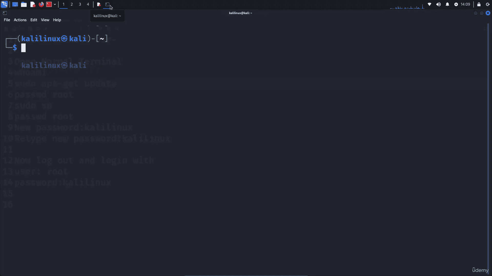

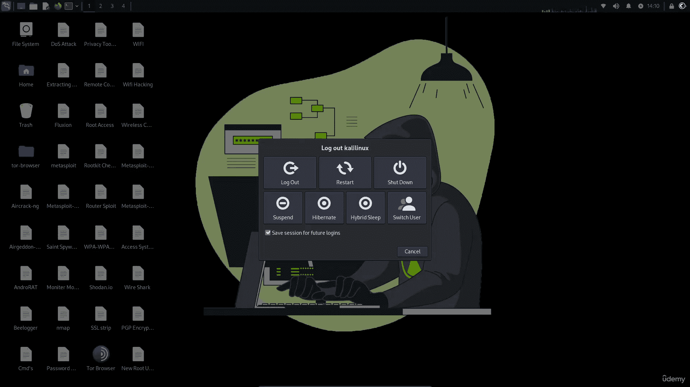

```bash
sudo apt update
sudo apt install gnupg
```

首先在 root 终端中执行 sudo apt update 更新软件源列表。如果你已经更新过系统，可以跳过这一步。然后执行 sudo apt install gnupg 安装 GNUPG 加密软件。安装过程中系统可能会提示确认，直接回车继续即可。安装完成后，你的系统就具备了进行公钥加密的基础能力。


### 生成加密密钥对 🗝️

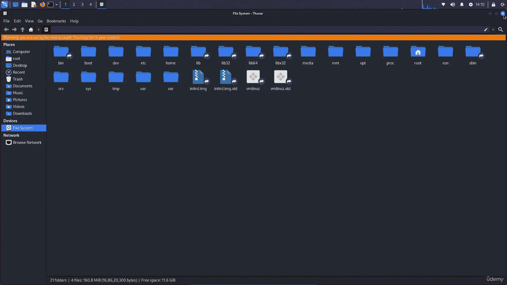

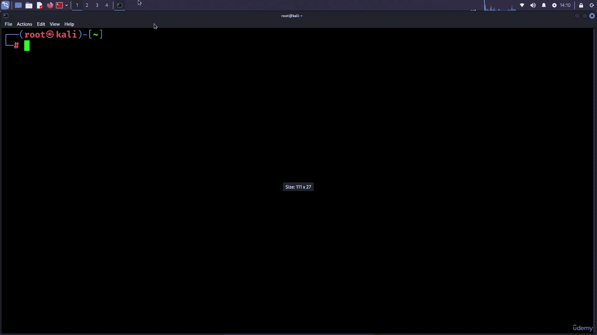

安装好 GNUPG 之后，下一步就是生成用于加密和解密的密钥对。上一节我们安装了 GNUPG 软件，本节中我们来看看如何生成 RSA 密钥对。

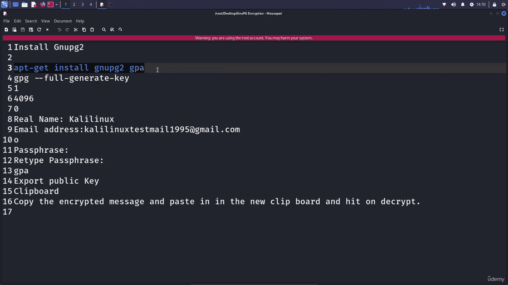

以下是生成密钥的命令：

```bash
gpg --full-generate-key
```

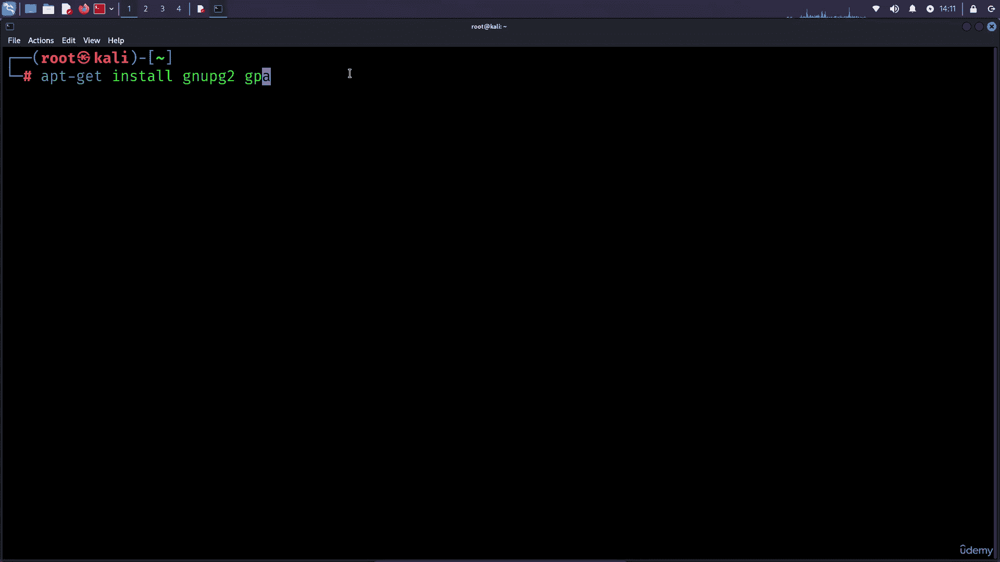

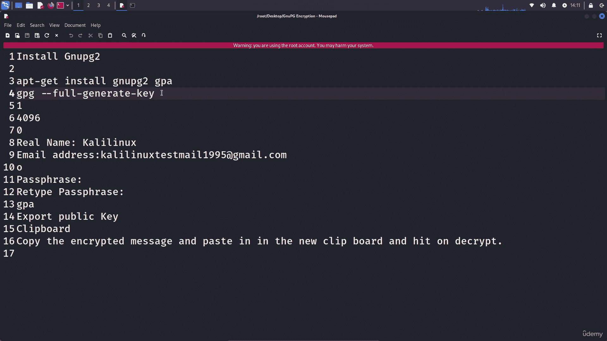

公钥加密的基本模型可以用公式表示：

$$C = E_{pub}(M), \quad M = D_{priv}(C)$$

其中 C 是密文，M 是明文，pub 是公钥，priv 是私钥。

运行该命令后，系统会让你选择加密类型，请选择第一个选项 RSA。接着选择密钥长度，这里我们选择 4096 位，这是目前比较安全的选择。之后系统会询问密钥的过期时间，如果你希望密钥永不过期，直接输入 0 并确认。接下来需要填写姓名和电子邮件地址，可以使用测试邮箱，也可以使用你自己的邮箱地址。然后系统会要求你设置一个保护短语，也就是密码。请注意，保护短语最好包含至少一个数字或特殊字符，如果输入的短语过于简单，系统会发出警告，但你可以选择强制使用。完成这些设置后，系统会开始生成密钥，生成完成后会显示公钥信息，公钥通常以一串字符结尾，例如 3a2。


### 导出公钥到桌面 📤

密钥对生成之后，我们需要把公钥导出到桌面，这样其他人就可以使用你的公钥来加密发送给你的消息。上一节我们生成了密钥对，本节中我们来看看如何导出公钥。

以下是导出公钥的操作步骤：

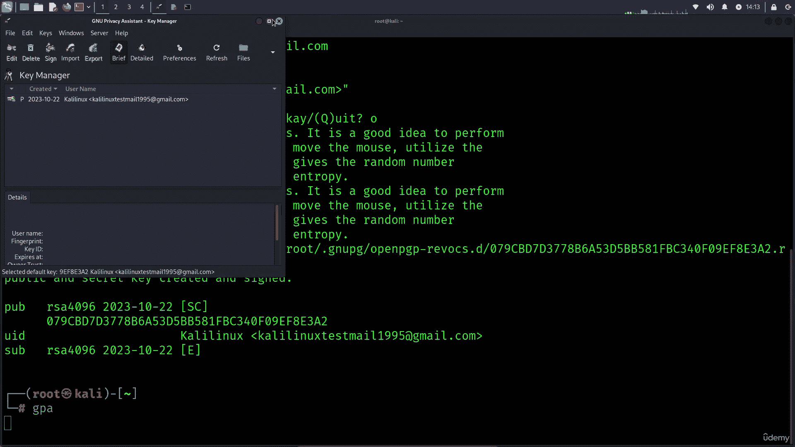

- 打开 GPA 图形密钥管理界面，在终端中输入 gpa 并按下回车。
- 在界面中找到刚才生成的密钥，右键点击选择导出公钥。
- 将公钥保存到桌面，文件名可以设置为 public.txt，格式选择 ASCII 文本格式。
- 导出完成后，系统会提示密钥已保存到 root 桌面的 public.txt 文件中。

公钥文件包含公钥和私钥的相关信息，但实际使用中只需要分享公钥部分。私钥是保密的，可以备份到桌面、文档或其他你信任的位置，本演示中暂不备份私钥。


### 加密与解密消息 🔒

公钥导出之后，我们就可以开始使用 GPA 界面对消息进行加密和解密了。上一节我们导出了公钥，本节中我们来看看具体如何加密一段文本并解密。

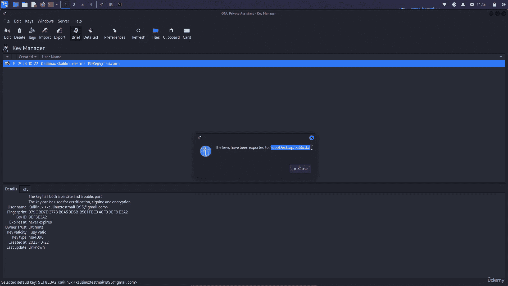

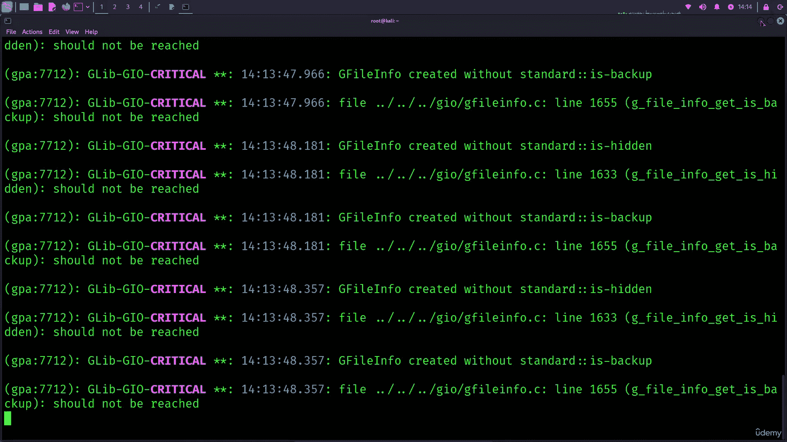

以下是加密和解密消息的操作流程：

1. 打开 GPA 用户界面，进入密钥管理窗口。
2. 将要加密的文本复制到剪贴板，例如一段测试消息。
3. 在界面中选择要使用的公钥，也可以选择对消息进行签名。
4. 输入之前设置的保护短语，系统会提示密钥长度，例如 4096 位。
5. 点击加密按钮，消息就会被加密。
6. 如果要解密，点击解密按钮，再次输入保护短语，就能恢复原始测试消息。

通过以上步骤，你就完成了一次文本消息的加密和解密过程。同样的方法可以用于加密任何文本文档或消息内容。


### 实际应用与总结 📝

加密技术不仅仅是实验室里的工具，它在现实世界中有着重要的应用。上一节我们学会了如何加密和解密消息，本节中我们来看看这个技术在现实中的意义。

以下是实际应用的例子：

- 举报人埃德瓦德·斯诺登使用这类加密软件与新闻记者和记者保持联系。
- 他利用加密方式泄露敏感的政府秘密信息，并将其发送给记者。
- 记者们基于这些信息制作新闻报道。

这个软件非常强大且安全，可以保障你的数据安全。你可以在自己的系统中多加练习，熟悉加密和解密的完整流程。

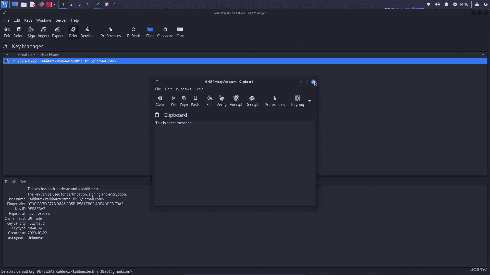


本节课中我们一起学习了如何在 Kali Linux 中创建 root 账户、更新系统、安装 GNUPG、生成 RSA 密钥对、导出公钥以及使用 GPA 加密和解密消息。希望这些内容能帮助你掌握基础的文本加密技巧，我们下节课见。

