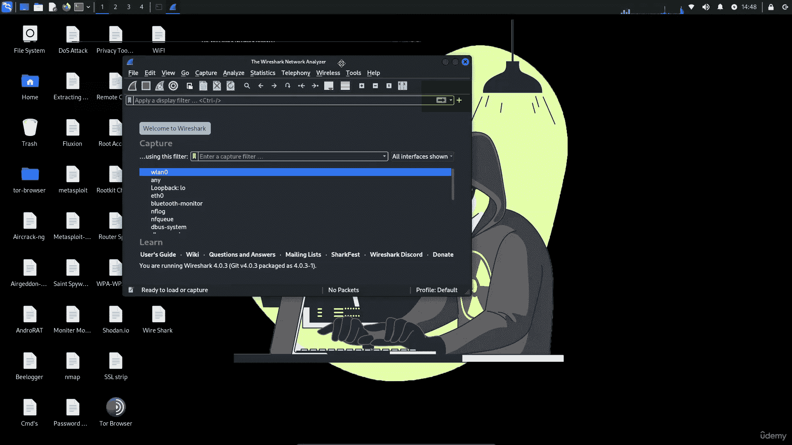
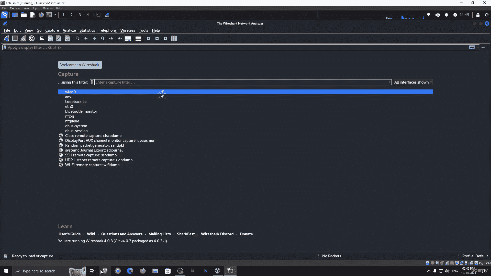
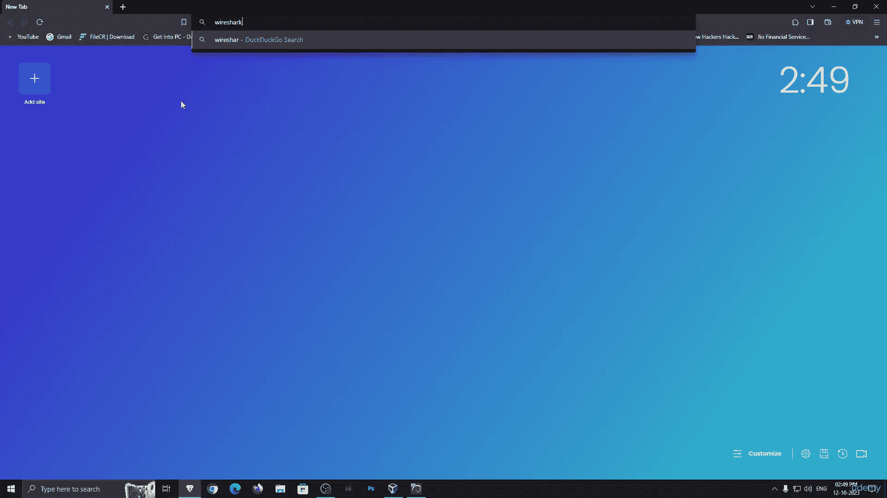
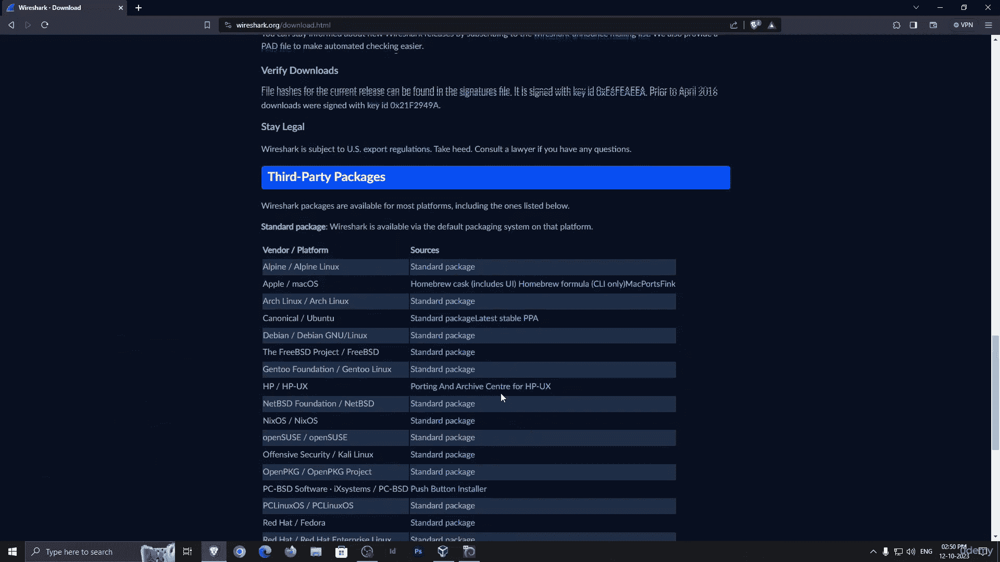
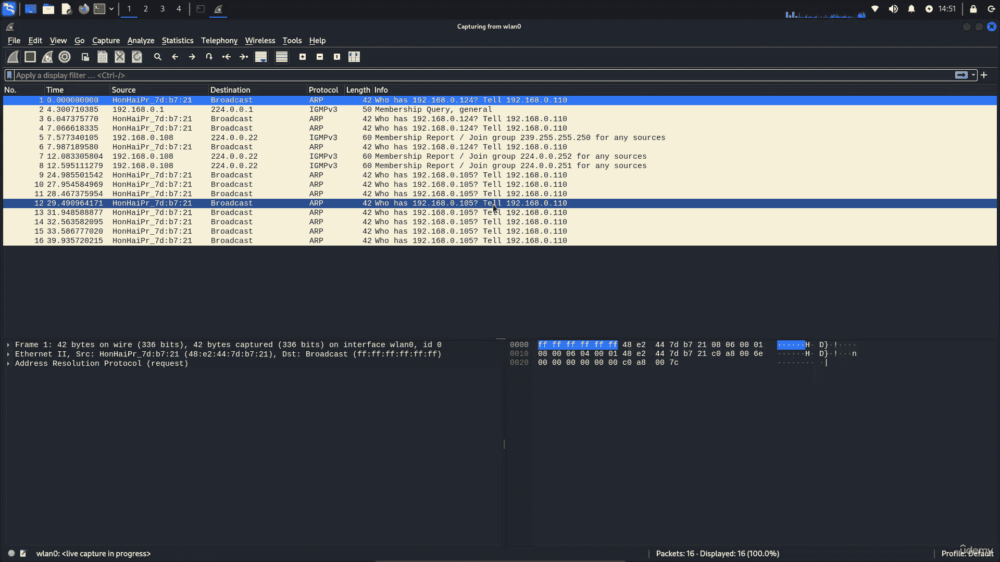
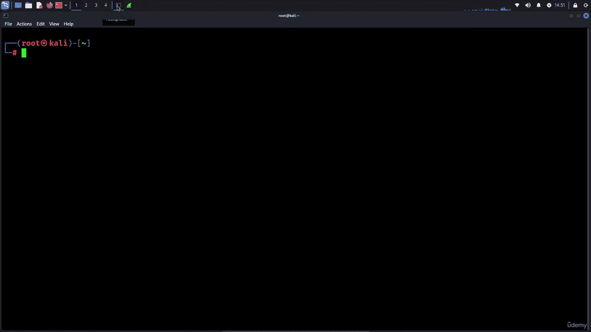
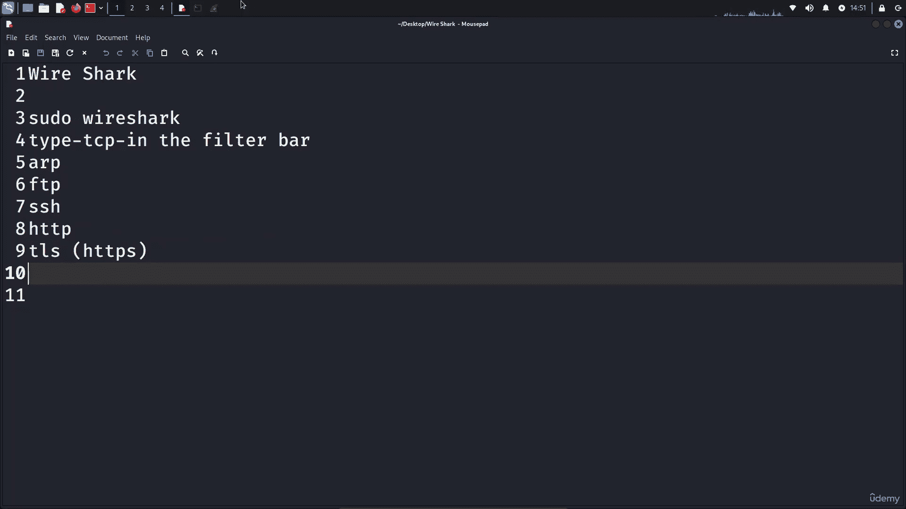
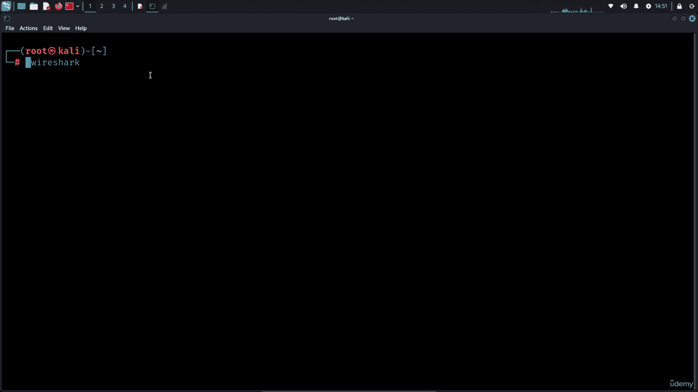
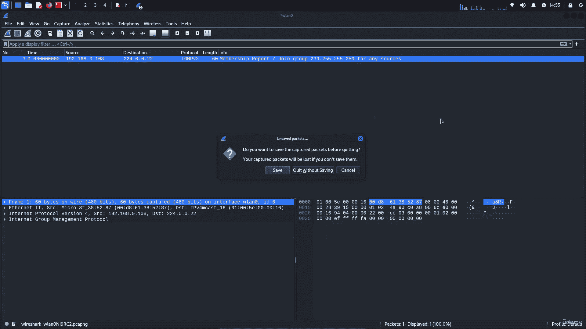

# Complete Ethical Hacking Course 2026：Go From Zero to Hero：42：安装 Wireshark 与命令行工具🔍


## 📖 本节概述

在本节课中，我们将一起学习如何安装和使用 Wireshark 这款网络协议分析工具。无论你是对网络安全完全没有经验的初学者，还是想要系统复习基础知识的学习者，这节课都会用最通俗易懂的方式带你入门。我们会先了解 Wireshark 是什么，然后看看它在不同操作系统上的安装方法，最后在 Kali Linux 环境中打开软件，认识常见的界面元素和命令行启动方式。内容会尽量直白，避免使用晦涩的专业术语，让你快速上手。


## 什么是 Wireshark🧰

在正式安装之前，我们先来搞清楚 Wireshark 到底是一款什么样的工具，这样你在后续操作中才会更有方向感。Wireshark 是一款开源的网络协议分析器，广泛应用于网络故障排查、安全审计以及数据包分析等场景。它的核心功能非常明确，就是捕获、分析和检查计算机网络上流动的数据包，并且支持实时显示这些数据包的内容。简单来说，你可以把它想象成一把网络世界的"显微镜”，能够把飞快经过的网络数据抓下来，逐个查看里面的细节。

用公式来描述它的核心定义：

```
Wireshark = 数据包捕获 + 协议分析 + 实时检查 + 数据包过滤
```



这个工具能够帮助你看到网络中正在传输什么，数据从哪里发出，发往哪里，具体携带了什么内容。对于初学者来说，不需要一开始就全部理解每一个数据包的结构，只需要知道它能"抓包”和"看包”即可。


## 支持的平台与安装方式💻



接下来我们看看 Wireshark 可以运行在哪些系统上，以及如何进行安装。了解这一点很重要，因为不同操作系统的安装步骤可能略有差异，但功能本质是一样的。

以下是 Wireshark 支持的主流操作系统：

- Windows 操作系统
- Mac 操作系统
- 各种 Linux 发行版，包括 Kali Linux

在 Kali Linux 系统中，Wireshark 通常已经预装好了，你不需要手动安装就可以直接使用。如果你使用的是 Windows 或 Mac 操作系统，安装方式也非常相似，只需前往官方网站下载对应的安装程序即可。该工具在每个平台上的功能基本完全一致，界面上的按钮和选项也大体相同，所以你在任何一个系统上学会了，换到另一个系统上也能很快找到对应的功能。



如果你想在 Windows 系统上安装，可以访问 Wireshark 的官方网站进行下载。官网会提供不同位数的安装包，比如 64 位版本，你可以根据自己的电脑配置选择合适的版本下载到本地系统中进行安装。


## 核心功能与使用场景🎯



安装完成后，我们再来看看 Wireshark 具体能用来做什么，以及在实际场景中它是如何发挥作用的。这部分内容能帮你建立起对工具用途的直观认识，避免盲目操作。

Wireshark 本质上是一个数据包嗅探器，主要用于网络数据分析。如果你已经连接到了目标设备所在的网络，就可以分析来自该设备的全部网络数据。比如，当对方通过 WiFi 连接网络并访问某些网站时，Wireshark 可以捕获这些通信过程中的数据包。如果对方访问的是 HTTP 网站，那么其中的密码等敏感信息就有可能在 Wireshark 中被直接查看到，因为 HTTP 协议传输的是明文数据。不过需要提醒的是，前提是你已经获得了该网络的合法访问权限，否则属于非法入侵行为。

下面是几个常见的使用场景示例：

- 分析局域网内设备之间的数据通信
- 排查网络延迟或连接中断的原因
- 查看明文协议（如 HTTP）中传输的敏感信息
- 捕获并研究不同网络协议的工作原理






## 启动 Wireshark 与常用命令🖥️

有了基本认知之后，我们来看看如何实际启动 Wireshark，以及在命令行中可以使用哪些命令。这一部分非常实用，因为很多时候我们不需要点击图标，直接通过终端启动会更加高效。

如果你在 Kali Linux 系统中使用，可以直接在终端输入以下命令来启动 Wireshark：





```bash
sudo wireshark
wireshark
```

执行这些命令后，程序就会启动并打开图形界面。启动完成后，你可以在过滤栏中输入特定的协议名称来筛选数据。例如，输入 TCP 可以查看传输控制协议相关的数据包，按下回车键后系统就会显示相应结果。如果你输入 arp，则会显示所有地址解析协议的详细信息，包括广播地址、本地 IP 地址以及比特率等数据。输入 ftp 会显示相关的 FTP 数据集，输入 http 可以查看访问过的所有 HTTP 网站，而输入 tls 则会显示 HTTPS 相关数据。

下面是一些常用的显示过滤器示例：

```text
tcp
arp
ftp
http
tls
```

如果当前网络中没有相关流量，可能会暂时没有显示结果，这属于正常现象，不需要担心。


## 界面工具栏详解🛠️

软件启动后，你会看到一个比较丰富的界面，上面有很多菜单和按钮。初学者看到这些选项可能会觉得眼花缭乱，但实际上常用的功能就那么几个，我们逐一来看。

以下是界面中常见的菜单和工具栏选项：

- 文件
- 编辑
- 视图，包含全屏模式、数据包列表、数据包详情、数据包字节等
- 过滤器
- 无线工具栏
- 主工具栏
- 时间显示格式
- 名称解析
- 缩放，支持精确到秒、毫秒、微秒甚至纳秒

界面还支持颜色化显示，可以让你一眼区分不同类型的数据包。你可以点击捕获按钮开始抓包，从 wlan0 接口停止捕获，也可以点击绿色的重启按钮来重新开始捕获。此外，还有分析菜单可以用于更深入地研究已捕获的数据包。


## 数据包捕获与查看技巧📦

掌握了界面布局之后，我们接下来学习如何实际进行数据包捕获，以及如何在已捕获的数据中快速定位你需要的内容。这些技巧能让你在分析网络流量时更加得心应手。

当你点击 wlan0 接口后，Wireshark 就会开始收集大量数据，你可以看到时间戳、数据来源等信息。界面中会显示数据帧、以太网协议、地址解析协议，以及所有的比特字节数据。在数据查看方面，你可以使用箭头标记在数据包之间导航，跳转到第一个数据包或最后一个数据包。当前正在显示的数据包会通过这些箭头标记来定位，方便你来回切换查看。你还可以放大或缩小数据包视图，在进行实时捕获时，系统还可以自动滚动到最新的数据包。

以下是数据包导航和缩放的常用操作：

- 点击箭头标记跳转到第一个数据包
- 点击箭头标记跳转到最后一个数据包
- 放大或缩小数据包视图
- 实时捕获时自动滚动到最后一个数据包

关于数据显示格式，你可以看到原始二进制十六进制流、可打印文本、十六进制转储等不同形式。点击停止按钮可以结束数据包捕获，然后选择继续保存捕获的数据。如果你想重新启动 Wireshark，可以在设置列中查看 wlan0 地址等相关信息，确保选择了正确的网络接口。


## ✅ 本节总结



本节课中，我们一起学习了 Wireshark 这款网络协议分析工具的基本概念、支持的平台与安装方式、核心功能与使用场景，以及在 Kali Linux 中如何启动软件和使用常用命令。我们还详细介绍了界面中的菜单和工具栏，并学习了数据包捕获、导航、缩放和查看格式等实用技巧。希望通过这节课的内容，你已经对 Wireshark 有了初步的认识，并能够在自己的系统中安装并启动它。在下一节课中，我们将继续深入学习捕获过滤器等更高级的内容，敬请期待。

