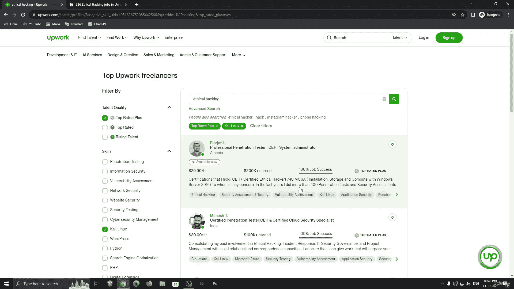

# 完整道德黑客课程 2026：42：在 Upwork 和 LinkedIn 上自由职业 💼


在本节课中我们将要学习如何把道德黑客技能应用到现实世界，具体来说就是如何在 Upwork 和 LinkedIn 这两个平台上寻找自由职业机会，创建个人资料，接单工作并赚取收入。无论你是完全的新手，还是已经掌握了一些基础知识，这节课都会告诉你如何把所学变成实际的机会。


## 第一部分：认识 Upwork 自由职业平台

首先我们来看看 Upwork 网站。这是一个自由职业平台，雇主在这里发布各种任务，自由职业者在这里接单完成工作。你只需要在网站上搜索道德黑客或者渗透测试，就能看到大量相关的工作机会，很多公司都在寻找懂网络安全的人才。


### 如何在 Upwork 上注册并创建个人资料

以下是具体的操作步骤，你可以直接照着做：
- 打开 Upwork 官方网站
- 注册个人账号
- 填写个人简介和专业技能
- 上传相关证书
- 发布服务并等待雇主联系

如果你具备 SQL 注入、Kali Linux 测试、网络安全、网络渗透测试、干扰 WiFi 网络、攻击并保护 Android 手机等技能，就有机会被雇佣。


### 平台上常见的网络安全服务

以下是市场上需求较大的技能类别，你可以重点学习这些方向：
- 渗透测试
- 信息安全
- 漏洞评估
- 网络安全
- 网站安全
- 安全测试

你的预期收入可以用下面这个简单公式来估算：

```text
总收入 = 时薪 × 每周工作时数 × 工作周数
```


## 第二部分：真实的自由职业者案例分析

上一部分我们介绍了 Upwork 平台的基本注册流程，本部分我们来看看平台上已经成功接单的案例，了解这些人具备什么样的技能和经验，这样你就知道自己需要努力的方向。


### 优秀个人资料的典型特征

以下是一些成功自由职业者的共同特征，你可以参考着来完善自己的资料：
- 拥有信息安全或系统管理方面的认证，例如认证道德黑客
- 进行过大量渗透测试和安全评估，有的人过去 30 年进行过 300 多次测试
- 精通 Web、移动端、Android 和 iOS 应用程序安全
- 具备服务器安全测试和加固经验
- 设置合理的时薪，有的人每小时收费 30 美元到 75 美元不等
- 已经赚取了超过 20 万美元甚至 10 万美元以上的收入

你也可以通过 Google 搜索或者参加更多网络安全课程来不断提升自己的能力，等你成为专家之后，就可以在 Upwork 上创建自己的个人资料，开始接单赚钱。


## 第三部分：在 LinkedIn 上寻找工作机会

上一部分我们分析了 Upwork 上的真实案例，本部分我们来看看 LinkedIn 平台。除了 Upwork，LinkedIn 也是一个非常好的平台。你可以在这里搜索工作，或者直接查找正在招聘道德黑客和渗透测试工程师的公司。


### 在 LinkedIn 上搜索工作的具体方法

以下是操作流程，建议你按顺序尝试：
- 点击“工作”选项卡
- 在搜索框输入“道德黑客”或“渗透测试”
- 浏览招聘公司的职位要求
- 查看职位类型，例如初级职位、全职工作、信息技术行业、互联网出版等
- 找到合适的公司，比如名为 Fusion Technology 的美国公司，然后提交申请

常见的职位角色包括渗透测试人员、漏洞和渗透测试工程师，以及全源威胁分析师。


### 如何让你的 LinkedIn 个人资料更有吸引力

以下是几个提升竞争力的建议，照着做能让你的资料更突出：
- 上传你的网络安全证书，增加个人资料分数
- 在个人资料中写明你在网上学到的新技能
- 列出你掌握的具体工具和方法，比如 SQL 注入检测、Kali Linux 使用、网络安全渗透测试等
- 完善工作经历和项目案例，让雇主觉得你更有价值

当你获得相关证书之后，可以直接上传到 LinkedIn，这样会让你的个人资料更有说服力，增加被雇佣的机会。


## 第四部分：把你的技能展示给世界

现在你已经了解了 Upwork 和 LinkedIn 的基本使用方法。不管你是想做兼职自由职业，还是想找全职工作，都可以把自己的网络安全技能摆在雇主面前，尝试接单并赚取一些钱。不要只是玩玩，要大胆地展示你的能力，让全世界看到你能做什么。




本节课中我们一起学习了如何在 Upwork 和 LinkedIn 上注册账号、创建个人资料、寻找渗透测试和道德黑客相关工作，以及如何通过证书和技能展示来提高被雇佣的机会。希望这些内容能帮助你把所学的道德黑客知识变成实际的收入。

