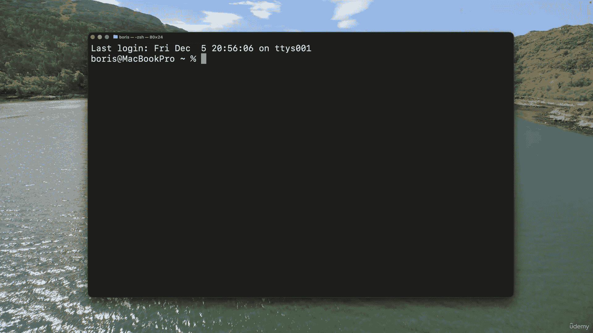
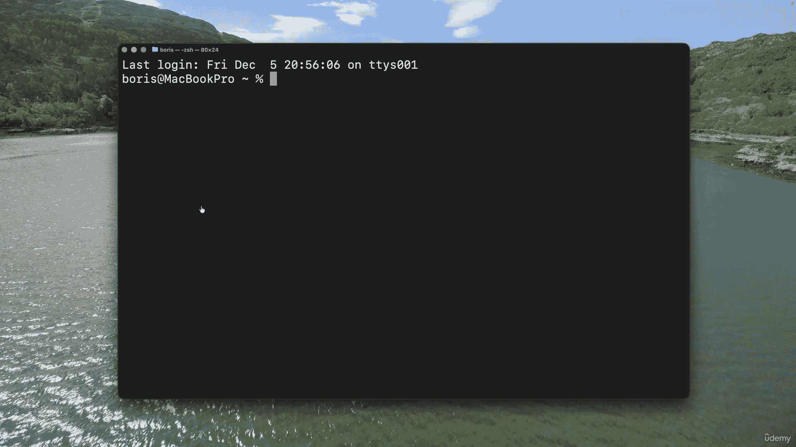
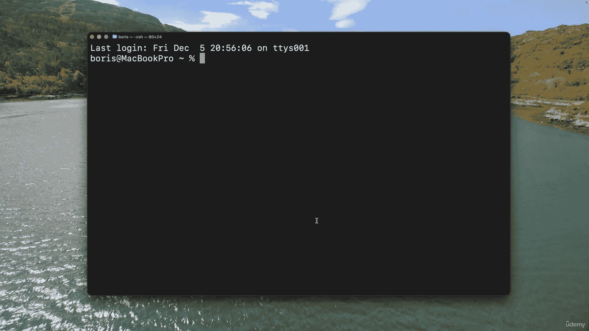
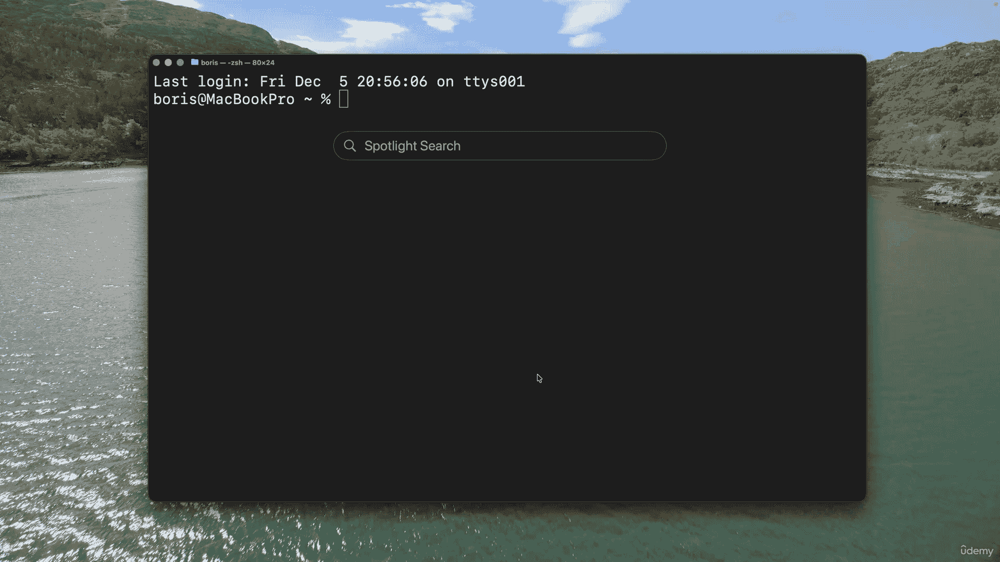
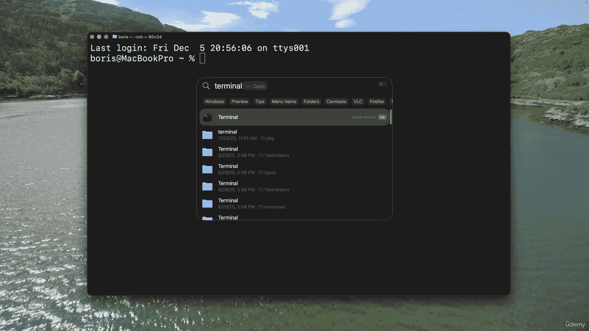
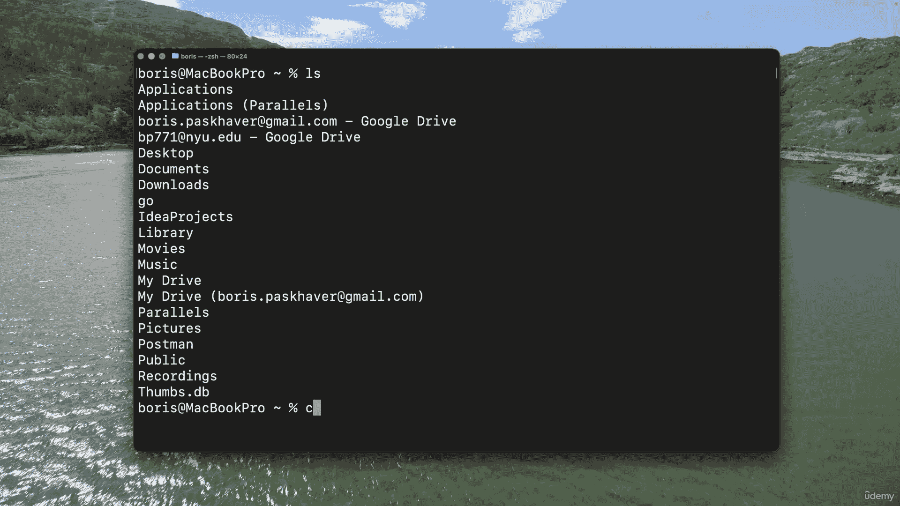
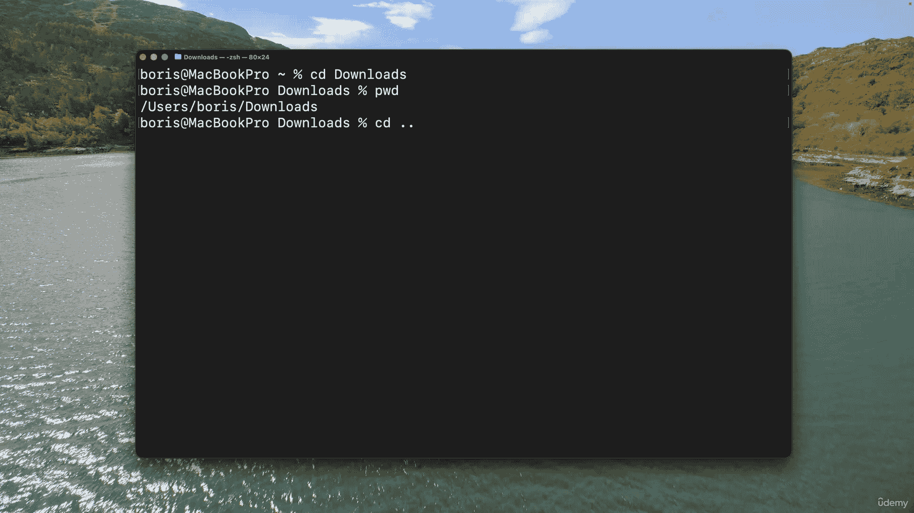
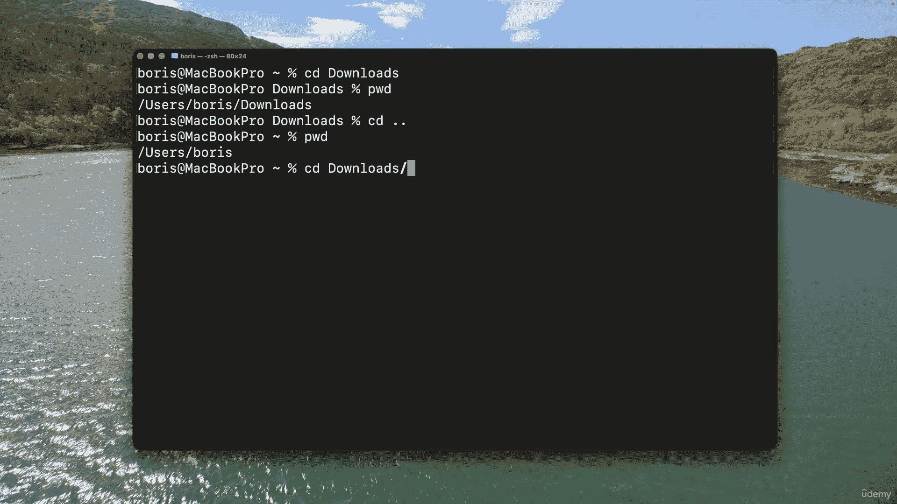
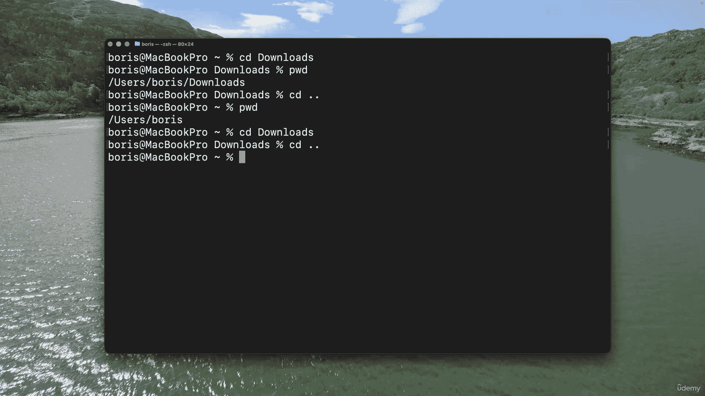
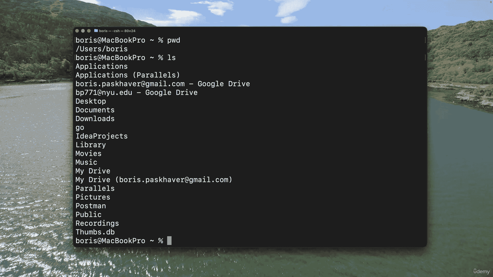

# 🍎 Polars 与 Python 数据分析：02：macOS 终端入门

在本节课中，我们将要学习 macOS 终端的基础用法。这一课是 macOS 上安装 Python 和 Polars 的准备环节，目标是把终端是什么、如何打开、如何关闭，以及最常用的几个命令讲清楚。你会看到，终端并不是一个神秘的黑框，而是一个用文字和电脑对话的窗口。接下来的一系列视频会聚焦在 macOS 操作系统上设置 Python 和 Polars，所以这一课会为后面的安装和使用打好基础。下面我们先从“为什么要认识终端”开始，再一步步进入具体操作。

## 🧭 Polars 与 Python 数据分析：02.1：为什么要先认识终端

接下来的一系列视频会聚焦在 macOS 操作系统上设置 Python 和 Polars。如果你是 Windows 用户，可以放心跳过这些课程，因为在这些课程之后，马上会有一批适合你操作系统的互补视频。如果你已经熟悉 Python 生态系统，并且有自己偏好的安装工具，也可以直接使用那个工具。这些教程专门面向完全全新的学生，目的是提供一步一步的指南，帮助你把推进课程所需的一切安装好。在安装任何东西之前，我们需要先熟悉一个 macOS 上已经可用的程序，它叫终端。终端就是这里看到的这个程序，它被称为命令行界面。它是一个文本提示窗口，用户可以在里面输入命令，让计算机执行。现代图形界面出现之前，人们就是用这种方式和计算机打交道的。终端对开发者仍然很有价值，因为它通常更快，也提供更多自定义空间，用文本能表达的东西比用鼠标点击能表达的东西多得多。你需要学习终端基础，是因为在本课程中，你会用它导航到下载好的课程文件，也会用它启动 Jupyter Lab，而 Jupyter Lab 就是我们编写 Python 和 Polars 代码的开发环境。

你可以把终端理解成一个“用文字操作文件夹”的工具。它不会替代 Finder，而是提供另一种更快、更直接的入口。为了更直观地理解，可以先记住下面这个核心概念。

```text
终端 = 命令行界面（CLI）
用户输入文本命令 -> 计算机执行命令
```

理解了终端的作用之后，下一步就是知道如何把它打开。下面我们来看看 macOS 上访问终端的常见方式。




## 🚪 Polars 与 Python 数据分析：02.2：如何打开和关闭终端

上一节我们介绍了终端是什么以及它在课程中的用途，本节中我们来看看如何打开和关闭终端。第一种方式是进入 Applications 文件夹，也就是“应用程序”文件夹。你可以打开 Mac 的 Finder 窗口，点击左侧的 Applications，然后向下滚动，找到 Utilities 文件夹，也就是“实用工具”文件夹。这里有很多系统工具，它们都是 macOS 电脑上预装的程序，你也能在这里找到终端应用。如果你会经常使用终端，建议点击并拖动它到 Dock 栏，这样就能方便地访问。第二种方式是使用 Mac 的 Spotlight 搜索功能，按 Command 键和空格键即可调出搜索输入框，在里面搜索已安装的应用。你可以搜索 Terminal，然后打开终端应用，这样也会出现终端提示符。



以下是两种打开终端的常见方式，初学者可以任选一种。

- 通过 Finder 打开：打开 Finder，点击左侧 Applications，向下找到 Utilities 文件夹，在里面找到 Terminal 并打开；如果经常使用，可以把 Terminal 拖到 Dock 栏。
- 通过 Spotlight 打开：按 `Command + Space` 调出搜索框，输入 `Terminal`，然后打开终端应用。

打开终端之后，也需要知道如何关闭它。关闭终端也有两种常见方式，你可以按顶部左侧的红色关闭按钮，也可以使用键盘快捷键 `Command + Q`。这两种方式都能关闭终端应用。关闭终端不会影响你电脑里的文件，它只是结束当前这个终端窗口。接下来我们继续理解终端和 Finder 之间的关系，这会帮助你后面学习目录命令。





## 📁 Polars 与 Python 数据分析：02.3：终端与 Finder 的关系

上一节我们知道了如何打开和关闭终端，本节中我们来看看终端和 Finder 之间的关系。有一个好消息是，我们只需要学习少数几个终端命令，就能比较有效地使用这个应用。你需要知道，终端的工作方式和 Finder 应用很像，它总是位于电脑或硬盘上的某个目录中。为了访问特定的文件、文件夹或应用，你需要在硬盘的文件系统中导航。换句话说，我们会使用文本命令来完成这些导航操作。你可以把“当前目录”理解成终端此刻所在的文件夹，后面的命令都会围绕这个位置展开。



下面这个关系可以先用一句话记住。

```text
当前目录 = 终端此刻所在的文件夹
```

理解了终端总是“站在某个文件夹里”之后，我们就可以学习如何查看自己在哪里，以及如何查看这个文件夹里有什么。下面进入最常用的入门命令。

## 📄 Polars 与 Python 数据分析：02.4：查看当前位置和目录内容

上一节我们理解了终端会在文件系统中导航，本节中我们来看看如何确认当前位置，以及如何查看目录内容。第一个命令是 `pwd`，它是 print working directory 的缩写。这里的 print 表示输出到屏幕，working directory 表示当前文件夹。比如我当前位于 `/Users/boris` 文件夹，你的用户名很可能不同，所以你的路径也会完全不同，这没有问题。这个路径表示的就是我们当前所在的位置。以下是 `pwd` 命令需要记住的要点，初学时可以先把它当成“我在哪里”的查询工具。

- `pwd` 的作用是打印当前工作目录。
- `print` 表示把结果输出到屏幕。
- `working directory` 表示终端当前所在的文件夹。
- 输出结果可能是 `/Users/你的用户名`，用户名不同是正常现象。

```bash
pwd
```

知道了自己在哪里之后，下一个问题就是：如何知道这个目录里有哪些文件和文件夹。为此可以使用 `ls` 命令，它是 list 的缩写。我们是在要求终端列出所有内容，也就是当前目录中的文件和文件夹。在我的例子里，就是在 Boris 目录下列出内容，你会看到很多可以继续导航的文件和文件夹。你的文件夹集合可能完全不同，这也没有问题。现在我们知道了如何查看自己在哪里，以及当前所在位置有什么内容。顺便说一句，如果你想清除终端输出，也有几个选项。以下是清除终端输出的两个做法，你可以根据需要选择。

- 使用快捷键 `Command + K` 清除当前终端输出。
- 使用 `clear` 命令清除之前的输出内容。

```bash
clear
```




清除输出只是让屏幕更干净，不会删除文件，也不会改变你所在的位置。接下来我们学习如何在目录之间移动，并介绍一个能大幅减少输入错误的小技巧。

## 🧭 Polars 与 Python 数据分析：02.5：用 cd 移动目录并使用 Tab 补全

上一节我们掌握了查看当前位置和目录内容的命令，本节中我们来看看如何在文件系统中移动。下一个命令是 `cd`，它是 change directory 的缩写，也就是“改变目录”。这就是我们在文件系统中移动的方式。比如在我的 Boris 文件夹里有一个 Downloads 目录，那么在 `cd` 后面加一个空格，再写 `Downloads` 就可以进入它。我的 Downloads 文件夹以大写 D 开头，所以匹配原始文件夹名的大小写非常重要。如果原文件夹名是大写 D，就要写大写 D。命令的结构是 `cd` 表示请求切换目录或导航，然后一个空格，再写你想进入的目标文件夹。执行之后，我就进入了 Downloads 文件夹。确认这一点的一种方式是再次执行 `pwd`，也就是再次打印工作目录，这时会看到我们确实在 Downloads 文件夹中。这个操作等价于在 Finder 窗口中双击一个文件夹进入它，我们向下导航了一层，进入 Downloads。你还可以继续用同样的方式向下导航更多层。以下是 `cd` 命令最常用的两个方向，初学时先把这两个方向记住。

- `cd 文件夹名`：进入下一层目录，例如 `cd Downloads`。
- `cd ..`：返回上一级目录，两个点表示向上一层。

```bash
cd Downloads
pwd
cd ..
pwd
```

如果想从 Downloads 返回 Boris，就使用 `cd` 命令，但不再写文件夹名，而是写两个点。两个点表示向上一级，所以执行后会回到顶层的 Boris 目录。还有一个很有用的小提示是 Tab 补全。Tab 补全的意思是使用键盘上的 Tab 键自动补全文件和文件夹名称。比如我可以先输入几个字符，例如 `DoW` 表示 Downloads，因为这是 Boris 中唯一以这几个字符开头的文件夹，终端可以推断出我想去哪里。写完 `DoW` 后按下 Tab 键，终端就会自动补全目录名。它对文件和应用也会做同样的事情。以下是使用 Tab 补全的两个直接好处，熟练之后会明显提升操作体验。



- 输入速度更快，不用完整敲出很长的文件夹名。
- 减少输入错误，避免拼写错误，终端会自动得到正确的文件夹名。

```bash
cd DoW
# 按下 Tab 键后，可能自动补全为：
cd Downloads
```

再次回顾一下：`cd` 用来向下导航，`cd ..` 用来向上导航，`pwd` 用来看当前所在目录，`ls` 用来看当前目录中存储的内容。到这里，入门所需的基础命令已经齐了。下一课会带领安装 U 终端工具，用它来在电脑上设置 Python 和 Polars。下面我们对本课做一个总结。

## ✅ Polars 与 Python 数据分析：02.6：本课总结

上一节我们完成了终端基础命令的学习，本节中我们对整节课做一次收束。本节课中，我们一起学习了 macOS 终端的基础知识，包括终端是什么、为什么开发者仍然使用它、如何通过 Finder 和 Spotlight 打开终端、如何关闭终端，以及终端和 Finder 在目录导航上的相似关系。我们还学习了 `pwd`、`ls`、`clear`、`cd` 和 `cd ..` 这些入门命令，并了解了 Tab 补全如何帮助初学者更快、更准确地输入文件或文件夹名称。以下是本课需要掌握的命令清单，后面下载课程文件并启动 Jupyter Lab 时会反复用到。





- `pwd`：查看当前工作目录。
- `ls`：列出当前目录中的文件和文件夹。
- `clear`：清除终端输出，也可以用 `Command + K`。
- `cd 文件夹名`：进入指定文件夹。
- `cd ..`：返回上一级文件夹。
- `Tab`：自动补全文件、文件夹或应用名称。

```text
pwd      -> 我在哪里
ls       -> 这里有什么
cd 名称  -> 进入下一层
cd ..    -> 返回上一层
Tab      -> 自动补全，减少输入错误
```



本节课中我们一起学习了终端的作用、打开和关闭方式，以及最常用的目录导航命令。下一课会继续安装用于设置 Python 和 Polars 的 U 终端工具，为后续编写数据分析代码做好准备。

