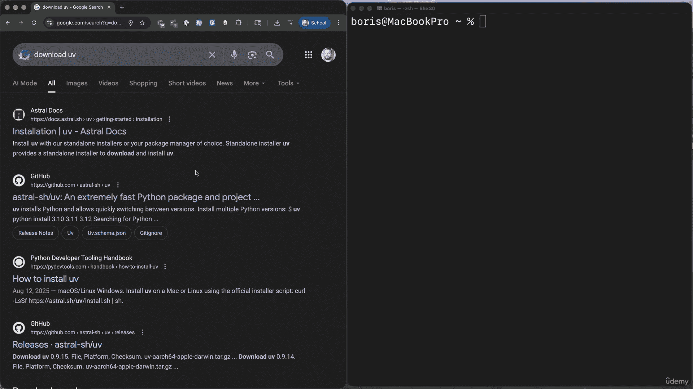
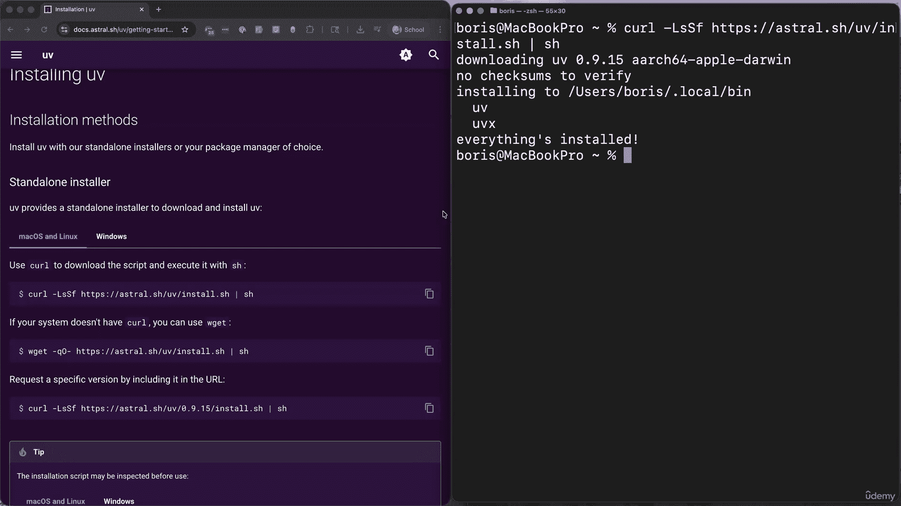
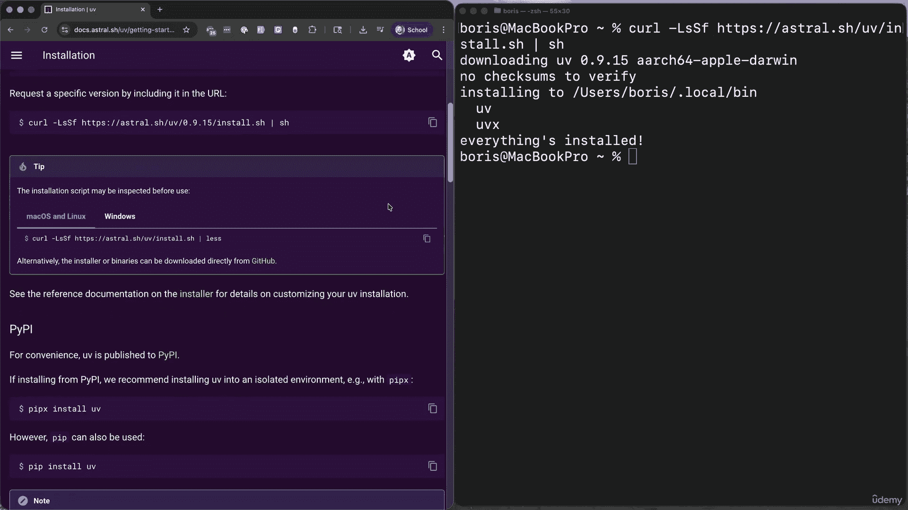
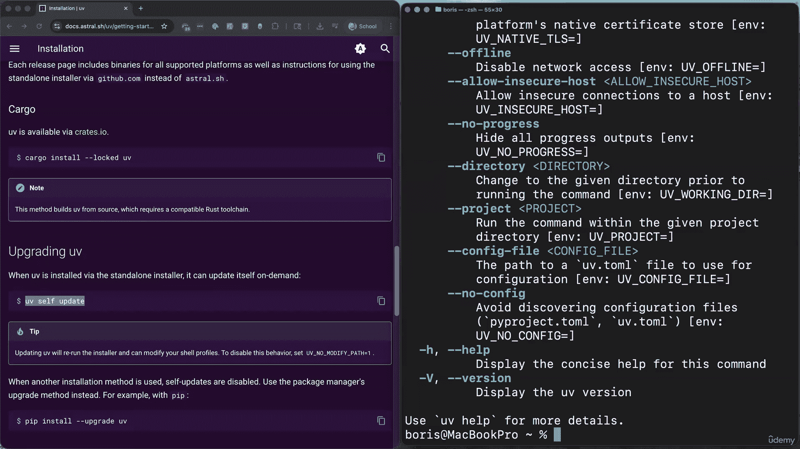
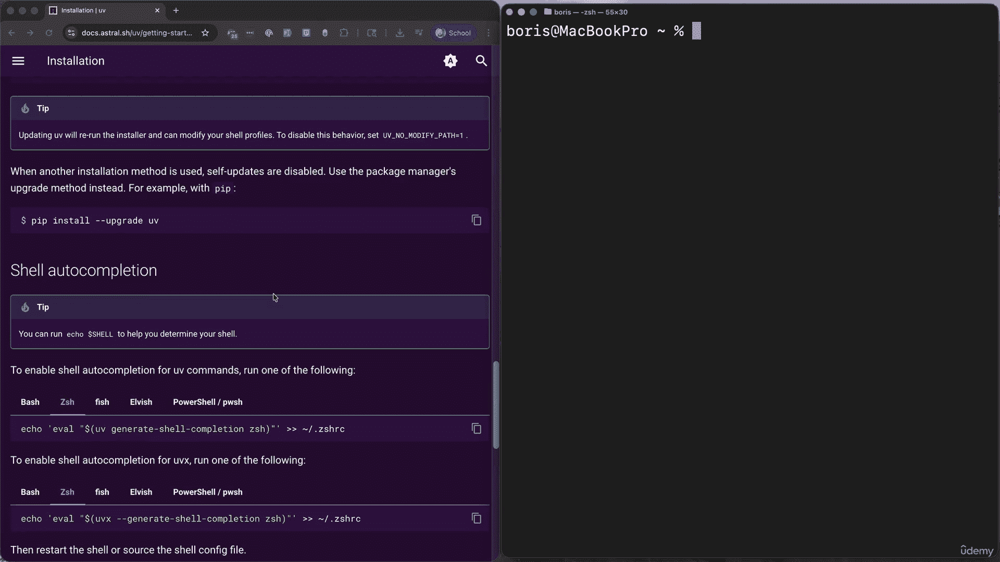
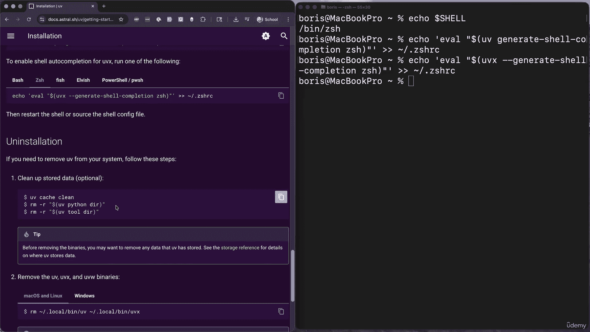
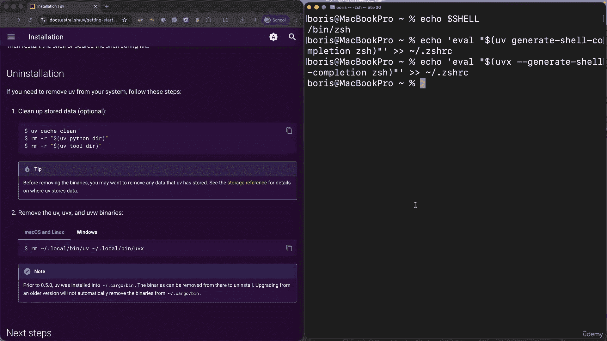

# 📊 数据分析与 Polars 和 Python：第 3 章：在 macOS 上安装 uv Python 包与项目管理器

在本节课中，我们将要学习如何在 macOS 上安装 uv，并用它来管理 Python 包和项目。uv 是一个速度非常快的 Python 包与项目管理器，后面的课程会用它来安装 Polars、JupyterLab 以及课程材料。下面我们会从 uv 是什么讲起，再走到官网复制安装命令，最后检查安装、配置自动补全并了解卸载方法。整体流程不复杂，跟着做即可。

## 🧭 数据分析与 Polars 和 Python：第 3 章：认识 uv 是什么

上一节我们还没有深入介绍 uv，本节中我们来看看它的基本定位。uv 是一个命令行程序，也就是说，它是一个在终端里运行的程序。通过它，创建全新的 Python 项目和在项目里安装包都会变得很简单。我们后面要用的两个例子是数据分析库 Polars 和代码环境 JupyterLab。

下面是 uv 在课程中的两个典型用途，先建立一个整体印象：

- 用一条 uv 命令创建课程项目环境。
- 用 uv 安装 Polars、JupyterLab 以及它们对应的依赖。

可以把这件事理解成一个简单的式子：`一条 uv 命令 = 正确 Python 版本 + 全部依赖 + 项目环境`。uv 最让人喜欢的地方是简单和快。一个 Python 项目往往有一大堆具体依赖，而且这些依赖还有不同版本；uv 可以把这些版本关系处理好，让项目快速启动。到了下一课下载课程材料时，uv 会把很多事情自动完成：执行一条 uv 命令，它会自动下载课程需要的正确 Python 版本，下载全部依赖及其正确版本，基本上一条命令就安装好全部内容。理解了这个定位后，我们就可以进入实际安装环节。



## 🌐 数据分析与 Polars 和 Python：第 3 章：打开官网并复制安装命令

上一节我们认识了 uv 的作用，本节中我们来看看怎样在 macOS 上把它装好。首先打开网页浏览器，这里使用 Chrome，在 Google 中搜索“download uv”。搜索结果里的第一个链接来自 Astral Docs，这个链接就是我们要找的官网页面。

这个页面通常会自动识别你的操作系统，并给出一个可以在命令行也就是终端里执行的安装命令。页面往下滚动时，要确认选择了“macOS and Linux”。确认之后，页面上会出现一条安装命令。你可以手动复制这条命令，也可以点击命令旁边的复制图标，把它自动复制到剪贴板。

下面是安装时用到的操作步骤，按顺序做即可：

- 在官网页面确认选中“macOS and Linux”。
- 复制页面给出的安装命令。
- 打开终端，用 `Command + V` 粘贴命令并执行。

执行这条命令后，uv 就会被下载并安装到电脑上，过程就是这样直接。安装完成后先不要急着往下走，官网页面上还有一些可能有帮助的内容，我们继续往下看，检查安装结果并了解升级方式。





## ✅ 数据分析与 Polars 和 Python：第 3 章：验证安装与升级 uv

上一节我们复制并执行了安装命令，本节中我们来看看怎样确认 uv 已经可用。官网页面向下滚动会看到几种不同的安装选项，这些选项暂时不用管，也不需要担心。继续往下看，还能看到以后把 uv 升级到最新版本的方法：运行 `uv self update` 即可。

uv 就是我们实际使用的应用程序，所以它是我们在终端里运行 uv 命令时的前缀。你可以直接运行 `uv` 来查看所有可用的应用命令。只要终端里能看到输出，就说明 uv 已经成功安装。如果因为某些原因它不能工作，最简单的处理方法是关闭终端应用再重新打开，然后再次尝试。

下面是验证安装时可以用到的命令，作用是让 uv 打印可用命令：

```bash
uv
```



看到命令列表或帮助输出，就说明安装成功。这个检查很直观，也适合初学者确认环境是否正常。确认安装之后，我们还可以继续配置自动补全，让后续输入命令更省力。

## ⌨️ 数据分析与 Polars 和 Python：第 3 章：配置自动补全

上一节我们验证了 uv 可以运行，本节中我们来看看自动补全。自动补全是一项推荐配置，它的作用是让我们在输入 uv 命令时可以用 Tab 键补全命令。这个配置不是严格必需的，你完全可以自己完整敲出命令；但它能提高输入速度和准确率，所以值得设置。

这里稍微复杂一点的地方在于，Mac 终端可能运行在不同类型的 shell 上。可以把 shell 理解成驱动终端的引擎。更麻烦的是，不同版本的 macOS 可能使用不同的 shell。过去六年左右，zsh 基本上是事实标准；如果你运行的是较老版本的 macOS，很可能使用的是 bash。

下面是在终端里查看当前 shell 的命令，输出会告诉你正在使用哪一种 shell：

```bash
echo $SHELL
```

例如，输出中显示 zsh，就说明当前是 Z shell。回到官网页面，在对应的 shell 标签下也会有一条可以复制的命令。选中 zsh 标签后复制并执行那条命令，就会在终端里为 uv 命令配置好自动补全。



下面是配置自动补全时的大致流程，按当前 shell 选择即可：

- 用 `echo $SHELL` 确认当前 shell。
- 在官网页面选择对应的 shell 标签。
- 复制该标签下的补全命令并在终端执行。

执行完成后，uv 命令的自动补全就会生效。官网页面上还有一条给 uv 生态中另一个工具使用的互补命令，原文称这个工具为 UX，也可以理解为 uvx。这条命令同样不是严格必需的，但以后可能有用，所以可以顺手执行。配置完成后，我们最后看看卸载方式和下一课安排。

## 🗑️ 数据分析与 Polars 和 Python：第 3 章：卸载说明与课程衔接

上一节我们配置了自动补全，本节中我们来看看以后如何卸载 uv，以及下一课要做什么。如果以后想完全卸载 uv，官网页面上有完整的安装指南和卸载命令。这里不逐步演示卸载过程，但你需要知道页面上的内容都是终端命令。

卸载时，美元符号表示一条独立命令，所以要把页面上列出的命令逐条执行。按照原文的说明，先逐行执行三行命令，再执行下方的一行命令，就可以把 uv 从电脑上完全移除。

下面是卸载时理解命令结构的一个提醒，不需要现在执行：

- `$` 表示一条单独的命令，不是命令内容的一部分。
- 多条命令要一行一行执行，不要合并成一行。
- 最后再执行收尾命令，完成彻底卸载。

到这里，uv 的安装、验证、自动补全和卸载说明就都覆盖了。现在 uv 这个 Python 包与项目管理器已经安装好，下一课我们就可以下载课程材料，并使用这个工具下载和设置 Python、Polars 以及其他需要的内容。



## 📝 数据分析与 Polars 和 Python：第 3 章：本节总结



前面几节我们完成了 uv 的安装说明，本节中我们一起回顾重点。本节课中我们一起学习了如何在 macOS 上安装 uv Python 包与项目管理器。我们先理解了 uv 是终端里的命令行程序，能快速创建 Python 项目并安装包；然后从 Astral Docs 官网复制安装命令，在终端中完成安装；接着用 `uv` 命令验证安装，了解 `uv self update` 升级方式；之后根据 `echo $SHELL` 的结果配置自动补全；最后了解了卸载命令的结构和下一课使用 uv 下载课程材料的安排。把这些步骤串起来，初学者也能按顺序完成环境准备。

