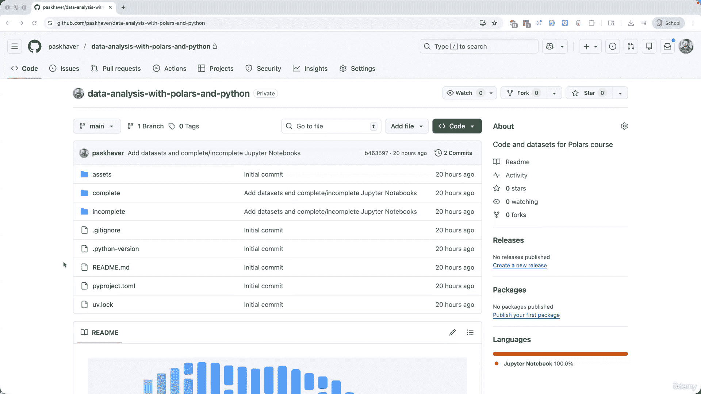
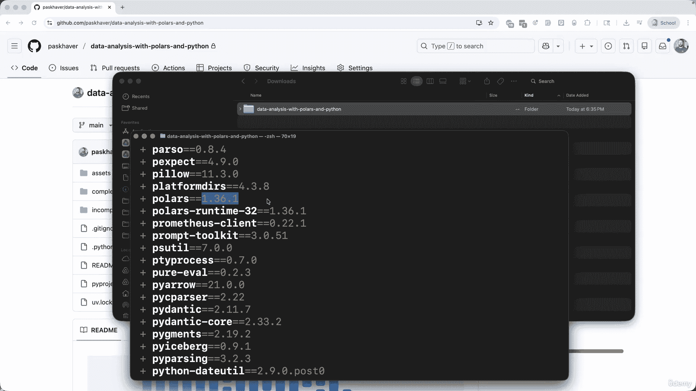

# 📚 数据分析与 Polars（Python）：第 4 节：下载课程资料并配置项目环境

## 🎯 概述

在本节课中，我们将要学习如何把课程所需的全部资料下载到本地电脑上，包括数据集和 Jupyter 笔记本文件。我们还会学习如何在 macOS 系统上解压这些资料，并且通过终端安装 Python、Polars 以及 Jupyter Lab 等所有必要的依赖库。整个过程只需要几条命令，非常轻松。

---

## 📥 第一步：下载课程资料

我们的配置流程接下来要做的，就是下载课程资料。课程资料里既包含了我们后面要用到的数据集，也包含了用来编写代码的 Jupyter 笔记本文件。也就是说，你拿到的这一份资料，基本上就是后面所有课程内容的基础，所有代码和数据都待在里面。

完整的项目（或者说代码仓库）已经放在 GitHub 上了。我会把这节课的链接作为附加资源提供给你，你在屏幕上也能看到这个链接。所以你可以直接打开浏览器，访问那个页面。如果你熟悉 Git 工具，那你当然可以用 `git clone` 命令把这个项目克隆到本地，这样你就能得到一个带版本管理的完整项目副本。如果你不熟悉 Git，那也没关系，最简单的办法是点击页面右侧那个绿色的 Code 按钮，然后选择 Download ZIP。这样就会下载一个 ZIP 文件。提醒一下，ZIP 文件本质上是一种压缩归档文件，它把很多文件和文件夹打包在一起，方便传输和存储。

---

## 📂 第二步：解压并整理资料

现在我来演示一下，我会打开我的下载文件夹，里面就有我刚才下载的那个 ZIP 文件。在 Mac 上解压 ZIP 文件非常简单，你只需要双击这个 ZIP 文件，系统就会自动把里面的内容解压到当前文件夹里。解压完成后，这个文件夹就是我们想要的课程资料文件夹了。

解压完成之后，那个 ZIP 文件就没用了，你可以完全把它删掉。我还会顺手把文件夹名字改一下，去掉末尾的 "main" 这几个字。这个 "main" 其实是 GitHub 仓库分支名的残留，跟课程内容没有任何关系，纯粹是下载时自动带上来的。改完之后，这个文件夹就是你完整的课程资料文件夹，所有东西都在里面了。你可以把它放在任何地方，不一定非要在下载文件夹里，只要你自己记得放在哪里就行。



---

## 🛠️ 第三步：安装 Python 和 Polars

接下来我们要做的，就是正式安装 Python 和 Polars。我们要怎么做呢？首先打开你的终端（Terminal）。然后我会用 `cd`（也就是 change directory，改变目录）命令，把当前目录切换到我下载项目的地方。你完全不需要把项目放在下载文件夹里，你可以选择任何你想存放的位置，只要是你在本课程中的工作空间就行。我这里为了演示方便，就放在下载文件夹里。

在终端里，我会用熟悉的 `cd` 命令来导航到下载的课程资料所在的目录。我会一步一步进入那个文件夹。这里要特别提一下，终端里的 Tab 补全功能非常有用——你只要输入目录名的开头，然后按一下 Tab 键，系统就会自动帮你补全剩下的部分，省去不少打字时间。现在我已经位于 data-analysis-with-polars-and-python 这个文件夹的顶层了。接下来，我们只需要执行一条命令，就能安装所有需要的东西。这条命令是：

```bash
uv sync
```

这条命令的作用是什么呢？它会查看项目内部的需求文件，这个文件叫做 `pyproject.toml`，里面记录了本课程需要的一切依赖。然后它会自动下载所有需要的依赖库，包括 Python 解释器本身、Polars 库、我们写代码用的 Jupyter Lab，以及它们各自依赖的子库。也就是说，你什么都不用管，一条命令全部搞定。命令执行完之后，你会看到一长串已经安装的库的列表。如果列表很长，完全没关系，这些都是像 Polars 和 Jupyter Lab 这样的库所需要用到的底层子库。

我往上滚动一下这个列表，你就能看到里面有一个叫 `polars` 的库，旁边就是它对应的版本号。这里要注意，我确实打算定期更新 GitHub 上的这个仓库，确保大家拿到的都是最新版本的 Python、Polars 以及其他依赖。所以，如果你以后看这个课程，运行 `uv sync` 后看到右边显示的版本号跟我这里不一样，那完全正常，只是说明你拿到的是更新版本的 Polars 或其它依赖而已，不影响使用。

---

## 🚀 结束语



到这里，配置工作就全部完成了。你只用了一条 `uv sync` 命令，就在这个项目文件夹里装好了 Python，装好了所有依赖。现在我们已经万事俱备，可以启动 Jupyter Lab，写第一段 Python 代码了。本节课中，我们一起学习了如何下载课程资料、如何在 macOS 上解压 ZIP 文件、如何整理文件夹名称，以及如何用 `uv sync` 一次性安装所有运行环境。有了这个基础，下一节我们就可以正式开始写代码了。
