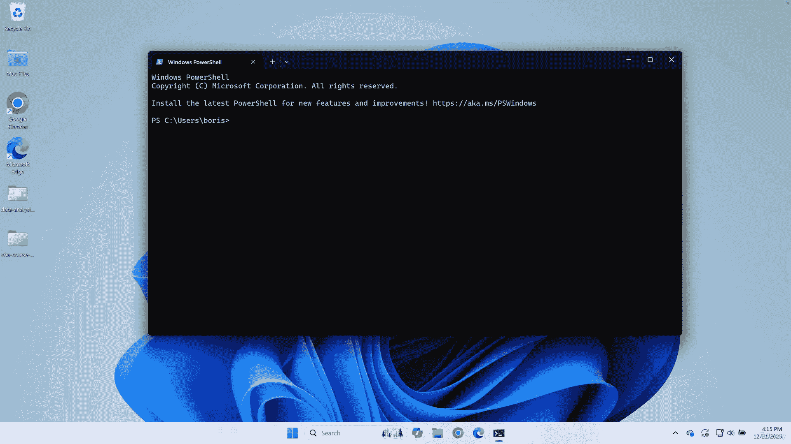
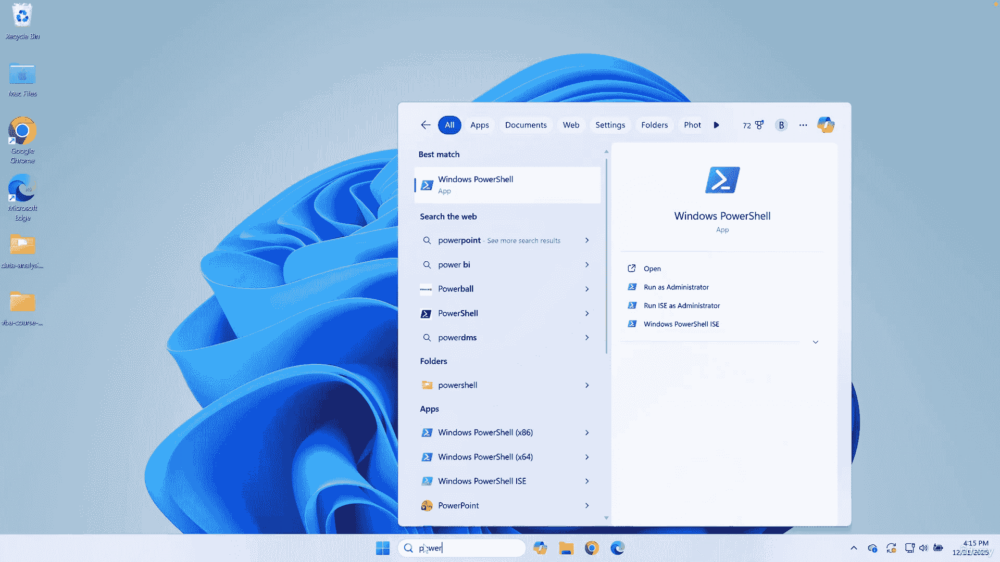
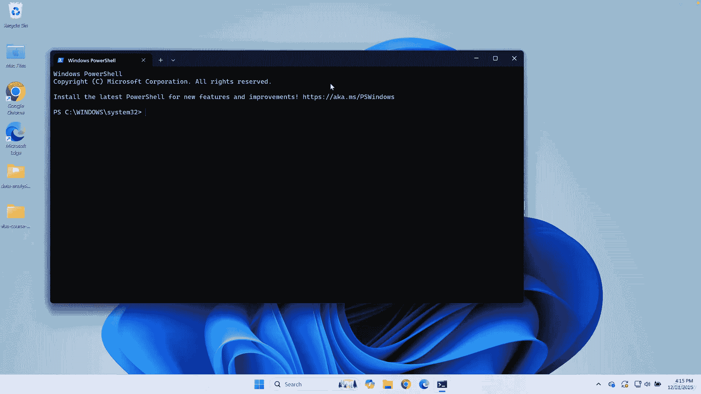
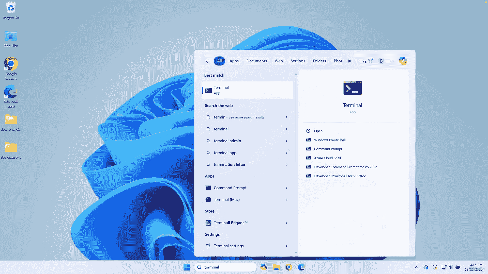
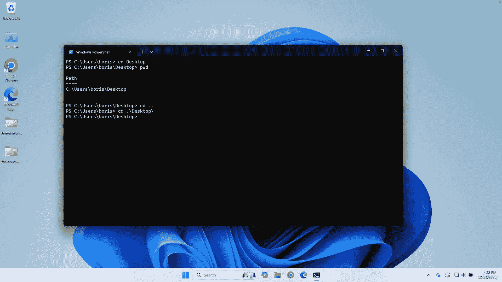

# 🐍 Polars 与 Python 数据分析：05：Windows 下的 PowerShell 入门

在本节课中我们将要学习 Windows 下 PowerShell 的基础用法，为后面安装 Python 和 polars 做准备。接下来的系列视频会把重点放在 Windows 操作系统上安装 Python 和 polars。如果你是 Mac OS 用户，可以跳过这些课程。同样，如果你已经熟悉 Python 生态，并且有自己偏好的 Python 安装工具，也可以直接使用那个工具并跳过这些课程。这些教程专门面向完全新手，目标是提供一步一步的安装指南，让学习者能够顺利推进整门课程。

在安装任何东西之前，需要先认识 Windows 上已经自带的一个程序，它的名字叫 PowerShell。屏幕上看到的 PowerShell 就是所谓的命令行界面，也就是终端。它是一个文本提示窗口，用户可以在里面输入命令，让计算机执行。我们写下一段文本命令，按下回车键执行，然后操作系统解释并执行这条命令。像 PowerShell 这样的应用，是现代图形界面出现之前用户与计算机交互的方式。今天 PowerShell 对开发者仍然很有价值，因为它通常比图形界面更快，也提供更多定制空间。用文本可以表达的内容，比用鼠标点击能表达的内容更多。本课程需要学习 PowerShell 基础，是因为课程中会用它导航到初始设置后下载的课程文件，也会用它启动 Jupyter Lab，而 Jupyter Lab 是我们编写 Python 和 polars 代码的开发环境。具体来说，本课程里有两个直接用途。

- **导航课程文件**：用 PowerShell 进入下载好的课程文件夹，找到后续要用的文件。

- **启动 Jupyter Lab**：用 PowerShell 启动开发环境，在里面编写 Python 和 polars 代码。

明白了 PowerShell 的用途之后，下面来看怎样启动它，以及怎样用它完成最基本的文件系统操作。

## 🧭 Polars 与 Python 数据分析：05.1：为什么需要先认识 PowerShell

在正式安装之前，先理解 PowerShell 是什么，可以让后面的操作更顺畅。PowerShell 是一个命令行工具，用户通过输入文字命令来操作计算机。它的基本流程可以写成下面的形式。

```text
用户输入文本命令 -> 按 Enter -> 操作系统解释并执行
```

PowerShell 和 Windows 资源管理器有一个共同点：它们始终位于文件系统中的某个目录里，也就是硬盘上的某个文件夹中。当前目录就是“现在所在的文件夹”。理解这个概念后，后面的 `pwd`、`ls` 和 `cd` 都会变得直观。PowerShell 看起来只是一个黑色窗口，但它的作用很直接：把用户想做的事情写成命令，交给操作系统执行。



上一节说明了 PowerShell 的用途，本节来看启动方式。启动 PowerShell 有不同入口，不同入口打开时所在的目录可能不同，这会影响到后续操作的方便程度。

## 🚀 Polars 与 Python 数据分析：05.2：怎样启动 PowerShell

上一节我们知道了为什么要用 PowerShell，本节来看看怎样打开它。最简单的方式是打开屏幕下方的 Windows 搜索菜单，然后搜索 PowerShell。这样做可以启动应用，但它可能直接把当前目录设在 `C:\Windows\System32`，这个位置并不理想。更推荐的方式是搜索一个叫 Terminal 的应用。Terminal 基本可以看作 PowerShell 的另一个快捷方式，它会打开同一个 PowerShell 应用，但会直接在用户主目录中启动。下面给出两个启动入口，推荐使用第二个。





- **搜索 PowerShell**：可以启动 PowerShell，但当前目录可能是 `C:\Windows\System32`，不太方便。

- **搜索 Terminal**：打开同一个 PowerShell 应用，并且会在用户主目录中启动，更适合后续操作。

PowerShell 的工作方式和 Windows 资源管理器类似，始终会在文件系统的某个目录中导航。示例中当前目录是 `C:\Users\boris`，你的用户名可能不同，所以显示的文件夹也会不同。核心点是：PowerShell 当前一定位于文件系统中的某个位置。好消息是，只需要少量命令，就能比较有效地使用这个工具。

启动 PowerShell 之后，下一步就是认识最常用的几个命令。下面先看命令清单，再逐个解释它们的作用。

## 🧰 Polars 与 Python 数据分析：05.3：三个核心命令与清屏

现在 PowerShell 已经打开，本节来学习最常用的几个命令。先看本课需要掌握的命令清单。



- **pwd**：`print working directory` 的缩写，用来输出当前工作目录，也就是当前所在文件夹。

- **ls**：`list` 的缩写，用来列出当前目录中的所有文件和文件夹。

- **cd**：`change directory` 的缩写，用来进入某个目录，或者退回到上一级目录。

- **clear**：用来清空当前屏幕上的输出，回到干净界面。

这些命令对应的核心概念可以用下面的形式表示。

```text
当前工作目录 = pwd 的输出
目录内容列表 = ls 的输出
新位置 = cd 目标目录
```

先看 `pwd`。`pwd` 是 `print working directory` 的缩写，`print` 表示输出，`working directory` 表示当前所在文件夹。按下回车后，`pwd` 会输出当前在文件系统中的位置。示例中输出的是 `C:\Users\boris`，这与命令行提示符中闪烁光标前显示的位置一致。PowerShell 本身可能已经显示当前位置，但并不是每个终端或命令行应用都会这样显示，所以 `pwd` 仍然值得掌握。代码如下。

```powershell
pwd
```

接着看 `ls`。`ls` 是 `list` 的缩写，它会输出当前目录中找到的所有文件、文件夹和应用。执行 `ls` 后，可以看到 `boris` 目录中的所有内容，包括很多文件夹、隐藏文件、`.exe` 文件等。这个视图本质上和 Windows 文件夹资源管理器看到的内容相同，只是这里用文本输出代替了图标。代码如下。

```powershell
ls
```

`pwd` 用来查看当前位置，`ls` 用来查看当前文件夹里有什么，最后一个是 `cd`。`cd` 允许向下进入一个目录，也允许向上退出当前目录。在展开 `cd` 之前，还有一个额外命令 `clear`。如果想清空 PowerShell 中当前的输出、给自己更多空间，可以执行 `clear`，它会删除屏幕上的所有内容，让界面回到干净状态。代码如下。

```powershell
clear
```

这些命令不用一次全部记住，先理解用途即可。上一节列出了 `cd`，本节继续展开它的用法，并介绍一个能显著提高输入效率的技巧。

## 📂 Polars 与 Python 数据分析：05.4：用 cd 上下导航和 Tab 补全

上一节我们列出了 `cd` 命令，本节来实际使用它。当前位于 `boris` 目录，这个目录里有一个 `Desktop` 文件夹。输入 `cd` 命令时，`cd` 是 `change directory` 的缩写，表示要改变目录。与前面两个命令不同，`cd` 需要额外信息：先输入一个空格，再输入想进入的目录名。也就是说，必须指定想导航到哪里。示例中写 `Desktop`，其中大写 `D` 需要注意，因为这里大小写敏感。按下回车后，就会进入这个目录。输出中会立即显示 `Desktop`，如果再用 `pwd` 确认，可以看到当前确实在 `Desktop` 文件夹中。代码如下。

```powershell
cd Desktop
pwd
```

`cd` 命令相当于在文件资源管理器中双击一个文件夹进入它，也就是向下进入一层或一个指定文件夹。如果想向上导航一层，比如从 `Desktop` 回到上一级的 `boris`，仍然使用 `cd`，但不再写文件夹名，而是写两个点。两个点的含义是“向上一级”，执行后会到达当前目录的上一级目录。代码如下。

```powershell
cd ..
pwd
```

最后介绍 Tab 补全。Tab 补全的意思是，按下键盘上的 Tab 键，就可以自动补全文件、文件夹或应用的名字。它不仅能加快输入速度，还能减少输入错误，因为 PowerShell 可以准确补全文件夹名或文件名。例如，如果知道要进入 `Desktop`，可以先输入 `cd Ds`，然后按 Tab 键，PowerShell 会自动补全文件夹名。它可能还会添加几个额外符号，这些符号现在不重要，只是用另一种方式表达同一个意思。PowerShell 能判断 `boris` 目录中没有其他以 `Ds` 开头的目录，所以输入 `Ds` 后按 Tab，它会智能判断你想输入的是 `Desktop`。这样输入更快，出错机会也更少。示例如下。

```powershell
cd Ds
# 按 Tab 后，PowerShell 会自动补全为 Desktop
```

到这里，本课的主要操作已经覆盖。下面用一个小结把命令和用途串起来，方便以后快速回顾。

## ✅ Polars 与 Python 数据分析：05.5：本课小结

到这里，本课的内容已经完成。PowerShell 是一个命令行工具，用文本命令向操作系统发出指令。本课介绍了几个重要命令。以下是本课需要记住的命令和用途。

- **pwd**：输出当前工作目录，确认自己现在在哪个文件夹。

- **ls**：输出当前目录中的所有文件和文件夹，查看当前文件夹里有什么。

- **cd**：改变目录，用于在文件夹之间上下导航。

- **clear**：清空屏幕输出，回到干净界面。



本节课中我们一起学习了 PowerShell 是什么、怎样启动 PowerShell、`pwd` 和 `ls` 和 `cd` 三个核心命令、用 `cd ..` 返回上一级，以及用 Tab 键自动补全文件或文件夹名。掌握这些基础操作后，就可以继续后面的 Python 和 polars 安装步骤。

