# 🔧 使用Polars和Python进行数据分析：第6节：在Windows上安装uv——Python包与项目管理器

在我们之前的课程中，我们已经了解了Python数据分析的基本概念，也认识了Polars和Jupyter Lab这些工具。本节课中，我们要安装一个非常关键的工具——uv。它是一个超快的Python包和项目管理器。简单来说，uv是一个命令行程序，我们可以在PowerShell中运行它，用来轻松地管理Python项目，并在项目中安装各种库。后面我们会需要两个重要的库：Polars，我们的数据分析工具包；以及Jupyter Lab，我们的编码环境。事实上，在下一节课中，当我们下载课程材料时，uv将使整个过程变得非常简单——只需要一条命令，就可以下载并安装所有的依赖项，包括Python本身以及各个库，并且确保它们的版本都是正确的。这正是我最喜欢uv的地方：它大大简化了在计算机上从零开始搭建Python项目的流程。

## 🔍 什么是uv？

uv是使用Rust语言编写的一个极快的Python包和项目管理器。你可以把它想象成传统pip工具的超级加速版，同时它还融入了虚拟环境管理功能。对于初学者而言，使用uv可以省去很多繁琐的环境配置步骤，让项目之间的依赖隔离变得轻而易举。在后续的课程中，我们会频繁使用它，所以现在把它安装好是非常值得的。


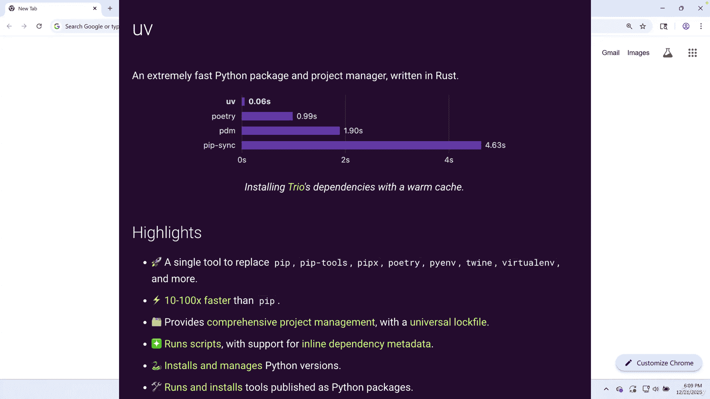

## 📥 安装uv

接下来，我们来实际操作安装uv。安装过程需要借助一个网页浏览器。让我们打开自己常用的浏览器，比如Chrome，然后访问Google，并在搜索框中输入“download uv”进行搜索。搜索结果中的第一个链接通常就是我们所需要的，即Astral Docs上的uv安装页面，我们点击进入该页面。默认情况下，这个页面应该能够自动检测出你的操作系统类型。但是，如果它没有正确检测，页面上也会分别显示针对macOS、Linux和Windows的命令，请务必确保你选择了Windows选项卡，如果它没有被自动选中的话。

在页面上，你会看到一个用于下载和安装uv的脚本命令。我们需要复制该命令，然后粘贴到PowerShell中执行。官方提供了一条很方便的复制按钮，点击它就可以把命令复制到剪贴板。接下来，我们打开PowerShell，按`Ctrl+V`粘贴刚才复制的命令，然后按回车执行。这个命令会下载并设置uv，整个过程通常很快。执行完毕后，uv就算安装成功了。

以下是安装命令的参考（请以官方页面提供的命令为准）：

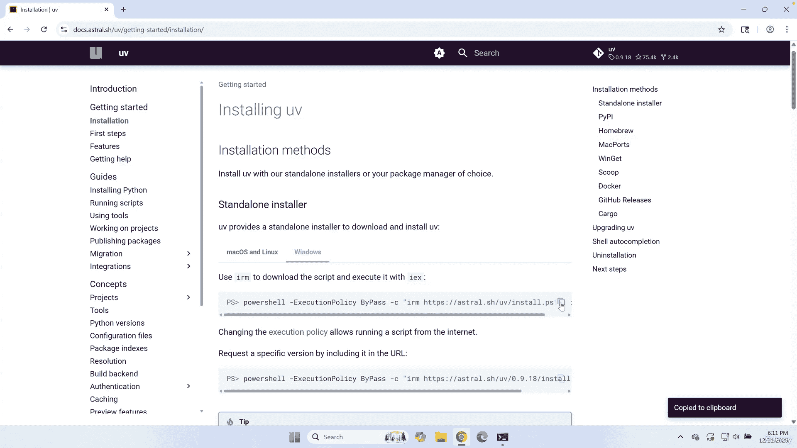

```powershell
irm https://astral.sh/uv/install.ps1 | iex
```

安装完成后，我建议你向下滚动页面，因为页面上还有一些值得我们注意的内容。这里展示了各种不同的uv安装方式，不过我们不需要了解全部，只需要知道我们这种方式足够了。

## 🔄 升级uv

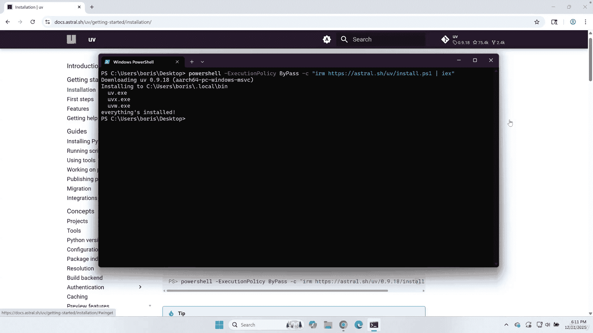

如果你以后想要升级这个作为命令行应用程序安装的uv工具，可以使用uv提供的自更新命令。这条命令是：

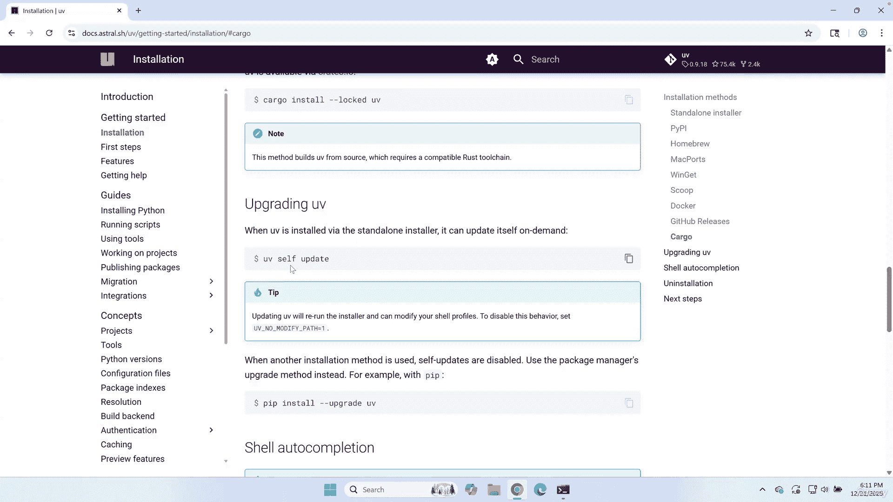

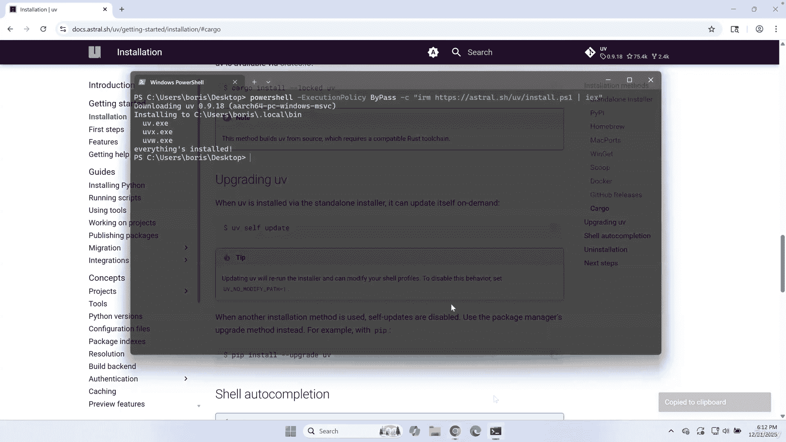

```powershell
uv self update
```

使用方法也很简单，在页面上复制这条命令，然后粘贴到PowerShell中执行。目前我们安装的是最新版本，所以执行后可能会提示没有可用更新。以后你可以不定期地检查并升级，这条命令就是你的利器。

## ⌨️ 配置PowerShell自动补全

除了升级之外，还有一个非常值得设置的功能，那就是命令行自动补全。在之前的课程中，我们演示过按`Tab`键可以自动补全文件名、文件夹名和应用程序名。配置好自动补全之后，这种便利性也将适用于uv命令。默认情况下，PowerShell只认识Windows自带的一些命令，对于uv它是完全陌生的。幸运的是，uv安装页面提供了用于启用自动补全的补充命令。这些命令同时适用于uv工具以及uvx工具（我们后面可能会提到），它们属于同一个生态体系下的互补工具。

要启用自动补全，我们需要复制页面上第一个代码块中的全部内容，回到PowerShell，先清空终端，然后粘贴并执行。在粘贴时，你可能会看到一个警告提示，它只是提醒你正在向终端中粘贴多行内容，这完全没问题，直接粘贴并执行即可。执行完之后，再对页面下方的第二个代码块重复刚才的操作：复制、粘贴、接受警告并执行。这样，自动补全功能就配置好了。

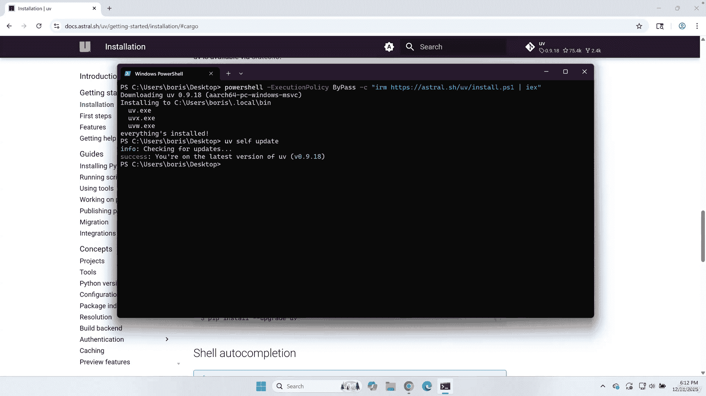

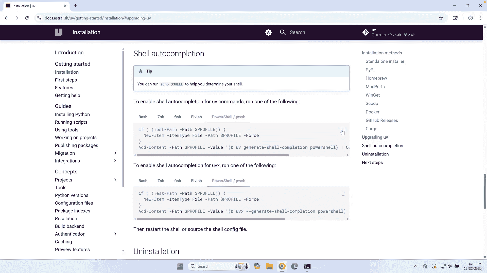

启用自动补全所需的两个命令（同样以官方页面为准）大致如下：

```powershell
uv completion powershell | Out-String | Invoke-Expression
```

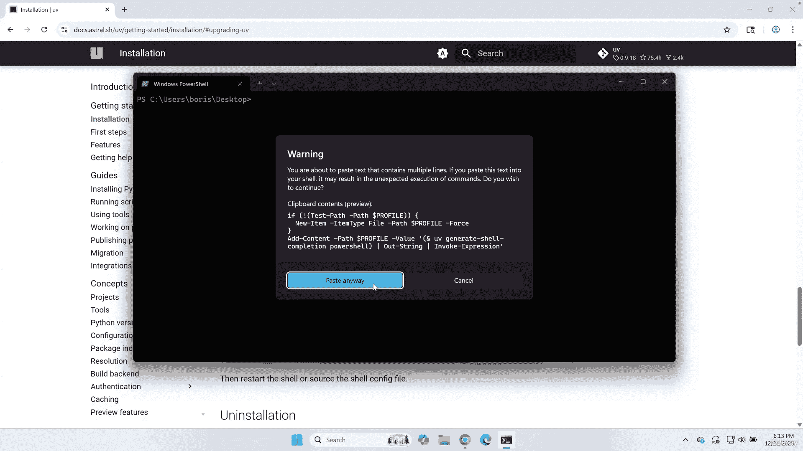

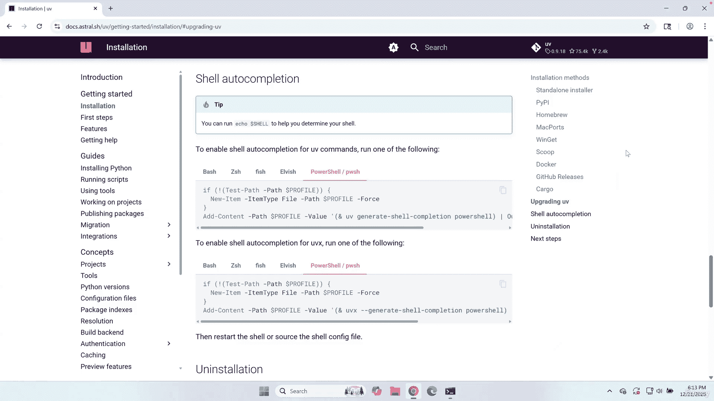

```powershell
uvx completion powershell | Out-String | Invoke-Expression
```

## 🗑️ 卸载uv（补充说明）

如果你以后需要卸载uv，我们不会在这里一步步演示整个过程，但官方页面中确实有一个“卸载”部分。你只需要按照顺序执行那里给出的命令即可。注意忽略命令开头的美元符号（`$`），直接复制右侧的命令内容，按顺序执行，然后再按顺序执行另一组命令，这样就能把uv从你的计算机中完全移除。

## 📋 本节总结

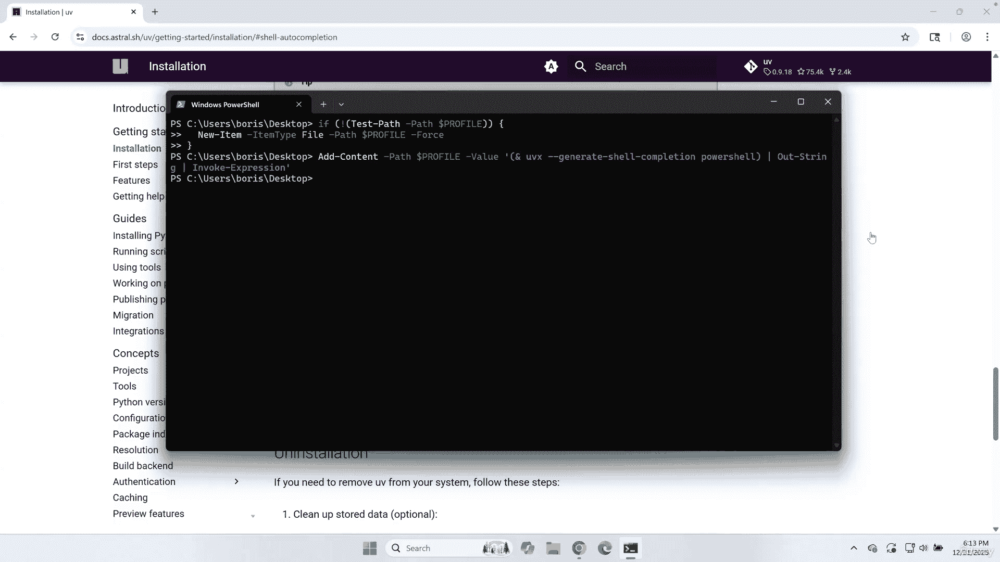

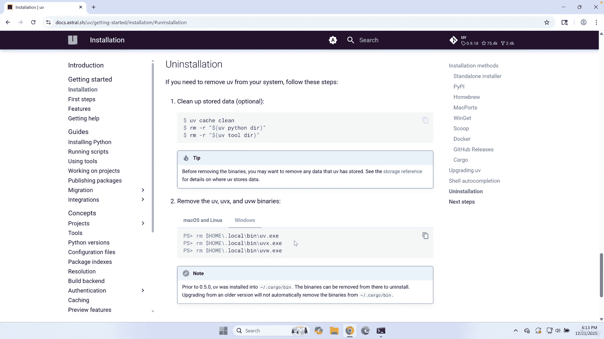

本节课我们一起学习了如何安装uv，包括在Windows系统中通过PowerShell执行官方安装命令，然后了解了如何通过`uv self update`命令来升级uv，以及如何为PowerShell配置uv和uvx命令的自动补全功能。最后，我们还简单提到了卸载uv的方法。现在，既然我们已经成功安装了uv，就可以放心地使用它来设置我们的项目环境了，包括安装合适的Python版本、创建项目文件夹以及处理其他所有依赖项。这些具体操作将在下一节课中为你详细展示。

