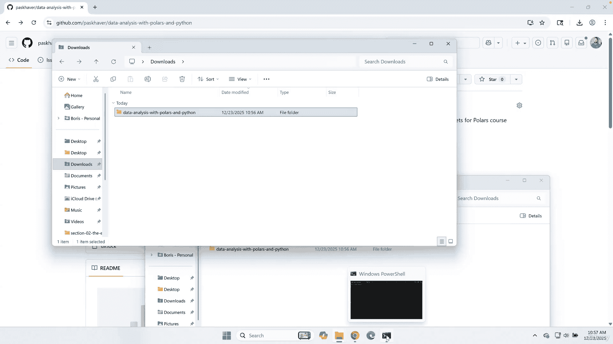
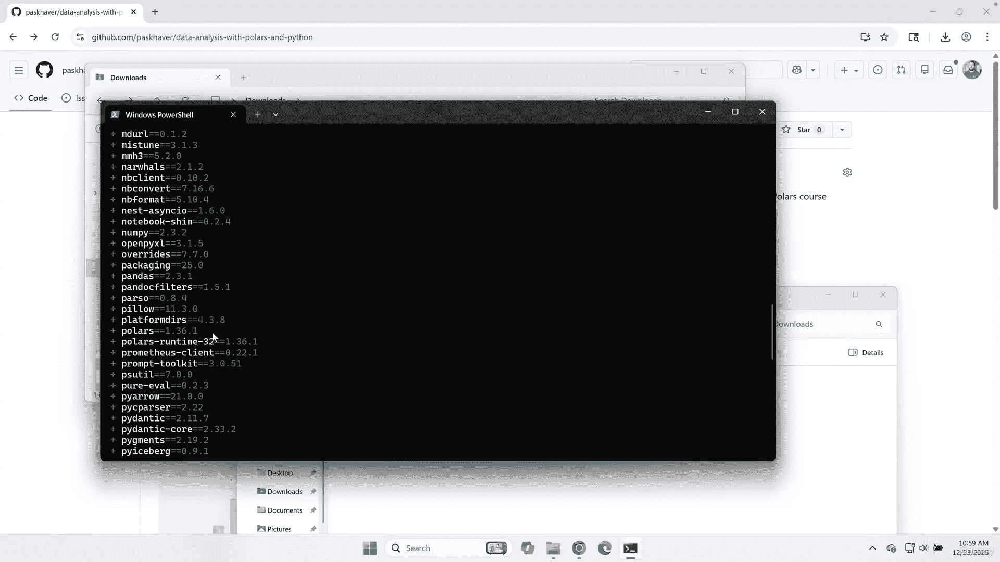

# 📦 Polars与Python数据分析：07：在Windows上下载课程材料并搭建项目

在本节课中，我们将要学习如何在Windows上下载课程材料，并把项目环境搭建起来。课程材料包括数据集和Jupyter Notebook，我们后续会在这些Notebook里编写Python和Polars代码。整个项目代码托管在GitHub上，因此第一步是把项目文件复制到本地；拿到文件后需要解压、整理目录，再打开终端进入项目目录，最后用`uv sync`安装Python和全部依赖。这个过程步骤不少，但每一步都很直接，下面按顺序完成。

## 📚 Polars与Python数据分析：07.1：课程概述与材料说明

上一节我们明确了本课程的目标，本节先说明课程材料从哪里来，以及下载时有哪些选择。课程代码和配套文件都放在GitHub上，所以需要把远程项目复制到本地电脑。对于熟悉Git命令行工具的技术用户，可以使用`git clone`命令把仓库或项目复制到本地电脑。

下载课程材料通常有两种方式，以下是两种方式的具体操作说明：

- 熟悉Git命令行工具：使用`git clone`把仓库或项目复制到本地电脑。
- 不熟悉Git：在GitHub页面点击绿色`Code`按钮，再选择`Download ZIP`。

如果使用`git clone`，命令形式如下，实际仓库地址以课程页面为准：

```bash
git clone <仓库地址>
```

选择`Download ZIP`后，会开始下载页面上看到的全部内容。这里需要记住，ZIP文件是一个压缩归档包，不能直接访问里面的文件；在使用其中的内容之前，需要先解压。完成下载或克隆后，下一节进入Windows上的解压和文件夹整理。

## 🗜️ Polars与Python数据分析：07.2：在Windows中解压课程材料

上一节我们拿到了课程材料的压缩包或本地仓库，本节看看在Windows上怎样解压并整理文件夹。先打开下载文件夹，找到刚下载的ZIP文件。在Windows电脑上，可以右键点击该文件，选择“全部提取”，这样就能解压压缩包。随后需要选择导出文件放置的位置；解压后的内容仍然会放在一个顶层文件夹里，所以放在哪里并不重要，这个位置可以作为本课程的主工作目录，也就是存放课程工作文件的地方。

在提取窗口中，可以把名称末尾的`-main`去掉，这是Git相关的小习惯。这里直接在下载文件夹中解压，勾选“完成后显示提取的文件”，然后点击“提取”。解压过程可能需要几秒钟。这里有一个需要留意的地方：解压后会得到一个名为`data analysis with polars and Python-main`的文件夹，而这个文件夹会嵌套在`data analysis with polars and Python`文件夹里面。简单说，就是外层文件夹包含内层文件夹，内层文件夹才包含真正需要的内容。

成功窗口打开的那个文件夹，才是实际需要的内容文件夹。把该文件夹拖到下载文件夹中，它就是最终要保留的文件夹。点进这个文件夹后，里面的内容会与GitHub页面上看到的内容一致，这就是需要的课程材料。回到下载文件夹后，原来的ZIP文件不再需要，可以删除；用来容纳实际内容文件夹的外层文件夹也不再需要。接着把这个文件夹重命名，去掉末尾的`-main`，这一步只是个人偏好。最终得到`data analysis with polars and Python`文件夹。可以用下面的目录结构理解这个整理过程：

```text
Downloads/
├── data analysis with polars and Python/          # 外层文件夹，可删除
│   └── data analysis with polars and Python-main/ # 实际内容，保留并重命名
│       ├── data/
│       └── notebooks/
```

完成文件夹整理后，课程材料已经放在本地。下一节要打开终端，进入这个项目目录，为安装依赖做好准备。

## 💻 Polars与Python数据分析：07.3：在终端中进入项目目录

上一节我们整理好了课程文件夹，本节需要打开终端或PowerShell，并进入项目所在目录。终端是输入命令的窗口，后续安装依赖和启动JupyterLab都会用到。可以搜索`terminal`并打开终端应用；如果使用PowerShell，也可以直接打开PowerShell。打开后，需要导航到存放课程文件的工作目录。这里使用下载文件夹，所以用`cd`命令进入下载目录；如果课程文件放在其他位置，也可以导航到对应文件夹，只要终端当前目录是课程文件所在位置即可。

进入下载目录后，还要进入真正的项目目录，也就是`data analysis with polars and Python`。输入目录名时可以使用Tab补全，减少手动输入错误。以下是进入项目目录的示例命令：

```powershell
cd Downloads
cd "data analysis with polars and Python"
```



执行完这些命令后，终端就位于项目目录中。下一节使用上一课提到的UV工具安装环境，它可以把安装过程简化为一条命令。

## ⚙️ Polars与Python数据分析：07.4：使用uv sync安装依赖

上一节我们进入了项目目录，本节使用UV安装项目需要的全部环境。上一课提到，UV的一个方便之处是只需要运行一条命令就能安装所有需要的内容，这条命令就是`uv sync`。运行该命令后，UV会下载一个Python版本；示例中下载的是Python 3.13。课程材料计划随着时间升级，因此未来观看课程时，可能会获取更新版本的Python，这属于正常情况。

UV下载Python后，会安装项目需要的库和依赖，其中包括数据分析库Polars，以及JupyterLab编码环境。这些库自身还有子依赖，所以安装时会看到很长的下载列表。`uv sync`会获取并安装所有需要的内容；根据网络连接速度，这个过程可能需要几分钟。命令执行完成后，所有内容都会安装在本地`data analysis with polars and Python`目录中。以下是`uv sync`的主要动作：

```bash
uv sync
```

这条命令可以理解为“下载Python并安装项目依赖”。安装完成后，向上滚动终端中的长列表，可以看到包括Polars在内的所有依赖。与Python版本号一样，右侧显示的版本号可能不同，而且通常会更大，因为课程材料会更新，以确保使用较新的Polars版本。不需要担心版本号与示例不一致；只要依赖列表中出现Polars，就说明安装成功。完成安装后，下一节课会与使用Mac的同学汇合，并展示如何启动JupyterLab编码环境。

这里再次提醒：

> 只要依赖列表中出现Polars，就说明安装成功。

## ✅ Polars与Python数据分析：07.5：本节总结

本节中我们一起学习了在Windows上下载课程材料并搭建项目的完整流程。我们了解了课程材料包括数据集和Jupyter Notebook，代码托管在GitHub上；熟悉Git时可以用`git clone`复制项目，不熟悉Git时可以下载ZIP压缩包。随后在Windows中解压ZIP文件，处理嵌套文件夹，删除不需要的压缩包和外层文件夹，并把实际内容文件夹重命名。接着打开终端或PowerShell，使用`cd`进入项目目录，最后运行`uv sync`安装Python、Polars、JupyterLab及其依赖。

以下是本节的检查要点：

- 项目目录中存在课程材料。
- 终端已经进入项目目录。
- `uv sync`执行完成。
- 依赖列表中出现Polars。



完成这些步骤后，本地环境就准备好了。下一节课将展示如何启动JupyterLab编码环境，并继续后续的数据分析学习。

