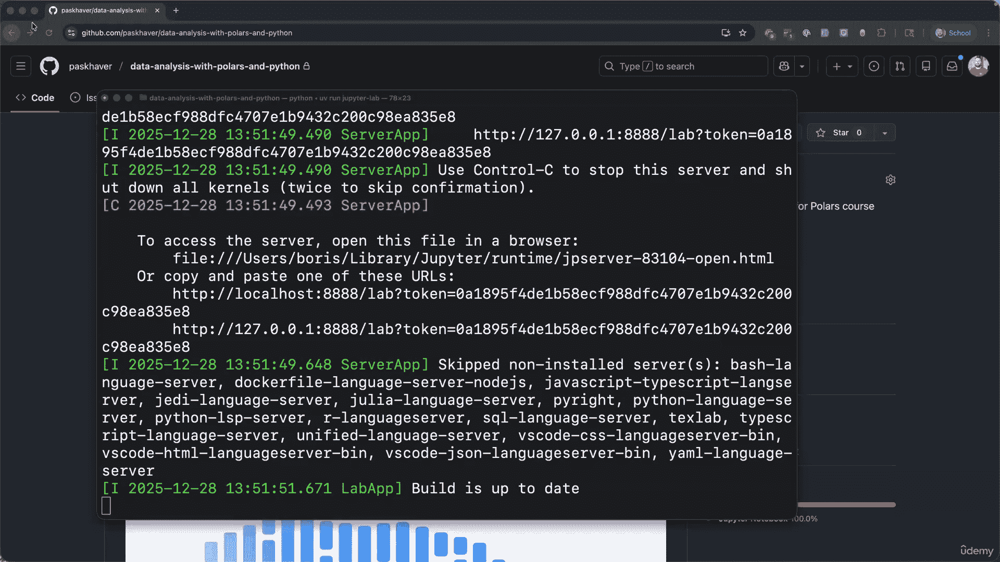
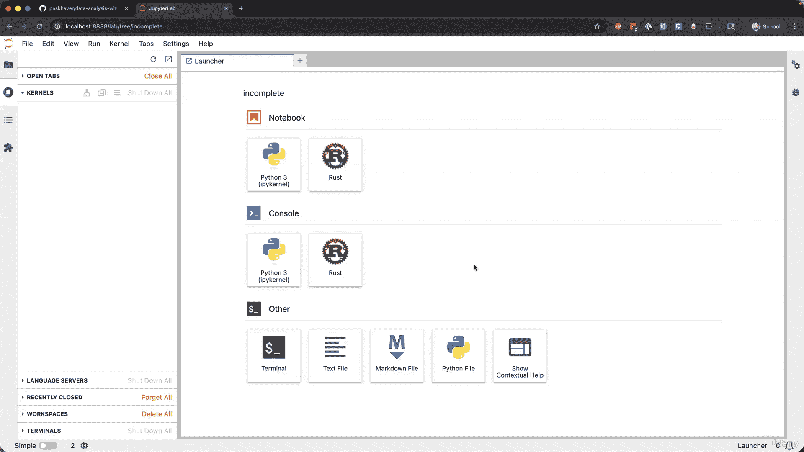
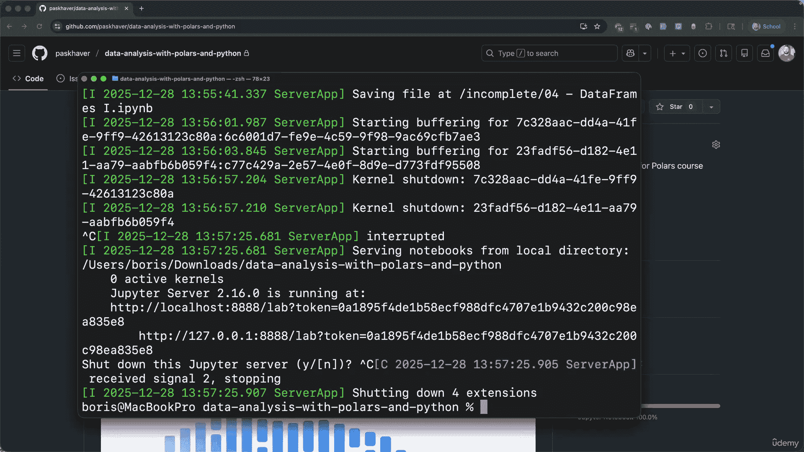

# Data Analysis with Polars and Python part1：p08：Jupyter Lab 启动与关闭 🚀

在本节课中，我们将学习 Jupyter Lab 的启动与关闭过程。Jupyter Lab 是本课程的核心编码环境，我们后续所有的 Python 和 Polars 代码都会在这里编写。这节课会带你从零开始，掌握如何用一条命令启动 Jupyter Lab，认识课程目录中的文件结构，理解“服务器”和“内核”这两个关键概念，并在最后学会如何正确地保存工作、关闭内核、停止服务器。整个过程并不复杂，但每一步都有它的道理。我们先把这些概念理清楚，这样你在日常使用中就不会手忙脚乱。

## 启动 Jupyter Lab：一条命令搞定 💻

在之前的课程中，我们已经通过 `uv` 命令安装好了相关环境，而 Jupyter Lab 就是随着那次安装一起被自动装好的。所以现在不需要额外安装任何东西，只需要在终端里执行一条命令，就能把它拉起来。

首先，你要打开终端，然后进入本课程的目录。这里，我们的课程目录叫做 `data analysis with Polars and Python`。你可以用 `cd` 命令进入它。进入之后，就可以运行下面这条核心命令了：

```bash
uv run jupyter lab
```



这条命令的含义是：使用 `uv` 来调用当前目录下已经安装好的 Python 版本，然后运行 `jupyter lab` 这个特定的命令。这里要注意，`uv` 必须全部小写，然后是一个空格，接着是 `run`，再空格，最后是 `jupyter lab`。`jupyter lab` 的拼写是 `J-U-P-Y-T-E-R` 加上一个横杠，再加上 `L-A-B`。

执行这条命令后，Jupyter Lab 服务器就会启动。那么什么是服务器呢？简单来说，**服务器就是一个持续运行的进程**，它不会像普通程序那样执行一次就退出。这个服务器启动后，实际上会在你的浏览器中打开一个应用程序。如果你没有看到浏览器自动弹出，别着急，你可以手动打开 Chrome 或 Firefox 之类的浏览器，然后在地址栏输入下面这个地址：

```text
http://localhost:8888/lab
```

这里的 `localhost` 其实就表示你自己的电脑。也就是说，这个应用并不是运行在互联网上，而是完全运行在你自己的电脑里。所以，只要你的浏览器访问这个地址，就能看到 Jupyter Lab 的界面。界面中通常会有一个类似文件管理器的图标，点击它就能看到课程目录里的所有内容。这个文件管理器就是你管理课程文件的地方。

## 认识课程目录结构 📁

当 Jupyter Lab 启动后，你会看到一个类似文件资源管理器的界面，里面列出了 `data analysis with Polars and Python` 文件夹中的所有内容。这个目录下有几个文件夹，我们来一个一个看。

首先，有一个叫做 `assets` 的文件夹。这个文件夹里存放的是一些图片，是课程文档中会用到的素材。你完全可以忽略这个文件夹，它对你的学习过程没有任何影响。真正需要关注的，是下面两个主要的文件夹：

- `complete`
- `incomplete`

这两个文件夹的名字直译过来就是“完整”和“不完整”。它们基本上是相同的，都存放着课程所需的数据集和 Jupyter notebook 文件。那它们有什么区别呢？区别就在于 notebook 文件的内容是否被填充完整。我们接下来会详细解释这一点。

## Jupyter Notebook 是什么 📓

在深入 `complete` 和 `incomplete` 之前，我们先来讲讲 Jupyter Notebook 这个文件格式。简单说，**Jupyter Notebook 就是我们编写 Python 和 Polars 代码的文件**。这些文件的扩展名是 `.ipynb`，也就是 `I-P-Y-N-B`。这类文件由一个个“单元格”（cell）组成，你可以在单元格里写 Python 代码，也可以插入文本单元格来写注释、笔记或者其他说明文字。这样做的好处是，代码和笔记可以放在一起，非常方便。

现在，我们来看看 `complete` 文件夹。你可以点击进入这个文件夹，不过现在不需要跟着操作，只是看一下。里面有一个示例 notebook，我们打开它。你会看到，这个 notebook 中的代码都是完整的。这些代码是课程老师在录制时写好的，可以说是“标准答案”，方便你后续对照自己的代码。所以，在 `complete` 文件夹中，所有的 notebook 都是已经完成的成品。你在看视频的时候，不需要在这里写任何代码。

而 `incomplete` 文件夹则是你真正要动手的地方。这里面的 notebook 与 `complete` 文件夹中的完全一样，除了代码单元格是空白的，等着你填写。也就是说，你的练习文件都在 `incomplete` 文件夹里。打开看看，你会发现里面的数据集和 notebook 文件与 `complete` 一一对应。举个例子，如果你打开 `incomplete` 文件夹里的 `04_data_frames_1` 这个 notebook，再和 `complete` 里的同名文件对比一下，左边是完整版，右边是不完整版，一眼就能看出差别。

在学习过程中，我强烈建议你自己动手写代码，而不是只跟着视频里老师敲什么你就敲什么。因为只有自己实际敲一遍，才能加深记忆。你可以尝试用不同的数据集、换不同的语法选项，甚至故意写错，然后从错误中学习。当然，如果你在练习中遇到 bug 或者报错，不知道哪里出了问题，你随时可以打开 `complete` 文件夹里的对应文件，把自己的代码和完整代码进行对比，找出差异，然后修正 `incomplete` 中的错误。这是非常有效的学习方法。不过我不建议你只是像看书一样把 notebook 从头到尾读一遍，那样收获不大。你应该自己尝试，亲手把代码输入进去，才能真正掌握。

## 关闭 Jupyter Lab：三步走 🛑

当一天的学习结束后，你需要正确地关闭 Jupyter Lab。这一步很重要，因为如果只是直接关掉浏览器标签页，后台的服务器可能还在运行，白白占用资源。所以，我们要按照下面的顺序来操作。

### 第一步：保存工作

关闭之前，首先要保存你的工作。最简单的方法是：在菜单栏点击 `File`，然后选择 `Save All`。这个操作会保存所有已经打开的 notebook。保存完成后，你的工作就已经安全地写在磁盘上了，这时候再关闭界面也没有后顾之忧。

### 第二步：关闭 Notebook 和内核

保存完工作之后，你会注意到，这些打开的 notebook 在 Jupyter Lab 界面中是以标签页的形式呈现的，就像浏览器中的多个网页标签一样。每个 notebook 都占一个标签，排列成一排。你可以在每个标签上看到一个小 X 按钮。你要一个个点击这些 X，把所有 notebook 标签全部关闭。

不过，仅仅关闭 notebook 标签，并不等于关闭了所谓的“内核”。**内核（kernel）本质上就是一个后台的 Python 服务器**，它是一段持续运行的程序。Python 在这个后台进程中运行，并时刻盯着你的 notebook。每当你运行一段 Python 代码，这个内核就会接收命令、执行 Python、然后把结果返回给你。所以，如果你只是关闭了 notebook 标签，内核可能还在后台运行。

怎么关闭内核呢？在 Jupyter Lab 的左侧边栏中，有一个按钮可以打开“运行中的内核”列表。点击那个按钮，你会看到每个打开的 notebook 对应一个正在运行的内核。比如你刚才打开了两个 notebook，就会看到两个内核。要全部关闭，只需点击列表中的 `Shut Down All`，然后在弹出的确认框中再点击一次 `Shut Down All`。这样，Jupyter Lab 界面里的所有内核就都关闭了。

### 第三步：在终端中停止服务器

最后一步，回到你的终端。这时候你会发现，之前那个终端窗口还在运行，并且显示着 Jupyter Lab 的服务器日志。实际上，这个服务器进程依然没有停止，只是你暂时关闭了浏览器端的界面。如果你现在想继续工作，还可以重新访问 `localhost:8888` 继续。但如果你要彻底结束，就需要在终端中按下组合键：

```text
Ctrl + C
```

连续按两次 `Ctrl+C`，就会被服务器识别为终止信号，然后服务器会关闭，终端也回到正常的命令行提示符状态。这就是完整的关闭流程。

## 日常启动与关闭的完整流程总结 🔄

为了让你更清晰地掌握整个流程，我再把启动和停止的完整步骤用代码和列表的形式总结一遍。



启动 Jupyter Lab 的步骤是：

- 打开终端，进入课程目录 `data analysis with Polars and Python`
- 执行命令 `uv run jupyter lab`
- 如果浏览器没有自动打开，手动访问 `http://localhost:8888/lab`

停止 Jupyter Lab 的步骤是：

- 点击菜单栏 `File` -> `Save All` 保存所有已打开的 notebook
- 逐个关闭所有 notebook 标签页，或者直接不管标签页，直接关闭内核也可以（但推荐先关标签，以免混乱）
- 点击左侧边栏的“内核”按钮，选择 `Shut Down All`，并在确认对话框中再次点击 `Shut Down All`
- 关闭浏览器中的 Jupyter Lab 标签页和浏览器本身
- 回到终端，连续按两次 `Ctrl+C` 停止服务器

当你下次想继续学习时，只需要从“启动”这一步重新来一遍即可。整个过程看起来步骤不少，但实际操作起来非常顺畅，习惯之后几乎不会花什么时间。

## 小结 📚



本节课我们一起学习了 Jupyter Lab 的启动与关闭。我们知道了通过 `uv run jupyter lab` 命令可以启动服务器；了解了 `complete` 和 `incomplete` 两个文件夹的区别，其中 `incomplete` 是你练习写代码的地方，而 `complete` 是供你对照参考的完整版；我们还明白了内核就是后台的 Python 服务器，关闭 notebook 标签并不等于关闭内核；最后，我们掌握了完整的关闭流程，包括保存文件、关闭内核、关闭浏览器标签，以及在终端中用两次 `Ctrl+C` 停止服务器。下一节课，我们将正式进入 Jupyter Lab 的界面，深入熟悉它的各个组成部分，敬请期待。
