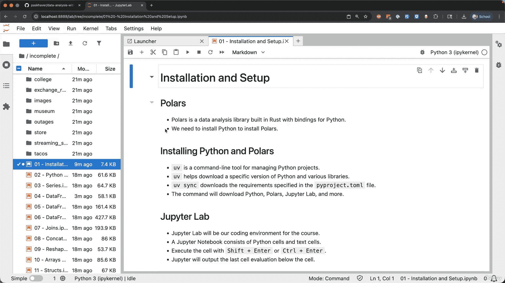

# 📘 数据分析与Polars（第一部分）：第9节：Jupyter Lab入门

在本节课中，我们将一起学习Jupyter Notebook的基础知识。你会了解notebook的文件结构和基本组成，知道如何编写和运行Python代码，并掌握一些常用的快捷键。我们还会介绍如何重启内核，以及命令模式和编辑模式的区别。学完这节课，你就能在Jupyter Notebook中顺畅地进行Python和Polars数据分析实践。这门课后面所有的示例代码都将在Jupyter Notebook中完成，所以把这个基础打牢固非常关键。

## 📂 1. 认识Jupyter Notebook

在开始之前，我先演示一下如何打开一个notebook。这里我已经在“incomplete”文件夹中，准备打开一个示例notebook，例如“01 installation and setup”。它在右侧打开后，我可以通过点击左侧菜单栏的图标来折叠左侧菜单，这样整个窗口就可以用来专心操作notebook了。

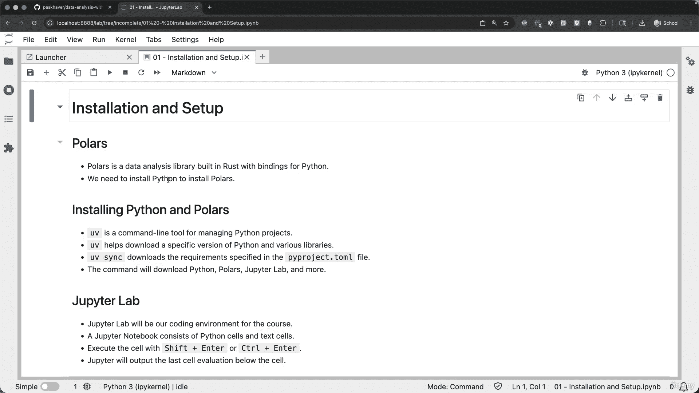

Jupyter Notebook文件的后缀是`.ipynb`，它由一个个“单元格”组成。单元格就是notebook的基本操作单位。我们可以在单元格中写文字，也可以写代码，然后单独执行它们。理解单元格的概念，是掌握notebook的第一步。

## 📝 2. 两种单元格：文本单元格与代码单元格

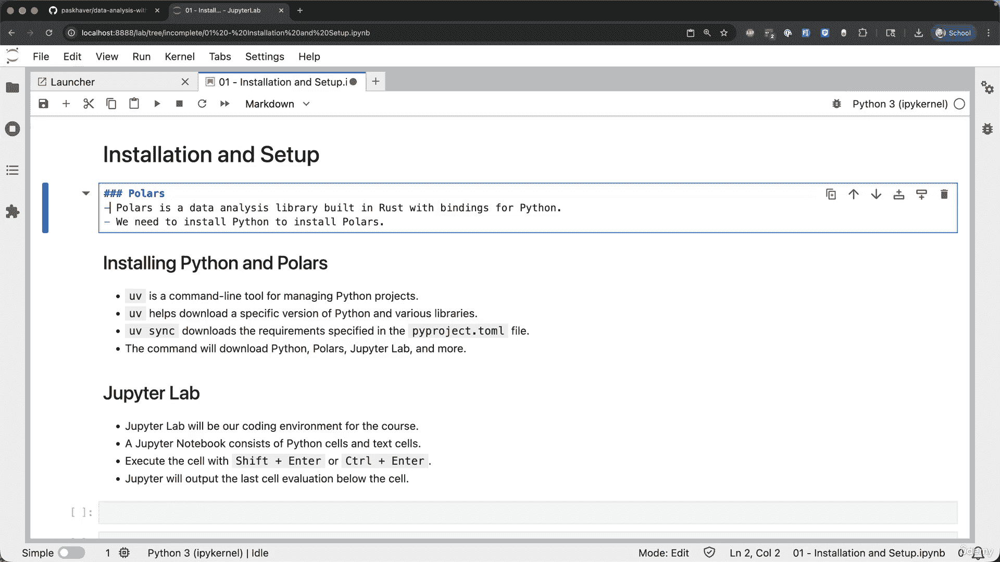

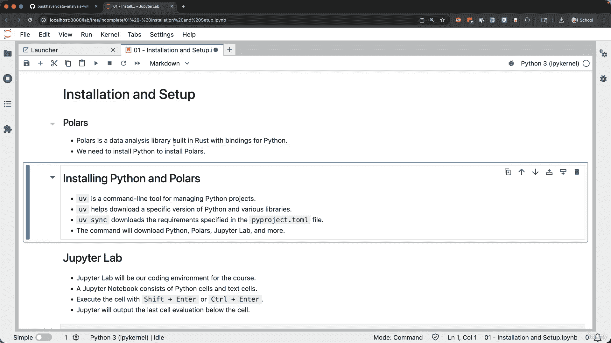

了解了notebook的基本构成后，现在我们把目光转向单元格的类型。notebook中主要有两种单元格：**文本单元格**和**代码单元格**。

文本单元格就像你屏幕上看到的这些，它们只是包含格式化后的文本，非常适合用来记录笔记。你现在看到的内容实际上是文本渲染后的效果。如果你双击进入某个文本单元格，就能看到它底层的文本内容，这种底层内容使用一种叫**Markdown**的格式化语言来编写。

我们可以花几分钟熟悉一下Markdown，因为它的规则非常简单。比如，连续使用两个井号`##`会创建一个二级标题，也就是第二大的标题；如果使用一个井号`#`，就会生成一个更大的标题。再比如，使用短横线`-`可以创建项目符号列表。你可以把Markdown理解成一种用字符代替按钮的排版工具。就像Microsoft Word那样，我们给文本加上各种视觉元素，只不过在这里我们使用符号来指定这些元素，而不是点击用户界面。

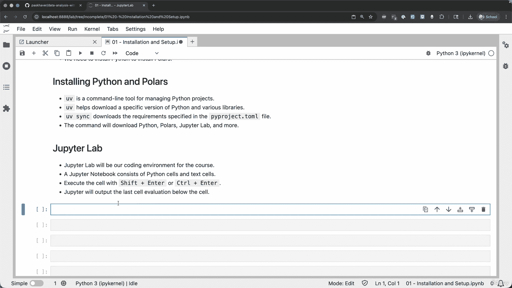

以上就是一个Markdown单元格（也就是文本单元格）的例子。只要回到常规模式，我们就能看到它实际格式化后的样子。关于“常规模式”，我们后面马上会讲到。当前单元格的类型会显示在界面顶部的下拉菜单中。只要显示的是“Markdown”，就说明当前单元格是文本单元格。往下滚动一点，我们就能看到另一种单元格——代码单元格。点击它，可以注意到顶部单元格类型会变成“Code”。

单元格类型是可以互换的。如果我想把这个代码单元格变成Markdown单元格，只需要点击下拉菜单并选择“Markdown”。反过来，如果我想把Markdown单元格变成代码单元格，也只需要点击下拉菜单并选择“Code”。这个切换操作非常常用，大家要记牢。

## 💻 3. 编写并执行Python代码

现在我们已经知道了两种单元格的区别，接下来看看如何在代码单元格中写Python代码。在任何代码单元格中，你可以写任意数量的Python代码，然后执行这个单元格，结果会立刻显示在单元格下方。举一个最简单的例子，我们可以做一个加法运算。点击单元格，输入`1`，空格，加号，空格，`1`。

如果你之前没有接触过编程或Python，这里要说明一下，`1 + 1`是一段有效的Python代码，`+`符号用来进行数学加法运算。代码写完之后还没有执行，它只是被保存在单元格里。要运行单元格，我们可以使用以下快捷键：

- `Shift + Enter`：执行当前单元格，然后移动到下一个单元格。
- `Ctrl + Enter`：执行当前单元格，但停留在当前单元格。

按下这两个组合键中的任意一个，输出都会出现在单元格正下方。背后的原理是：Jupyter Lab有一个正在运行的Python内核在后台监听，当你发出执行代码的指令时，它就会运行单元格中的代码，并把结果返回。这个内核就是我们上一课中演示过如何关闭的东西，所以它也可以被随时重启。

这里还有几个细节值得注意。第一，单元格左侧方括号里的数字反映了这个单元格的执行顺序。例如，如果我在打开notebook后执行了`3 + 5`，这已经是第三次执行单元格，所以数字会显示为`3`。而且单元格的执行顺序不一定要连续。比如，我可以重新执行这个单元格，让编号变成`4`；再重新执行另一个单元格，编号就会变成`5`。

在学习过程中，我强烈建议大家多动手实验。你得到的执行编号很可能和视频中不一样，这完全正常，因为我们都忙着执行自己的单元格，只不过时机不同。所以不要担心编号对不上。

另一个值得注意的规则是：单元格下方显示的最终输出，是单元格内**最后一行被执行**的结果。为了说清楚，我们看个例子。如果我把单元格中的代码移除，重新执行，下面就没有任何输出。然后我写两行代码，第一行`1 + 1`，第二行`3 + 5`。此时按`Ctrl + Enter`执行，我们会看到`8`。也就是说，只有最后一行被求值的内容会被打印出来。

但这并不代表前面的代码没有执行。整个单元格都会从头到尾运行：Python计算出了`1 + 1 = 2`，但因为没有要求打印或输出，这个结果就被丢弃了；接着Python继续运行下一行，计算出`8`，然后把`8`输出到单元格下方。我特意提这一点，是因为在后面的课程中，我经常会在同一个单元格里给出多个不同写法的代码示例，它们可以达到相似或相同的结果。大家要始终记住，下方显示的是最后一行的执行结果，但上面所有代码也都成功运行了。

## 🔄 4. 重启内核：让一切回到干净状态

在上面的过程中，我们提到了内核这个概念。那么，如果在使用notebook时遇到明显卡顿，或者某些单元格执行不正常，又或者整体感觉不太对劲，应该怎么办呢？答案是重启内核。

你可以选择关闭Jupyter Lab服务器再重新启动。不过，如果只是想重启内核（也就是为当前notebook提供后台支持的Python进程），可以直接使用顶部“Kernel”菜单，里面有几个选项。其中，“Restart Kernel”基本上就是把一切都清空。你几乎可以把它看作重新打开notebook，就像刚刚启动Jupyter Lab时那样。所有保存在内存里的内容，包括你写过的Python代码所产生的状态，都会被清除。可以把它理解成一个“重置按钮”。菜单里的其他选项都是这个命令的不同变体。

例如，如果你选择“Restart Kernel and Clear All Outputs”，也就是重启内核并清除所有单元格的输出，那么确认之后，服务会重启，单元格下方的所有输出也会被移除，相当于给你一块干净的画布。重启之后如果你再次执行单元格，注意这个单元格又变成了第一次执行，因为一切都已经从头开始了。通常在遇到技术问题的时候，我都会使用“Restart Kernel”，这是从notebook内部快速重启一切的好方法。

## ⌨️ 5. 命令模式与编辑模式

重启内核能解决很多奇怪的问题，接下来我们再看一些操作notebook本身的快捷键。为了使用这些快捷键，我们需要先理解Jupyter Lab的两种模式：**命令模式**和**编辑模式**。

当我们点击某个单元格时，无论是代码单元格还是Markdown单元格，我们实际上就是在编辑它。此时单元格内会出现闪烁的光标，我们输入的每个字符都会被当作要添加到单元格中的内容。这就是编辑模式。

要执行各种快捷键，就需要进入命令模式。在命令模式下，键盘按键不再输入内容，而是作为触发各种全局操作或notebook级操作的快捷键。进入命令模式的方法是按下`Esc`键。你可以通过视觉指示来判断是否进入了命令模式：单元格内的闪烁光标消失了，整个单元格被高亮边框包围。

## 🚀 6. 常用快捷键：创建、删除与切换单元格

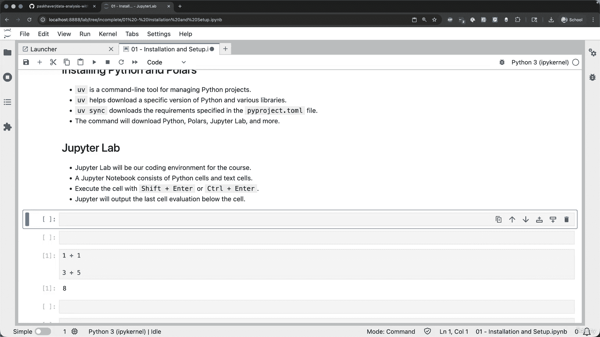

现在来看一些实际的快捷键操作。在命令模式下，快速创建单元格非常简单。下面的快捷键可以帮你在指定位置新增单元格：

- 按`A`：在当前高亮单元格上方创建一个空白单元格。
- 按`B`：在当前高亮单元格下方创建一个空白单元格。

例如，我在命令模式下按一下`A`，上方就多出一个空单元格；再按一下`A`，又会在更上方创建一个。同理，按几次`B`，就会在下方创建出多个空白单元格。

删除单元格同样需要在命令模式下进行。比如我先点击单元格，此时处于编辑模式，有闪烁光标；按`Esc`进入命令模式后，就可以使用删除快捷键了。下面是一些删除相关的方法：

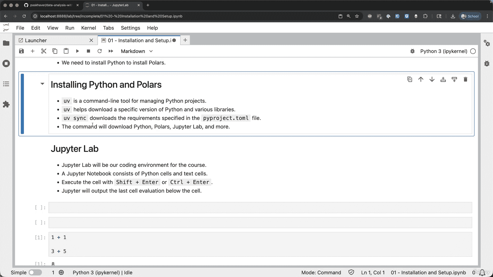

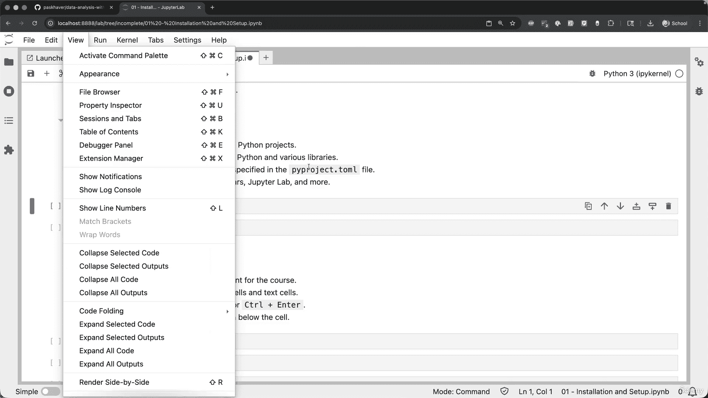

- 按`D`两次（即`DD`）：删除当前单元格，无论它是空的还是包含内容。这会直接移除，所以使用时需要小心。
- 按`X`：剪切当前单元格。剪切时，你会复制它的内容并准备粘贴到其他位置；如果你剪切后不粘贴，那就相当于删除了。

我个人更喜欢用`X`，因为它比`DD`少按一次键，是一种更快速的删除方式。当然，Jupyter Lab也提供了撤销和重做功能。点击顶部“Edit”菜单，你就能看到对应的按钮和快捷键，所以你的工作不会彻底丢失，但删除时还是要谨慎一些。

除了创建和删除，我们还可以快速修改单元格的类型。界面上的下拉菜单是一种方法，命令模式下的快捷键则更快。如果你想更改单元格类型，可以这样做：

- 按`M`：把当前单元格切换为Markdown单元格。
- 按`Y`：把当前单元格切换为Python代码单元格。

例如，在命令模式下按`M`，顶部下拉菜单就会变成“Markdown”，此时单元格中的所有内容都会被解释为文本而不是Python代码。如果按`Y`，它又会变回代码单元格。这里有一点要特别注意：如果你尝试在Markdown单元格中运行Python代码，是不会成功的。你只需要切换单元格类型为代码单元格，就可以得到预期的运行结果。

顺带说明一下，执行一个Markdown单元格（比如按`Shift + Enter`或`Ctrl + Enter`）并不是去运行代码，而是把其中的Markdown文本渲染成格式正确的展示效果。因此，文本单元格同样有编辑模式，你可以一边看课程，一边用Markdown写下自己的笔记，然后按快捷键回到干净的展示模式。

## 🎯 总结

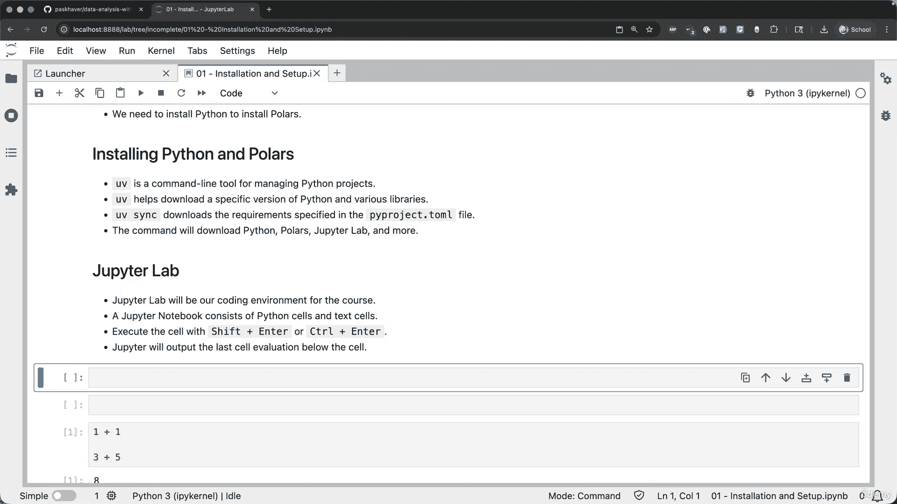

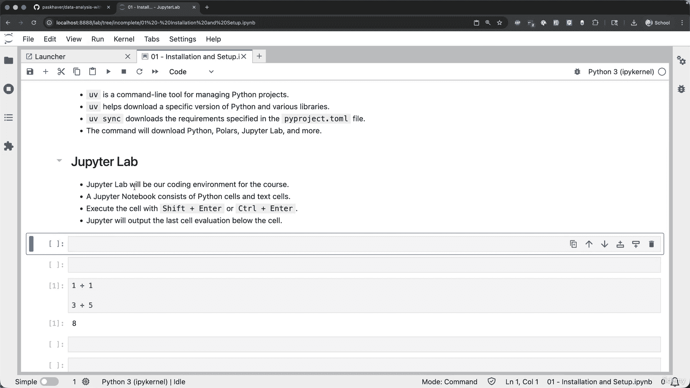

本节课我们一起学习了Jupyter Notebook的核心使用方法。我们从打开notebook开始，认识了`.ipynb`文件以及单元格的概念；然后区分了文本单元格和代码单元格，学习了简单的Markdown语法；接着实际编写了Python代码，并用`Shift + Enter`或`Ctrl + Enter`来执行，理解了执行编号和最后一行输出规则；我们也介绍了如何通过重启内核来重置notebook状态；最后详细讲解了命令模式与编辑模式，以及创建、删除、切换单元格类型的各种快捷键。

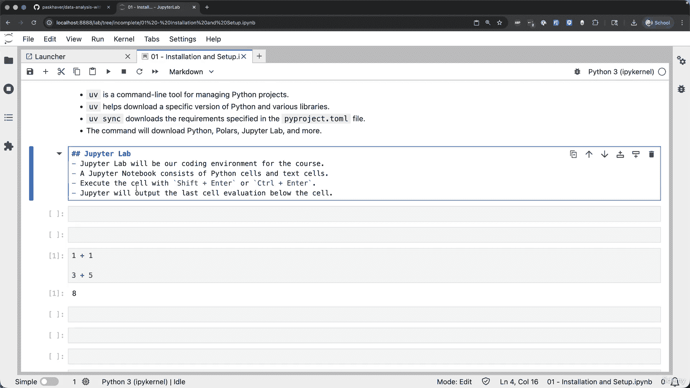

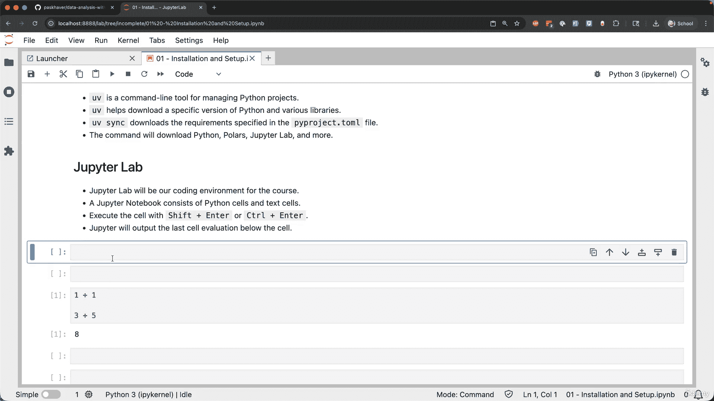

今后在课程中，你只需要在代码单元格中写下Python和Polars代码，确认单元格类型是“Code”（必要时按`Esc`进入命令模式再按`Y`），然后按`Shift + Enter`或`Ctrl + Enter`运行，就可以在正下方看到即时输出。这就是使用Jupyter Notebook的全部核心内容。下节课，我们再继续学习更多数据分析技巧。

