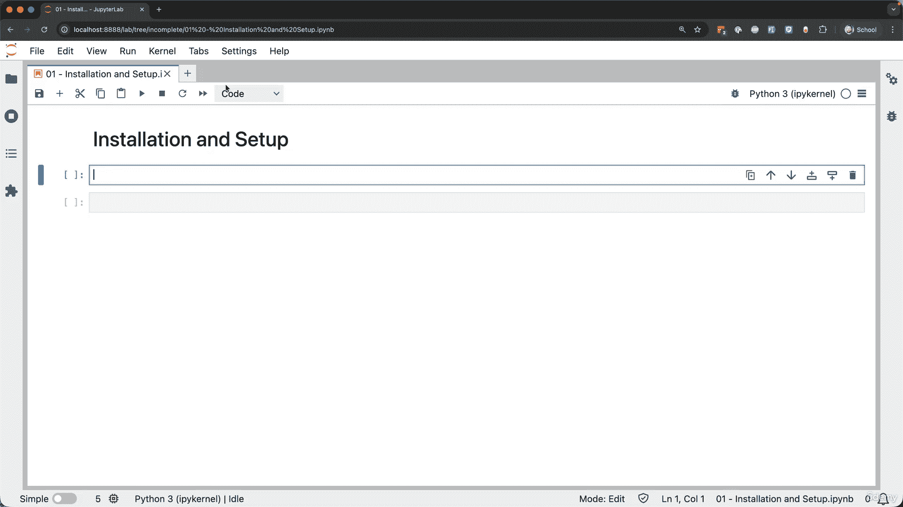
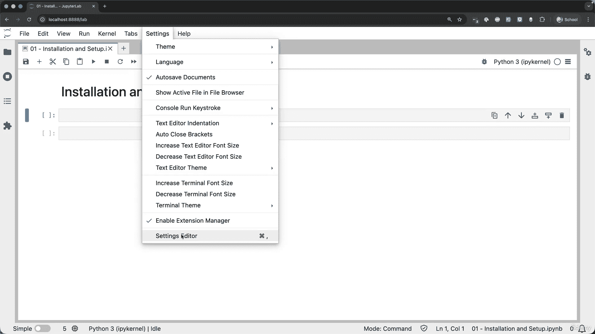
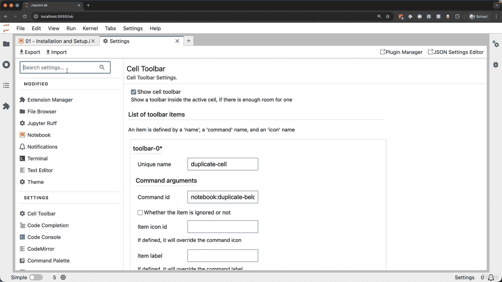
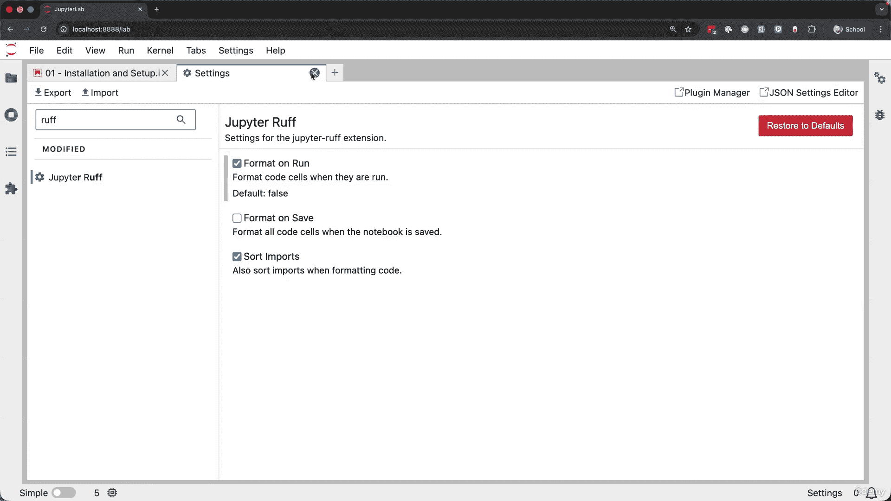
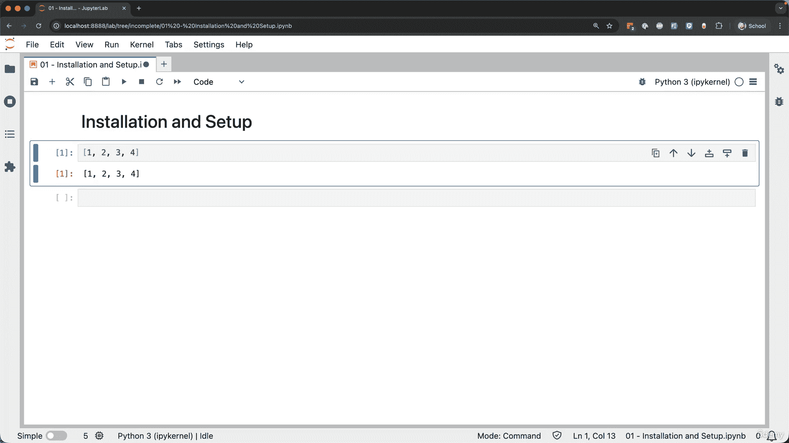

## 🧰 Udemy - Data Analysis with Polars and Python part1：p10：在 Jupyter Lab 中设置 Ruff 格式化器


在本节课中我们将要学习如何在 Jupyter Notebook 或 Jupyter Lab 中启用 Ruff 工具来格式化 Python 代码。本教程会从 Ruff 的作用、设置入口、依赖确认、选项开启和一个代码示例依次展开，帮助初学者理解整个流程。即使之前没有接触过 Python，也可以跟着步骤完成设置，因为本教程重点在于工具配置，不要求先理解所有代码细节。


### 🎯 Ruff 格式化器的作用


上一部分我们了解了课程目标，本节来看看 Ruff 到底做什么。Ruff 由制作 uv Python 包管理器的同一个团队开发。Ruff 做的事情是格式化代码，让代码在不同项目之间保持一致和美观。核心概念可以用公式描述：

```text
格式化前代码语义 = 格式化后代码语义
代码结构不变
代码外观改变
```

也就是说，Ruff 不会改变代码的结构，只会改变代码的外观。写得正确的 Python 代码可以被 Ruff 整理得更美观，这种美观是视觉层面的统一，不涉及逻辑变化。对于初学者来说，可以把它理解成给代码做排版，让代码在团队和项目之间更容易保持一致的风格。


### ⚙️ 在 Jupyter Lab 中打开设置编辑器


理解了 Ruff 只改外观后，本节看看如何在 Jupyter Lab 里进入设置。在 Jupyter Notebook 顶部界面中，进入 `Settings`，然后选择最下方的 `Settings Editor`。这个操作会打开 Jupyter Lab 的全部设置。设置页面里有搜索栏，可以用它限制或筛选想要定位的具体设置。打开路径如下：

```text
Settings -> Settings Editor
```

进入设置编辑器后，接下来要搜索 Ruff。在搜索栏中输入 `Ruff`，然后选择 `Jupyter Ruff`。我已将它包含在项目依赖中。以下是进入 Ruff 设置的具体步骤：





- 打开顶部菜单 `Settings`。
- 选择 `Settings Editor`。
- 在搜索栏输入 `Ruff`。
- 选择 `Jupyter Ruff` 相关设置。




### 📦 确认 Ruff 依赖已经安装


完成设置入口后，本节确认依赖情况。执行 `uv sync` 下载项目全部库时，Ruff 应已被包含。这里会有几个选项需要查看。以下是需要确认的选项：

- 确保勾选 `Format on run`。
- 确认 Ruff 相关设置已经出现。
- 确认依赖已经通过 `uv sync` 安装。

> 提示：`Format on run` 的核心作用是让 Ruff 在运行单元格时自动检查并格式化代码。


### ▶️ 开启运行单元格时自动格式化


上一节确认了依赖和选项，本节解释 `Format on run` 的作用。每当在 Jupyter Notebook 中运行或执行一个示例单元格时，如果 Ruff 发现可以格式化该单元格，它会自动执行格式化。这个过程可以用下面的流程表示：

```text
运行单元格 -> Ruff 检查 -> 可以格式化 -> 自动格式化
```



我理解课程学员的技能水平差异很大，可能有人从未见过 Python，因此不需要理解接下来写的代码。这里只展示 Ruff 可能做的一个例子，目的是观察格式化效果，而不是学习 Python 语法本身。只要跟着执行单元格，就能看到 Ruff 如何自动整理代码。


### 🧪 一个 Python 列表示例


理解了自动格式化选项后，本节用一个例子演示 Ruff 的行为。我只想展示 Ruff 可能做的一个例子。这里声明一个 Python 列表。如果从未见过这种写法没有问题。通常 Python 列表代码会写在一行，这里将把它展开成多行。示例代码如下：

```python
numbers = [
1,
2,
3,
4,
5
]
```

你会注意到，每当我再次通过按住 `Control` 键并按 `Enter` 执行单元格，Ruff 会自动格式化它。它不改变我写的内容，只改变视觉呈现方式。这确保代码在 Python 社区中保持标准化，并且看起来美观。以下是执行示例时需要观察的点：

- 执行单元格使用 `Control + Enter`。
- Ruff 会自动整理列表的排版。
- 代码含义保持不变。
- 代码外观变得更统一。


### ✅ 总结




本节课中我们一起学习了 Ruff 格式化器的概念，以及在 Jupyter Lab 中启用它的完整流程。Ruff 由 uv 团队制作，只改变代码外观，不改变代码语义；通过 `Settings -> Settings Editor` 可以打开设置并搜索 `Ruff`；执行 `uv sync` 时 Ruff 应包含在依赖中；勾选 `Format on run` 后，运行单元格时 Ruff 会自动格式化；最后通过一个 Python 列表示例观察了多行代码被自动整理的效果。掌握这些步骤后，就可以在 Jupyter Lab 中使用 Ruff 让代码风格更统一、更美观。
