# Data Analysis with Polars and Python：第100节：介绍数据集 📚

在本节课中，我们将要认识一个非常重要的概念：连接（join）。连接在数据分析里非常常见，因为真实世界中的数据很少会整整齐齐地放在一张表里，而是经常分散在多个表、多个数据集中。这一节我们会先介绍五个不同的数据集，然后在后面的课程中，我们会逐一尝试用各种方式把它们连接起来。

## 欢迎来到新章节 🎉

欢迎来到课程的新章节。这一章专门讲 Polars 中的连接操作。数据在现实世界里往往是散落着的，可能分散在多个表、多个数据集，甚至多个文件里。所谓连接，就是基于某种逻辑条件，把两个或多个表（或者数据框）合并成一个表。用大白话说，就是“把几张小的数据表拼成一张大的数据表”。

其实 `join` 这个词本身的英文意思就是“链接”或者“连接”，我们在做的事情正是这件事。我们要做的，就是把两个不同的数据集连接起来，让它们变成一张信息量更大的表。在这个章节里，我们不仅会引入一个数据集，而是会引入五个不同的数据集。我们会把这五个数据集从头到尾看一遍，然后探索所有能够把它们链接起来或合并起来的方式。

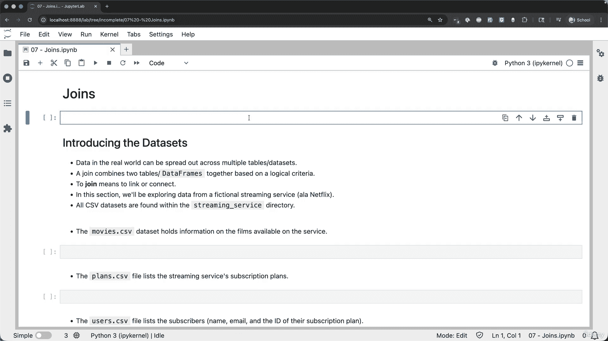

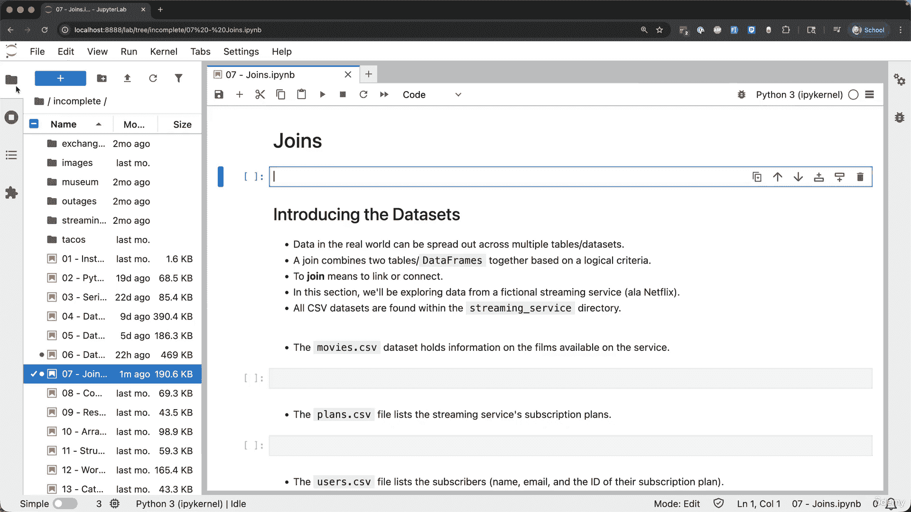

既然要开始实践，就先准备好环境。我们要使用一个全新的 Jupyter notebook，这个 notebook 的名字叫 `07_joins`。和往常一样，第一步一定是导入 Polars 库，并且用 `as` 关键字给它设置一个社区常用的别名 `pl`。下面这段代码就是我们的固定开局：

```python
import polars as pl
```

有了 `pl` 这个别名，后面写起来会方便很多，整个数据分析的流程也就可以正式开始了。

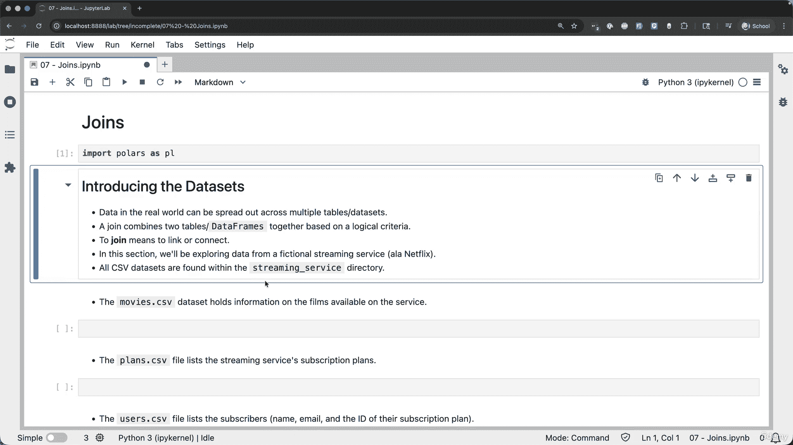

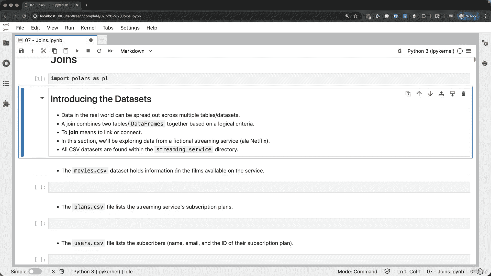

## 什么是连接（Join）？ 🔗

在正式开始介绍数据集之前，我们先花一点点时间把连接的概念说清楚。连接不是一种魔法，它本质上就是一个数据操作。用公式表示的话，连接可以写成这样：

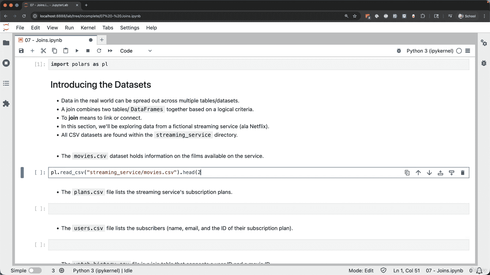

```text
merged = left_table.join(right_table, on=连接条件, how=连接方式)
```

这个公式的意思是：左边有一张表，右边有一张表，我们根据某个连接条件把它们拼在一起，最后得到一张合并后的新表。后面这一节里，你会反复看到这种操作。现在我们只需要记住一个要点：如果两张表里有可以互相匹配的列，那就可以用连接把它们合并起来。

## 五个数据集总览 📁

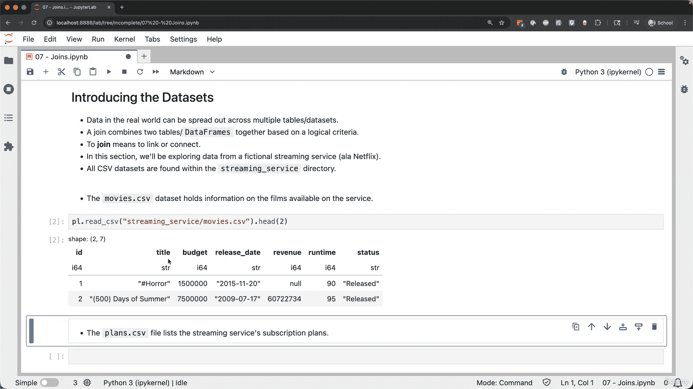

在真正动手连接之前，肯定得先认识一下我们手上的数据。这一节要介绍的内容其实很直接，就是把所有数据集挨个看一遍。所有数据集都放在一个嵌套的 `streaming_service` 目录里，而且全部都是 CSV 文件。以下就是我们要用到的五个数据集，它们各自承担着不同的角色：

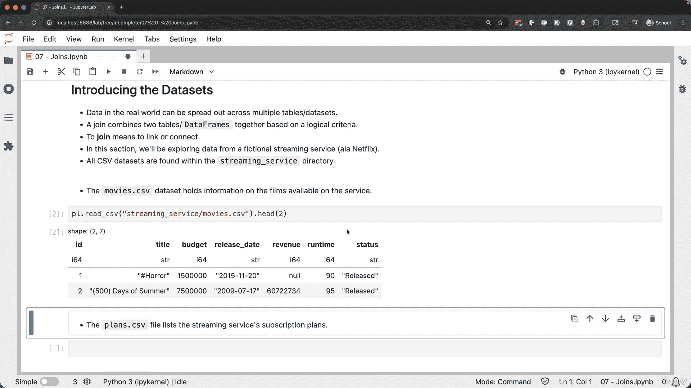

- `movies.csv`：电影数据集，展示流媒体服务上会出现的电影信息。
- `plans.csv`：套餐数据集，用户可以选择订阅的各种服务方案。
- `users.csv`：用户数据集，注册并使用这个服务的订阅者。
- `watch_history.csv`：观看历史数据集，记录用户观看电影的时间和对应电影。
- `support.csv`：支持工单数据集，记录用户提交的客服投诉。

这个目录结构很简单，所有文件都待在 `streaming_service` 文件夹里。接下来，我们就一个一个地看看里面到底都有什么内容。

### 电影数据集 movies.csv 🎬

先从 `movies.csv` 开始。因为文件放在嵌套目录里，所以使用 `read_csv` 函数的时候，需要把完整路径写出来。这个完整路径是 `streaming_service/movies.csv`。为了不让预览内容太多，我们还会在这个数据框上调用 `head` 方法，并且传入参数 `2`，这样只需要看前两行就够了。具体的写法如下：

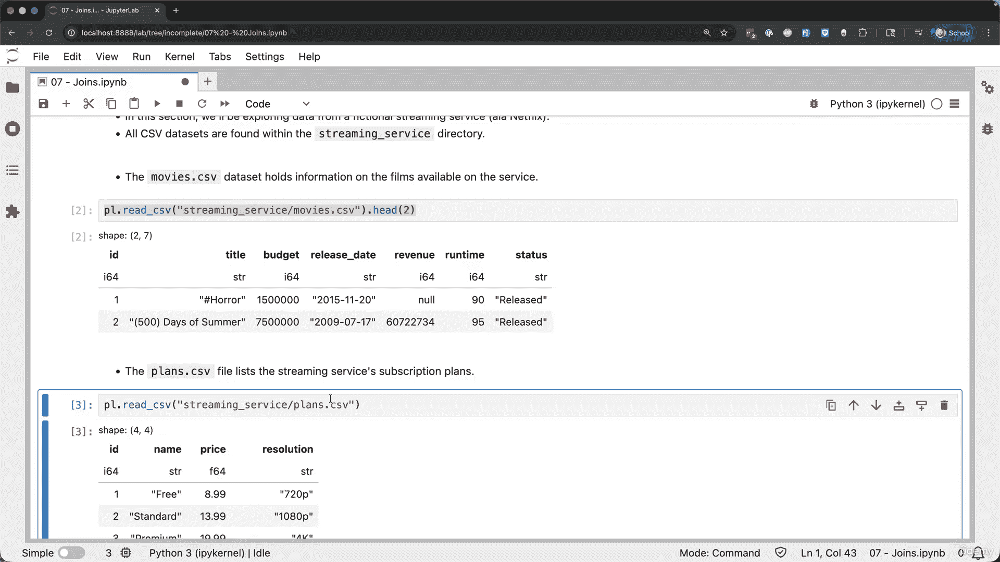

```python
movies = pl.read_csv("streaming_service/movies.csv")
movies.head(2)
```

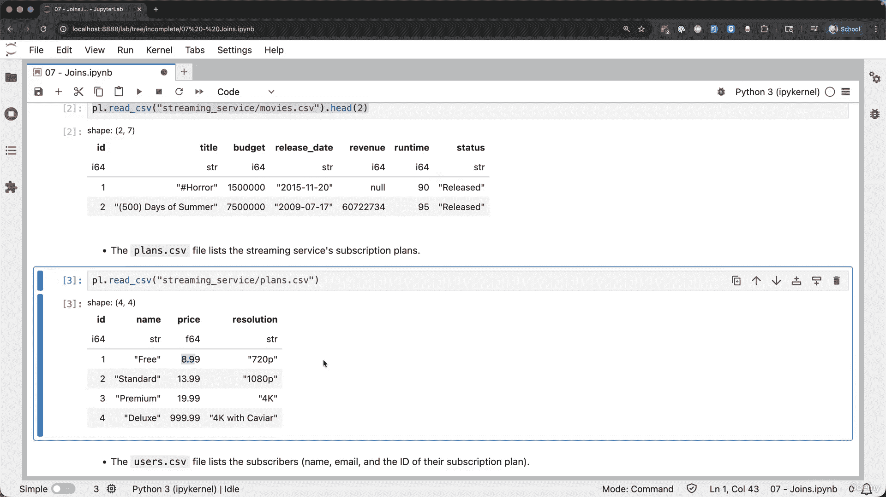

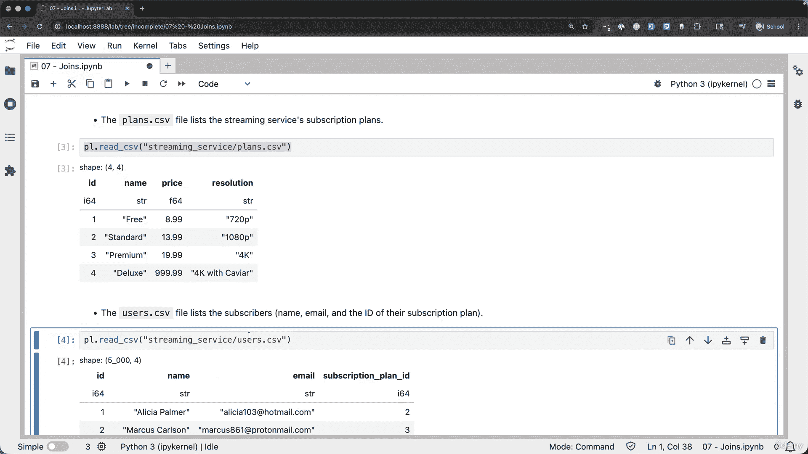

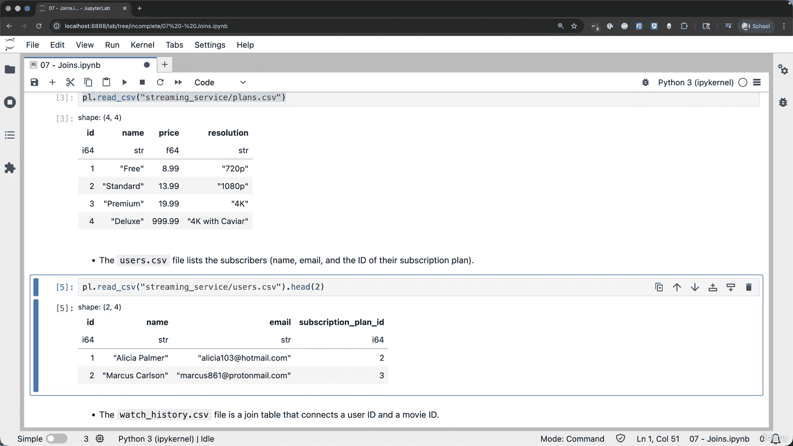

运行之后，你会看到一个非常小的预览表格。那么这个数据集到底是什么呢？你可以把它想象成一个假 Netflix，或者类似的其他流媒体平台。这个数据集就是我们虚构的流媒体服务上会展示的电影集合。每一部电影都有一个 ID，还有标题、电影预算、上映日期。这个上映日期可能是平台上的发布日期，也可能是在影院上映的日期，总之就是一个日期。除此之外，还有电影的票房收入、片长，以及状态。状态这一列在我看来就是“已上映（released）”或者“未上映（unreleased）”，并没有太复杂的东西。

### 套餐数据集 plans.csv 📦

看完了电影数据集，我们再来看看下一个 CSV 文件，它叫 `plans.csv`。这个文件的读取方式和上面完全一样，只需要把文件名从 `movies.csv` 改成 `plans.csv` 就可以。因为这个数据集很短，所以我们不需要使用 `head` 方法，直接全部加载出来看也没有任何问题。

这个数据集是我们服务上所有可用套餐的集合。什么意思呢？简单来说，就是用户可以注册的各种服务方案，比如普通套餐、高级套餐之类的。每个套餐都有自己的一行记录，里面包含几个关键信息：套餐名称、每月价格，以及用户观看视频时能达到的最大分辨率。更有意思的是，里面有一个“豪华套餐（Deluxe）”，价格很高，支持 4K 流媒体，还带鱼子酱。这是我故意加进去的一个小玩笑，大家看到之后不用太惊讶。

### 用户数据集 users.csv 👤

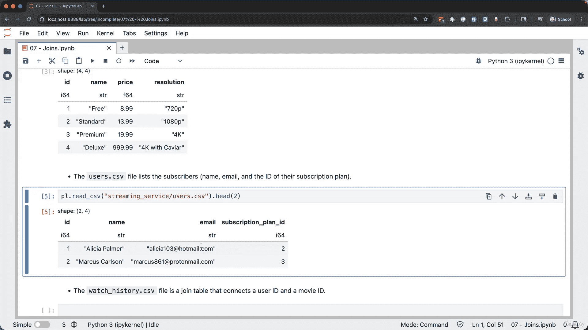

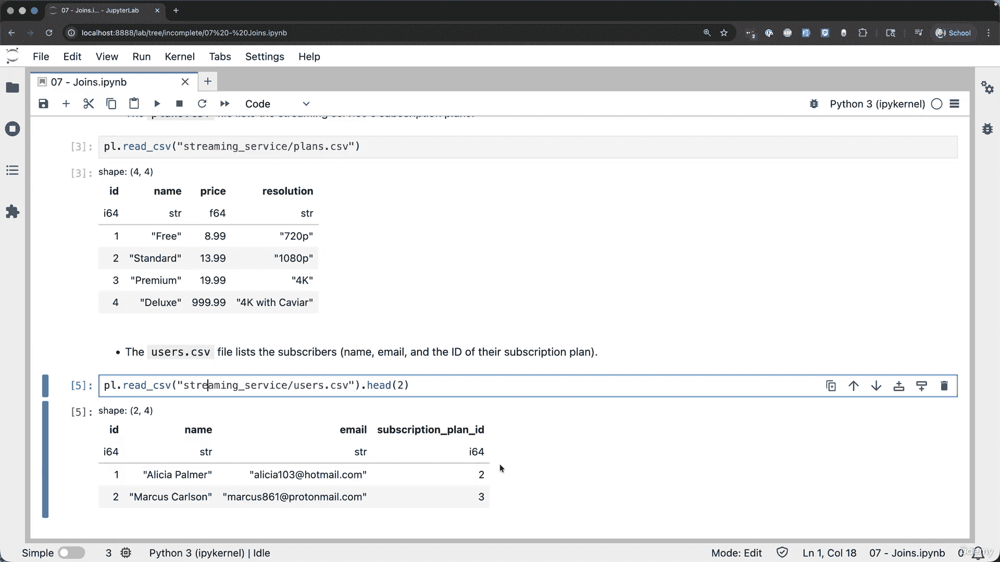

把套餐看完之后，我们继续向下滚动，把上面复制粘贴过的代码再拿过来用一次。下一个数据集叫 `users.csv`。这个数据集收集的是我们网站上所有订阅者的信息。和电影数据集一样，我们也调用 `head` 方法，只看最前面的几行就够了。

这个数据集里有用户 ID、用户在系统里的名字、电子邮件，以及一个订阅套餐 ID。这个订阅套餐 ID 是一个数字，它对应着 `plans` 表里的 ID。举个例子，如果用户 Alicia Palmer 的套餐 ID 是 `2`，那就意味着她订阅的是“标准套餐”。看到这里，你应该已经意识到数据是怎么分散在两个不同数据集里的了。如果我们想把套餐名称之类的信息显示到用户表里，只靠用户表本身是不够的。我们需要做某种连接操作，把套餐表里的信息带到用户表的每一行里来。这正是本部分后面要反复练习的事情，也算是一个非常典型的连接场景。

### 观看历史数据集 watch_history.csv 📺

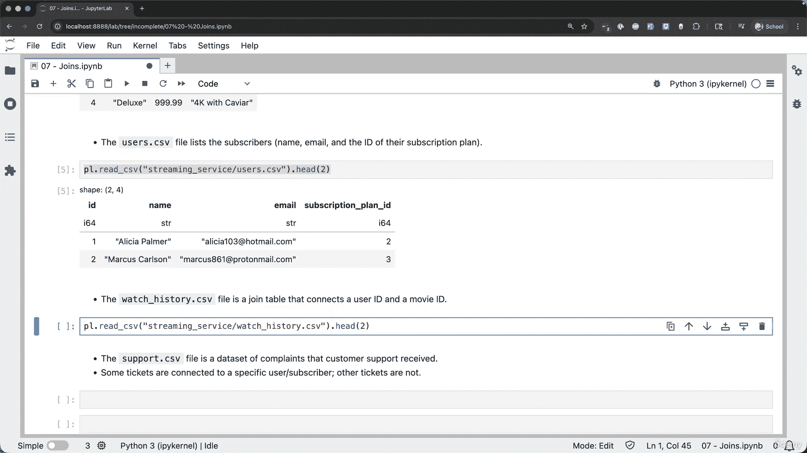

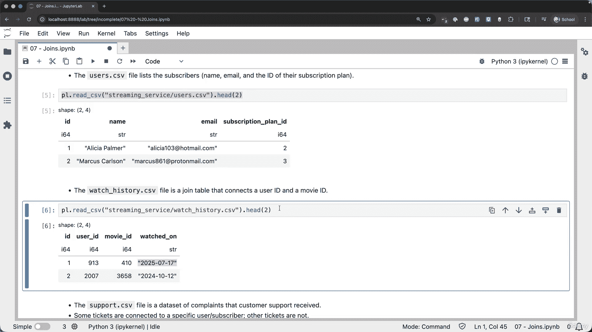

接下来要认识的是 `watch_history.csv`。我们把这个文件加载进来，然后看看它的结构。这个数据集有一个很特别的角色，它属于我们所说的“连接表（join table）”。什么叫连接表呢？用大白话解释，连接表就是一张专门用来把多个外键（foreign key）串在一起的表。而外键听起来很玄乎，其实就是指向其他表的标识符。比如一个表里的某个 ID，恰好指向另一个表里的某一列，那么这个 ID 在对方看来就是外键。

连接表本身不会存太多完整的业务信息，它更多是用来记录“谁在什么时间做了什么事”。这个 `watch_history` 表记录的是：某个特定 ID 的用户，在某个日期或时间，观看了某个特定 ID 的电影。例如，用户 `913` 在某个时刻观看了 ID 为 `410` 的电影，这就是一条典型的观看历史记录。这张表虽然看起来简单，但它往往是连接用户表和电影表的桥梁，非常实用。

### 支持工单数据集 support.csv 🎫

最后一个是 `support.csv`。老规矩，我们把代码里的文件名改成 `support`。这个数据集来自我们网站上一个人不错的客户支持团队，里面收集的是这个团队收到的所有客户支持工单。每个工单都有一个工单 ID。有时候我们知道是哪个用户提交了投诉，所以我们能看到用户 ID；但有时候用户没有登录，或者不想留下身份，那么这一列就会是空的。也就是说，用户 ID 列里确实会出现 `null` 空值，这一点在后续处理的时候要特别注意。除了这些，工单里还有一个“投诉”列，内容就是用户具体的投诉信息，也就是用户不喜欢这个服务的哪些地方。

## 统一的导入代码 📥

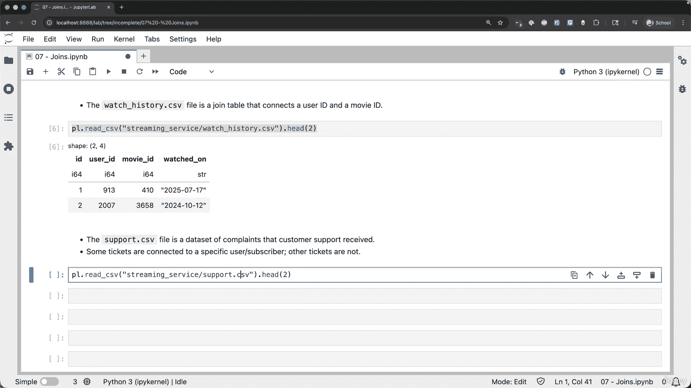

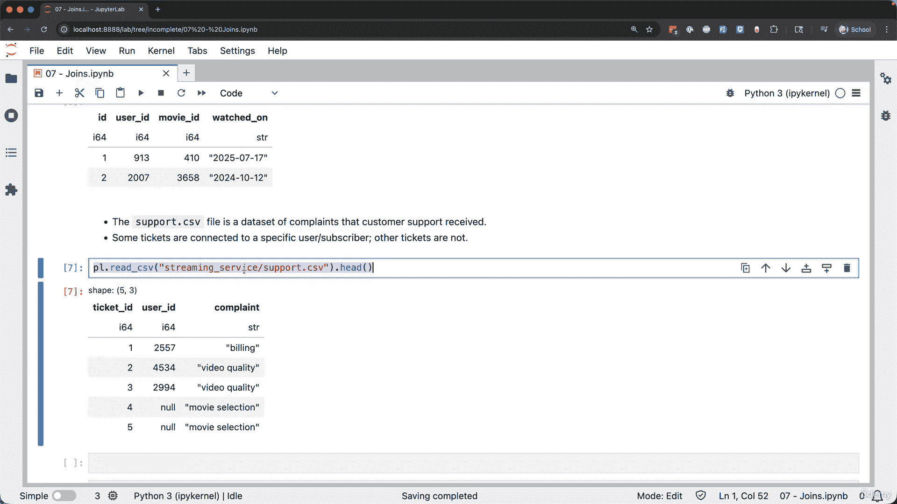

五个数据集现在都认识完了。在正式进入连接操作之前，还有一件很重要的准备工作要做：把所有这些 CSV 文件一次性导入进来，并且赋给合适的变量。这样以后每一节课开始的时候，我们就不用重复读文件，而是直接使用这些已经准备好的变量。下面这段代码就是我们要放在每节课开头的“标准导入代码”：

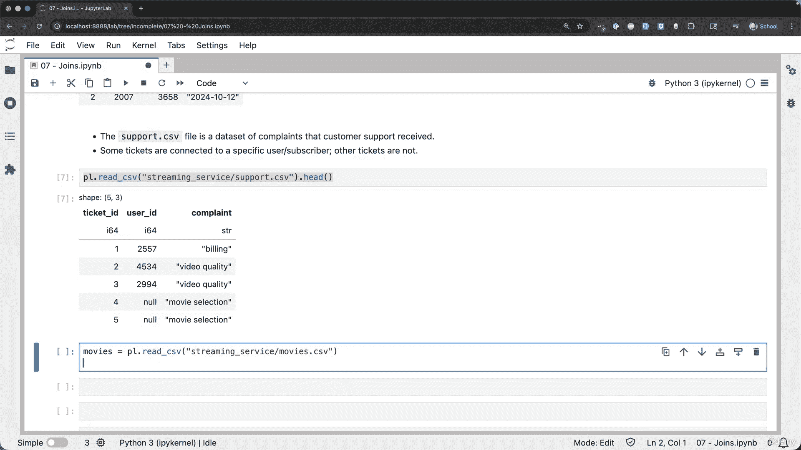

```python
import polars as pl

movies = pl.read_csv("streaming_service/movies.csv")
plans = pl.read_csv("streaming_service/plans.csv")
users = pl.read_csv("streaming_service/users.csv")
watch_history = pl.read_csv("streaming_service/watch_history.csv")
support = pl.read_csv("streaming_service/support.csv")
```

上面的代码把每个 CSV 都导入到了对应的 Polars 数据框里。第一个是电影文件，赋给 `movies` 变量；第二个是套餐文件，赋给 `plans` 变量；第三个是用户文件，赋给 `users` 变量；第四个是观看历史文件，赋给 `watch_history` 变量；最后一个是支持工单文件，赋给 `support` 变量。这样命名非常直观，看到变量名就能大概知道里面存的是什么。

运行这个单元格，确认一下所有文件能否正常导入。只要没有报错，那就说明一切正常。这段导入代码会作为每节课的起点，反复出现在后面的内容中，所以把它的结构记清楚会很有帮助。

## 总结 ✅

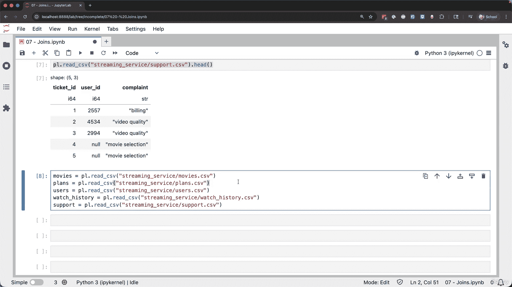

本节课中，我们一起学习了连接（join）的基本概念，也知道了在数据分析中，数据经常分散在多张表里，而连接操作可以基于某种逻辑条件，把这些表合并成一张新表。我们还逐一介绍了五个数据集：`movies.csv` 提供了电影的基本信息，`plans.csv` 提供了订阅套餐信息，`users.csv` 提供了用户和订阅关系，`watch_history.csv` 作为连接表记录了用户与电影的观看关系，`support.csv` 则记录了客服工单和用户投诉。最后，我们还准备好了统一的导入代码，把五个 CSV 文件全部载入到各自的 Polars 数据框里。有了这些基础，后面就可以放心地探索 Polars 中各种类型的连接操作了。下一节课，我们就会正式进入连接的世界，敬请期待。
