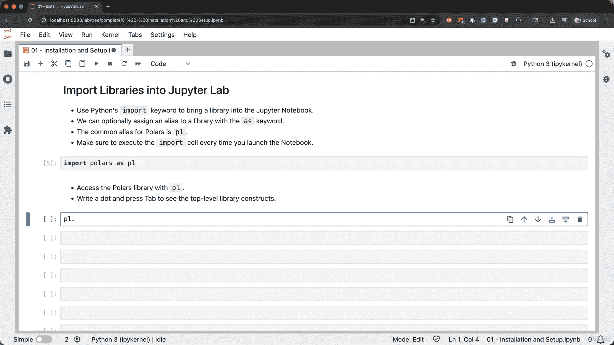
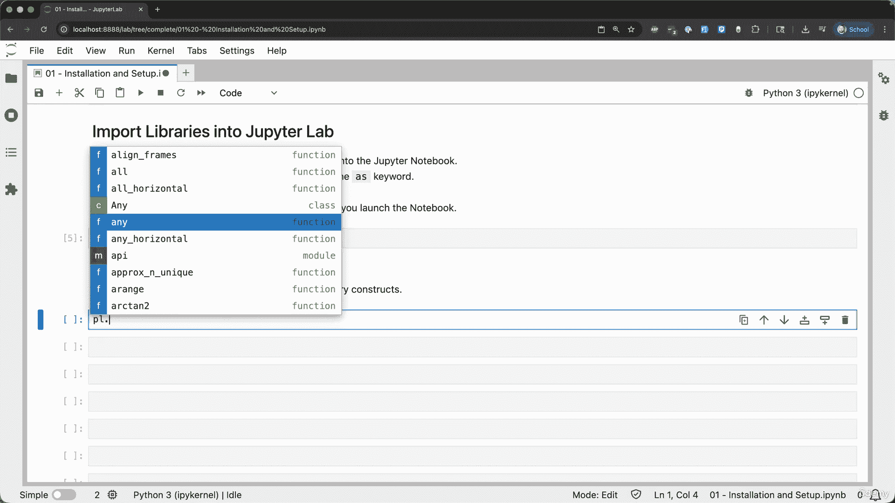
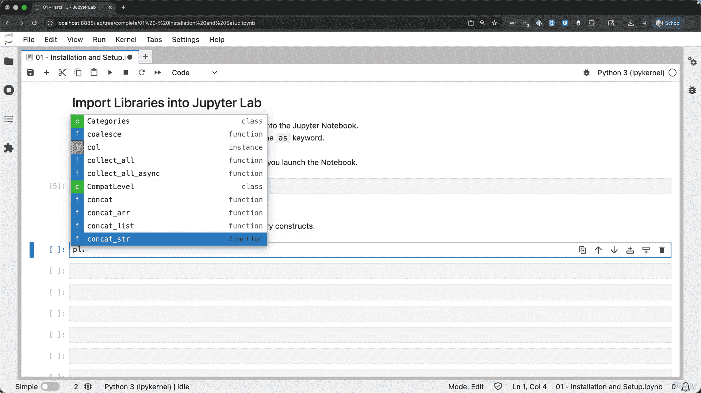
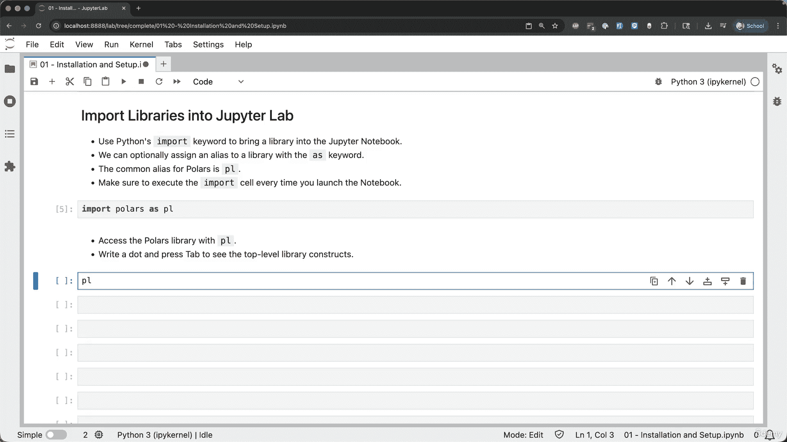
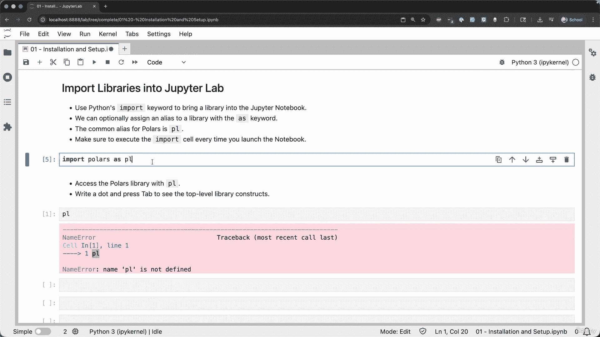
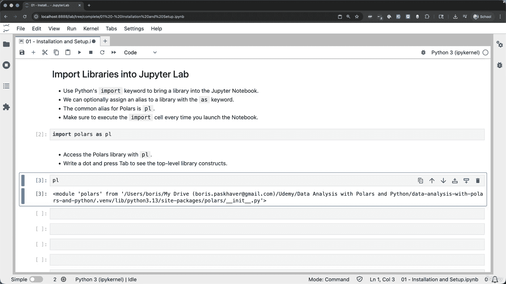

## 📚 使用Polars和Python进行数据分析：第11节：将库导入Jupyter Lab

在本节课中，我们将学习如何把 Polars 库导入到 Jupyter Lab 中。这是本节要讲的最后一块内容，我会比较快地演示整个过程。如果你刚接触 Python，完全不用紧张，在后面的 Python 速成课中，我们还会更详细地拆解每一个步骤。现在，让我们从最基本的概念开始说起。

### 什么是 Polars 库？

首先来复习一个概念：Polars 是一个库。所谓库，就是一堆独立于 Python 核心语言的代码打包在一起形成的集合。你可以把它想象成一个装满现成工具的工具箱，里面提供了很多专门用于数据处理和分析的函数与数据结构。

当 Jupyter Lab 启动时，它默认会给我们一个可用的 Python 环境，但并不会自动把 Polars 也放进来。我们必须主动选择将 Polars 带入到当前项目，或者说带入到当前的 Jupyter notebook 中，这样才能真正使用它。换句话说，导入这个动作不会自己发生，而是需要你亲手操作。

### 如何导入 Polars？

导入 Polars 的方法非常简单，核心就是使用 Python 内置的一个关键字：`import`。在单元格里，我们先全小写输入 `import`，然后打一个空格，再写上要导入的库的全名，也就是全小写的 `polars`。完整的写法是这样的：

```python
import polars
```

写完以后，直接执行这个单元格，Polars 就会被成功导入到当前的 Jupyter notebook 里了。当然，这只是最基础的一种导入方式。在实际项目中，我们通常还会再做一步可选的额外操作，让后续使用更加方便。

### 给 Polars 设置别名

刚才我们已经把 Polars 导入进来了，但每次想用它的时候，都得把 `polars` 这六个字母完整地敲出来，多少有点费手指。所以，一个非常常见的做法是给这个库分配一个别名。别名其实就是另一个名字，或者也可以理解成一个昵称。开发者们之所以喜欢用别名，说白了就是为了少打几个字，让代码写起来更轻松。

那要怎么设置别名呢？方法很简单：在 `import polars` 后面加一个空格，然后写上小写的 `as` 关键字，再空一格，最后写上你想要的别名。这个 `as` 关键字的作用，就是把前面导入的库和后面指定的别名绑定在一起，让它们变成同一个东西的两个称呼。

对于 Polars 来说，社区里约定俗成的别名是 `pl`。当然，这部分完全是可选的，想用什么别名都由你自己决定。不过我还是建议你直接沿用社区惯例，用 `pl`，这样别人看到你的代码时，也能一眼就明白你导入的是哪个库。

```python
import polars as pl
```

执行这个单元格之后，Polars 不但被导入了，而且被绑定上了别名 `pl`。以后在代码里再想引用它，直接写 `pl` 就行，比写全名省事多了。

### 验证导入是否成功

导入完成之后，我们怎么确认 Polars 真的已经可用呢？一个很简单的验证办法是：在单元格里输入 `pl`，然后紧接着输入一个点 `.`，再按下 Tab 键。这时 Jupyter Lab 会弹出一个智能提示列表，里面列出了 Polars 库中所有顶层的、可以直接使用的成员。你可以把这些成员想象成库的“主大厅”，所有能用的工具都陈列在眼前。







如果这个智能提示能够正常弹出来，就说明 Polars 已经成功导入，并且现在随时可以调用它的各种功能了。换句话说，这个列表就是我们导入成功的“验收证明”。

### 一个必须注意的坑：重启后需要重新导入

接下来要强调一个非常重要的点：每当你关闭 Jupyter notebook 时，所有执行过的代码、导入的库、生成的变量，统统会被清空。所以，当你重新启动 Jupyter Lab，再次打开这个 notebook 时，Polars 其实并没有被导入，除非你重新执行一遍之前的导入代码。

我可以模拟一下这个场景：点击界面上方的 “Kernel” 菜单，选择 “Restart Kernel”，然后确认重启。这样一来，notebook 就回到了一块干净的石板、一张空白的画布的状态。

假设第二天你打开 Jupyter Lab，想继续用 Polars，于是直接在单元格里输入 `pl`，然后执行，你大概率会看到一个大红框，里面显示的是 Python 错误信息。看到这个红框千万别慌，它只是在告诉你：你写的代码有问题。具体来说，输出那里会写着 `NameError: name 'pl' is not defined`。为什么会出现这个错误呢？原因就是 `pl` 这个名字根本还没有被定义过——因为 Polars 还没有被导入，而导入代码所在的单元格还没有被执行。在 Python 和 Jupyter Lab 看来，`pl` 就是一个不存在的名字。

所以请牢牢记住：每次重启 notebook，你都是从零开始。如果看到了 “name 'pl' is not defined” 这样的错误信息，解决办法其实很简单，只需要回去重新执行一次导入代码，也就是运行 `import polars as pl`，让 Polars 重新变成可用状态。这样一来，所有 Polars 的功能就都能恢复正常工作了。



### 总结





本节课中，我们一起学习了如何在 Jupyter Lab 中导入 Polars 库。我们先认识了什么是库，以及为什么需要手动导入；接着，我们使用 `import polars` 完成了基本导入；然后，通过 `import polars as pl` 给库设置了一个更简短的别名 `pl`；我们还借助 Tab 键的智能提示功能，验证了导入是否成功。最后，我们重点强调了重启 notebook 后必须重新执行导入代码，否则就会遇到 `NameError`。希望这个知识点能帮你少踩一些坑，我们下节课再见。
