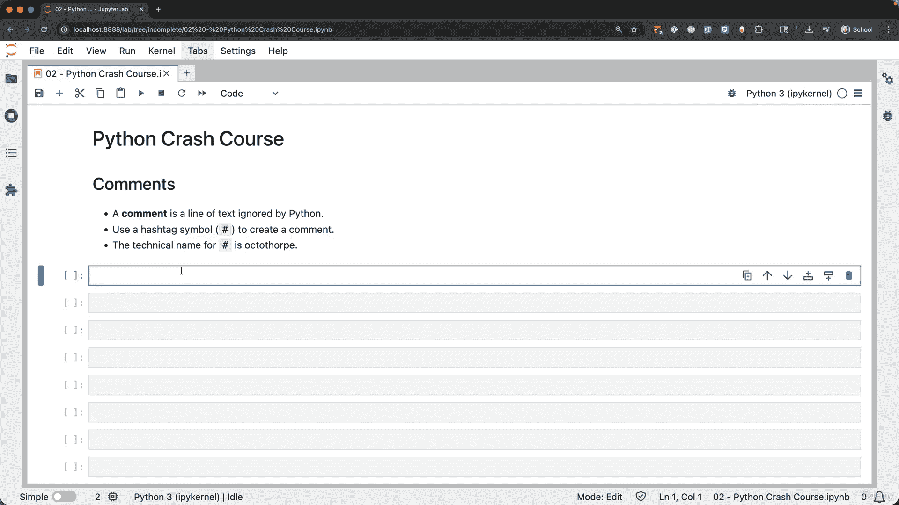
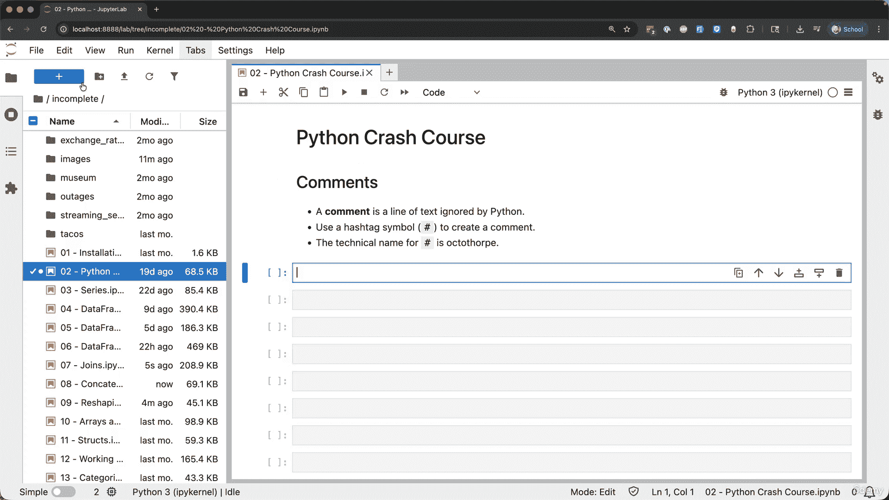
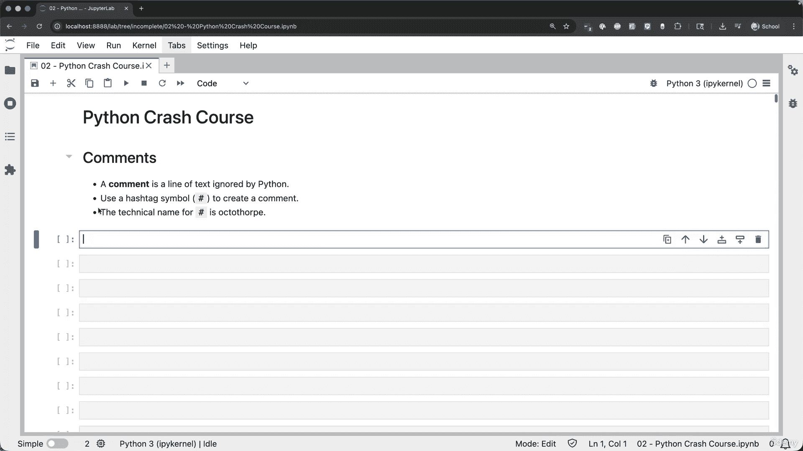
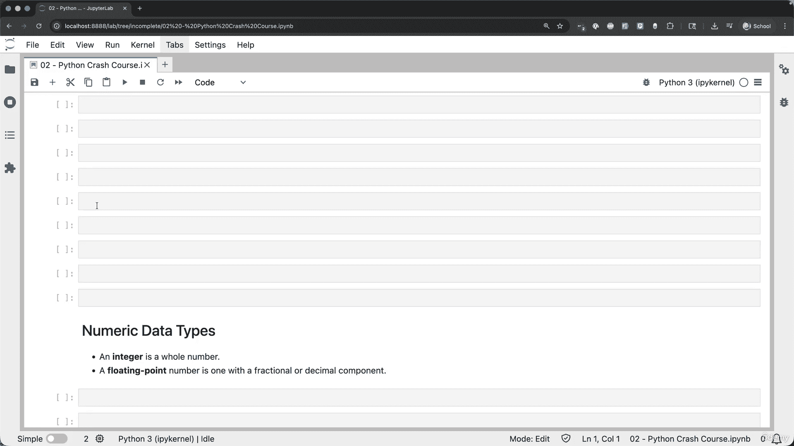
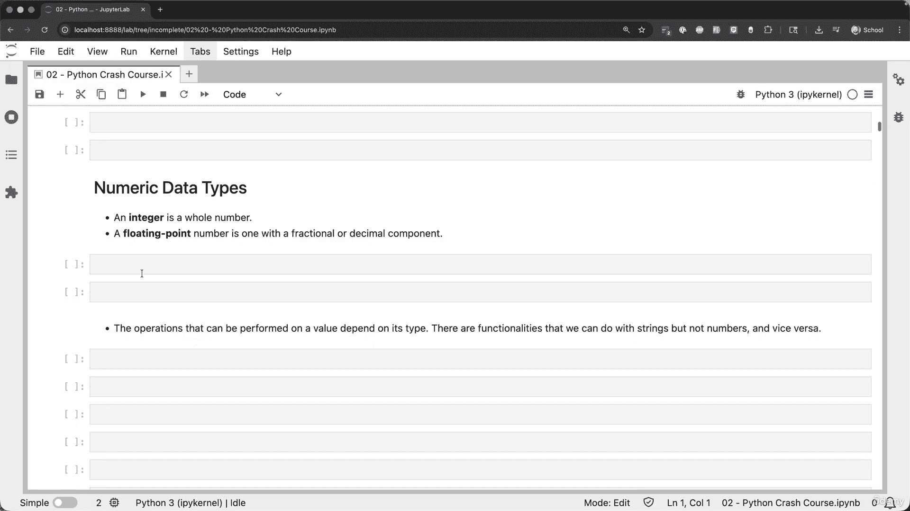
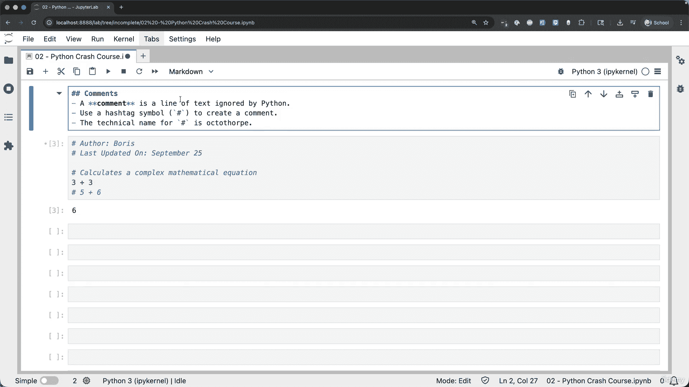
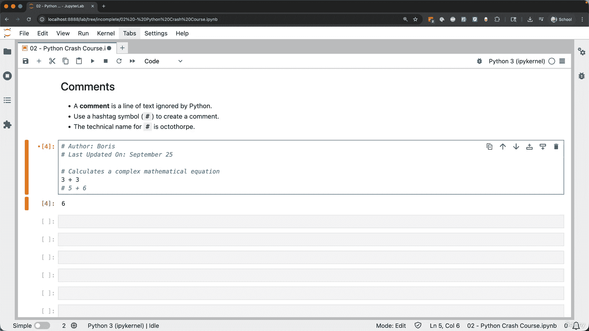

# 🐍 Polars 与 Python 数据分析：第12节：注释

在本节课中我们将要学习 Python 速成部分里的“注释”，同时先了解这一节课程在整个课程中的位置和学习目标。原文开头介绍，下一节课程会综合介绍 Python 编程语言，重点放在使用 Python 生态中任意库（包括 Polars）所需的核心语言概念。课程覆盖数据类型、变量、函数、列表和字典等数据结构，也会说明如何使用 Polars 这样的外部库。熟悉 Python 的读者可以跳过本节，或者快速浏览本节。作者希望本节对没有 Python 经验、也没有编程经验的人最有帮助。如果你属于这种情况，强烈建议先完成本节，再进入 Polars 内容。接下来会使用一个名为 O2 的全新 Jupyter notebook。

## 📘 Polars 与 Python 数据分析：12.1：课程定位与学习目标

上一段我们说明了本节在课程中的位置，本节中我们来看看学习目标和学习建议。这一部分的作用是让初学者知道为什么先学 Python 核心概念，再学 Polars。Polars 是 Python 生态中的一个库，所以要先理解 Python 的基础语言概念，后面使用 Polars 时才能更顺畅。

以下是本节课程定位涉及的主要内容：

- 本节会综合介绍 Python 编程语言。

- 重点讲使用 Python 生态中任意库所需的核心语言概念，包括 Polars。



- 覆盖数据类型、变量、函数、列表和字典等数据结构。

- 说明如何使用 Polars 这样的外部库。

- 熟悉 Python 的读者可以跳过本节，或者快速浏览。

- 本节希望最大程度帮助没有 Python 经验或编程经验的人。

- 如果你没有相关经验，强烈建议先完成本节，再进入 Polars 内容。

> 如果你没有 Python 或编程经验，强烈建议先完成本节，再进入 Polars 内容。

在明确学习目标之后，课程会进入一个全新的 Jupyter notebook，名字叫 O2。接下来的内容都围绕这个 notebook 展开。上一节我们介绍了课程定位，本节中我们来看看 Python 速成部分里最基础的注释概念。



## 🧾 Polars 与 Python 数据分析：12.2：注释是什么





在每个 Jupyter notebook 中，作者都提供了很多注释，目的是让学习者观看课程视频、推进课程内容时，以及之后回顾自己写的内容时，都能看到覆盖了哪些主题的提醒。下面从注释的定义开始。注释是程序执行时会被 Python 忽略的一行文本。Python 代码由命令组成，命令就是让计算机执行的一条指令。在 Jupyter notebook 中，代码写在单元格里，Python 会从顶部到底部依次执行这些代码。



可以用一个简单例子理解单元格执行。Python 可以用小学学过的常见数学符号做基本数学运算，例如写 `3 + 3`。加号两边的空格不是必需的，但很常见，因为这样读起来更清楚。执行单元格时可以按住 Shift 或 Control 再按 Enter，输出会显示在单元格底部。这是有效的 Python 代码，Jupyter notebook 执行了写进去的 Python。

```python
3 + 3
```

如果再添加一行代码，例如 `5 + 6`，会在最底部看到 `11`，这是最后一行的输出。重点是 Python 仍然处理了单元格里的所有代码。它会先计算第一行得到 `6`，然后忽略这个结果，再计算第二行得到 `11`，因为 `11` 是单元格最后一行，所以它成为最终输出。这个单元格仍然是有效的 Python 代码。

```python
3 + 3
5 + 6
# 单元格最终输出 11，因为 11 是最后一行表达式的值
# Python 仍然处理了 3 + 3，只是 6 不会成为最终输出
```

注释是会被 Python 忽略的一行文本，创建注释要使用特殊的井号符号 `#`，在大多数键盘上就是 Shift + 3。可以在 `5 + 6` 这一行前面加上 `#`。这个符号的技术名称是 octothorpe。加上之后，这一行会立刻变灰，失去原来的格式，例如加号原本的紫色会消失。Python 会完全忽略这一行，因为它已经是注释。因此 `3 + 3` 会成为 Jupyter notebook 重新执行单元格时最后一行实际被求值的代码，所以重新执行后会得到 `6`。原因是 `5 + 6` 这一行代码从未运行。

```python
3 + 3
# 5 + 6
# 重新执行后输出 6；被注释的行不会运行
```

还可能注意到，代码格式化器会格式化单元格，并在注释符号 `#` 后面加一个空格。这个空格不是严格必需的，但它能让这一行更容易阅读。以上是注释的技术解释。注释的实际用户价值是给代码提供文档说明。注释符号允许我们在某一行里放任意内容。我们可以写代码描述，可以写元数据，可以写实现信息、版权信息，甚至写一个笑话。注释提供了在普通 Python 代码中插入纯文本的能力。

以下是注释常见用途：

- 给代码写描述。

- 记录元数据。

- 记录实现信息。

- 记录版权信息。

- 写一个笑话。

- 在普通 Python 代码中插入纯文本说明。

例如，可以写一个 `#` 注释，内容写作者名字，再写最后更新时间，比如 September 25th。这些行都会被完全忽略。还可以给程序写某种描述，例如“计算一个复杂的数学方程”。这里的目的不只是搞笑，更重要的是给未来读代码的人解释代码在做什么。

```python
# author: 你的名字
# last updated on: September 25th
# calculates a complex mathematical equation
3 + 3
```

上一节我们看到了注释在单元格中的基本效果，本节中我们来看看注释与 Jupyter Notebook 里的 Markdown 内容有什么区别。这个区别对初学者很重要，因为二者看起来都像“文字”，但运行机制完全不同。

## 🔍 Polars 与 Python 数据分析：12.3：注释与 Markdown 的区别

注释与 Jupyter notebook 里那些 Markdown 构造完全不同。Jupyter notebook 里的这些常规单元格是用 Markdown 格式写的，由普通文本以及用于加粗、斜体和创建列表的特殊符号组成。要记住，Jupyter Lab 只是一个专门用来写 Python 代码的环境。并不是所有 Python 代码都必须写在 Jupyter notebook 中。相比之下，这里讲的注释代码属于 Python 本身。无论在世界任何地方运行任何 Python 文件，也无论使用哪种 Python 环境，`#` 符号都会被识别。它不必位于 Jupyter notebook 编辑器里。

注释是 Python 语言内置的构造，它给我们一个机会，让某一行在 Python 从顶部到底部求值时不被读取。这样就能在代码里加入各种有用的信息，这就是注释的好处。在学习本节的过程中，可以把笔记写在额外的单元格里；如果想把注释和有效的 Python 代码放在一起，也可以让一行以 `#` 开头，这个符号后面的所有内容都会被完全忽略。

以下是注释与 Markdown 单元格的主要区别：

- 注释属于 Python 语言本身，`#` 在任何 Python 文件和 Python 环境中都会被识别。

- Markdown 单元格属于 Jupyter Notebook 的界面内容，用普通文本和加粗、斜体、列表等 Markdown 符号写成。

- Jupyter Lab 是专门写 Python 代码的环境，但 Python 代码不一定要写在 Jupyter notebook 中。

- 注释是语言内置构造，作用是让某一行不被 Python 读取。

- 注释可以用来加入说明、元数据、实现信息等有用内容。

技术上也可以在有效代码行后面加 `#`，因为注释从 `#` 出现的位置开始。例如写 `3 + 3  # this will give us 6`，`3 + 3` 仍然会被求值并执行，因为它是有效代码，注释从 `#` 出现的位置开始。实际中更常见的是把注释写在独立行上，因为这种写法有时会让人困惑。大多数开发者会把注释写在单独的独立行上，这样更容易识别注释从哪里开始，有效代码在哪里。

```python
3 + 3  # this will give us 6
# 3 + 3 仍然会执行；注释从 # 出现的位置开始
```

上一节我们区分了注释和 Markdown，本节中我们来看看写注释时更实用的做法。下面这些建议可以帮助初学者减少困惑，也让代码更容易回顾。

## 🧠 Polars 与 Python 数据分析：12.4：使用注释的建议


学习本节时可以做笔记，笔记可以放在额外的单元格里。如果想把注释和有效 Python 代码放在一起，只要让一行以 `#` 开头，这个符号后面的所有内容都会被完全忽略。下面列出一些更实用的做法。



以下是写注释时更实用的建议：

- 把注释写在独立行上，便于识别注释开始的位置和有效代码的位置。

- 在有效代码行后加 `#` 技术上可行，但实际中不常见，因为可能造成混淆。

- 注释从 `#` 出现的位置开始，`#` 后面的内容不会执行。

- 学习笔记可以放在额外单元格中，也可以作为注释写在代码旁边。

- 注释适合写代码描述、元数据、实现信息、版权信息或说明文字。

## 🧾 Polars 与 Python 数据分析：12.5：本节总结

本节课中我们一起学习了 Python 速成部分里的注释，也了解了本节课程的学习目标。我们知道了注释是程序执行时被 Python 忽略的文本，创建注释使用 `#`，在大多数键盘上是 Shift + 3。我们通过 `3 + 3` 和 `5 + 6` 的例子看到了 Jupyter notebook 会从顶部到底部执行单元格，而单元格输出取最后一行有效代码的结果。我们还看到了注释会让某一行不参与执行，所以把 `5 + 6` 注释掉后，重新执行得到 `6`。

核心概念可以概括为以下公式和代码：

```text
注释起点 = 字符 # 出现的位置
注释内容 = # 后面的文本，执行时被忽略
单元格输出 = 最后一行有效代码的求值结果
```

```python
3 + 3
# 5 + 6
# 输出为 6，因为被注释的行不会执行
```



我们还区分了 Python 注释和 Jupyter Notebook 的 Markdown 单元格。注释属于 Python 语言本身，在任何 Python 环境中都能识别；Markdown 单元格属于 Jupyter Notebook 的界面内容。最后我们给出了写注释的建议：优先把注释写在独立行上，便于识别；技术上可以在有效代码后加 `#`，但实际中不常见。下一节继续学习。

