# Polars与Python数据分析：13：数据类型 📊

在本节课中我们将要学习Python中的常见基本数据类型，包括整数、浮点数、字符串、布尔值和None。我们还会理解数据类型如何影响程序中的操作，以及类型错误在Jupyter Notebook中是什么样子。学习Python的一个好起点，是查看语言中定义的基本数据类型。现实世界由许多类型的数据组成，数据类型表示相关值的类别。比如年龄可以用数字表示，名字可以用一段文本表示，约会时间可以用日期表示。我们每天都在使用这些数据类型，因此Python实现了许多数据类型，让开发者能够准确建模现实世界。理解这些构造在编程语言中的技术名称很重要，因为这些名称和缩写会出现在代码和错误信息中。

上面我们说明了数据类型与现实世界建模的关系，本节我们来看看Python中的整数。整数是没有小数部分的完整数，可以写成：

```python
5
0
-13
```

为了更直白地理解，可以记住一个公式：`整数 = 没有小数部分的数`。

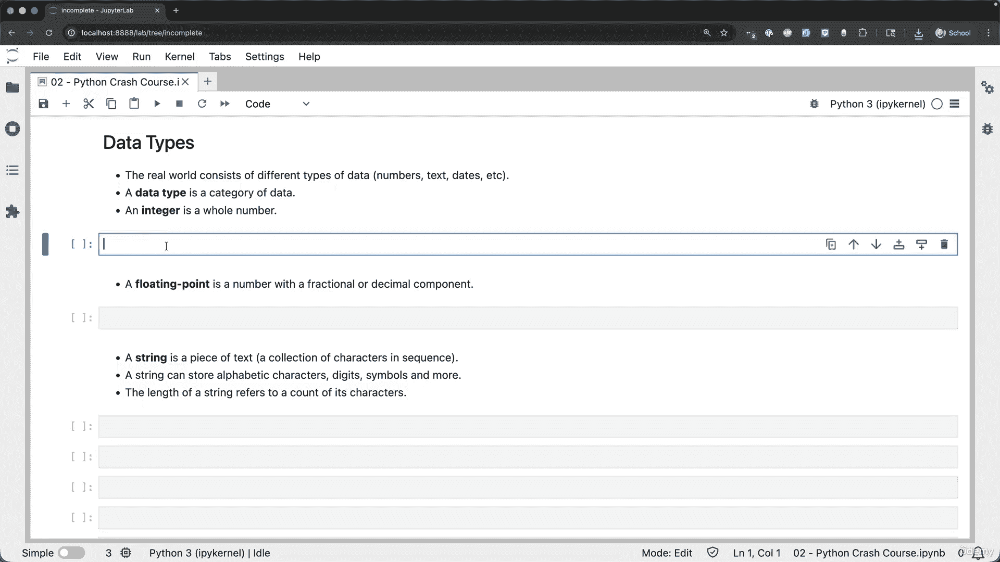

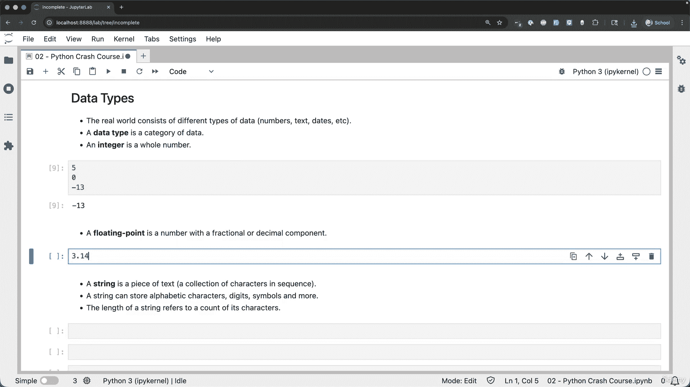

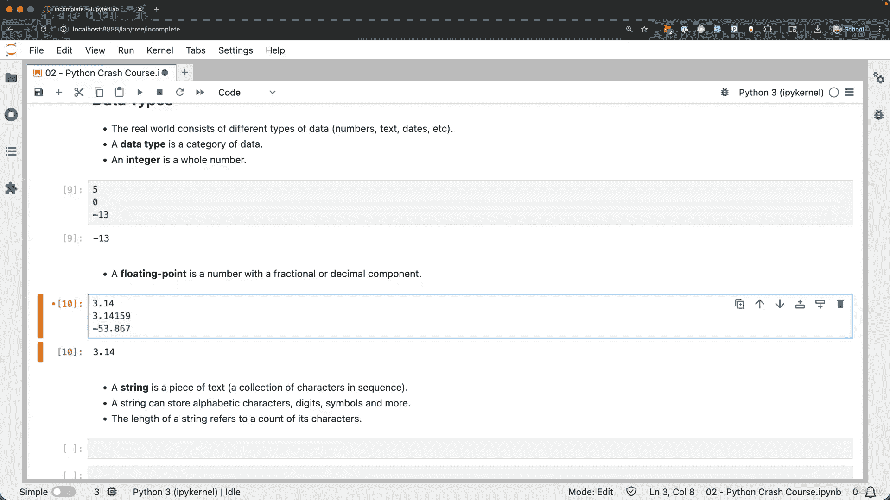

以下是整数的几个例子：

- `5` 是整数。
- `0` 是整数。
- `-13` 也是整数。

这几个值彼此不同，但可以说它们属于同一种数据类型，也就是整数。整数就是完整数。理解了整数之后，本节我们来看看带小数部分的数字，也就是浮点数。

## Polars与Python数据分析：13.2：浮点数 🔢

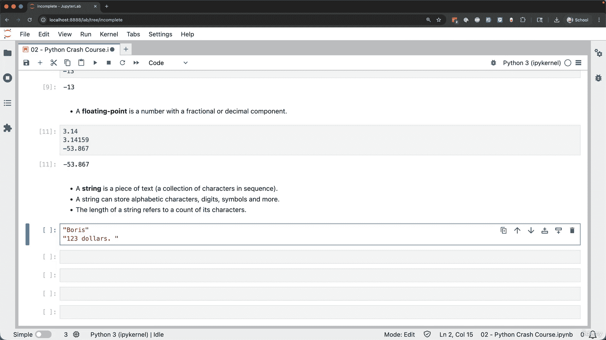

上一节我们介绍了整数，本节我们来看看浮点数。Python也支持浮点值，有时简称float。浮点数带有小数部分或分数部分。小数点很重要，只要看到小数点，就表示正在处理浮点值，也叫float。浮点数可以写成：

```python
3.14
3.14159
-53.867
```

以下是浮点数的几个例子：

- `3.14` 是浮点值。
- `3.14159` 是浮点值。
- `-53.867` 是浮点值。

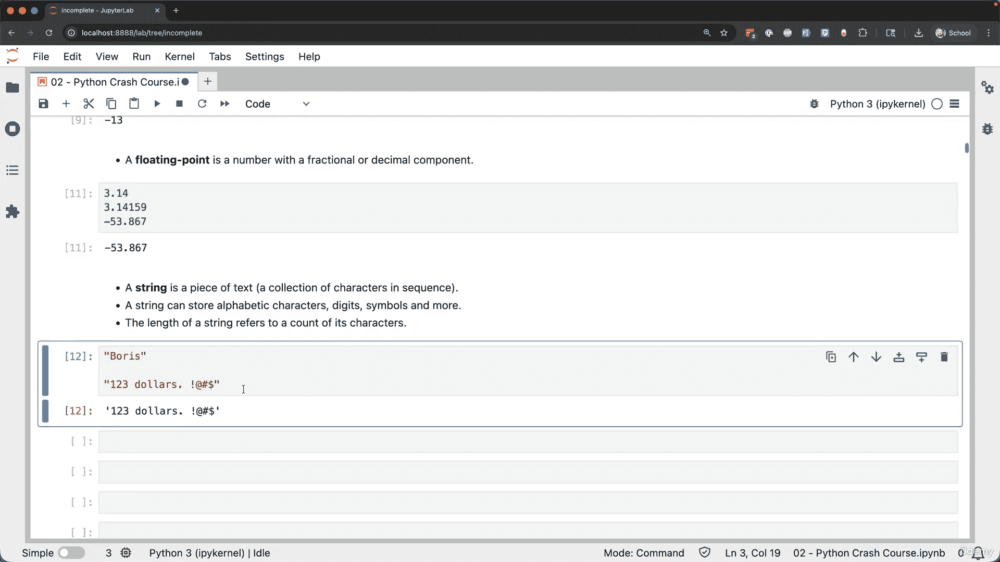

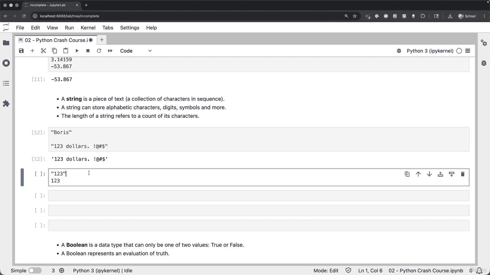

这些值都包含小数点，因此都是浮点数。对初学者来说，记住“看到小数点就想到float”就足够。数字类型介绍到这里，本节我们来看看文本类型，也就是字符串。

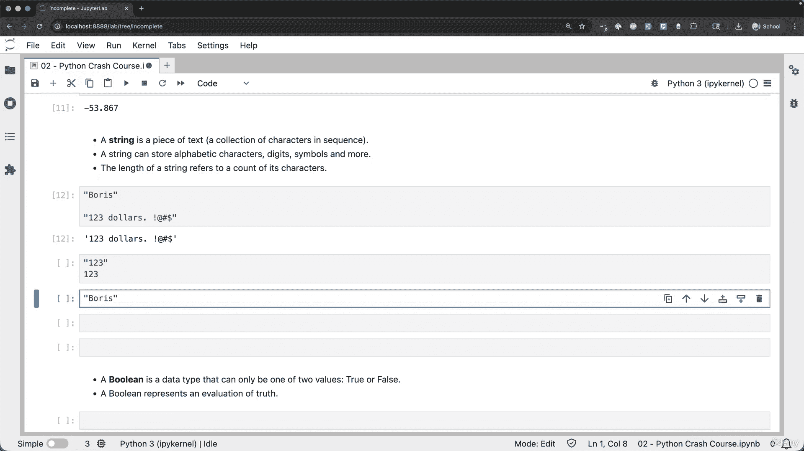

## Polars与Python数据分析：13.3：字符串 🔤

上一节我们介绍了浮点数，本节我们来看看字符串。字符串表示一段文本，也可以表示按顺序排列的字符集合。在Python中，我们用一对双引号声明字符串。第一个引号可以叫开引号，第二个引号可以叫闭引号，两个双引号之间写入字符串的文本内容。例如：

```python
"Boris"
"$123. 各种符号"
```

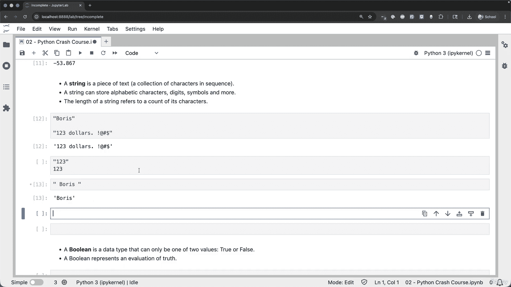

以下是字符串声明的例子：

- `"Boris"` 是一个保存名字的字符串。
- `"$123. 各种符号"` 也是一个有效字符串。

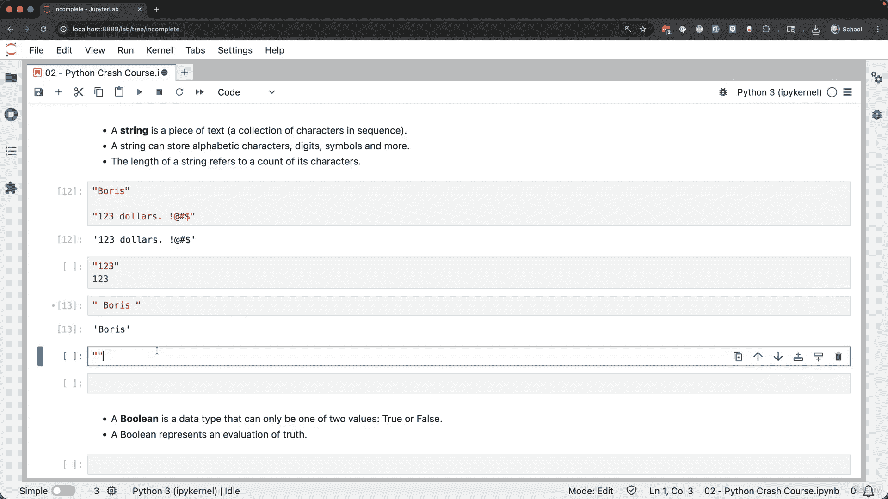

字符串可以保存字母字符，也可以保存数字、空格和各种符号。因此第二个例子仍然是有效字符串。理解字符串的写法之后，本节我们来看看字符串和数字容易混淆的地方。需要特别注意正在处理的数据类型。例如，可以声明双引号中的`"123"`。Python会把它看成由三个连续数字组成的一段文本，这与整数`123`是不同的概念。引号很重要，因为引号把这个值确立为字符串，也就是一段文本。字符串能做的某些操作，整数不能做，反之亦然。下面是容易混淆的例子：

- `"123"` 是字符串，表示三个连续数字组成的文本。
- `123` 是整数，表示一个数值。

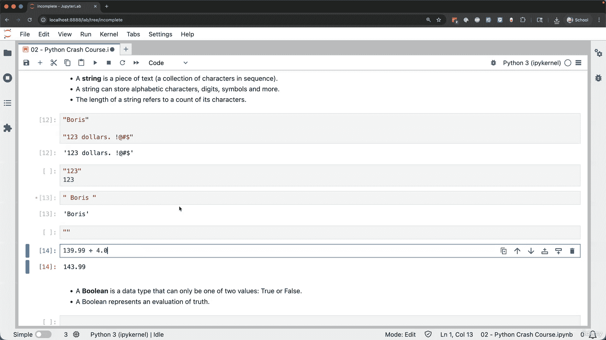

这个区别会影响后续能执行的操作。字符串不仅可以是文本，还可以有长度。上一节我们看了字符串和数字的区别，本节我们来看看字符串长度与空字符串。

## Polars与Python数据分析：13.4：字符串长度 📏

字符串的长度指字符数量。例如重新声明`"Boris"`，可以说这个字符串长度为5，因为里面有5个字符。Python认为每个字符都会计入字符串长度。空格和字母一样是有效字符。因此，在字符串末尾加一个空格，长度变成6；在字符串开头加一个空格，长度变成7。字符串长度就是字符计数。我们也可以用代码表示：

```python
len("Boris")   # 5
len("Boris ")  # 6
len(" Boris")  # 7
len("")        # 0
```

以下是长度变化的例子：

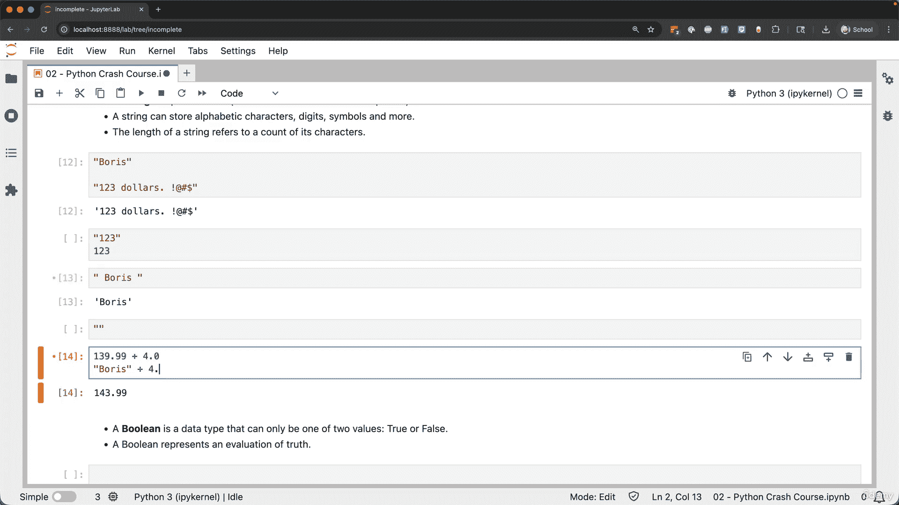

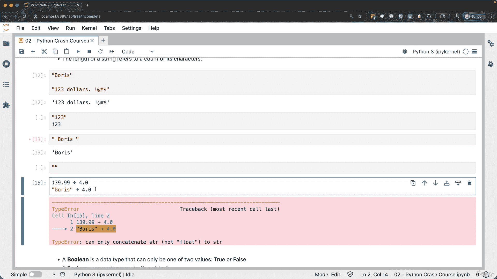

- `len("Boris")` 的结果是5，因为有5个字符。
- `len("Boris ")` 的结果是6，因为末尾空格也是字符。
- `len(" Boris")` 的结果是7，因为开头空格也是字符。
- `len("")` 的结果是0，因为空字符串没有文本字符。

空字符串就是一对双引号之间没有内容，长度是0，也就是字符计数为0。到此我们知道了字符串长度如何计算，本节我们来看看不同数据类型能执行哪些操作，以及操作不兼容时会出现什么错误。

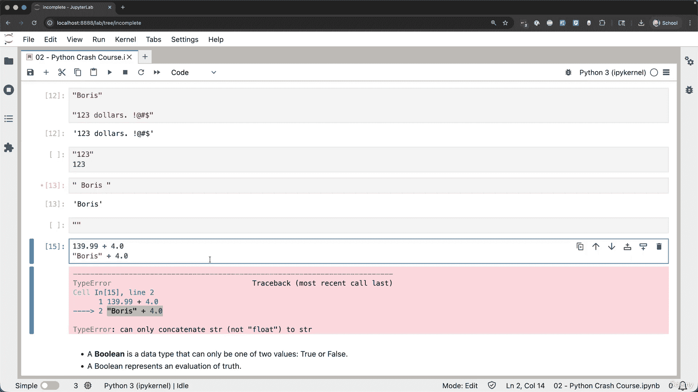

## Polars与Python数据分析：13.5：类型操作与错误 ⚠️

上一节我们介绍了字符串长度，本节我们来看看不同数据类型的操作差异。不同数据类型可以执行不同操作。例如两个浮点值可以用加号相加，`139.99 + 4.0`会得到计算结果。加号也可以把两个整数或两个浮点数相加。可是，如果把加号用于不能很好配合的两个数据类型，就会遇到错误，Python中有时把错误叫异常。以下是可执行与不可执行操作的例子：

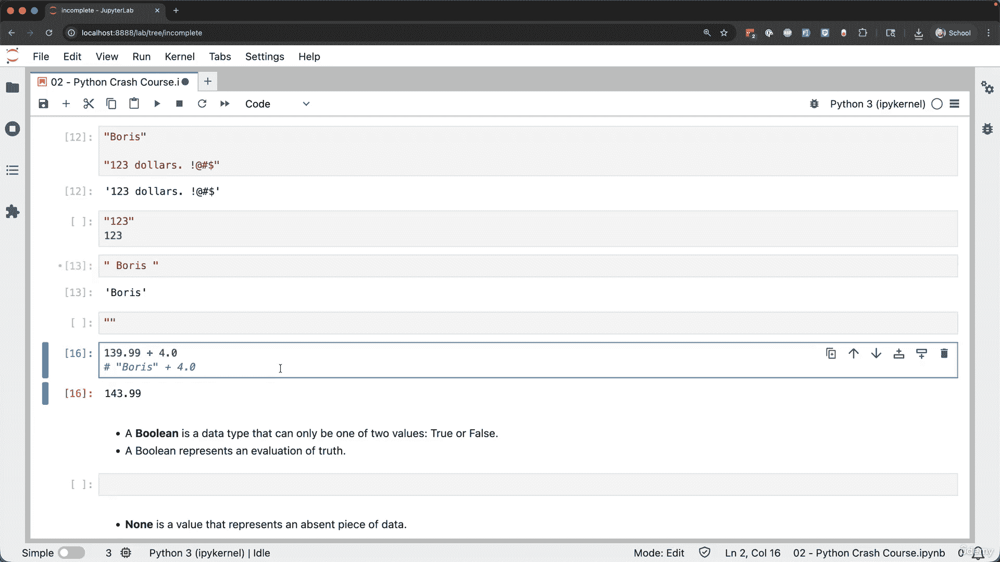

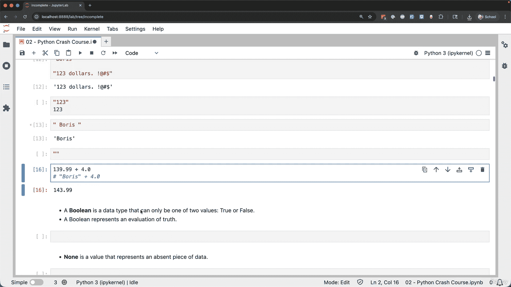

- `139.99 + 4.0` 可以执行，因为两个值都是浮点数。
- `5 + 7` 可以执行，因为两个值都是整数。
- `"Boris" + 4.0` 不可执行，因为字符串和浮点数不能直接用加号连接。

如果尝试把字符串`"Boris"`与浮点值`4.0`相加，会得到错误和异常。Python不知道如何用这两个数据类型执行这个操作。这一点强化了一个观念：数据类型很重要，因为类型会影响可能执行的操作。在Jupyter Notebook中遇到错误不用害怕。错误只表示Python无法执行这个单元格的内容。Python会提供错误消息和错误类别。这个例子是类型错误TypeError，也就是处理类型时出现的错误。错误消息会说明只能concatenate，也就是把字符串与另一个字符串连接，不能把字符串与float连接。错误消息类似：

> TypeError: can only concatenate str (not "float") to str

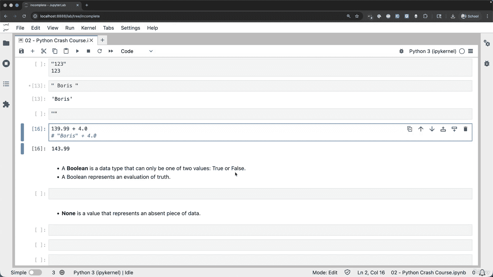

理解这些类型名称和缩写很重要，因为错误信息中会出现名称和缩写，这能帮助更容易理解收到的错误消息。再次说明，看到错误不用害怕，它只表示代码在那个位置无法执行。可以修正代码、删除代码，或者把代码注释掉，然后回到正常工作状态。理解了类型操作和错误之后，本节我们来看看布尔类型。

## Polars与Python数据分析：13.6：布尔 ✅

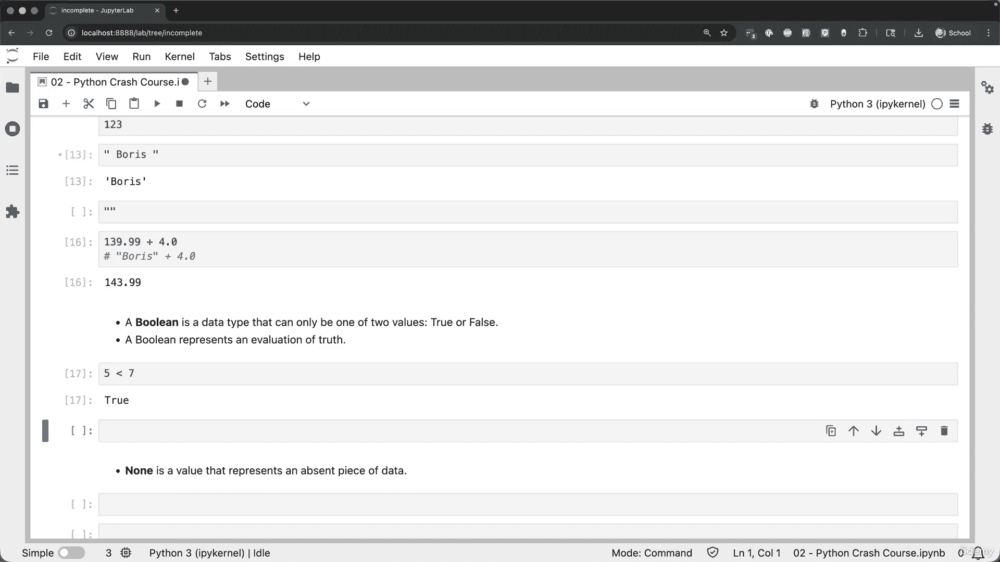

上一节我们看到了类型不兼容会产生错误，本节我们来看看布尔。如果刚开始编程，布尔可能是第一个不熟悉的数据类型。布尔只能取两个值之一：`True`或`False`。`True`用大写T拼写，`False`用大写F拼写。这个数据类型得名于英国数学家乔治·布尔。布尔建模真或事实的概念。现实中有些陈述不是用文本或数字建模，而是对真假的断言。例如，我们想对两个值做数学比较，看一个是否小于另一个。数学中的小于符号是尖括号`<`。可以问5是否小于7。很多布尔值来自比较或求值。5是否小于7的正确答案是一个真假断言，要么为真，要么为假。Python会返回`True`，因为“5小于7”是真陈述。另一个例子是问10是否大于12。大于运算符在Python和数学中是反向尖括号`>`。检查10是否大于12，会得到互补的布尔值`False`。布尔只能取这两个值之一，并且和Python中其他类型一样是常规数据类型。以下是布尔比较的例子：

- `5 < 7` 返回`True`。
- `10 > 12` 返回`False`。

在单元格中也可以直接声明`True`或`False`。这些值与数学计算产生的结果是相同的值，也是相同的数据类型。代码可以是：

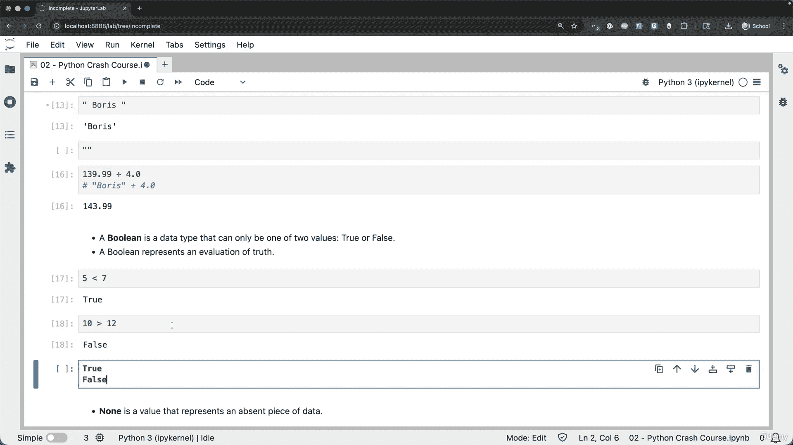

```python
True
False
```

以下是直接声明布尔与字符串对比的例子：

- `True` 是布尔值，大写T。
- `False` 是布尔值，大写F。
- `"True"` 是字符串，不是布尔值。

布尔与字符串是完全不同的值。字符串支持某些布尔不支持的操作，布尔也支持某些字符串不支持的操作。Python中每一个字符都有影响，因此`True`和`"True"`不同。布尔介绍到这里，本节我们来看看表示缺失数据的特殊值None。

## Polars与Python数据分析：13.7：None 🕳️

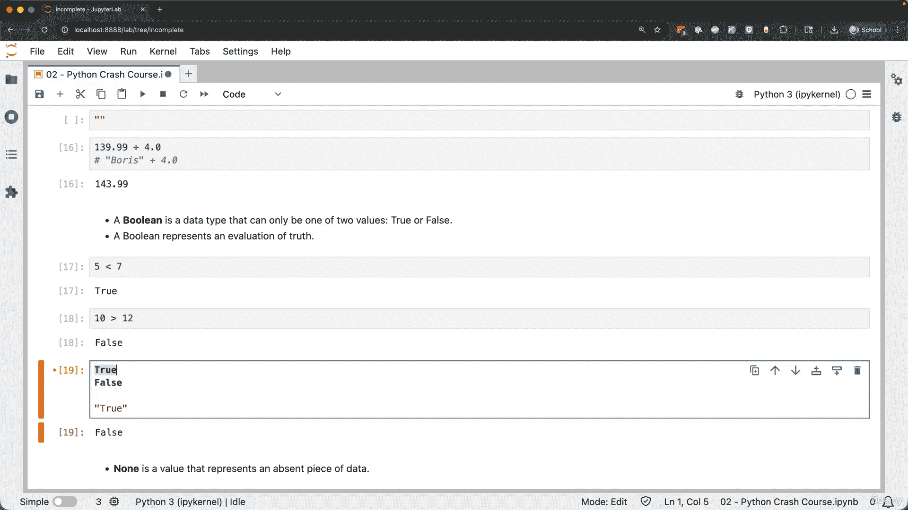

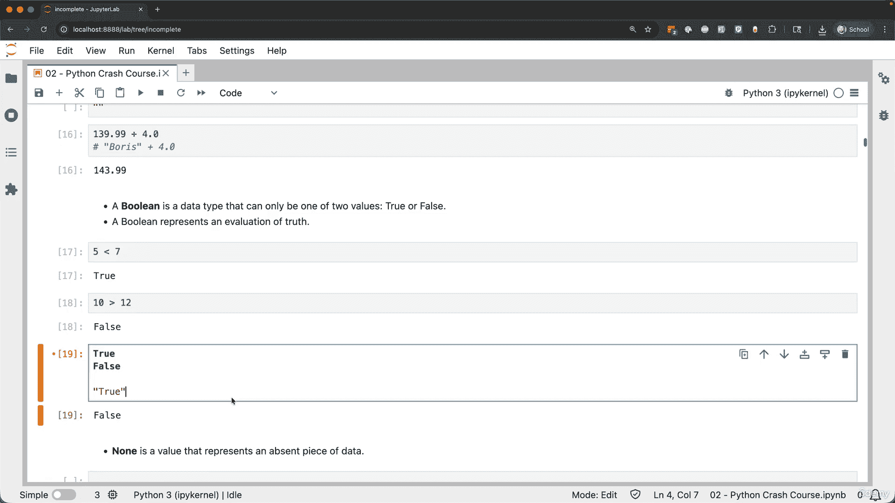

上一节我们介绍了布尔值，本节我们来看看None。本课最后介绍的特殊数据类型叫None。None表示缺失，或表示某条数据不存在。假设开始记录未来一周每天的天气。周一在纸上写下天气，周二也写下天气，依此类推。可以把这些测量建模为浮点值。假设周四忘记测量。现实中如何表示缺失、不存在或空值。我们需要Python语言中的某种值，作为缺失值的占位符。程序中必须写某个值，因为不能只留一个空单元格，空单元格意味着什么都没有。我们需要一个具体值，用代码表示缺失的东西。这种情况下就使用None值。可以写成：

```python
None
```

当某种操作没有最终输出时，经常会看到None。None用大写N。它是表示虚无的值或类型。因为这里没有东西，技术上它是具体值，但执行单元格后下方没有可视输出。它仍然是具体有效值，与布尔`True`或整数`5`没有不同。只是Python没有内容可打印，因为这个值表示虚无。单元格下方没有输出。这一点有一点令人困惑，但它是Python中的具体值。可以把它看作与整数或字符串没有不同，它只是表示缺失数据的值。以下是None的关键特征：

- None表示缺失、不存在或空值。
- None是具体有效值。
- None用大写N拼写。
- 执行`None`单元格后没有可视输出。
- 没有最终输出的操作中常会出现None。

以上就是对Python常见基本数据类型的快速介绍。开始用Python编程后，会到处看到这些类型。在学习了这些类型之后，本节我们做一个小结。

## Polars与Python数据分析：13.8：总结 📝

在上一节我们介绍了None这个特殊值，本节我们对整节内容做总结。本节课中我们一起学习了Python常见基本数据类型。以下是本节课覆盖的核心内容：

- 数据类型表示相关值的类别，用于建模现实世界。
- 整数是没有小数部分的完整数，例如`5`、`0`、`-13`。
- 浮点数带小数点或小数部分，例如`3.14`、`3.14159`、`-53.867`。
- 字符串表示文本或字符序列，用双引号声明，例如`"Boris"`、`"123"`。
- 字符串长度是字符计数，空格也计入长度，空字符串长度为0。
- 不同数据类型支持不同操作，不兼容操作会产生TypeError等错误。
- 布尔只能取`True`或`False`，常用于比较和真假断言。
- None表示缺失或不存在的数据，是具体有效值，执行后可能没有可视输出。

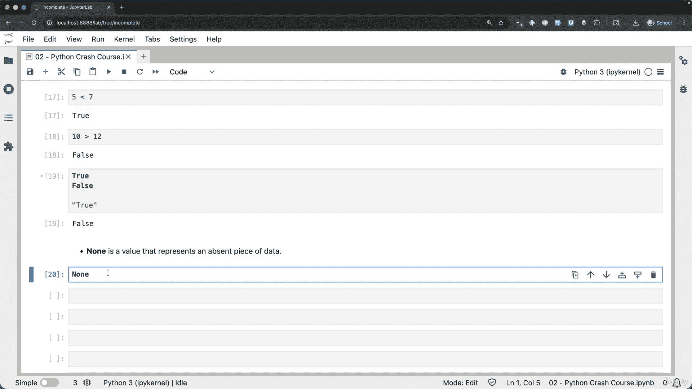

本节课中我们一起学习了整数、浮点数、字符串、布尔值和None，也理解了数据类型会影响可执行操作和错误信息。下节课继续学习Python中的其他内容。

