# 🐍 Polars 与 Python 数据分析：第14节：Python 中的运算符

在本节课中，我们将要学习 Python 中一些常见运算符。运算符是 Python 里非常基础也很常用的组成部分，理解它们之后，我们才能继续写表达式、做计算，并在后面的数据分析代码中更顺畅地处理数值和文本。本节课会从运算符和操作数的定义讲起，然后依次介绍算术运算、字符串上的运算符、常见错误、运算优先级，以及除法、整除和取模。内容会尽量用大白话解释，让初学者也能看懂。

## 🧮 Polars 与 Python 数据分析：第14节：运算符与操作数

上一节我们介绍了代码和表达式的基本写法，本节中我们来看看运算符到底是什么。运算符是一个符号，它会对一个或多个值执行某种操作或过程。被运算符作用到的那个值或多个值，叫作操作数。这个术语听起来有点技术化，但即使从来没有编程过，我们也在日常生活中见过类似的想法。比如 Python 里的加号用于加法，用来求两个值的和。

下面列出运算符和操作数最核心的关系，以及一个加法示例。  
- 运算符是对一个或多个值执行操作的符号。  
- 操作数是被运算符作用的值。  
- 在 `5 + 3` 中，`5` 和 `3` 是操作数，`+` 是加法运算符。  

```python
5 + 3
# 结果是 8
```

在上面的例子中，加号可以称为加法运算符，它对 `5` 和 `3` 这两个操作数执行加法操作，最后得到和 `8`。运算符前后的空格在 Python 中不是技术上的硬性要求，但加上空格能让代码更容易阅读。我们使用的 notebook 应该会自动格式化数学表达式，并自动补上空格，这来自上一节设置好的粗略格式化器。这个细节不影响计算，但它能让代码更整洁。

完成运算符和操作数的基本认识后，下一节我们看看更多常见算术运算符，以及它们如何作用于不同数据类型。

## ➕ Polars 与 Python 数据分析：第14节：加法、减法与乘法

上一节我们介绍了运算符和操作数的定义，本节中我们来看看常见的数学算术运算符。Python 为常见的数学算术运算提供了不同符号，例如减法、除法和乘法。这些运算符不仅能用于数字，还能用于多种数据类型，并且有时会产生不同类型的结果。理解这一点很重要，因为后面处理字符串和混合类型时会遇到不同行为。

下面列出加、减、乘的基本用法和代码示例。  
- 加法使用加号，例如 `5 + 3` 得到 `8`。  
- 减法使用减号，例如 `10 - 5` 得到 `5`。  
- 乘法使用星号，例如 `4 * 3` 得到 `12`；星号可以通过键盘上的 `Shift + 8` 输入。  

```python
5 + 3      # 8
10 - 5     # 5
4 * 3      # 12
```

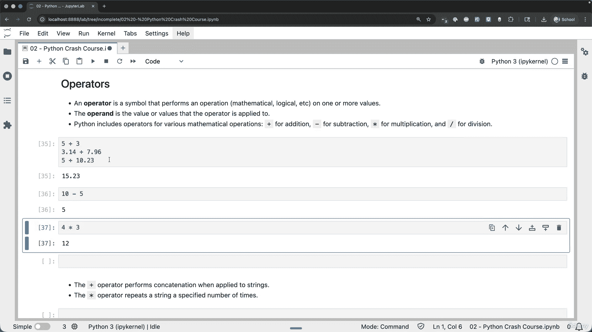

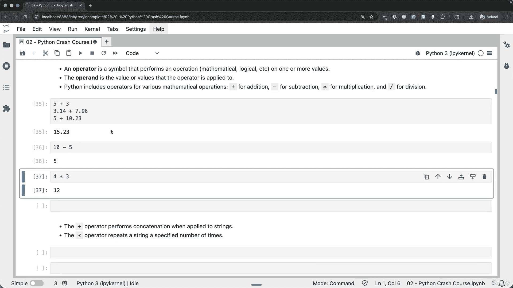

除了整数，我们也可以把加法运算符用于两个浮点数，这完全合法。Python 很多时候还能处理不同类型的值。例如 `5 + 10.23` 中，`5` 是整数，`10.23` 是浮点数，它们是两种不同的数据类型，但 Python 理解我们想要求和，于是会返回浮点数的和。这个例子说明，运算符会根据参与运算的数据类型决定具体行为，同时也说明 Python 在合理情况下会自动处理类型差异。

在了解数字上的加减乘之后，下一节我们把同样的符号用到字符串上，看看结果会发生什么变化。

## 🔤 Polars 与 Python 数据分析：第14节：字符串拼接与重复

上一节我们在数字上使用了加法、减法和乘法，本节中我们来看看运算符作用于字符串时的效果。很多情况下，运算符可以应用到不同数据类型上，并得到不同结果，字符串就是很典型的例子。字符串上的加号不再是数学加法，而是把两个字符串连接起来。

下面列出字符串拼接的例子和相关术语。  
- `"race" + "car"` 会合并成新的字符串 `"racecar"`。  
- 这种把两个字符串粘在一起的技术术语叫“拼接”。  
- 在这个语境里，加号可以称为拼接运算符。  

```python
"race" + "car"
# 结果是 "racecar"
```

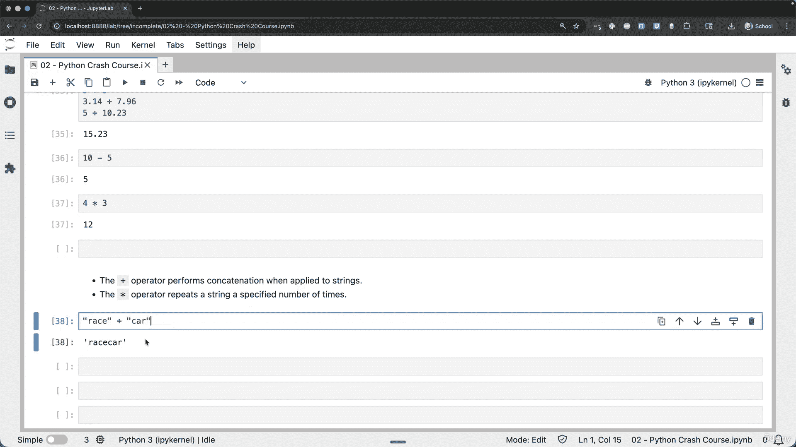

Python 会把 `"race"` 和 `"car"` 合并或连接成一个新的字符串 `"racecar"`。拼接的意思是，把一个字符串粘到另一个字符串的末尾，从而组合成新字符串。所以在这个场景中，加号执行的是拼接操作。技术上说，如果你和开发者交流，这叫作拼接，而不是加法，但原则是一样的：我们在语言中使用某个符号，把它作用于两个操作数，然后得到拼接后的字符串结果。

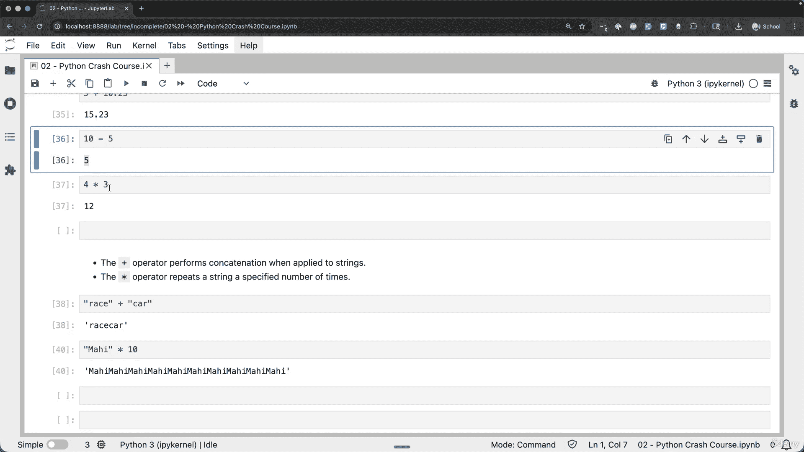

字符串上还可以使用乘法运算符，这一点比较有意思。下面列出字符串重复的示例。  
- `"Mahi" * 2` 会把字符串重复两次，产生类似 `Mahi Mahi` 的重复文本。  
- 如果把次数改成 `10`，就会得到重复 10 次的文本。  
- 关键点是乘法在这里表示重复字符串，而不是数学乘法。  

```python
"Mahi" * 2
# 产生重复两次的文本

"Mahi" * 10
# 产生重复十次的文本
```

这里的乘法运算符会让字符串重复指定次数，并返回一个新的字符串。这个例子再次说明，同一个符号在不同数据类型上可能有不同含义。上一节我们处理的是数字，本节中我们看到字符串上的加号和乘号分别变成了拼接和重复。

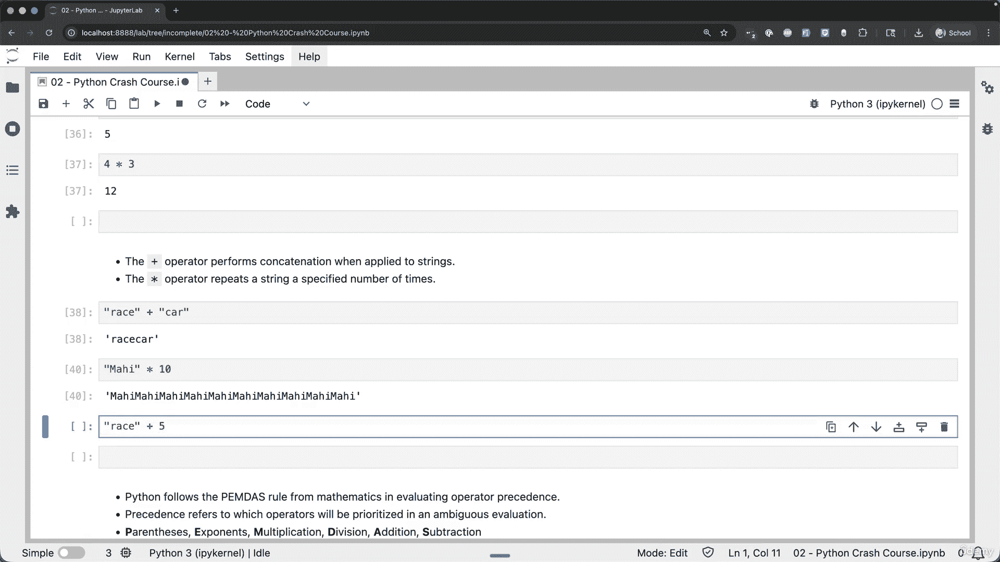

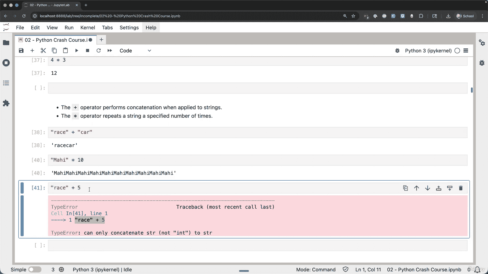

在了解字符串运算符之后，下一节我们看看当运算符无法处理某种类型组合时，Python 会如何报错。

## ⚠️ Polars 与 Python 数据分析：第14节：类型错误与解析差异

上一节我们看到了字符串上的加号和乘号可以正常工作，本节中我们来看看当 Python 无法执行请求的操作时会发生什么。我们在上一课已经看到，只要 Python 无法完成请求的操作，就会抛出错误或异常。前面那些单元格都是合法的，因此在下面产生了合法输出。但如果把字符串和数字用加号混在一起，就会出问题。

下面列出字符串和数字相加时的错误示例。  
- `"race" + 5` 会报错，因为 Python 试图做拼接，但不知道如何把数字拼到字符串末尾。  
- `5 + "race"` 也会报错，但错误信息不同，因为 Python 这时把 `+` 理解为加法。  
- 同一个符号在不同操作数组合下会被 Python 用不同方式解析。  

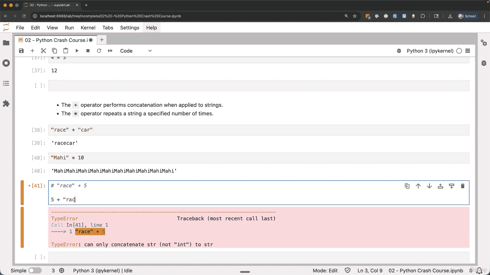

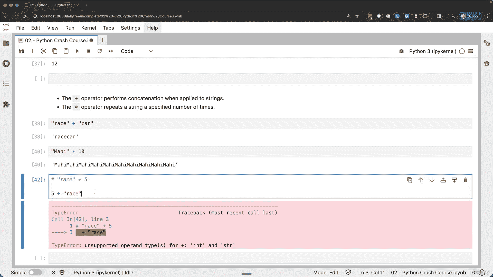

```python
"race" + 5
# TypeError

5 + "race"
# 另一个错误信息
```

在 `"race" + 5` 中，Python 不明白我们想做什么。技术上，它会假设我们想执行拼接，也就是往 `"race"` 末尾添加另一个字符串，但它不知道如何把数字作为拼接字符串加到 `"race"` 后面，因此会遇到类型错误。反过来写 `5 + "race"` 也会得到异常，但错误信息不同，因为现在 Python 认为我们想执行加法，于是把这个符号解释为加法运算符，而不是拼接运算符；它会表示无法把 `"race"` 数值化地加到数字 `5` 上。错误信息可能因为 Python 解析代码的方式不同而变化，这说明同一个符号可能带来不同结果，运算符两侧操作数的类型也会影响 Python 如何解析代码。

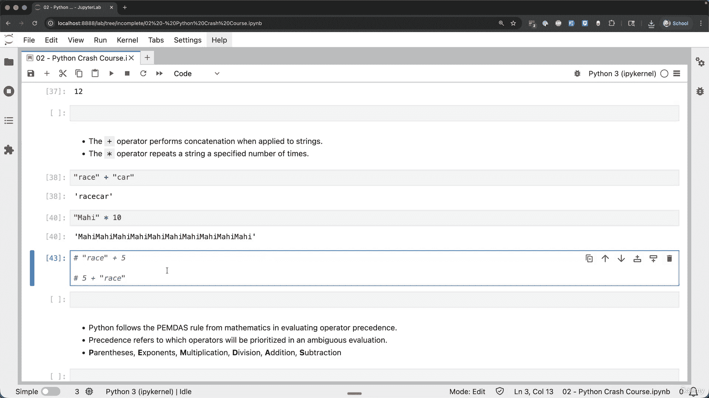

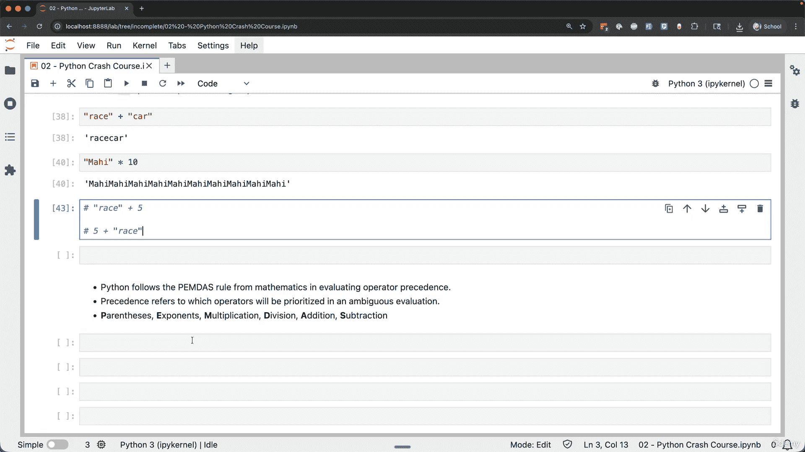

为了回到可工作状态，可以把报错的代码注释掉。下面列出注释代码的作用。  
- 注释掉报错行后，notebook 可以继续正常执行其他单元格。  
- 这一步只是恢复工作状态，不影响前面学到的运算符规则。  

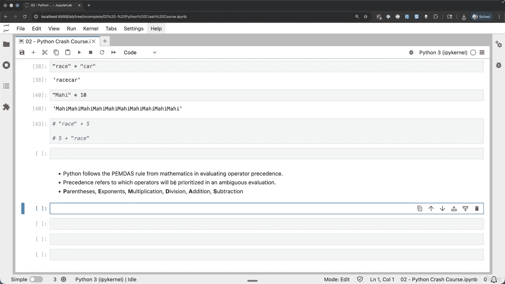

```python
# "race" + 5
```

处理完类型错误后，下一节我们进入运算优先级，看看一个表达式里有多个运算符时，Python 按什么顺序计算。

## 🧠 Polars 与 Python 数据分析：第14节：PEMDAS 与运算优先级

上一节我们处理了类型错误，本节中我们来看看多个运算符同时出现时，Python 如何决定先算哪一步。这里要介绍 PEMDAS，它是一条数学规则，用来告诉 Python 如何评估运算符优先级。优先级就是运算符被优先处理和使用的顺序。有时表达式可能有歧义，也就是代码无法用一致的方式评估，这时必须决定如何解析，并让这个决定保持一致。

下面列出 PEMDAS 的优先级顺序。  
- `P` 代表括号。  
- `E` 代表指数。  
- `M` 和 `D` 代表乘法和除法，它们被归为同一类。  
- `A` 和 `S` 代表加法和减法，它们也被归为同一类。  
- 越靠前的类别优先级越高。  

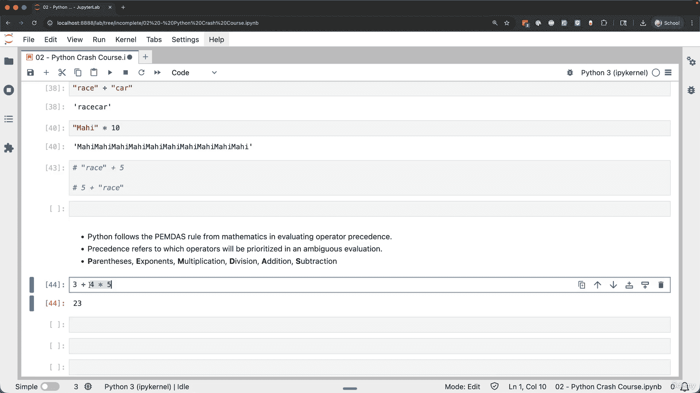

```text
PEMDAS：括号 > 指数 > 乘法/除法 > 加法/减法
```

乘法和除法比加法和减法更重要，所以在一个混合表达式中，Python 会优先计算乘法。下面列出优先级示例。  
- `3 + 4 * 5` 会先算 `4 * 5 = 20`，再算 `3 + 20 = 23`。  
- 如果先用括号写成 `(3 + 4) * 5`，就会先算括号里的 `7`，再算 `7 * 5 = 35`。  
- 括号的优先级高于乘法和除法，因此可以强制改变计算顺序。  

```python
3 + 4 * 5
# 结果是 23

(3 + 4) * 5
# 结果是 35
```

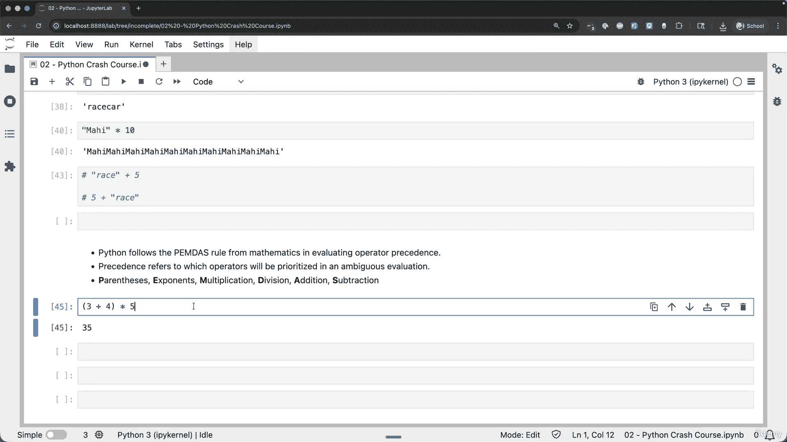

在 `3 + 4 * 5` 中，逻辑上可以有两种理解：先算 `3 + 4` 得到 `7`，再乘以 `5` 得到 `35`；或者先算 `4 * 5` 得到 `20`，再加 `3` 得到 `23`。Python 实际得到 `23`，正是因为 PEMDAS 规则让乘法优先于加法。如果想让 `3 + 4` 先算，就用一对括号把 `3 + 4` 包起来，这会覆盖乘法和除法的优先级，从而得到不同结果 `35`。

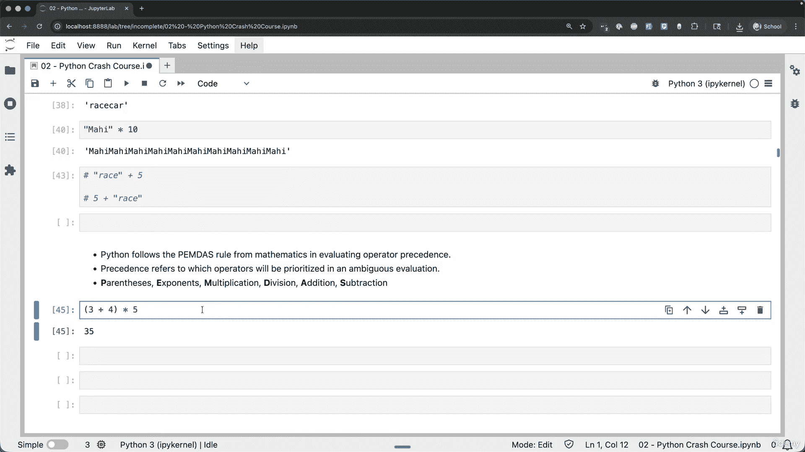

掌握优先级之后，下一节我们继续看除法相关运算符，包括普通除法、整除和取模。

## ➗ Polars 与 Python 数据分析：第14节：浮点除法、整除与取模

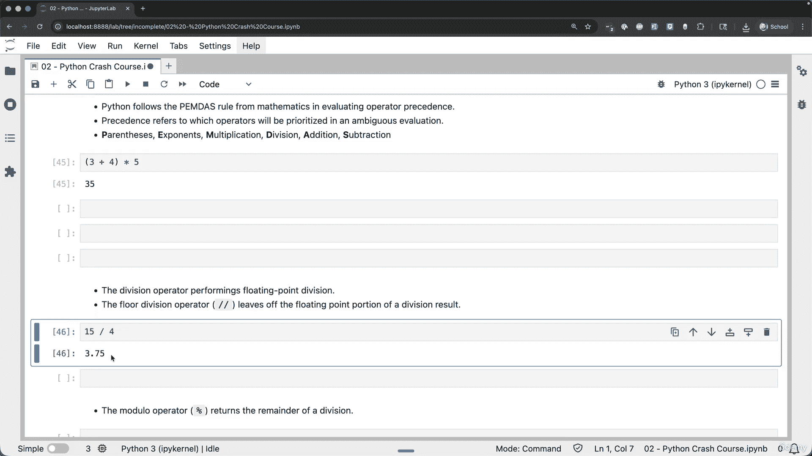

上一节我们学习了 PEMDAS 和括号如何改变计算顺序，本节中我们来看看除法相关的几个运算符。除法比较有意思，因为 Python 中有两种不同的除法方式。第一种是普通除法，也就是很多人熟悉的浮点除法。它使用正斜杠 `/`，会返回带小数部分的结果。

下面列出浮点除法的示例和特点。  
- `15 / 4` 得到 `3.75`。  
- `16 / 4` 仍然得到 `4.0`，结果是浮点数。  
- 普通除法为了保持一致，总是返回浮点数。  

```python
15 / 4
# 3.75

16 / 4
# 4.0
```

在 `15 / 4` 中，我们会得到常规的浮点除法结果 `3.75`，因为 `15` 不能被整数 `4` 整除，所以结果带有小数部分。即使数字可以被整除，例如 `16 / 4`，结果仍然是浮点数 `4.0`。这是为了保持一致：不管结果能不能表示成整数，Python 在普通除法中都希望返回浮点值，这种除法叫作浮点除法。

与浮点除法相对的是整除，也叫向下取整除法。下面列出整除的示例和特点。  
- 整除使用两个正斜杠 `//`。  
- `//` 是由多个符号组成的运算符，但逻辑仍然是把运算符放在两个操作数之间。  
- `15 // 4` 得到 `3`，因为 `4` 最多完整进入 `15` 三次。  
- `16 // 4` 得到 `4`。  
- 整除会去掉小数部分，总是返回整数或整数值。  

```python
15 // 4
# 3

16 // 4
# 4
```

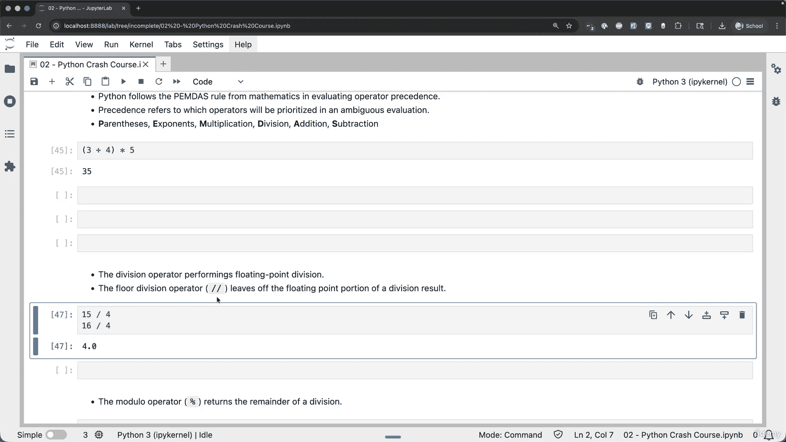

整除会舍去除法结果中的浮点部分，换句话说，它总是返回整数或完整数字值。`15 // 4` 告诉我们 `4` 完整进入 `15` 的次数，结果是 `3`，因为 `4` 进入 `12` 三次后就不能再完整进入一次。可以把它理解成执行除法后砍掉小数部分，因此总是得到整数。`16 // 4` 用整除计算得到 `4`。所以普通除法总是得到浮点数，而整除总是得到整数。

最后一个要介绍的运算符是取模，它会给出除法后的余数，也就是执行除法后剩下多少。下面列出取模的示例和特点。  
- 取模使用百分号 `%`。  
- `14 % 3` 得到 `2`。  
- `15 % 3` 得到 `0`。  
- `16 % 3` 得到 `1`。  
- `2 % 3` 得到 `2`，因为左侧操作数较小时，结果就是左侧操作数。  

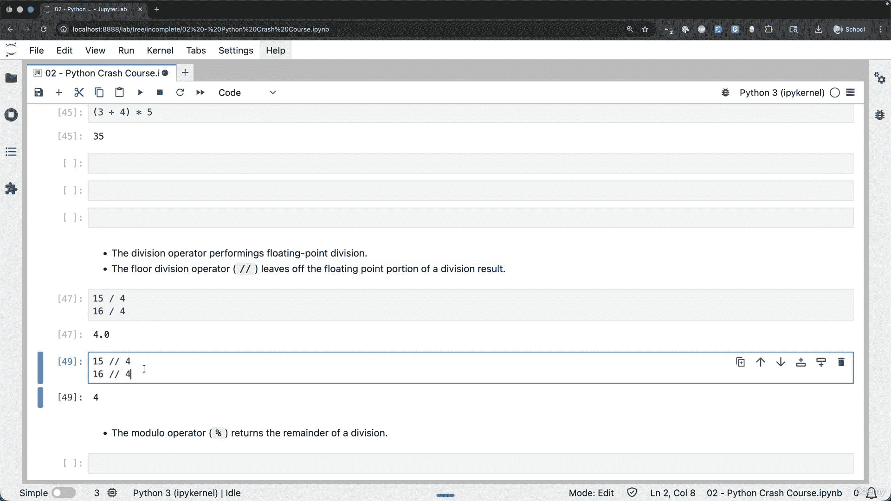

```python
14 % 3
# 2

15 % 3
# 0

16 % 3
# 1

2 % 3
# 2
```

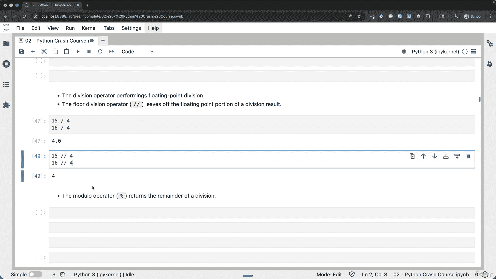

在 `14 % 3` 中，我们问的是 `14` 除以 `3` 后剩下什么。`3` 可以完整进入 `12`，要到 `14` 还剩下 `2`，所以结果是 `2`。`15 % 3` 问的是 `15` 除以 `3` 的余数，`3` 可以完整进入 `15`，因此余数是 `0`。`16 % 3` 的余数是 `1`，因为 `3` 完整进入 `15` 后还多出 `1`。如果左侧的值更小，例如 `2 % 3`，可以理解为 `3` 进入 `0` 次，然后剩下 `2`，所以结果就是左侧操作数 `2`。这个运算符叫取模运算符，有时也叫余数运算符，因为它返回除法的余数。

到这里，我们已经把常见数学运算符、字符串运算符、错误、优先级和除法相关运算符都过了一遍。下一节我们对本节课做一个小结。

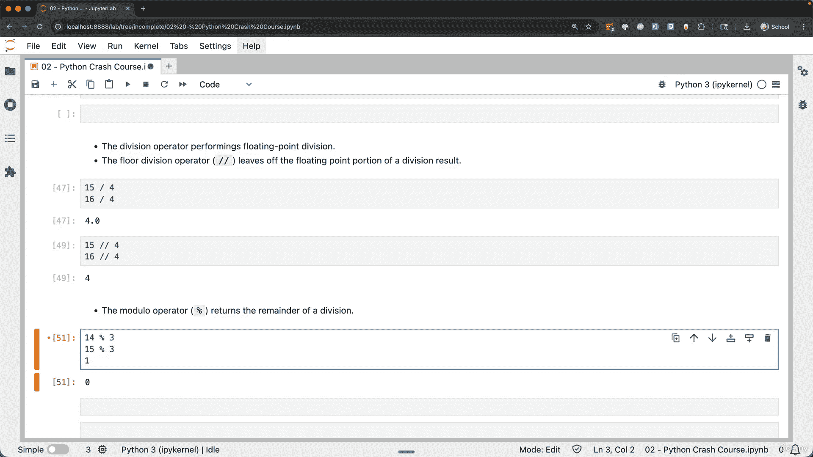

## 📝 Polars 与 Python 数据分析：第14节：本节总结

前面的小节分别介绍了运算符基础、算术运算符、字符串拼接与重复、类型错误、PEMDAS 优先级，以及浮点除法、整除和取模。本节中我们对这些内容做一次收束，帮助你把整节课的线索串起来。运算符就是一个符号，作用于一个或多个值，这些值叫作操作数。大多数运算符是单个符号，但像整除 `//` 这样的运算符会包含多个符号，核心思想仍然相同：我们请求 Python 对一个或多个值执行某种过程或操作。

下面列出本节课的核心结论。  
- 运算符是执行操作的符号，操作数是被操作的值。  
- `+` 在数字上是加法，在字符串上是拼接。  
- `*` 在数字上是乘法，在字符串上可以重复字符串。  
- 类型不匹配时可能触发类型错误，错误信息会随解析方式变化。  
- PEMDAS 决定优先级：括号、指数、乘除、加减。  
- `/` 是浮点除法，`//` 是整除，`%` 是取模或余数。  

```text
操作数 + 运算符 + 操作数 -> 结果
```

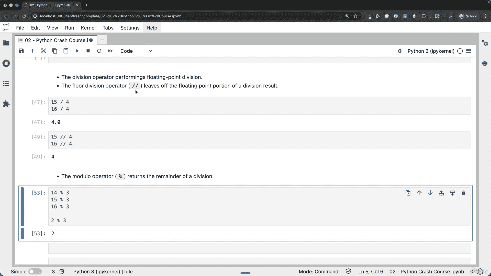

本节课中我们一起学习了 Python 中常见的运算符，包括加法、减法、乘法、字符串拼接、字符串重复、浮点除法、整除和取模，也学习了操作数、类型错误和 PEMDAS 优先级。掌握这些内容后，我们在写 Python 表达式时就能更清楚地知道每一步会得到什么结果，也能更容易看懂后面数据分析代码中的计算逻辑。

