# 🔍 Polars 与 Python 数据分析：第15课：相等与不等运算符

在本节课中，我们将要学习 Python 和 Polars 中用来比较值的相等与不等运算符。这些运算符看起来很基础，但它们是后面写条件判断、数据筛选和逻辑控制的基础。我们会从最简单的相等运算符 `==` 开始，再扩展到字符串、布尔值和其他数据类型的比较，然后介绍不等运算符 `!=`，最后介绍小于、小于等于、大于、大于等于这些数学比较运算符。需要记住的一点是，本课中的这些运算符都会返回布尔值，也就是 `True` 或 `False`，用来表示某个比较条件是否成立。

下面先从相等运算符开始，看看两个值相等时，Python 如何给出判断结果。

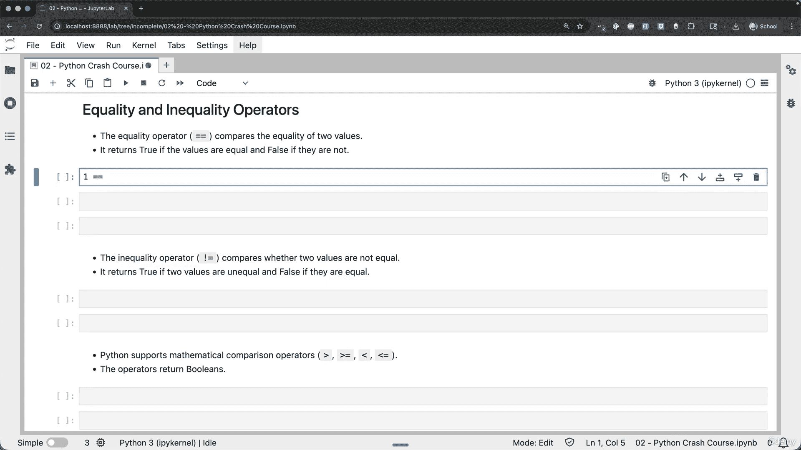

## ✅ Polars 与 Python 数据分析：第15.1节：相等运算符

上一段概述提到我们会先从相等开始，本节中我们来看看相等运算符的基本用法。相等的意思是两个东西完全一样，是同一个值。相等运算符写作两个连续的等号 `==`，不是一个等号。参与比较的两个值叫做操作数，它们分别位于运算符左右两边。核心公式可以写成下面这样。

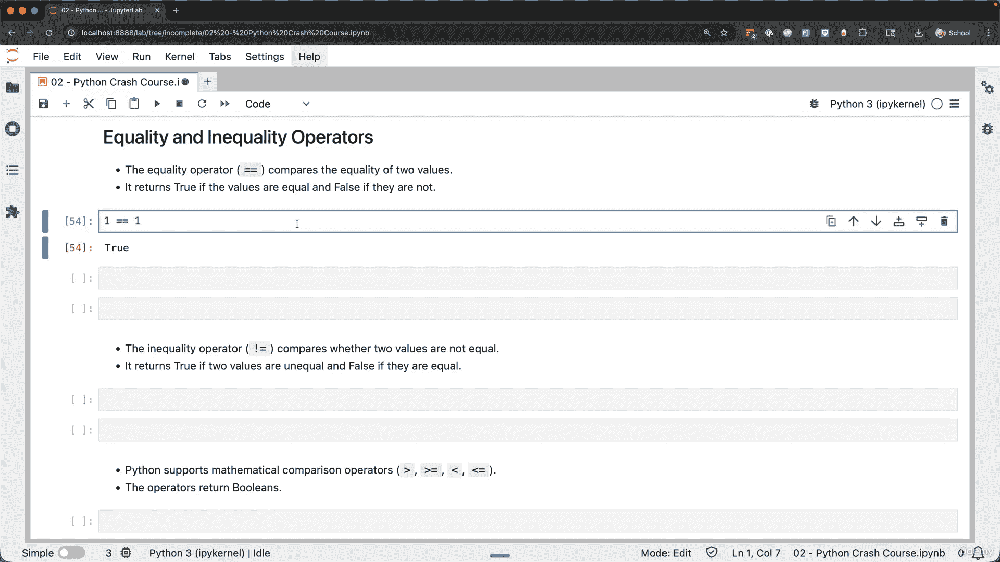

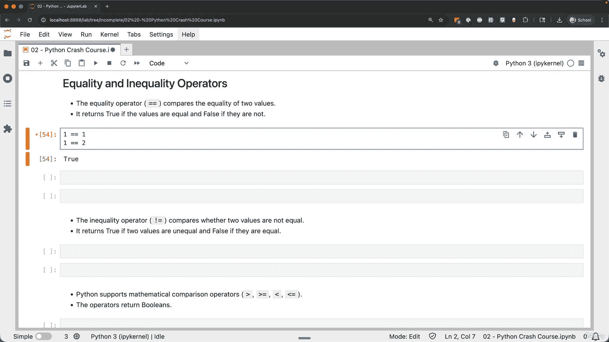

```python
左操作数 == 右操作数
```

例如，要比较数字 1 是否等于数字 1，可以写成 `1 == 1`，左边写值 1，中间写两个连续的等号，右边再写一个用于比较的操作数 2。这里实际示例是 `1 == 1`，它会返回布尔值 `True`。

```python
1 == 1   # 返回 True
```

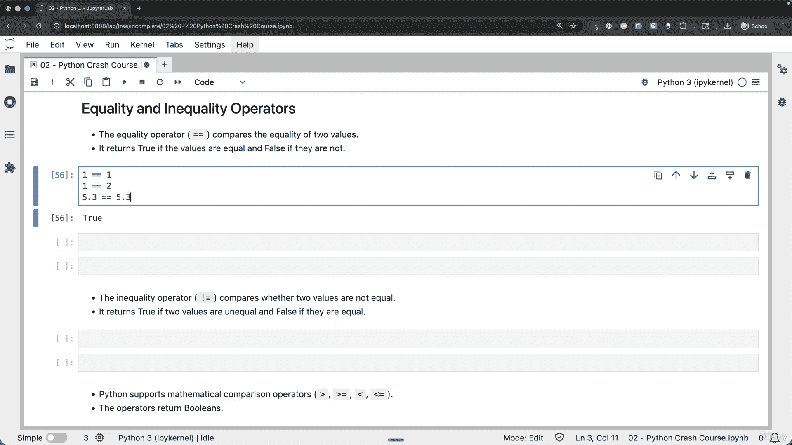

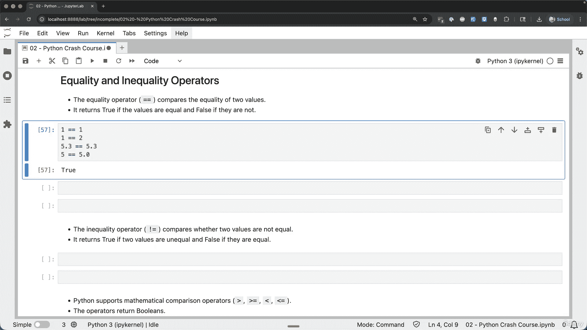

布尔值是一种数据类型，用来表示真或假的判断结果。相等运算符在两个值相等时返回 `True`，在两个值不相等时返回 `False`。下面再检查 1 是否等于 2，这次会得到 `False`，因为两个值不同。

```python
1 == 2   # 返回 False
```

同样的逻辑可以应用到浮点数。例如检查 `5.3 == 5.3`，会得到 `True`。

```python
5.3 == 5.3   # 返回 True
```

有时还可以比较不同数据类型的值是否相等。例如比较整数 `5` 和浮点数 `5.0`，左边是整数，右边是浮点数，数据类型不同，但它们在数学上是同一个值，所以会得到 `True`。如果比较整数 `5` 和浮点数 `5.1`，右边的值存在差异，两者并不完全相同，所以会得到 `False`。

```python
5 == 5.0   # 返回 True
5 == 5.1   # 返回 False
```

你可能会问，既然已经知道 1 等于 1、1 不等于 2，为什么还要使用相等运算符。原文中的这些例子是人为设计的简单例子，目的只是说明运算符如何工作。在真实世界中，相等运算符两边通常有一个值是动态值，也就是事先无法预测的值。例如在 Polars 场景中，读取一个数据集后，可以检查某一行中的值是否等于一个提前知道并直接写在代码里的固定值。这样一边是固定常量、硬编码值，另一边是动态、不可预测值。相等运算符在这里很有用，因为可以检查条件是否满足，并经常据此编写条件代码：条件成立时执行一段逻辑，条件不成立时执行另一段逻辑。这些例子很简单，但目的严格是演示该运算符在 Python 中如何工作。

了解数值相等后，本节继续看字符串和布尔值的相等比较，因为相等运算符并不只适用于数字。

## 🔤 Polars 与 Python 数据分析：第15.2节：字符串和布尔值的相等比较

上一节我们介绍了数值的相等比较，本节中我们来看看相等运算符在字符串和布尔值上的表现。相等运算符适用于许多不同的数据类型，字符串就是常见的一种。比较两个字符串是否相等时，必须字符数量完全相同、字符串长度完全相同，并且每一个字符都完全相同。可以用下面的公式来理解。

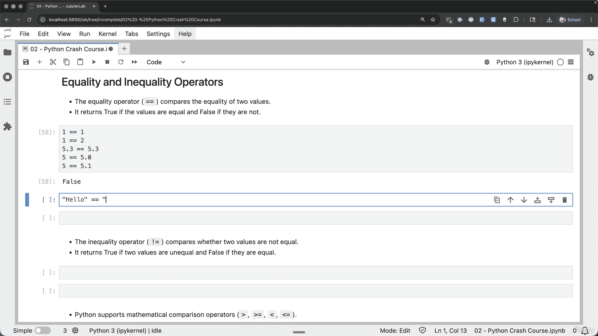

```python
字符串A == 字符串B
```

只有当两个字符串长度相同且每个对应字符都相同时，结果才是 `True`。例如创建字符串 `"hello"`，再用相等运算符与另一个 `"hello"` 比较，会得到 `True`。如果比较 `"hello"` 和 `"goodbye"`，会得到布尔值 `False`。

```python
"hello" == "hello"     # 返回 True
"hello" == "goodbye"   # 返回 False
```

这里有几个重要注意事项。第一是大小写敏感，编程语言会区分大小写。例如把首字母大写的 `"Hello"` 和小写开头的 `"hello"` 比较，这两个字符串不相等，所以相等运算符会返回 `False`，因为大写 `H` 不被认为等于小写 `h`。

```python
"Hello" == "hello"   # 返回 False
```

另一个注意事项是空格和符号。很多人会把字母字符当成字符串的一部分，但经常忽略空格。计算机则会评估字符串中定义的每一个字符。例如创建字符串 `"hello"`，再与末尾带空格的 `"hello "` 比较，这个空格与额外的字母、符号或数字没有区别。两个字符串不相等，字符数量也不相同，右边多了一个空格，所以结果是 `False`。

```python
"hello" == "hello "   # 返回 False
```

除了字符串，还可以比较布尔值。例如询问 `True` 是否等于 `True`，它们是否是同一个值、同一个东西，答案是 `True`，它们确实是完全相同的值，就像数字 1 等于数字 1 一样。布尔值只有两个可能取值，因此比较组合比较有限。检查 `True == False` 会得到 `False`，因为“真等于假”这个说法是假的。比较 `False == False` 会得到 `True`，因为这两个值相等。检查 `False == True` 会得到 `False`，因为它们也是两个不同的值。

```python
True == True     # 返回 True
True == False    # 返回 False
False == False   # 返回 True
False == True    # 返回 False
```

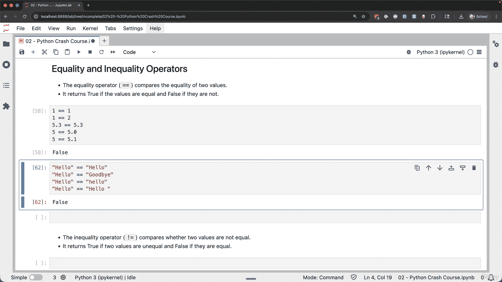

以上是相等运算符。与它互补的运算符是不等运算符，下一节我们来看看如何判断两个值不相等。

## 🚫 Polars 与 Python 数据分析：第15.3节：不等运算符

上一节我们介绍了相等运算符以及字符串和布尔值的相等比较，本节中我们来看看不等运算符。不等运算符做的是相反的事情，它比较两个值是否不相等。如果两个值不相等，它返回 `True`；如果两个值相等，它返回 `False`。核心公式如下。

```python
左操作数 != 右操作数
```

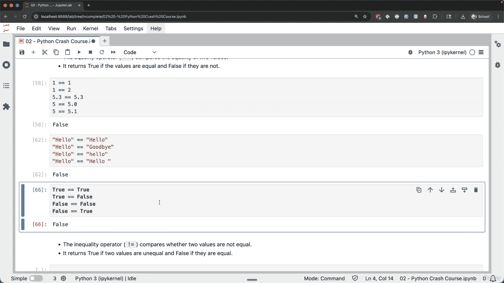

不等运算符由一个感叹号和一个等号组成，即 `!=`。例如检查 5 是否不等于 10，写成 `5 != 10`，右边是用于比较不等关系的操作数。因为“5 不等于 10”是事实，所以会得到 `True`。

```python
5 != 10   # 返回 True
```

如果比较 5 和 5 的不等关系，写成 `5 != 5`，会得到 `False`，因为“5 不等于 5”这个说法是假的。

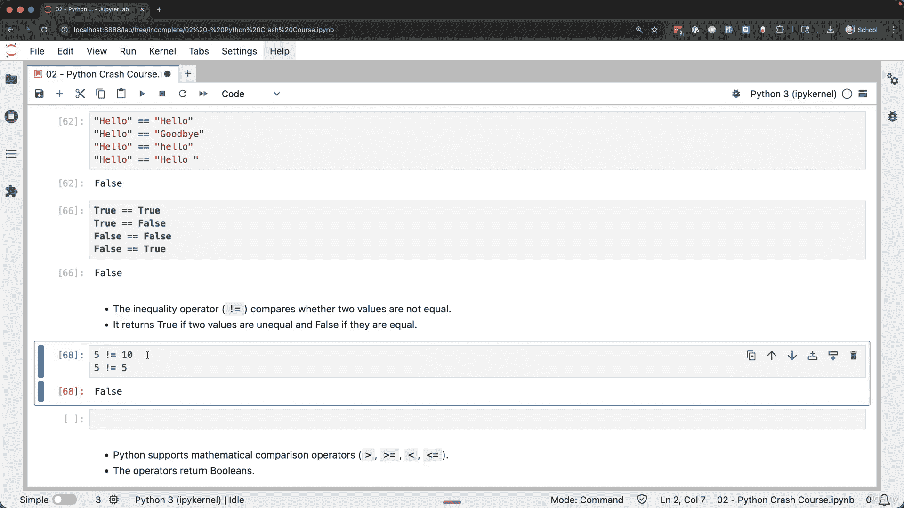

```python
5 != 5   # 返回 False
```

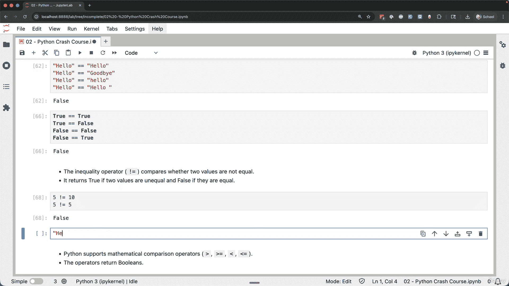

同样的原则适用于其他数据类型。例如检查字符串 `"hello"` 是否不等于字符串 `"hello"`，会得到 `False`，因为“它们不相等”这个说法是假的，它们其实相等。再检查 `"hello"` 是否不等于 `"Hello"`，会得到 `True`，因为这两个字符串确实不相等。Python 关心大小写敏感，因此不认为小写 `h` 和大写 `H` 等价。

```python
"hello" != "hello"   # 返回 False
"hello" != "Hello"   # 返回 True
```

以上是相等和不等运算符的快速介绍。Polars 还支持许多常见的数学比较运算符，下一节我们来看看大于、大于等于、小于和小于等于这些运算符。

## 📏 Polars 与 Python 数据分析：第15.4节：其他数学比较运算符

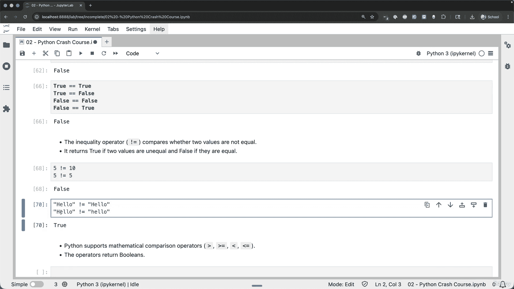

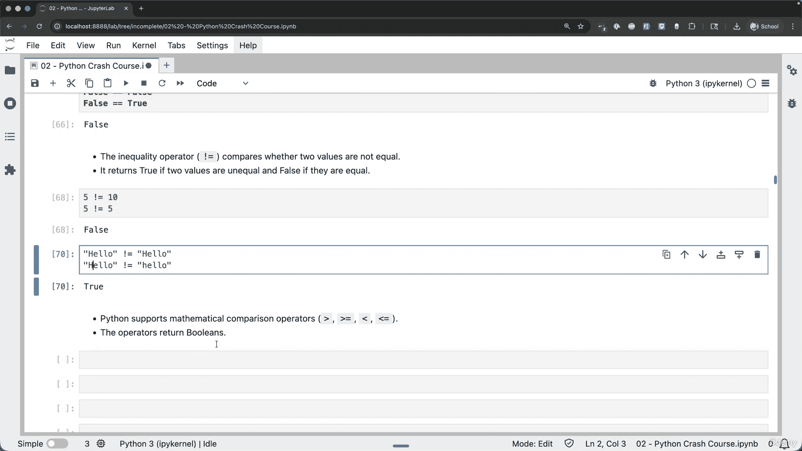

上一节我们介绍了不等运算符，本节中我们来看看其他常见的数学比较运算符。Polars 支持许多常见数学比较运算符，包括大于、大于等于、小于以及小于等于。以下是本课涉及的数学比较运算符及其含义。

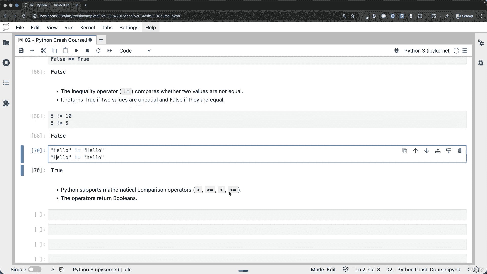

- `>` 表示大于，检查左边的值是否大于右边的值。
- `>=` 表示大于等于，检查左边的值是否大于或等于右边的值。
- `<` 表示小于，检查左边的值是否小于右边的值。
- `<=` 表示小于等于，检查左边的值是否小于或等于右边的值。

在上一课中我们展示了小于符号，例如可以检查 5 是否小于 8，写成 `5 < 8`，会得到 `True`。

```python
5 < 8   # 返回 True
```

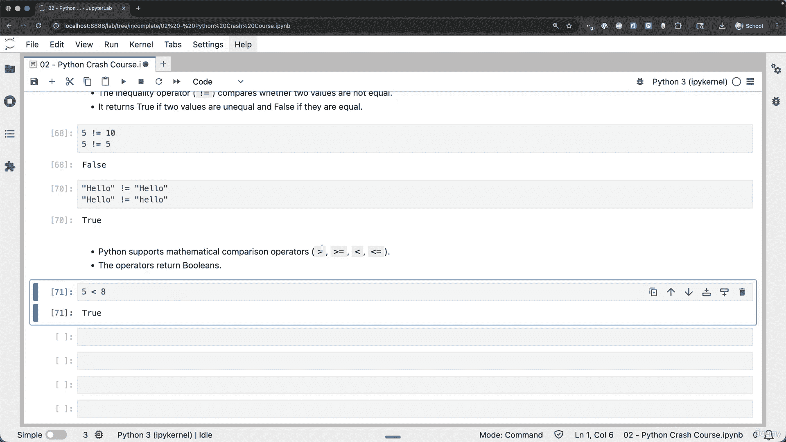

类似地，可以应用小于等于运算符，它由小于符号后接等号组成，即 `<=`。它会检查左边的值是否小于右边的值，或者是否等于右边的值。例如 `5 <= 8` 仍然会得到 `True`。如果比较 `8 <= 8`，也会得到 `True`，因为 8 等于 8。如果这里使用严格小于符号 `8 < 8`，会得到 `False`，因为 8 不小于 8，它是小于等于 8。

```python
5 <= 8   # 返回 True
8 <= 8   # 返回 True
8 < 8    # 返回 False
```

小于和小于等于的反向运算符是大于和大于等于。例如使用大于符号 `>`，即右尖括号，检查 14 是否大于 9，会得到 `True`。使用大于等于运算符 `>=`，即尖括号后接等号，检查 14 是否大于或等于 9，也会得到 `True`。同样规则适用于 `14 >= 14`，会得到 `True`。如果检查 `14 >= 17`，最终会得到 `False`。

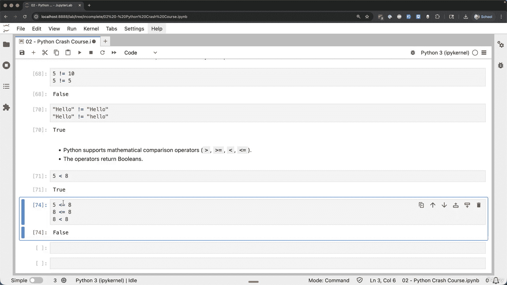

```python
14 > 9     # 返回 True
14 >= 9    # 返回 True
14 >= 14   # 返回 True
14 >= 17   # 返回 False
```

本课中的所有运算符都会产生布尔值 `True` 或 `False`，它们是对事实的断言，也就是对真假判断的陈述。我们比较的是值的相等关系、不等关系，或者两个值的数学顺序、排序顺序，也就是一个值排在另一个值之前还是之后。理解这些比较结果后，在 Polars 中筛选数据或编写条件逻辑时，就可以更清楚地知道每一步会得到真还是假。

## 🎯 Polars 与 Python 数据分析：第15.5节：课程总结

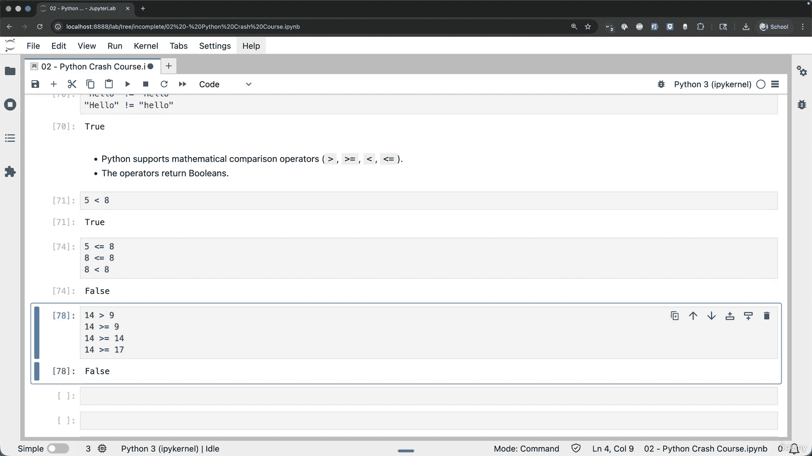

本节课中我们一起学习了 Python 和 Polars 中的相等与不等运算符。我们了解了相等运算符 `==` 用来判断两个值是否相等，不等运算符 `!=` 用来判断两个值是否不相等，还学习了大于 `>`、大于等于 `>=`、小于 `<`、小于等于 `<=` 这些数学比较运算符。所有运算符都会返回布尔值 `True` 或 `False`，表示某个比较条件是否成立。我们还看到字符串比较要求长度相同且每个字符完全相同，大小写敏感，空格和符号也会参与比较；布尔值比较只有两个可能取值；不同数据类型在数学值相同的情况下也可能得到相等结果。最后，这些运算符在实际数据分析中常用于检查动态值是否满足某个固定条件，并据此执行不同的条件逻辑。

