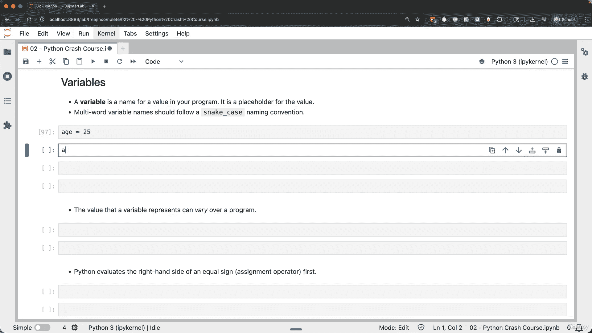
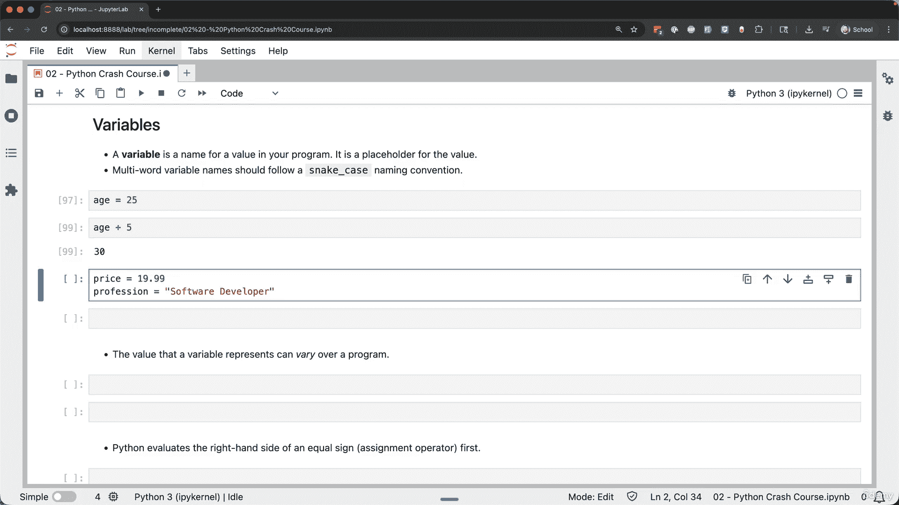
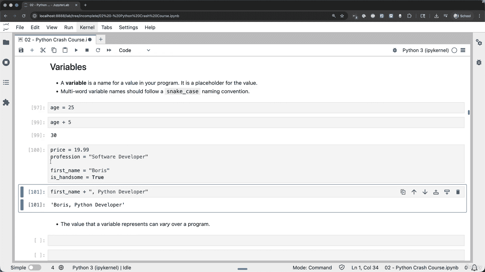
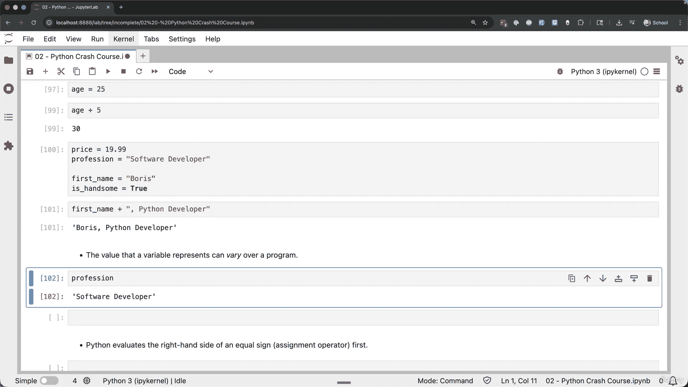
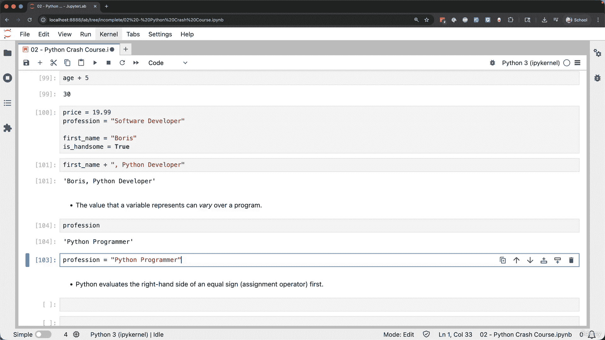
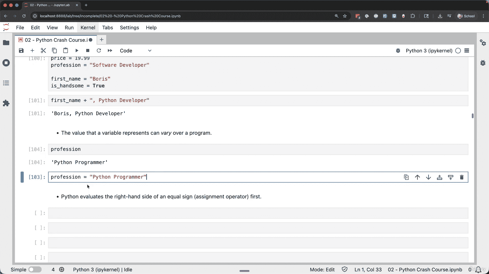
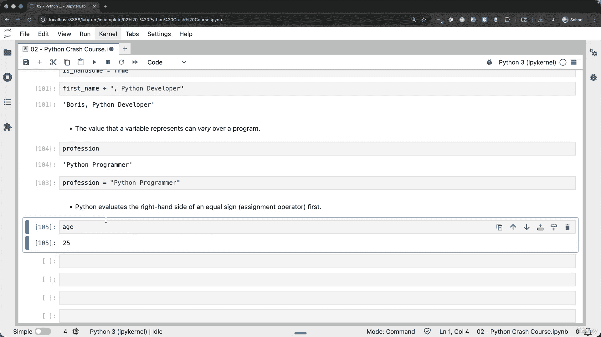
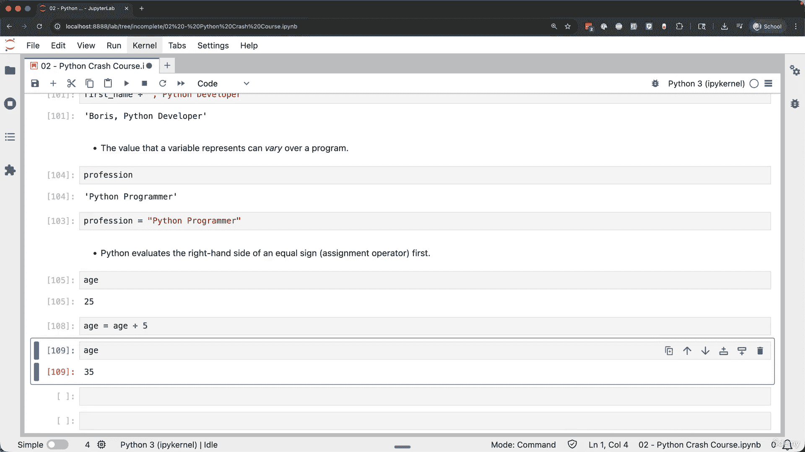

# 📘 数据分析与 Polars 和 Python 第一部分：16：变量

在本节课中，我们将要学习 Python 中的变量。变量是程序里给某个值起的名字，可以把它理解成值的占位符或替身，用来告诉阅读代码的人这个值代表什么。本节会从变量是什么讲起，然后介绍赋值写法、常见数据类型、命名规范、重新赋值，以及 Python 计算赋值语句的顺序。所有内容会用直白的语言说明，并通过代码展示核心概念。

## 🧩 16.1：变量是什么

在概述之后，本节我们来看看变量到底是什么。变量是程序中某个值的名字，可以把它看成值的占位符或替身，它能为值提供上下文，说明这个值代表什么。举例来说，假设要在 Python 程序中表示一个人的年龄，可能有一位朋友 25 岁。如果只在单元格里写数字 `25`，就不知道这个数字代表什么，它可能是任何东西。使用变量时，可以给这个值起一个名字，并在程序中反复使用这个名字。

这个赋值关系的核心写法如下：

```python
age = 25
```

在上面的代码中，`age` 是变量名，`25` 是赋给它的值。变量名让数字 `25` 有了“年龄”的含义，后续代码就可以通过 `age` 来使用这个值。



## ✍️ 16.2：如何给变量赋值

上一节我们介绍了变量的含义，本节中我们来看看如何给变量赋值。赋值时先选择一个名字，例如全小写的 `age`，然后写等号，再把要赋的值写在等号右边。这里的等号是一个运算符，通常称为赋值运算符，因为它把右边的值赋给左边的变量或名字。赋值的基本公式如下：

```python
变量名 = 值
```

例如，可以写成 `age = 25`。执行这个单元格后，下方不会显示任何内容，但 Jupyter Notebook 中已经存在一个名为 `age` 的名字。此时输出 `age` 变量，得到的结果是 `25`。需要强调，`age` 不是字符串，它是 Python 程序中存在的名字，代表值 `25`。以下代码展示赋值和输出结果：

```python
age = 25
age
# 输出：25
```

变量可以像数字一样使用。例如，原来可以直接计算 `25 + 5`；现在也可以写 `age + 5`。Python 会把 `age` 替换成它代表的值 `25`，然后再加上 `5`，得到 `30`。代码示例如下：



```python
age + 5
# 输出：30
```

## 🔢 16.3：变量与数据类型

上一节我们完成了基本赋值，本节中我们来看看变量可以保存哪些数据类型。把变量赋值为整数只是示例，变量可以赋给任意 Python 值，也可以保存任意数据类型。例如，可以定义 `price` 变量并赋值为 `19.99`，这是一个浮点数；也可以定义 `profession` 变量并赋值为字符串，例如 `"software developer"`。以下是原文中的数据类型示例：

- `age = 25`：把整数赋给变量，表示年龄。
- `price = 19.99`：把浮点数赋给变量，表示价格。
- `profession = "software developer"`：把字符串赋给变量，表示职业。

上面这些例子说明，变量不局限于数字，它可以保存不同类型的值。使用变量时，只需要把变量名写在代码里，Python 会把它替换成对应的值，然后继续执行计算或拼接等操作。

## 🐍 16.4：变量命名与 snake case

上一节我们使用了不同类型的数据，本节中我们来看看变量命名规范。如果变量名需要包含多个单词，完全可以使用多个单词，但 Python 社区的惯例是使用 snake case 格式。snake case 是一种视觉约定，做法是把变量名中的所有单词用下划线分隔，并且全部使用小写。例如，变量名 `first name` 不能直接写成带空格的形式，而要写成 `first_name`。变量名必须是一批连续字符，一旦加入空格就不再是有效变量名，因此下划线提供了一种清晰的分隔方式，同时下划线本身也是变量名的常规组成部分。

以下代码展示 snake case 命名和字符串拼接：

```python
first_name = "Boris"
is_handsome = True
is_handsome_today = True

first_name + ", " + "Python developer"
# 输出：'Boris, Python developer'
```

`first_name` 是一个两个单词的变量名，因此用下划线分隔；`is_handsome` 同样把两个单词用下划线分开；如果需要更多单词，例如 `is_handsome_today`，就在每个单词之间继续加下划线。这里还可以把变量赋值为布尔值，作为另一种数据类型的例子。执行单元格后，这些变量都已经定义完成，可以像占位符一样使用它们对应的值。例如在字符串拼接中，`first_name` 是字符串，Python 会找到它的值 `Boris`，再把它和后面的字符串拼接起来，返回一个新的字符串。



## 🔄 16.5：重新赋值与执行顺序

上一节我们规范了变量命名，本节中我们来看看变量为什么会“变”以及如何重新赋值。变量之所以叫变量，是因为它代表的值可以在程序运行过程中变化。例如，先输出 `profession` 变量，当前值等于 `"software developer"`；然后在下面使用相同的赋值语法重新赋值，也就是把这个名字赋给一个完全不同的新值。可以把 `profession` 从 `"software developer"` 改成 `"Python programmer"`。执行单元格后，`profession` 这个名字就会从 `"software developer"` 替换为 `"Python programmer"`，前提是变量名拼写正确。



以下代码展示重新赋值的过程：

```python
profession = "software developer"
profession
# 输出：'software developer'

profession = "Python programmer"
profession
# 输出：'Python programmer'
```

在 Jupyter Notebook 中，执行顺序会影响变量的当前值。即使某个单元格顺序不同或出现在更前面，只要重新执行它，`profession` 在 Notebook 上下文中的值仍然是 `"Python programmer"`，因为那是最新执行的单元格，也是最后一次赋给 `profession` 变量的值。理解这一点对使用 Notebook 很重要，因为变量的当前值取决于最后一次执行和最后一次赋值，而不是代码在页面上的绝对位置。

## ➗ 16.6：先计算等号右侧

上一节我们看到了重新赋值，本节中我们来看看 Python 计算赋值语句的顺序。Python 会先计算等号右侧，也就是赋值运算符右侧，然后再把结果赋给左侧变量。因此，像 `age = age + 5` 这样的语法完全有效。这里等号两边都有 `age`，并且有多个符号，看起来容易困惑，但规则很明确：先看等号右侧，弄清楚右侧的求值结果，最终结果才会赋给变量。核心公式可以写成：





```python
age = age + 5
```

下面用步骤拆解这条语句。以下是执行 `age = age + 5` 时的理解步骤：

1. 先把等号想象成不存在，只关注等号右侧的 `age + 5`。
2. 在执行这一行时，假设 `age` 当前等于 `25`，那么右侧就是 `25 + 5`，结果为 `30`。
3. 然后 Python 把右侧的结果 `30` 赋给左侧的 `age`，覆盖之前的值 `25`。
4. 于是 `age` 现在等于 `30`；如果再次执行同一个单元格，就取当前的 `30` 加 `5` 得到 `35`，再把 `35` 赋给 `age`。

完整示例代码如下：

```python
age = 25
age = age + 5
age
# 输出：30

age = age + 5
age
# 输出：35
```



在这个过程里，`age` 在重新定义或覆盖自身时被重复使用，等号右侧先算出新值，左侧再接收这个新值。这个规则解释了为什么变量可以出现在赋值语句的两边，也解释了为什么连续执行同一行代码会不断更新变量的值。

## 🧾 16.7：总结



前面各节介绍了变量从定义到使用的完整流程，本节对内容做一个小结。本节课中我们一起学习了 Python 中的变量：变量是程序中值的名字或占位符；赋值使用 `变量名 = 值`，等号是赋值运算符；变量可以保存整数、浮点数、字符串和布尔值等不同数据类型；多个单词的变量名通常使用 snake case，也就是全小写并用下划线分隔；变量可以重新赋值，Notebook 中变量的当前值取决于最后执行的赋值；赋值时 Python 先计算等号右侧，再把结果赋给左侧。掌握这些内容后，就可以在 Python 程序中用变量为值提供清晰的名字和上下文。

