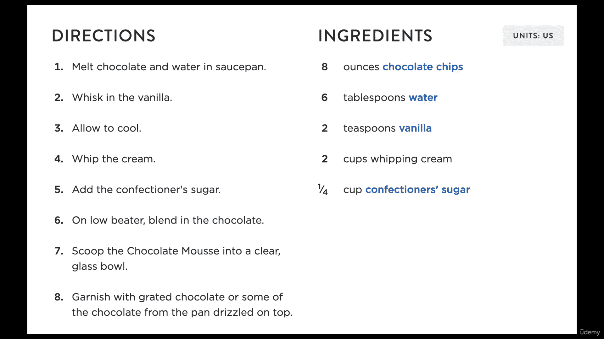
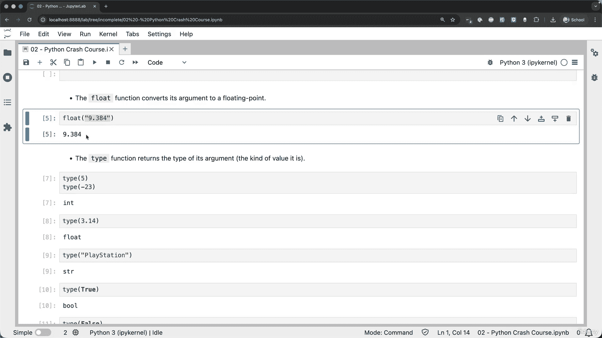

# 🐍 使用 Polars 与 Python 进行数据分析：第17节：Python 内置函数

在本节课中，我们将要学习 Python 中的内置函数，并把原文内容整理成一篇适合初学者的教程。我们会先说明函数是什么，再解释参数和返回值，然后通过 `len`、`str`、`int`、`float` 和 `type` 等例子，观察它们在 Jupyter Notebook 中如何调用、如何输出结果，最后总结调用函数的基本语法。对初学者来说，可以先抓住三个部分：输入是什么、函数内部做了什么、输出是什么。函数可以理解成一个已经写好的小工具，我们只需要传入数据，就能拿到结果，而不需要每次都重新写一遍内部逻辑。

在概述之后，本节中我们来看看函数的基本概念。原文先用一个定义说明函数是什么，又用烹饪食谱做类比，帮助理解函数为什么可以重复使用。下面列出函数定义和直觉类比中的关键含义，方便逐条理解：

- 函数是一个可复用的过程。

- 函数也可以定义为一组按顺序执行的步骤。

- 函数本质上是 Python 代码的容器，这个容器可以按需重复执行，从而完成一致的计算。



- 一个常见的类比是现实世界中的烹饪食谱。

- 烹饪食谱是一组按顺序遵循的步骤，执行后会得到一致的结果，也就是一餐饭。

- 食谱存在的原因是让某个人把步骤写下来一次。

- 然后另一个人可以照着这些步骤执行，得到一致的一餐饭结果。

- 类似地，在任何一种编程语言中，都会有许多常见操作需要完成，不管具体程序是什么，也不管业务领域是什么。

- 例如，计算字符串长度就是一个常见操作，也就是统计字符串中包含多少个字符。

- 程序员不需要在程序里手动定义“如何统计字符串字符数”的逻辑。

- 因为 Python 方便地提供了名为 `len` 的内置函数，它是一个可复用过程，会替我们完成“计算字符串长度”这个操作。

- 我们因此可以使用这个工具并复用它，从而得到一致的字符串长度结果。

- 运行或执行函数时，常见术语是“调用函数”，意思是运行那组指令序列。

- 例如可以说，我们想调用 `len` 函数来计算字符串 `"Boris"` 的长度。

这些点合起来说明，函数的核心价值是把一段常用逻辑封装起来，让使用者不必反复关心内部细节。上一节我们说明了函数是什么，本节中我们来看看函数如何接收输入以及如何返回输出。原文把输入称为参数，把输出称为返回值，并用食谱中的食材和做好的菜来类比，这些概念对后面理解 `len` 等函数非常重要。

围绕参数和返回值，可以抓住以下内容：

- 函数可以接受输入，输入在技术术语中称为参数。

- 输入或参数是调用函数时流入函数的数据，函数可以在自己的逻辑中使用这份数据。

- 输入可以是任何有效的 Python 数据类型，可以是整数、浮点数、布尔值、字符串等。

- 函数不强制要求接受输入，它可以接受零个输入，也可以接受多个输入，具体取决于函数本身的定义、函数要做什么，以及函数需要从外部世界获得什么数据才能运行。

- 回到烹饪食谱的类比，函数参数相当于食谱中使用的食材。

- 食材会流入食谱，使食谱中的指令能够结合该食材来执行；同样地，参数就是流入函数的数据。

- 函数也可以产生所谓“返回值”，返回值就是函数的输出。

- 返回值是函数交还给外部世界的东西。

- 它被称为返回值，是因为它是函数返回给调用者的数据类型或值。

- 以 `len` 函数为例，这个函数计算字符串长度，也就是统计字符数量。

- 调用 `len` 时提供的参数或输入是一个给定字符串，函数的返回值或输出是实际长度，也就是表示字符数量的数字。

- 因此，使用函数时，我们可以把数据传进去，也可以把数据取出来，而函数负责内部那段可复用的过程，这段过程包含一定数量的 Python 代码，并完成有价值的工作。

理解了参数和返回值之后，本节中我们来看第一个实际例子：`len` 函数。原文提到，Python 开发团队把这些函数或构造内置到语言中，是因为它们能帮助开发者完成几乎每个人都会遇到的常见操作。本课会展示多个 Python 内置函数的实际例子，先从前面提到的 `len` 函数开始。

`len` 是函数名，是 length 的缩写。为了运行、执行或调用这个函数，需要在函数名后面跟一对圆括号，左括号和右括号都很关键。`len` 函数接受一个输入或一个参数，也就是要计算长度的字符串，参数必须放在这对圆括号里面。例如，可以声明字符串 `"Python is fun"` 并执行下面的代码：

```python
len("Python is fun")
```

执行后会得到长度 `13`。这表示字符串中一共有 13 个字符。注意，空格也会被计算在内。`Python` 有 6 个字母，`is` 有 2 个字母，合计 8 个；`fun` 有 3 个字母，合计 11 个；再加上 2 个空格，总共就是 13 个字符。再次强调，这里的函数名是 `len`，我们调用或运行这个函数，并传入一个参数，参数是字符串 `"Python is fun"`，`len` 函数返回给我们的值是 `13`，这个值会打印在单元格下方。

在 Jupyter Notebook 中，每当我们执行一个调用函数的单元格，输出就会放在对应位置，返回值会成为该单元格的输出。`len` 函数的优势在于，我们不需要手动编写遍历字符串并计算字符数量的逻辑。到了第二天，如果我们要计算一个完全不同的字符串长度，也不需要担心计算长度有多复杂，因为 Python 团队已经在 `len` 函数的定义中解决了这个问题，我们只是在复用 `len` 函数的逻辑来计算长度。如果熟悉 Excel，就会发现这和 Excel 中的 `lookup` 或 `countif` 等函数是同一个原则：在 Excel 单元格中写等号，然后写函数，再给函数输入，函数产生返回值或输出，输出写入单元格；Python 中也是完全相同的原则。

上一节我们通过 `len` 看到了内置函数的典型用法，本节中我们来看看 `str`、`int` 和 `float` 等转换类函数。原文在课程收尾处给出了这些函数的例子，用来说明内置函数可以帮助我们处理各种不同情况。下面列出这几个函数的主要用途和示例：

- `str` 是 string 的缩写，它接受一个参数或输入，并把该输入转换成字符串表示。

- 例如，程序中可能有一个浮点值 `3.14`，某种操作需要把它转换成等价的字符串，这时可以把 `3.14` 作为参数传给 `str` 函数，返回值就是该数据类型的字符串表示。

- 类似地，`int` 和 `float` 函数可以帮助我们把参数转换成各自对应的不同数据类型。

- 例如，可以用完全相同的语法调用 `int` 函数：写函数名，再加圆括号。

- 这些函数都内置在 Python 中，因此必须准确拼写；大小写敏感很重要，例如把首字母大写，这个函数就不存在。

- Python 有一个所有字母都小写的 `int` 函数，没有首字母大写 `I` 的 `int` 函数。

- 调用 `int` 函数时，在圆括号中给它一个参数，例如一个保存数字 `10` 的字符串，`int` 函数会返回一个返回值，也就是把这个字符串转换成等价整数，因此会得到 `10`。

- 这里要强调一个重要观点：参数或输入的数据类型可能与返回值的数据类型完全不同，也可能保持一致，这取决于函数在做什么，以及定义函数的开发者如何定义它接受什么输入或参数、返回什么结果。

- 接下来是 `float` 函数：写函数名，然后用一对圆括号调用或运行它，并提供一个或多个参数，具体取决于函数预期接受多少参数。

- `float` 可以接受类似字符串 `"9.384"` 的输入，并返回一个浮点值，也就是该输入的浮点数表示。

- 我们不需要担心如何把一个数据类型转换成另一个数据类型的复杂性，因为这些辅助函数都内置在 Python 中，任何需要使用的开发者都可以直接复用。

这些转换函数让初学者不必从零编写类型转换逻辑。可以用下面的代码直观看到它们的返回结果：

```python
str(3.14)       # 返回 "3.14" 这样的字符串表示
int("10")       # 返回整数 10
float("9.384")  # 返回浮点数 9.384
```

上一节我们介绍了转换类内置函数，本节中我们来看看 `type` 函数如何帮助判断数据的类型。原文把 `type` 称为非常有帮助的函数，因为可以把 Python 中任何有效值或对象传给它，它会告诉我们该数据的类型，也就是这个数据是什么种类、由什么构成、到底是什么。下面给出 `type` 函数返回类型的几个直观示例：

- 如果传入整数 `55`，这是一个具体数字、具体整数，`type` 会告诉我们它的类型是整数，`55` 这种事物的种类是整数，也就是一个完整数字。

- 如果传入另一个值 `-23`，它与 `55` 是完全不同的具体数字，但它的类型或本质种类仍然是整数。

- `type` 有用的原因不在于处理这些硬编码值，而在于处理某些复杂的 Python 对象，例如来自某个包或库的对象，而你不知道它到底是什么种类；这时可以把那个动态对象传给 `type`，`type` 会告诉你传入对象的种类，得到结果后可以查阅文档了解更多信息。

- 为了展示更多可能返回的变体，可以调用 `type` 并传入浮点值 `3.14`，它与整数是完全不同的种类，它是浮点数，`type` 会告诉我们这一点。

- 可以调用 `type` 并传入字符串，例如 `"PlayStation"`，Python 会告诉我们输入的类型确实是 `str`，也就是字符串的缩写。

- 最后一个例子是调用 `type` 并传入 Python 布尔值；布尔值拼写时首字母大写，因此这里写大写的 `True`，Python 会告诉我们这是 `bool` 或布尔值。

- 如果调用 `type` 并传入互补的 `False` 值，它的类型仍然是 `bool`。

可以用下面的代码集中观察这些结果：

```python
type(55)             # int
type(-23)            # int
type(3.14)           # float
type("PlayStation")  # str
type(True)           # bool
type(False)          # bool
```

通过 `type` 函数，初学者可以在遇到陌生对象时先确认它的类型，再决定下一步如何操作。前面我们看了函数概念和几个具体函数，本节中我们统一回顾调用函数的语法，并做总结。原文贯穿整个课程反复强调，调用函数的语法始终相同：写出函数名，然后加一对圆括号。可以把这对圆括号理解为运行或执行函数，它相当于我们真正去烹饪那份食谱。我们是在告诉 Python：我知道你知道如何计算给定输入或参数的浮点表示，请执行这个逻辑。因此，圆括号的作用就是执行函数；在圆括号内部，我们可以提供一个或多个参数，这些参数是流入函数的输入；随后函数会产生返回值，也就是函数的输出，这个输出会打印在给定单元格中函数执行结果的下方。

为了把本课要点收在一起，下面列出调用函数时需要记住的事项：

- 先写出函数名。

- 函数名后面跟一对圆括号，左括号和右括号都不可缺少。

- 圆括号表示执行函数，相当于真正烹饪食谱。

- 圆括号内可以放一个或多个参数，具体数量取决于函数定义。

- 参数是流入函数的输入，可以是不同的数据类型。

- 函数会产生返回值，返回值就是输出，并显示在 Jupyter Notebook 单元格下方。



本节课中，我们一起学习了 Python 内置函数的基本概念和实际用法。函数是一个可复用过程，是一组按顺序执行的步骤，也是 Python 代码的容器；参数是调用函数时流入函数的输入，返回值是函数交还给外部世界的结果。我们通过 `len` 计算字符串长度，通过 `str`、`int` 和 `float` 进行类型转换，通过 `type` 判断数据类型，并统一回顾了“函数名加圆括号”的调用语法。掌握这些内容后，初学者就可以把内置函数当成现成工具来使用，减少重复编写常见逻辑的工作量。

