# 🌡️ Data Analysis with Polars and Python：18：自定义函数

在本节课中，我们将学习如何创建属于自己的自定义函数。上一节课里我们见识了 Python 内置的一些函数，比如 `len` 和 `str`，它们能帮我们处理字符串和数字。但现实世界里的需求千奇百怪，内置函数不可能面面俱到。所以，我们完全可以定义自己的函数，让它们按照我们设定的逻辑去运行，而且用起来和内置函数几乎一模一样。这就像是你自己发明了一个小工具，用起来顺手，还能反复使用。

## 📦 什么是自定义函数，为什么需要它？

我们定义一个函数的时候，要给它起一个名字，并且列出一组可能接收的输入，这些输入在函数定义中叫作**参数**。然后，我们要写清楚这个函数具体要做什么，也就是函数内部的程序逻辑。说白了，函数体就是一段普通的 Python 代码，按顺序执行：第一步做这个，第二步做那个，最后在结束的时候，函数可以返回一个值，这个值就是函数最终交给外部世界的输出结果。

自定义函数的好处在于，我们可以把现实世界中一些具体的业务逻辑、某个领域特有的规则，统统装进一个函数里。每一个函数就像是一个封装好的逻辑小盒子，里面藏着一段固定的处理流程。如果没有函数，我们可能要把同样的逻辑复制粘贴好多遍，既痛苦又容易出错。现在只需要把逻辑写一次，封装成函数，之后想用多少次就用多少次，等于一劳永逸。

举个例子，假设我们是气象科学家，经常要处理温度转换的数据。数据源通常给的是摄氏度，而我们可能习惯用华氏度。Python 并没有内置一个把摄氏度转成华氏度的函数，但这难不倒我们，完全可以自己写一个。这个函数接收一个参数，这个参数就是我们需要输入的值，也就是摄氏温度。在函数体里，我们写下转换公式，然后返回一个新的值，这个值就是华氏温度。这正是本节课我们要完成的目标。

## 🖊️ 创建自定义函数的基本步骤

我们先用注释把目标写清楚：声明一个接收摄氏温度、返回华氏温度的自定义函数。接下来，我们按照下面的步骤来创建这个函数。

### 第一步：使用 `def` 关键字

我们要从 `def` 关键字开始，它内置于 Python，是“define”（定义）的缩写。意思是，我们要定义一个新函数，给一段新的步骤序列起一个名字，之后可以反复执行这段步骤。这是定义函数的一个硬性语法要求。写完 `def` 之后，敲一个空格，然后写函数名。

### 第二步：给函数起一个合适的名字

起名字的时候，Python 社区推荐使用**蛇形命名法**（snake case）。蛇形命名法的规则是：所有字母小写，单词之间用下划线分隔。比如，你要写“convert to Fahrenheit”（转换为华氏度），就得写成 `convert_to_fahrenheit`。函数名叫什么是我们自己说了算，但最好是能让人一眼看出这个函数在干什么。所以，我们就把这个函数命名为 `convert_to_fahrenheit`。

注意，`def` 关键字是必须的，函数名则是我们自己定的，你可以随便起，只要符合命名规则就行。

### 第三步：定义参数列表

函数名之后，我们要写一对圆括号，左括号和右括号。在括号里，我们要定义函数接收哪些参数。参数，说白了就是给预期输入起的名字。等以后我们调用函数的时候，就像上一节课调用 `len` 函数那样，要往里面传入实际的输入值，这个实际输入值叫做**实参**（argument）。参数（parameter）的作用，就是给这些实参起个名字，方便在函数体里引用它们，也能让人明白这些值到底代表什么意思。

回到我们的例子，`convert_to_fahrenheit` 函数需要接收一个参数，也就是一个输入值，这个值就是摄氏温度。我们把这个参数叫作 `celsius_temp`，写在括号里。参数的名字和函数名一样，也是我们自己定的，你可以叫它 `celsius`，也可以叫它 `temp`，完全随意，但括号里必须写清楚，这个函数要接收一个输入才能运行。

如果你想让函数接收多个参数，也可以，只需要在第一个参数后面加一个逗号，然后写下第二个参数的名字。例如：`def convert_to_fahrenheit(celsius_temp, a)`，这就表示这个函数要接收两个输入。我们先不管第二个参数，还是回到只接收 `celsius_temp` 的状态。

### 第四步：写冒号和函数体

写完括号和参数之后，下一步是写一个冒号，然后换行。Python 这门语言有一个很有意思的语法特点，也属于它的技术设计：它使用**缩进**来划分代码块。所谓代码块，就是属于某个结构的一段代码。那么问题来了，我们怎么区分哪些代码属于 `convert_to_fahrenheit` 函数，哪些只是普通的单元格代码呢？答案就是看缩进。只要这一行代码缩进了，比如光标闪动的位置是在这行前面空了一个 Tab 或者四个空格，那么 Python 就会认为这段代码属于这个函数的程序逻辑。

比如，你在函数体里写下第一步操作，这段代码就属于 `convert_to_fahrenheit`；接着写下第二步、第三步，同样属于这个函数。一旦你回到正常的缩进级别，也就是没有缩进了，那就代表函数逻辑结束、函数定义到此为止。比如，不缩进的代码就是普通单元格代码，在程序最顶层运行。所以，函数体里的这些行，因为带了缩进，就归属于 `convert_to_fahrenheit`。

当你写完函数定义并敲回车换行时，Jupyter Notebook 会自动帮你缩进，省得你手动按空格，非常方便。

## 🧮 实现摄氏度转华氏度的函数

现在，我们在函数体里开始写真正的计算逻辑。我们拿到参数 `celsius_temp`，这是调用函数时传入的值。要把摄氏温度转成华氏度，公式很简单：

```python
华氏度 = 摄氏度 * 1.8 + 32
```

所以我们先用 `celsius_temp` 乘以 `1.8`。在函数体内，也就是缩进的这段代码里，我们完全可以声明自己的局部变量。比如，我可以把这个计算结果赋值给一个变量，叫做 `calculation`。变量名随我高兴，只是为了给这个数值一点额外的上下文，让人知道它是什么东西。

要注意的是，函数内部的变量和函数外部的普通变量有一个关键区别：这些函数内部的变量只会在函数运行期间存活。每当我们运行 `convert_to_fahrenheit`，Python 就会创建 `calculation` 这个变量，但函数一运行完，这个变量就被丢弃了。换句话说，它是临时的，不是永久的，只存在于函数体内部，帮助我们组织代码。

拿到了 `calculation` 之后，我们再把它加上 `32`。这样，我们就得到了最终的华氏温度。不过，现在这段代码还有一个问题：我们虽然算出了结果，但没有把这个结果指定为函数的**返回值**。返回值是参数（输入）的对立面，它就是函数的输出，是函数要交还给调用者的东西。换句话说，每当有人调用 `convert_to_fahrenheit`，这个返回值就是我们要送出去的结果。

我们现在正确地计算了华氏温度，但还没有真正把它交出去，没有把它送出函数。为了把一个值指定为输出或返回值，我们得在最终的计算结果前面加上 `return` 关键字。`return` 关键字会终止函数，所谓终止，意思就是这个函数运行到这一行就算完了，因为 `return` 的意思是：“把所有事情处理完，然后把最终值送回外面。”这点很重要，因为如果你在 `return` 之后还写了其他代码，那些代码实际上永远不会运行，因为 `return` 已经强制函数在这里结束了。那么这后面的代码就完全失去了意义。

所以，我们把 `return` 加上，就大功告成了。

下面是完整的函数定义代码：

```python
def convert_to_fahrenheit(celsius_temp):
    calculation = celsius_temp * 1.8
    return calculation + 32
```

执行这个单元格，程序里就多了一个新的函数，叫做 `convert_to_fahrenheit`。你可以认为这个函数和 `len` 这种内置函数没什么区别。

## 🔁 如何调用自定义函数

我们回忆一下，像 `len` 这样的函数是怎么调用的。我们要写出它的名字，然后写一对圆括号，这就是调用函数的语法，它能够真正运行属于 `len` 的代码。然后，我们给出一个输入值，这个输入值称为**实参**。例如，`len` 函数可以接收一个实参，比如字符串 `"hello"`，它的返回值是 `5`，也就是该字符串的字符个数。

调用我们自己的自定义函数，语法完全一样。我们写出完整的函数名，也就是 `convert_to_fahrenheit`。然后，针对每一个定义的参数，这里有一个参数叫 `celsius_temp`，我们需要提供对应的实参。比如我们传入 `0`，那么这个 `0` 就会成为具体的值，去填补参数名 `celsius_temp` 的位置。当函数执行时，它就会用 `celsius_temp = 0` 来运行函数体里的逻辑：`0 * 1.8` 得到 `0`，再加 `32` 得到 `32`，最后把 `32` 返回出来。这个 `32` 就是函数的返回值，Python 会把它打印在单元格的下方。

所以，调用代码如下：

```python
convert_to_fahrenheit(0)
```

你会看到输出结果是 `32.0`。严格来说，我们得到的是一个浮点数，因为乘了小数 `1.8`，所以整数 `0` 被转换成了浮点数。不过，这完全不影响我们的意图。

这样一来，我们就把这个转换逻辑隔离到了一个方便好用的函数里。如果以后要转换别的温度，根本不需要重新声明这段逻辑，也不用每次去回忆转换公式是什么。我们只需要说“今天要转换一个不同的温度，比如 14 度”，然后调用同一个函数，传入不同的输入值 `14` 就行了：

```python
convert_to_fahrenheit(14)
```

这就体现了函数复用的好处：逻辑只定义在一个地方，我们可以反复使用它，不需要到处复制粘贴代码，因为函数本身已经承担了“知道如何把摄氏度转换成华氏度”的责任。

## 🏷️ 指定参数名的调用方式

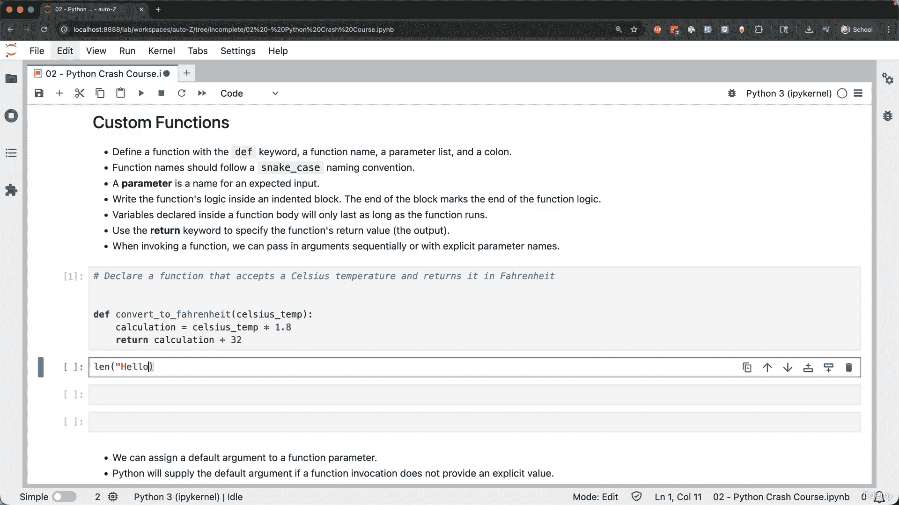

在上面的两个例子里，我们都是按顺序传入实参的，也就是直接在括号里按参数定义顺序写值。接下来，我想给你展示另一种可选的语法，这是等价的另一种写法。当你写实参的时候，可以直接写出参数名，比如我的参数名是 `celsius_temp`，我可以写完参数名，再写等号，然后写具体的值。例如：

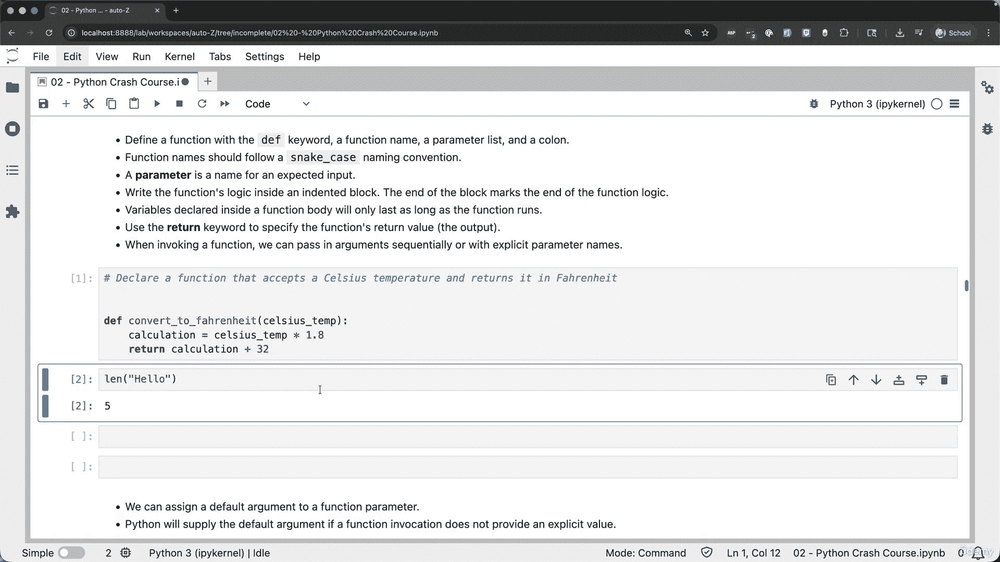

```python
convert_to_fahrenheit(celsius_temp=24)
```

这跟直接传 `24` 是一样的效果，但把参数名显式写出来有它的好处：万一函数有很多参数，你可能会忘记哪个位置对应哪个输入，这种写法能给读代码的人提供更多清晰的信息。比如，看到 `celsius_temp=24`，别人马上就知道这个 `24` 代表的是摄氏温度。

如果我们还有更多的参数，比如之前我们看到过 `a`，那么可以这样传参：

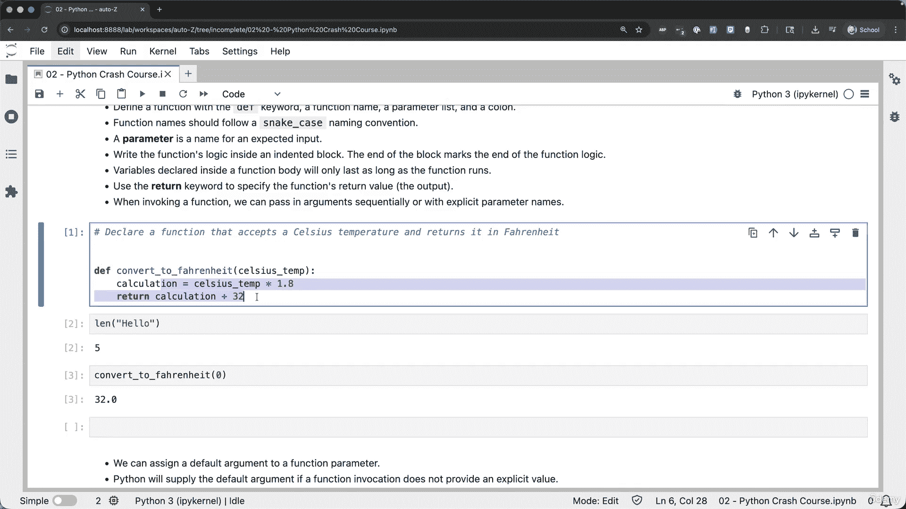

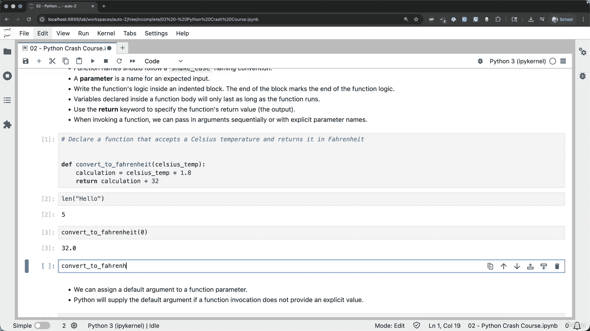

```python
convert_to_fahrenheit(celsius_temp=24, a=1)
```

也可以按顺序传：

```python
convert_to_fahrenheit(24, 1)
```

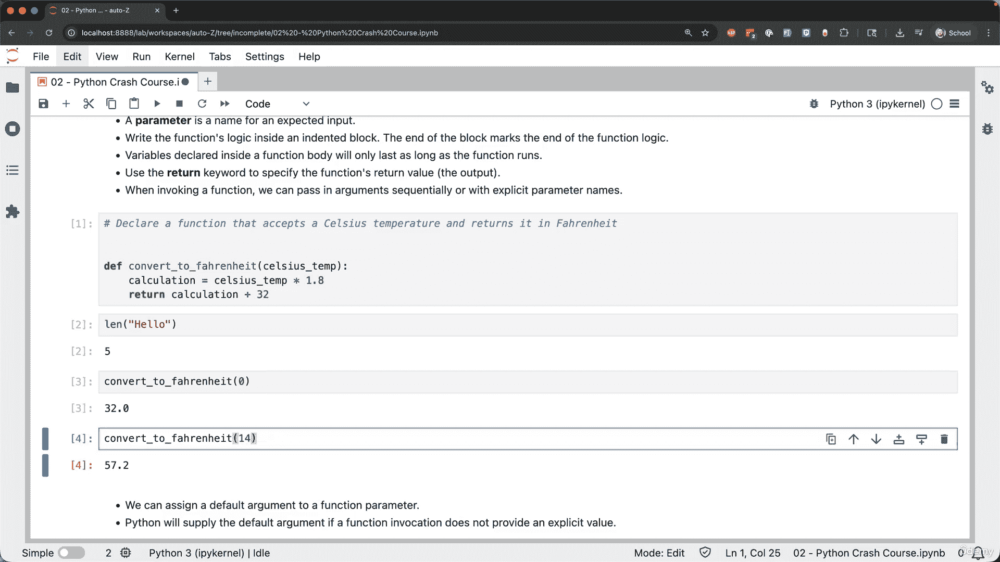

无论怎么说，函数定义里定义了几个参数，调用的时候就要传几个实参。要么按顺序用逗号分隔，逗号是必须的，空格只是为了可读性；要么显式地写出每个参数名，像定义时那样，后面跟等号和值，每组之间也要用逗号和空格分隔。

## 🎛️ 默认参数（默认实参）

这节课我想给你展示的最后一样东西，叫做**默认实参**。我们把上面函数定义的代码复制下来，粘贴到下面。

现在，这里有一个参数 `celsius_temp`，它要求在调用函数的时候必须提供一个实参。不过，我们还可以选择给函数的参数附加一个默认实参。这个默认值就是一个备用的回退值，意思是，如果调用函数时没有显式提供这个参数的值，Python 就会自动用这个默认值来填充。定义默认实参的方法很简单，在参数名后面写一个等号，然后写上默认值即可：

```python
def convert_to_fahrenheit(celsius_temp=0):
    calculation = celsius_temp * 1.8
    return calculation + 32
```

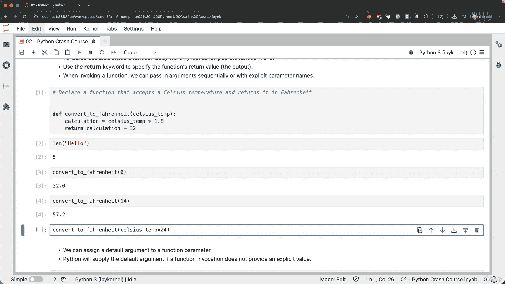

我在这里规定默认值是 `0`，这只是一个随意的决定。然后执行这个单元格，让这个新版本的函数覆盖掉之前定义的旧版本。

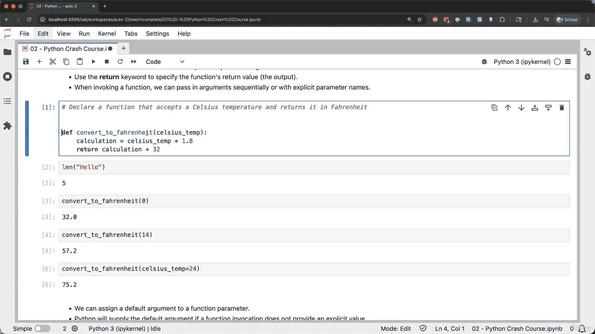

这样做意味着，如果我在调用 `convert_to_fahrenheit` 时，某个调用没有给 `celsius_temp` 提供值，函数也不会报错。比如我这样调用：

```python
convert_to_fahrenheit()
```

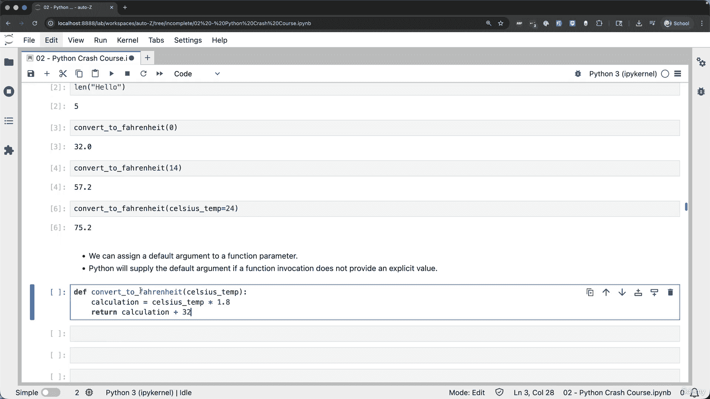

括号依然是必需的，但我不再传入任何值。因为 Python 没有收到对应的值，它就会自动用默认的 `0` 来替代，结果当然就是 `32.0`。

当然，我们还是可以照常传值，比如传入 `50`：

```python
convert_to_fahrenheit(50)
```

或者显式写出参数名：

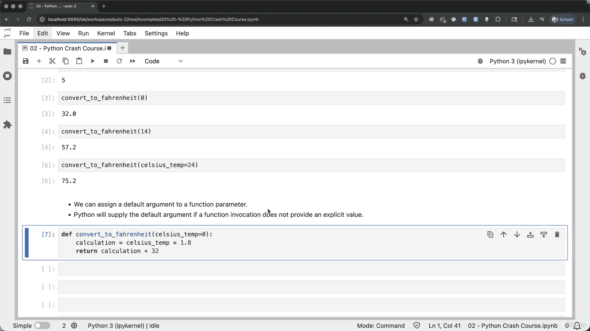

```python
convert_to_fahrenheit(celsius_temp=50)
```

所以，之前写过的所有调用代码依然有效，唯一的区别就是现在这个参数不再是必填的了，而是可选的，因为 Python 会回退到默认值。

## 🧩 函数的核心价值：封装与复用

希望通过这节课，你已经理解了自定义函数的基本语法，更重要的是，它真正的价值所在。函数允许我们把代码拆分成一个个可复用的过程，每个过程都是一段带有逐步指令的可执行代码。这些过程（也就是函数）可以接收输入，也就是实参，然后产生一个最终的返回值，作为输出发送回外部世界。这样一来，我们就不再需要反复重写代码，可以把某个业务逻辑锁进一个函数里。当然，你完全可以在一段程序里定义成百上千个函数，理想情况下，每个函数应该是一个小巧、可复用的过程，只负责一个单一的责任。核心思想是，你可以把现实世界建模的复杂性拆分成很多这样的小函数，每个函数只做一件事，从而让整个领域模型变得简单清晰。

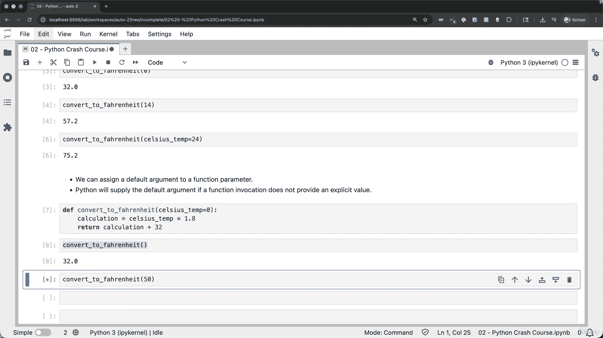

## 📝 总结

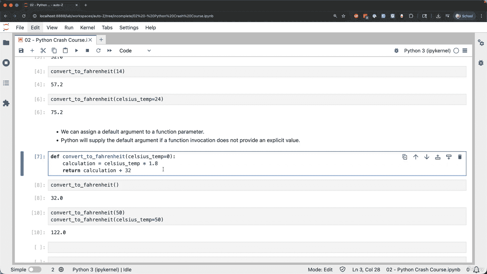

本节课我们一起学习了如何创建和使用自定义函数。我们首先明白了自定义函数的作用：把一段逻辑封装好，可以反复调用，不需要复制粘贴。然后，我们学习了创建函数的四个基本步骤：用 `def` 关键字开始，起一个蛇形命名的函数名，定义参数列表，写冒号和缩进的函数体。接着，我们实现了摄氏度转华氏度的函数，通过公式 `华氏度 = 摄氏度 * 1.8 + 32` 完成了转换。我们也掌握了调用自定义函数的语法，以及两种传参方式：按顺序传参和显式指定参数名传参。最后，我们还学习了默认实参，它让参数在调用时变成可选的。函数是 Python 编程中非常核心的基础工具，掌握了它，你就能写出更加整洁、可维护、可复用的代码。我们下节课再见。
