# Polars 与 Python 数据分析：第19节：字符串方法 🐍

在本节课中，我们将要学习 Python 中“对象”和“方法”的基本概念，并重点练习字符串方法。对象是程序里的具体值，方法可以理解为对象能执行的动作。我们会从对象和方法的定义讲起，再通过字符串示例演示 `upper()`、`lower()`、`strip()`、`replace()`、`startswith()`、`in` 等常见操作。还会说明字符串不可变、方法链、参数传递和布尔返回值这些对后续数据分析很关键的基础知识。


上一段已经说明课程目标，下面先认识对象。


## 🧩 对象是什么

对象是 Python 里对程序内一个值的技术称呼。字符串 `"hello"` 是一个对象，数字 `5` 也是一个对象。对象就是一个数字化的数据结构，是 Python 程序中真实存在的具体值。不同对象类型对应现实世界中不同数据：文本、数值、时间日期等。理解对象是理解方法的前提，因为方法总是依附在某个具体对象上，不存在脱离对象的字符串方法。


既然对象是具体值，那么对象能做什么？本节来看看方法。


## 🛠️ 方法是什么

方法可以看作附加在对象上的函数。可以把方法理解成你要求对象执行的一个动作，也就是对象具备的行为或功能。以前调用普通函数时，会把一个值或对象作为参数输入；方法则直接在这个对象上使用。方法调用的核心语法如下：

```python
对象.方法名(参数...)
```

也可以写成下面这个公式：

\[
\text{方法调用} = \text{对象} . \text{方法名}(\text{参数列表})
\]

也就是说，先写值或对象，再写一个点，然后写方法名和一对括号。你能使用哪些方法，取决于当前对象的类型。字符串、数字、布尔值等对象支持的方法不同。函数和方法很相似：它们都是可调用的过程，都可以接收参数作为输入，也都可以产生返回值。二者唯一的关键区别是，方法专门定义在某个值上，附加在对象上，因此不能像顶层 Python 函数那样直接调用；调用方法需要一个具体对象、一个程序中的具体值。


> 方法不是独立存在的函数，它依附在具体对象上，并通过“对象.方法名()”的方式调用。


理论说清楚后，下面进入字符串方法示例。


## 🔤 字符串方法入门：upper、lower 与 swapcase

先定义一个变量 `profession`，给它赋一个字符串值，示例为 `"PythonDevelop"`。这个字符串就是对象，变量 `profession` 用来引用这个值。调用方法时，在变量后面写点和方法名。在 Jupyter Notebook 环境中，可以按 Tab 键触发补全，查看字符串可用的方法。补全提示里可能把方法叫作 function，但技术上说它是 method；两者很类似，都是 Python 按顺序执行并产生结果的指令序列，只是这些方法专门附加在字符串上。例如调用 `upper()`，需要写方法名并加上括号来运行，这和调用函数很像，但必须有一个实际字符串作为方法操作的对象。`upper()` 返回一个新字符串，新字符串中所有字符都是大写；可以对比原字符串和返回值。这里有一个重要概念：对象可以是可变的或不可变的。可变对象能够改变，对可变对象调用方法可能改变其内部状态；不可变对象不能改变，字符串就是 Python 中不可变对象的例子，关于可变对象的更多细节会在后续课程展开。因此 `upper()` 不会改变 `profession` 原来的字符串。输出 `profession` 可以看到它仍是原来的大小写。`upper()` 实际是在计算机内存中返回一个全新的字符串：它以原字符串为基础，创建一个所有字符都大写的新字符串并返回。


下面的代码展示不可变性和几个基础方法：

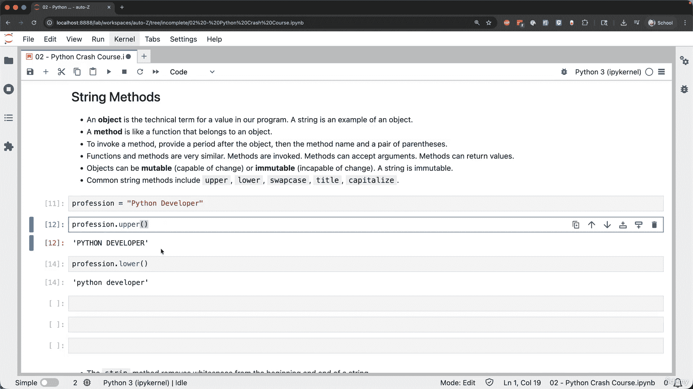

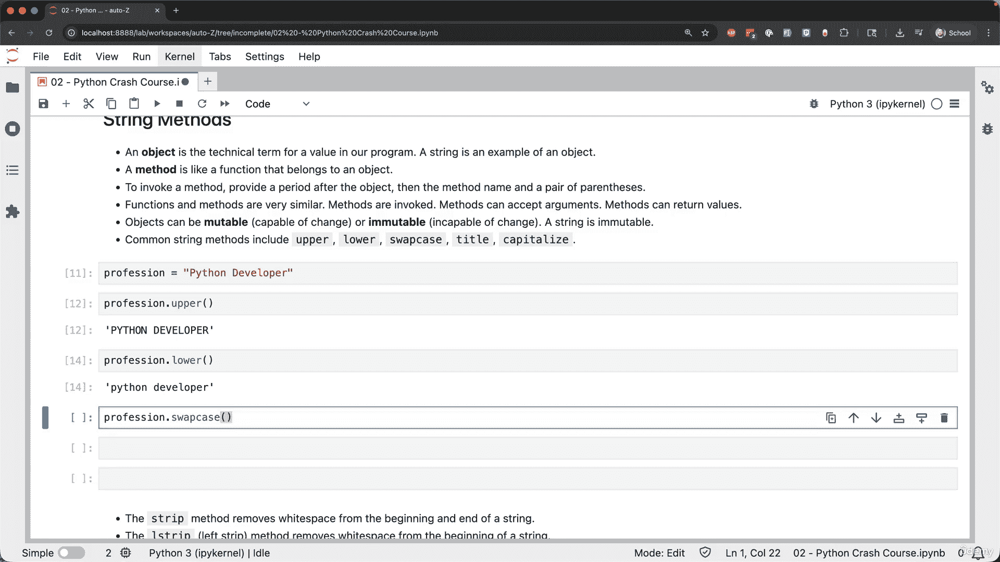

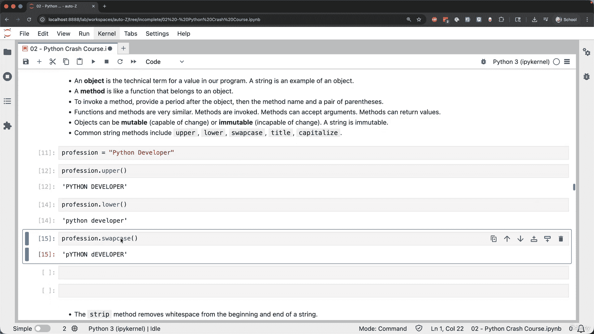

```python
profession = "PythonDevelop"
profession.upper()      # 返回 "PYTHONDEVELOP"
profession              # 仍是 "PythonDevelop"
profession.lower()      # 返回 "pythondevelop"
profession.swapcase()   # 返回 "pYTHONdEVELOP"
```

所有方法都遵循相同语法：提供值或对象，写点，再写可用的方法名。字符串能做什么，与数字、布尔值等类型能做什么不同，因为不同对象支持的行为不同。数字无法“变成大写”，所以 Python 的整数类型没有字符串对象那样的 `upper()` 方法。只要有一个用引号创建的字符串对象，就可以调用这些字符串方法。`lower()` 是 `upper()` 的互补方法，返回全小写的新字符串，语法同样是点、方法名和括号，并且不接收参数，也就是不需要外部输入。`swapcase()` 会反转原字符串的大小写：小写变大写，大写变小写，返回一个新字符串。


除了大小写整体转换，字符串还支持按单词处理大小写。


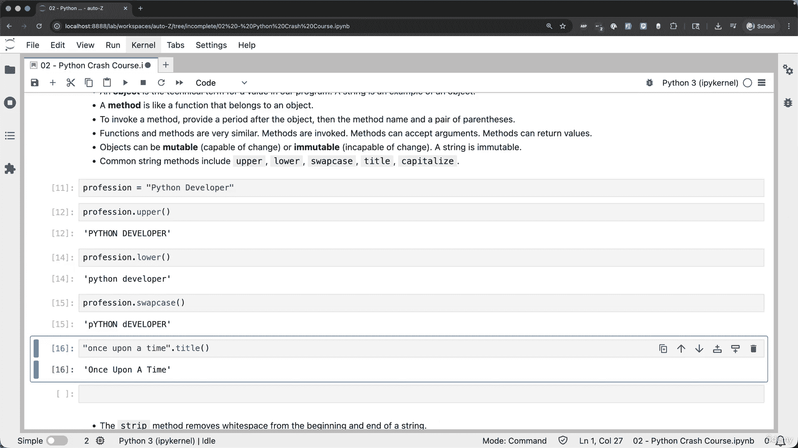

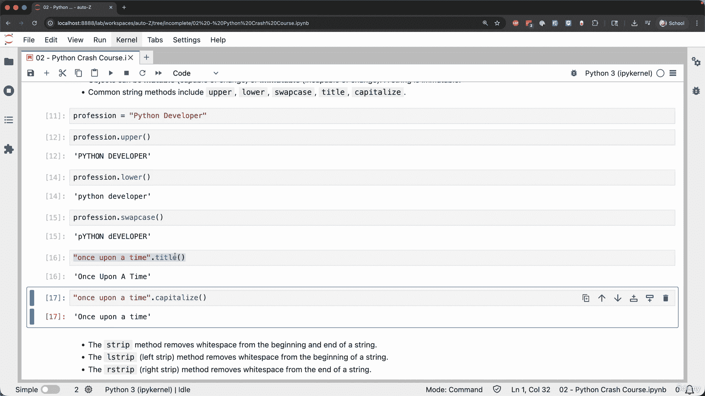

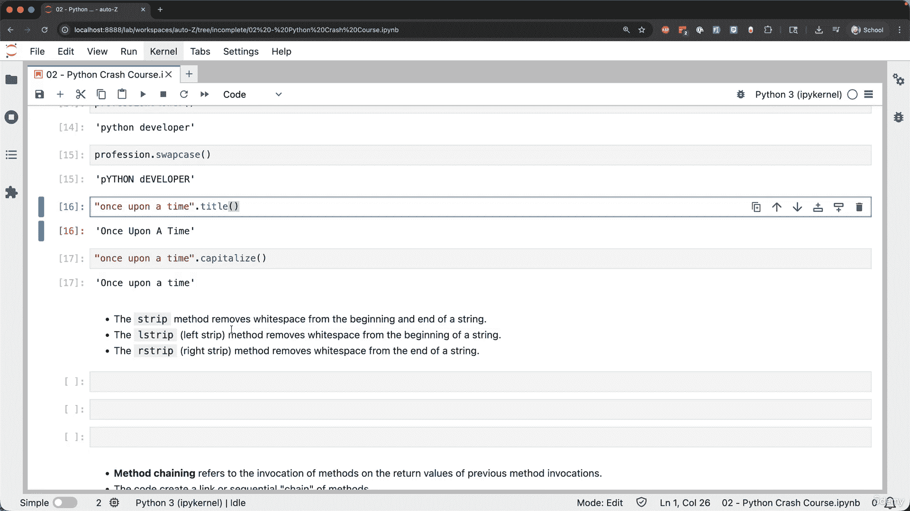

## 📝 title 与 capitalize

可以写一个新字符串 `"once upon a time"` 来演示。这里不需要把字符串赋值给变量，语法仍然一样：写值或对象，点，方法名和括号。`title()` 会把每个单词的首字母大写；Python 会利用空格判断每个单词在哪里结束、下一个单词在哪里开始，然后把每个单词的第一个字母大写。与之互补的是 `capitalize()`，它只把整个字符串的第一个字母大写，而不是每个单词都大写。比如对 `"once upon a time"` 调用 `title()`，会得到每个单词首字母大写的结果；调用 `capitalize()`，只会把开头的 `o` 变成大写。


代码示例如下：

```python
"once upon a time".title()       # 返回 "Once Upon A Time"
"once upon a time".capitalize()  # 返回 "Once upon a time"
```

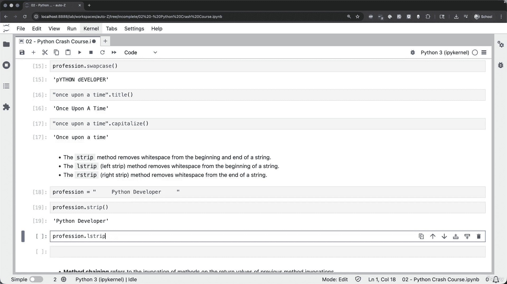

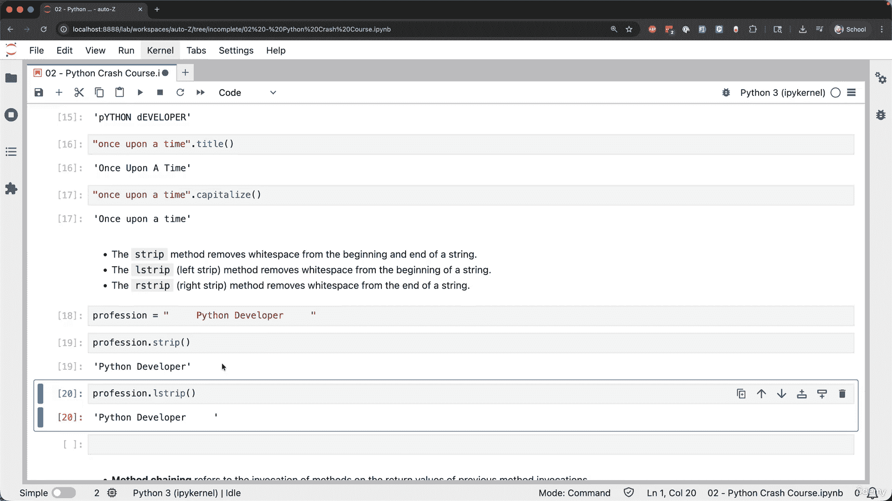

接下来看看处理空白字符的 strip 方法家族。


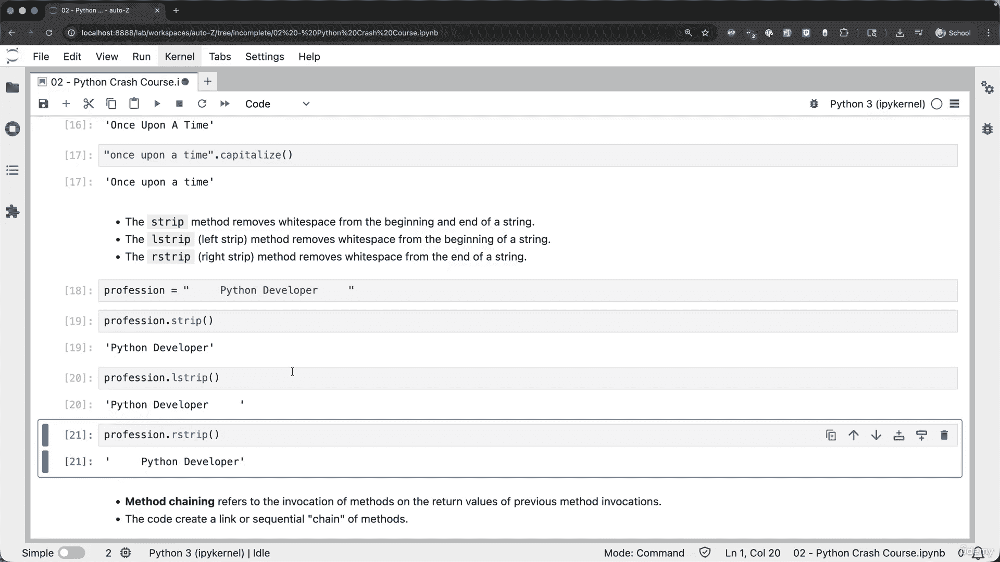

## 🧹 strip、lstrip 与 rstrip

重新定义 `profession` 变量，这次在字符串 `"Python developer"` 的开头和结尾都加入一些空格。执行单元格后，`profession` 就等于这个带前后空格的新字符串。`strip()` 会删除字符串开头和结尾的所有空白字符，并再次返回一个全新字符串；和前面的方法一样，它不会原地修改原字符串。`lstrip()` 只删除字符串开头，也就是左侧的空白；其中 `l` 是 left 的缩写，它不会删除结尾的空白。`rstrip()` 是互补方法，只删除字符串结尾，也就是右侧的空白；其中 `r` 是 right 的缩写，它不会删除开头的空白。


示例代码：

```python
profession = "  Python developer  "
profession.strip()   # 删除前后空白
profession.lstrip()  # 只删除左侧空白
profession.rstrip()  # 只删除右侧空白
```

这些方法返回新字符串，所以可以继续对新字符串调用其他方法，这就引出方法链。


## 🔗 方法链

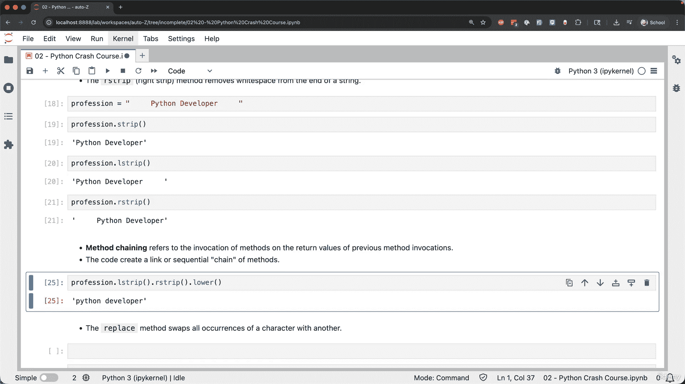

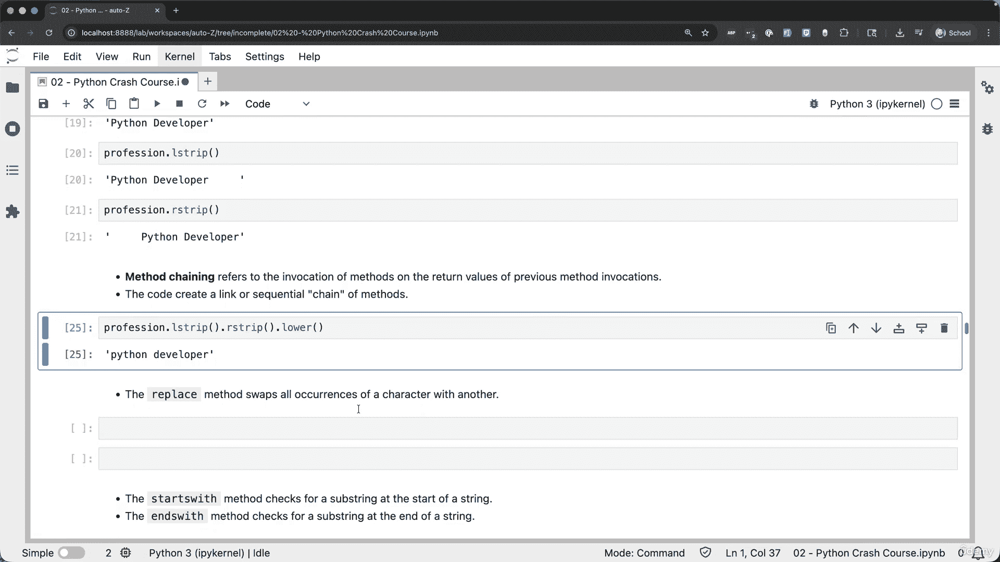

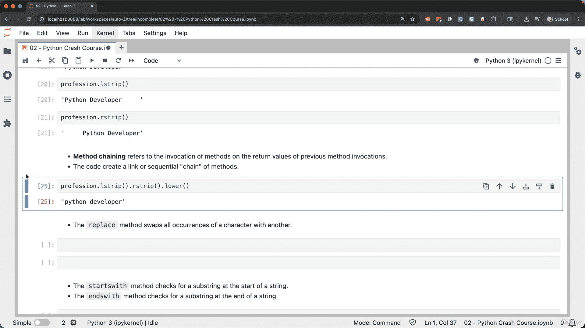

Python 代码中常见一种写法叫方法链。方法链指的是：对上一个方法调用的返回值继续调用方法。之所以可行，是因为方法返回的值或对象本身也有方法，可以继续调用。假设当前 `profession` 仍带有前后空白，而你不知道 `strip()`，只知道 `lstrip()` 和 `rstrip()`。可以先调用 `lstrip()` 删除开头空白；`lstrip()` 的返回值是一个全新的字符串对象，也是程序中的一个新字符串值。因为它是字符串，所以具备前面讲过的所有字符串方法，比如 `rstrip()`、`title()`、`upper()` 等。于是可以在这个返回字符串后面继续写点，调用下一个方法，例如 `rstrip()`。这就是方法链：多个方法形成连续链条，每个方法返回一个值，再在这个值上调用下一个方法。还可以继续对 `rstrip()` 的结果调用 `lower()`，最终得到一个前后空白都删除、并且所有字符都小写的字符串。


方法链代码：

```python
profession.lstrip().rstrip().lower()
```

前面的方法大多不接收参数，下面看看接收参数的方法。


## 🔄 replace 与参数

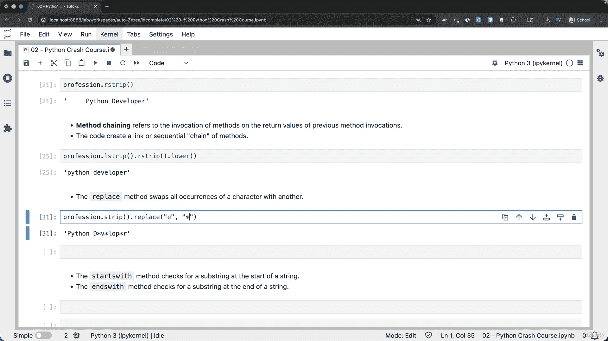

很多方法会接收参数，这些参数用于定制方法的行为，就像普通函数的参数和实参用于定制函数行为一样。字符串有一个 `replace()` 方法，用于把指定字符的所有出现位置替换成另一个字符。它的第一个参数是要搜索的内容，第二个参数是替换成的内容。先对 `profession` 调用 `strip()` 删除空白，再调用 `replace()`。第一个参数传入字符串 `"e"`，表示搜索所有小写字母 `e`；用逗号和空格分隔多个参数，逗号用于分隔参数，空格只是为了可读性；第二个参数传入 `"*"`，表示把 `e` 替换成星号。最终会返回一个全新字符串，其中每个 `e` 都被替换成星号。关键点是：`replace()` 是接收参数或输入的方法；与 `lower()` 不同，`replace()` 本身不知道要做什么，它需要知道搜索什么、替换成什么，而这两个内容会随着调用场景变化。


代码示例：

```python
profession.strip().replace("e", "*")
```

有些方法不仅接收参数，还会返回字符串以外类型的值，例如布尔值。


## ✅ startswith 与 endswith

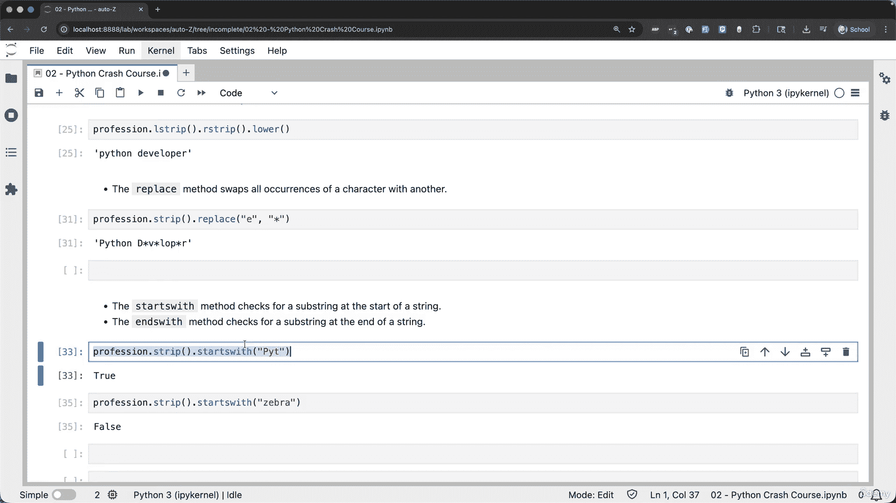

再看一个接收参数并返回不同值类型的方法：`startswith()`。它检查字符串开头是否存在某个子字符串，并返回布尔值。布尔值是表示真假的类型，只有 `True` 和 `False` 两个值。示例中，先对 `profession` 调用 `strip()` 删除空白，再链式调用 `startswith()`。该方法接收一个输入参数，也就是要在字符串开头搜索的内容。传入 `"Pyt"`，注意大写 `P`，因为字符串比较关心大小写；这里问的是字符串是否以这个大小写形式的 `"Pyt"` 开头，结果为 `True`。如果换成小写 `"pyt"`，会得到相反的布尔值 `False`，因为 Python 区分大小写；`"Python developer"` 并不以小写 `"pyt"` 开头。像 `"zebra"` 这样更简单的例子也会返回 `False`。`startswith()` 和 `endswith()` 都返回布尔值，而不是像前面方法那样返回新字符串；它们是在判断一个真假陈述。`endswith()` 检查字符串是否以给定子字符串结尾，如果结尾匹配就返回 `True`。例如 `"Python developer"` 以 `"oper"` 结尾，会返回 `True`。如果在末尾加一个空格，并且先调用 `strip()` 删除尾部空白，那么字符串仍然以 `"oper"` 结尾，但没有实际空格；空格也是一个字符，和普通字母字符不同，所以用带空格的结尾去匹配会得到 `False`。


代码示例：

```python
profession.strip().startswith("Pyt")   # True
profession.strip().startswith("pyt")   # False
profession.strip().endswith("oper")    # True
profession.strip().endswith("oper ")   # False
```

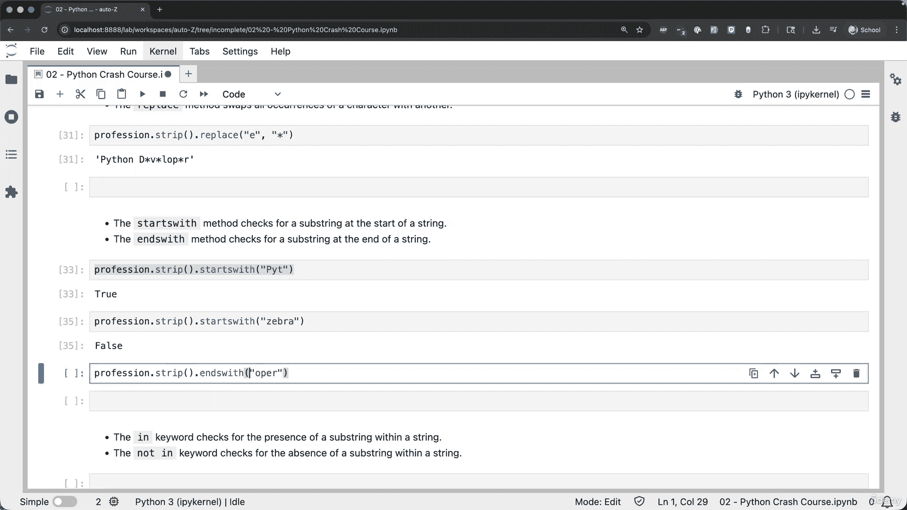

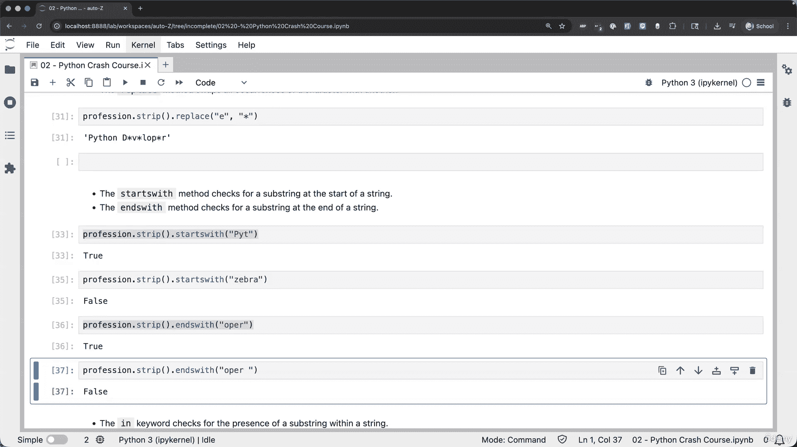

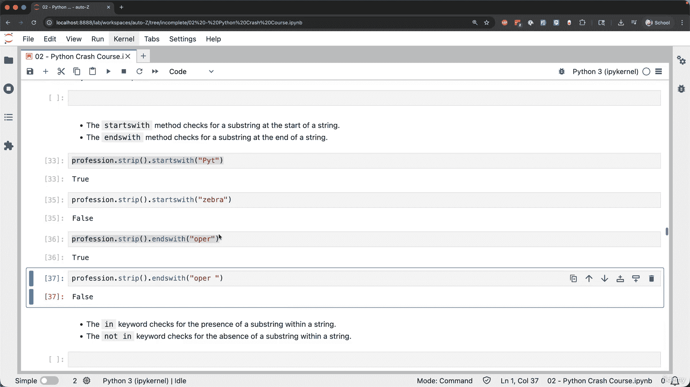

最后介绍两个不是方法但非常常用的字符串关键字。


## 🔍 in 与 not in

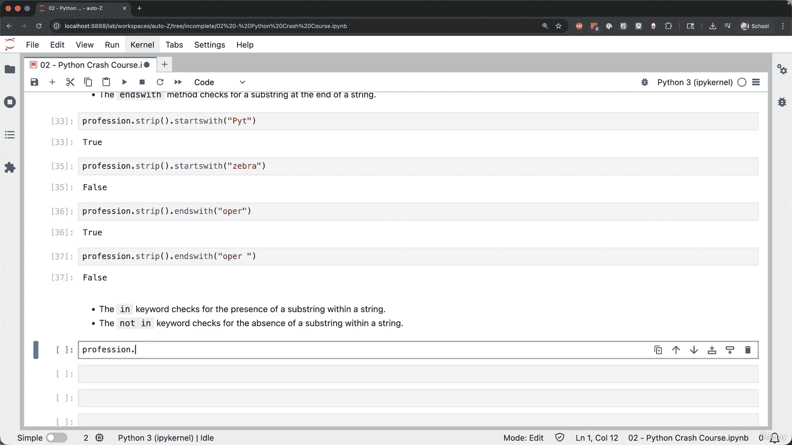

`in` 和 `not in` 不是严格意义上的方法，不使用点语法、方法名和括号来调用，但它们也是字符串操作，而且非常常用。`in` 关键字检查子字符串是否出现在字符串中：它不限定开头、中间或结尾，只要搜索内容在字符串任意位置存在就返回 `True`，不存在就返回 `False`。`startswith()` 只看开头，`endswith()` 只看结尾，而 `in` 检查是否包含在任意位置。示例中先对 `profession` 调用 `strip()`；然后写要搜索的文本，再写关键字 `in`，右边写被搜索的字符串。读起来像英语：某个文本是否在某个字符串中。例如搜索 `"dev"`，它存在于 `"Python developer"` 中，因此返回 `True`；如果搜索 `"eg"` 这类明显不存在的内容，会返回 `False`。需要注意大小写敏感：搜索 `"Dev"` 会得到 `False`，因为原字符串里是小写 `dev`。`in` 的相反操作是 `not in`，它检查搜索内容是否不在目标字符串中。如果搜索内容不存在，返回 `True`；如果搜索内容存在，返回 `False`。例如 `"engineering"` 不在 `"Python developer"` 中，返回 `True`；`"dev"` 不在该字符串中是错误陈述，因为 `dev` 明显存在，所以返回 `False`。`in` 和 `not in` 的评估结果总是相反：一个检查子字符串是否包含在较大字符串中，另一个检查子字符串是否不存在于较大字符串中。


代码示例：

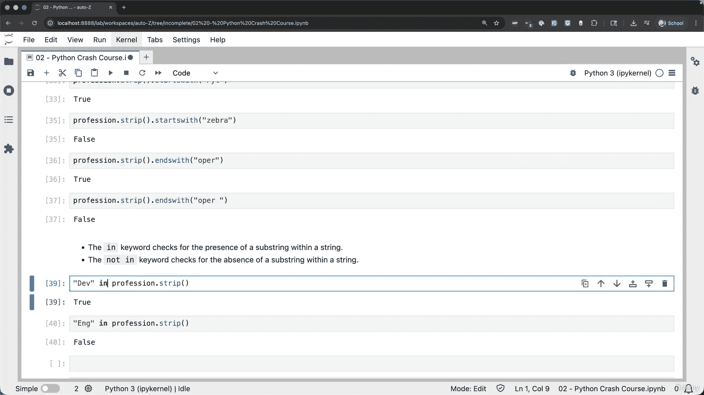

```python
"dev" in profession.strip()      # True
"Dev" in profession.strip()      # False
"eg" in profession.strip()       # False
"engineering" not in profession.strip()  # True
"dev" not in profession.strip()          # False
```

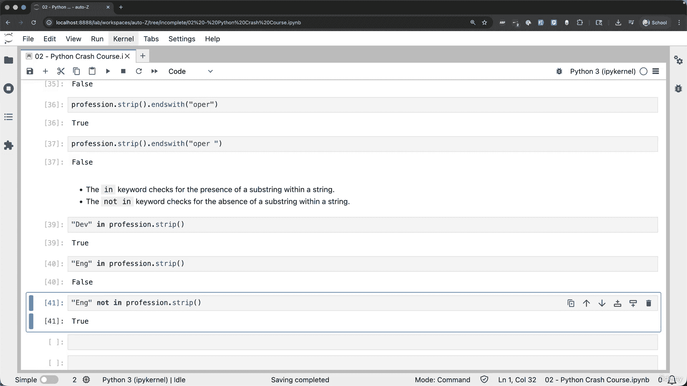

到这里，字符串方法的主要基础已经覆盖。以下是本节主要字符串操作的速查清单，便于复习。

- `upper()`：返回全大写的新字符串。
- `lower()`：返回全小写的新字符串。
- `swapcase()`：反转大小写。
- `title()`：每个单词首字母大写。
- `capitalize()`：整个字符串首字母大写。
- `strip()`：删除前后空白。
- `lstrip()`：删除开头空白。
- `rstrip()`：删除结尾空白。
- `replace(旧, 新)`：替换所有匹配内容。
- `startswith(前缀)`：判断是否以某内容开头，返回布尔值。
- `endswith(后缀)`：判断是否以某内容结尾，返回布尔值。
- `in` 与 `not in`：判断子字符串是否包含在字符串中，或判断其反面。

这份清单只是速查，具体行为仍要结合前面示例理解。下面总结本节课内容。


## 🧾 总结

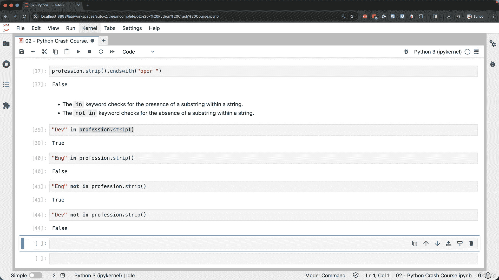

本节课中，我们一起学习了对象和方法的基础。对象是 Python 程序中的具体值，字符串、数字、日期时间等都可以是对象；方法可以理解为附加在对象上的函数，是对象能够执行的行为或功能。方法通过“对象.方法名(参数...)”调用，不能像顶层函数那样脱离具体对象直接调用。我们练习了 `upper()`、`lower()`、`swapcase()`、`title()`、`capitalize()`、`strip()`、`lstrip()`、`rstrip()`、`replace()`、`startswith()`、`endswith()` 等字符串方法，并理解了字符串不可变：这些方法通常返回新字符串，而不是修改原字符串。我们还学习了方法链、参数传递、布尔返回值以及 `in` 和 `not in` 关键字。后续介绍更多对象和数据类型时，它们也会有类似的方法，也就是各自能够执行的行为和功能。

